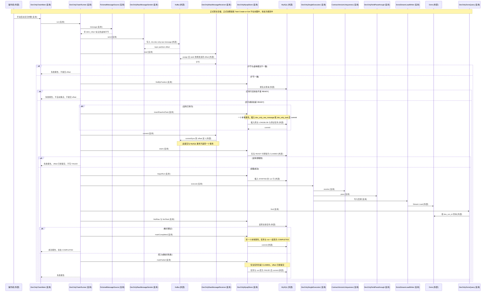
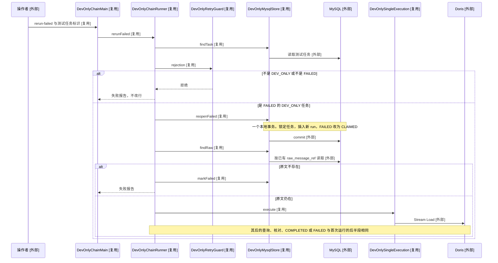
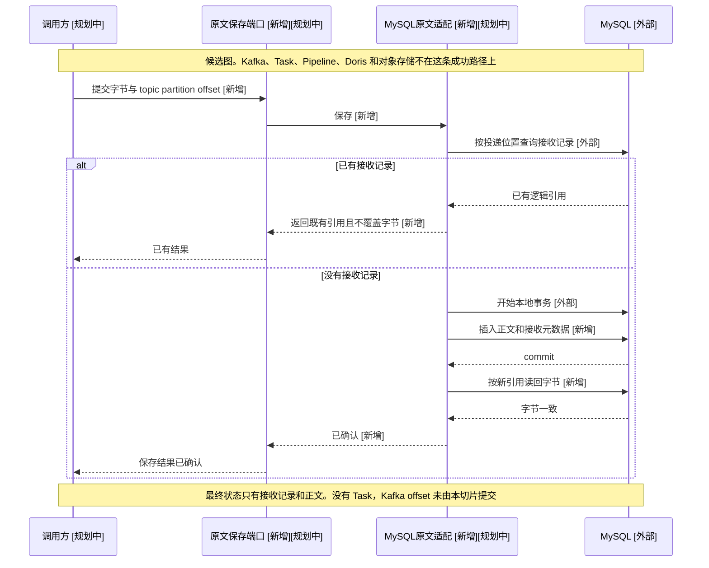
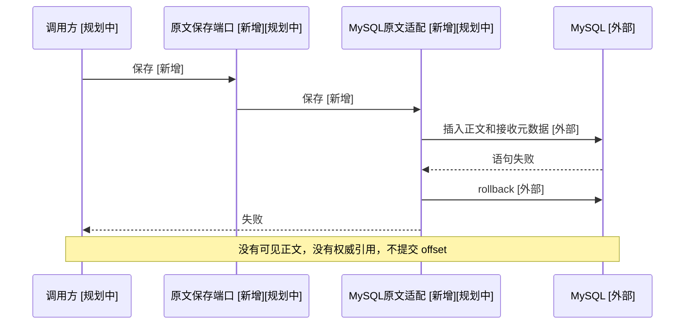
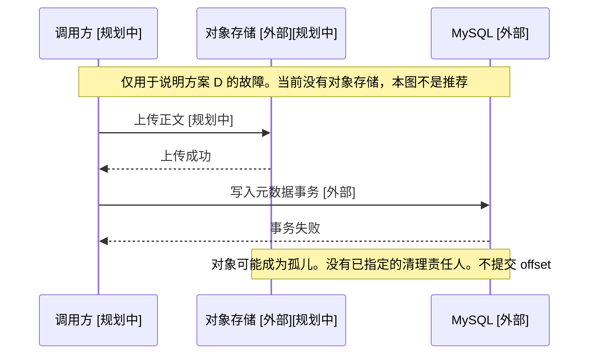
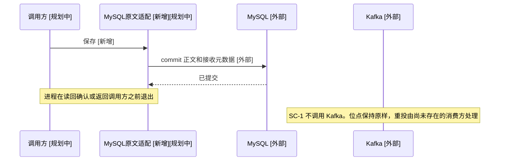
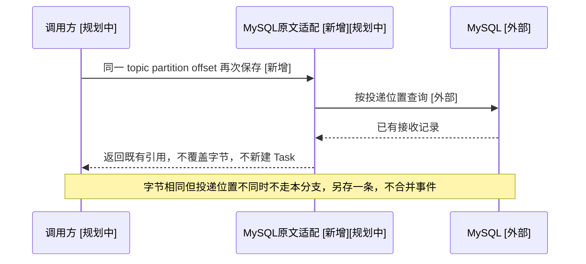
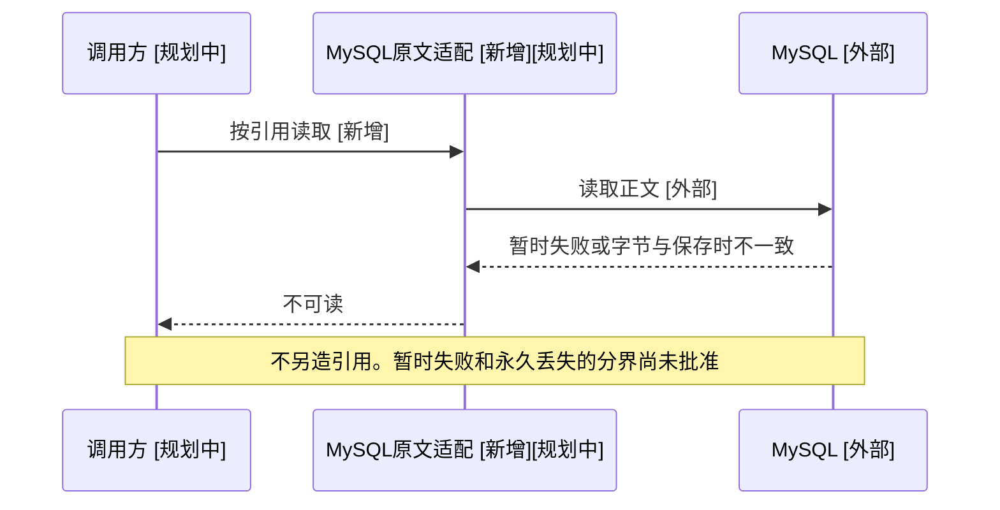

# IR-15 正式原文保存介质与保留策略专项决策准备

- 状态：决策准备。不是已接受 ADR，不关闭 IR-15，不创建 SC-1 实施授权
- 证据基线：`0d538f1edb013789f3f8309e7d050902d8707bd8` 之后的工作区；本文件是新增调查
- 本轮不连接服务器，不执行测试，不修改既有 ADR、IR 或代码

Stage C 的含义沿用 [Stage-C-正式落地前实现边界与最小切片规划](Stage-C-正式落地前实现边界与最小切片规划.md)。SC-1 是该规划里的「正式原文保存」切片，当时已标明受 IR-15 阻断。本文只为这个切片准备可审查的选择，不开始编码。

## 1. 结论摘要

1. 现在不能实施 SC-1。介质、引用算法、报文大小、字符集和模块落点都没有已接受决定。
2. 调查建议把「MySQL 同一事务保存正文和接收元数据」列为以后 ADR 的优先候选。理由只是：MySQL 8.0.46 是已接受的事务服务器，同库事务能同时提交正文和引用。报文大小没有证据。超限时这条候选不成立，不能先上线再看。
3. 不建议把本地文件系统、Doris、DEV_ONLY 表或未经证实的对象存储写成当前正式介质。MySQL 元数据加对象存储正文保留为大小超限之后的候选，不是现在的推荐。
4. `rawPayloadRef` 应是平台生成的逻辑引用，不是内容哈希，不是 Kafka offset，不是文件路径或对象键。相同字节不合并业务事件。
5. 原文保存成功不等于 Task 已创建。无稳定身份时不建 Task，也不提交 offset。Kafka、MySQL 和对象存储之间没有统一事务。
6. 不设定保留天数。ADR-0003 禁止覆盖历史观测，并不由此推出原文永远不能删除，也没有授权删除。
7. 第 11 节给出当前 DEV_ONLY 链路和 SC-1 候选时序。候选图不是已实现链路，也不修改 DEV_ONLY。

上列第 2 至第 6 点都是调查建议或仍须用户决定的事项，不是已接受设计。

## 2. 现有设计与证据

### 2.1 已接受 ADR

| 文件 | 和原文有关的已接受范围 |
| --- | --- |
| [ADR-0005](../decisions/0005-mysql-doris-storage-baseline.md) | MySQL 8.0.46 是事务服务器版本，Doris 4.0.7 是 OLAP 服务器版本。Doris 不承接任务终态、配置发布、审计权威或原始报文正文。驱动、字符集、排序规则、隔离级别、物理表和工程接入未完成 |
| [ADR-0003](../decisions/0003-unmapped-conflict-observation.md) | 已写下的历史观测不覆盖，冲突决定创建后不可修改。范围不是原文产品，也不给出保留天数 |
| [ADR-0004](../decisions/0004-external-contract-version-resolution.md) | 只覆盖已经固定的快照内、金额提取前的契约版本解析。不包含原文表或引用算法 |
| [ADR-0002](../decisions/0002-v2-module-architecture.md) | 十模块不变。Core 不依赖 JDBC 或对象存储客户端。Pipeline 不依赖 Connector、Writer 的实现。Admin 不执行数据处理 |

ADR-0005 写「根 POM 目前没有 MySQL 驱动」。当前 `app-worker` 已为 DEV_ONLY 依赖 `mysql-connector-j`。这是文档相对后到代码的滞后。它不把驱动写成正式持久化已接入，本轮不改 ADR。

### 2.2 已冻结或已接受的相关规则

金额冲突处理的冻结范围以 ADR-0003 指向的 06-03-03-05 为准。Pipeline 设计文档本身尚未冻结。06-04-01 第 9 节仍禁止正式持久化 Java、Worker 领取实现和端到端集成。Stage B 总结第 7.1 节要求，没有写明范围的单独批准就不能写 Stage C 局部代码。

### 2.3 未接受的候选设计

| 文档 | 候选，不是批准 |
| --- | --- |
| [06-04-29](../investigation/round-01/06-04/06-04-29%20MTX%20Data%20Platform%20V2%20IR-15%20原始报文存储、异常隔离与数据保留策略专项调查.md) | 保存、可再读确认、逻辑引用和跨系统故障表。明确不选产品、不给天数、不关闭 IR-15 |
| [06-04-30](../investigation/round-01/06-04/06-04-30%20MTX%20Data%20Platform%20V2%20IR-15%20数据实体保留与删除规则专项调查.md) | 已有实体的覆盖和删除边界。原文对象不进入「允许删除」结论 |
| [06-04-06](../investigation/round-01/06-04-06%20MTX%20Data%20Platform%20V2%20存储技术选型与约束专项评估.md) 第 5 节 | 对象存储与关系库大字段并列，直到有报文大小分布。共享文件系统缺少共享卷决策 |
| [06-04-10](../investigation/round-01/06-04-10%20MTX%20Data%20Platform%20V2%20Source%20Event%20Identity%20与%20Kafka%20消息接入幂等专项设计.md) | 无身份不建任务、不提交 offset。对象存储若被使用，与 MySQL 不是一个本地事务 |
| [06-04-04](../investigation/round-01/06-04-04%20MTX%20Data%20Platform%20V2%20持久化模型与存储职责专项设计.md) | 正文可在对象存储或关系库大字段，两条都还没有适配证据 |
| N-10 持久化物理模型比较 | 原文正文字节介质未选，不在该比较里建成 MySQL 正文表 |

06-04-29 第 3 节已核对：台账 IR-15 的题目是保留策略。原文介质和异常隔离是后续调查扩展，不是台账原句已经覆盖的决定。本文沿用这个区分，不把介质选择写成 IR-15 已经接受的内容。

### 2.4 尚未决策

台账 [06-04-02](../investigation/round-01/06-04-02%20MTX%20Data%20Platform%20V2%20工程实施未决设计决策台账.md)：

| ID | 状态 | 对本题的作用 |
| --- | --- | --- |
| IR-15 | 待决策，P2 | 保留和删除条件未按实体批准。介质未选 |
| IR-03 | 部分确认 / 待决策 | 无身份不建任务、不提交 offset。隔离介质未选。不发明通用事件键 |
| IR-02 | 待决策，P0 | 观测四段含 `rawPayloadRef`。物理唯一约束未落实 |
| IR-09 | 设计已明确 / 待验证 | 消费、原文、任务和提交点没有已验证的共同边界 |
| IR-10 | 待决策 | 删除和归档若要审计，落点未选 |
| IR-04、IR-07 | 未关闭 | 挡住快照选择和正式领取，不在 SC-1 内实现 |

[06-04-61](../investigation/round-01/06-04-61%20MTX%20Data%20Platform%20V2%20MySQL%20字符身份比较语义与唯一索引键长专项调查.md) 没有选定字符集、排序规则或列宽。字符串引用若要做唯一索引，现在不能证明比较语义。

仓库没有报文大小分布、增长率或保留期限。没有 MinIO、S3、OSS 或 HDFS 的已接受选型，也没有已部署对象存储的证据。`trade-flow` 表上的 BLOB、本地归档和 OSS 归档不是 V2 能力。

### 2.5 仅 DEV_ONLY

`DevOnlyMysqlStore.insertRawAndTask` 在一个 MySQL 事务里写入 `dev_only_raw_message` 和 `dev_only_task`。正文是 `LONGBLOB`。引用是 `raw` 加运行 UUID，主键是该引用。唯一键是 `(kafka_topic, kafka_partition, kafka_offset)`，不是内容哈希，也不是来源事件身份。库名只允许 `mtx_rdp_dev_only`。

`DevOnlyChainRunner.run` 在这次插入成功后提交 Kafka offset，然后才领取和写 Doris。`InMemoryRawMessageStore` 只在进程内，不是这条链路的持久化。这些都不是正式原文介质。

## 3. 存储方案比较

比较使用现有文档和产品手册的一般约束。本轮没有测量报文，也没有连接数据库。

| 维度 | A. MySQL BLOB | B. 本地文件系统 | C. 仅对象存储 | D. MySQL 元数据 + 对象正文 | E. Doris 存正文 |
| --- | --- | --- | --- | --- | --- |
| 正文可靠性 | 与事务提交绑定。提交成功则行和字节一起可见。大对象增加 redo、binlog、备份和复制体积。大小上限没有项目证据 | 崩溃可能留下半截文件。覆盖是普通写文件的默认语义 | 取决于未选定的产品。本仓库不能声称已具备写一次或对象锁 | 正文与元数据不是一个事务。会出现孤儿对象或有引用无正文 | ADR-0005 写明 Doris 不存原始报文正文 |
| 多 Worker | 多实例可连同一 MySQL。这是服务器能力，不是已批准的连接池 | 各 Worker 本地盘互不可见。共享盘没有部署决策 | 产品若存在，多实例可按键访问。产品不存在 | 同 C，另加 MySQL 并发 | 不采用 |
| 幂等写入 | 可用数值位点做接收记录的条件插入。不能用哈希合并事件。字符串引用的唯一索引还受 06-04-61 约束 | 文件名约定不能强制不覆盖 | 条件创建因产品而异，未证实 | 对象条件创建与数据库唯一约束是两次动作 | 不采用 |
| 原子性 | 正文和元数据可以在一个本地事务 | 文件与数据库不是一个事务 | 没有元数据事务 | 明确不是一个事务 | 不与 MySQL 组成一个事务 |
| 恢复 | 提交不明时按 06-04-09、06-04-29：不把缺行当成已回滚，不另造权威引用 | 半截文件和数据库记录需要对账，规则未设计 | 未选定产品就没有恢复手册 | 孤儿对象和缺对象都要单独识别 | 不能用 Doris 副本恢复原文权威 |
| 备份与归档 | 正文进入数据库备份。归档要另做，不能删掉仍被引用的字节 | 文件备份和数据库备份不是一个恢复点 | 生命周期是产品能力，天数未定 | 两套备份的时间点不同 | 分析副本不是原文备份 |
| 删除 | 行可被有权限的语句改写或删除。不可变靠权限和禁止更新，不是产品自动保证 | 文件可被覆盖或删除 | 未选定产品 | 删对象和删引用不是一个动作 | 不采用 |
| 运维复杂度 | 低，只要报文放得进已规划的事务库 | 多节点下高，且容易覆盖 | 要新增一套未部署的系统 | 两套系统加对账 | 把 OLAP 误当成原文库 |
| 当前基础设施 | 版本基线已接受。正式驱动、字符集、库表未接受。DEV_ONLY 使用不能当成正式适配 | 没有共享持久卷证据 | 没有部署证据 | 对象存储一半没有证据 | 服务器版本已接受，职责排除原文 |
| 扩展成本 | 报文变大后要迁出正文，逻辑引用不能改 | 以后迁到共享存储还要补写一次约束 | 选定产品后的迁移成本现在不能估计 | 一开始就拆开，避免以后搬迁，但现在缺产品 | 不作为扩展路径 |

方案 E 不比 A 到 D 更适合。它与已接受的 Doris 职责相反。

### 3.1 A. MySQL BLOB

正文和接收元数据可以放在一个 InnoDB 事务里。这是本比较里唯一不依赖未部署系统的原子边界。

代价是大报文进入 Buffer Pool、redo、binlog、备份和复制。MySQL 还有包大小和行大小限制。项目没有报文分布，不能写一个安全的最大长度。并发下，位点唯一键只能识别同一次投递，不能识别同一业务事件的另一次投递。内容哈希唯一键会把不同事件收成一行，这与 06-04-29 第 6 节冲突。

字符集未定时，不要把引用字符串建成正式唯一索引。位点三列是数值和主题名；主题名仍是字符串，06-04-61 的比较语义同样还没选定。

### 3.2 B. 本地文件系统

多个 `app-worker` 实例各自看到自己的磁盘。06-04-06 已写明，没有共享持久卷和可强制的写一次约束时，不把共享文件系统当作两个独立应用的正文权威。本地盘更不适合。崩溃窗口里的半截文件没有已批准的修复规则。

不推荐作为正式多节点介质。

### 3.3 C. 对象存储

对象键不能直接当成观测身份里的 `rawPayloadRef`。06-04-25 和 06-04-29 要求逻辑引用与物理地址分开，迁移时不改已经绑定的引用。

条件创建、禁止覆盖、版本控制和生命周期都是具体产品的能力。仓库没有选定产品，也没有已部署实例。不能把某一云厂商的锁或 `If-None-Match` 写成已经具备。`trade-flow` 的 OSS 归档类型不是 V2 选型。

仅有对象、没有事务型元数据时，消费位点、引用和正文缺少一个已接受的提交点。不推荐作为当前正式方案。

### 3.4 D. MySQL 元数据 + 对象存储正文

这是 06-04-06 保留的长期并列选项。上传成功而数据库回滚会留下孤儿对象。数据库提交成功而对象暂时读不到，则引用存在但正文不可用。06-04-29 要求此时不推进依赖该字节的 Pipeline，不另造权威引用，也不提交会跳过这条消息的 offset。

清理孤儿对象的责任人未指定。对象存储故障时，已读到的消息停在不提交 offset，分区会停住。这和 IR-03 对无身份消息的处理是同一类阻塞，不能靠静默跳过解除。

在对象存储产品被单独接受之前，D 不能作为 SC-1 的实施前提。若以后测量证明 BLOB 放不下，D 是应重新打开的候选，而不是现在的默认。

## 4. 原文引用与重复写入语义

五个概念保持分开：

| 概念 | 候选语义 | 明确不是 |
| --- | --- | --- |
| 来源业务事件身份 | 只来自来源契约已经声明的字段。现在没有这份声明 | `rawPayloadRef`、哈希、offset、UUID |
| `rawPayloadRef` | 平台生成的逻辑引用。第一次绑定到任务后不替换 | 对象键、文件路径、内容哈希 |
| 内容哈希 | 若以后批准，只用于读回比对 | 事件身份，也不是 SC-1 的去重键 |
| topic、partition、offset | 一次投递的位置 | 跨来源的业务身份 |
| 内部接收记录 | 一次保存动作的记录，可指向正文 | Task，也不是 `replayRequestId` |

调查建议，供以后的 ADR 选择：

- 引用由平台生成，不由调用方指定路径。
- 不使用内容哈希作为引用。
- 相同字节不一定是同一业务事件。不同来源或不同身份即使字节相同，也不共享一个会一起被删除的正文对象。存储层去重会把无关事件的生命周期绑在一起，SC-1 不做。
- 相同业务事件以后可以带不同字节。06-04-10 和 06-04-29 已有这条候选。权威引用保持第一次绑定的那一个，新字节不覆盖它。
- 同一 offset 再次投递时，只能按投递位置识别已有接收记录。返回该记录不等于创建或取回 Task。
- 同一业务事件从另一个 offset 到达时，不把新 offset 写成原任务的身份，也不替换权威引用。没有身份时，连「同一业务事件」都不能判断，因此不能合并。
- 重复保存的候选动作是：已有接收记录则返回该记录并拒绝覆盖字节；没有接收记录则新增。不因正文相同而合并事件。

这些句子都还不是批准。它们禁止的事项是：用哈希代替 IR-03，用 offset 代替跨来源身份，用 UUID 完成 Task Create-or-Get，因正文相同自动合并业务事件。

## 5. Kafka offset 与原文保存关系

没有跨 Kafka、MySQL 和对象存储的统一事务。保存成功不能推出 Task 已创建。下面沿用 06-04-29 第 7 节的方向，并标出尚无已批准恢复规则。

| 故障时点 | 能否提交 offset | 能否继续消费下一条 | 孤儿对象 | 如何识别已有原文 | 人工 | 已批准恢复规则 |
| --- | --- | --- | --- | --- | --- | --- |
| 已读取，原文未保存 | 否 | 否，不移过本条 | 无 | 无权威对象 | 保存能力恢复前不能当成功 | 无。候选是恢复后从保存重做 |
| 正文写入成功，元数据提交失败 | 否 | 否 | 若正文不在同一事务，会有 | 不能用缺行证明正文不存在 | 结果不确定时要核对 | 无。06-04-29 禁止另造权威引用 |
| 正文和元数据已提交，提交 offset 前崩溃 | 否，崩溃前没提交 | 恢复后仍不因「行已经在」就跳过未核对的消息 | 无，若同事务 | 按投递位置读接收记录 | 核对可再读之前不建可执行任务 | 无。候选是先确认字节再决定任务 |
| offset 已提交但原文不可读 | 已经提交，不能靠再次提交补救 | 已提交的位置不会自动退回 | 不一定 | 引用还在但字节读不到 | 永久不可读的处理未决 | 无。不换快照，不伪造字节 |
| 对象写入成功，MySQL 回滚 | 否 | 否 | 有 | 对象可能在，数据库行不在 | 未指定谁清理 | 无。不能立刻当垃圾删除 |
| MySQL 行在，对象暂时不可用 | 若 offset 尚未提交，则不提交 | 不跳过本条 | 否 | 引用在，读取失败 | 暂时故障与永久丢失未定义分界 | 无。不推进依赖这次读取的步骤 |
| 同一消息再次投递 | 只有该条已经可再读，并且处在允许移动的连续前缀内，才可以移过。无身份时仍不提交 | 无身份时不继续把这条当成已完成 | 重复保存可能再产生未绑定对象 | 投递位置，不是哈希 | 不确定时要核对 | 无。IR-03 仍禁止无身份提交 |
| 重平衡期间重复处理 | 与上一行相同。重平衡不是提交理由 | 同上 | 同上 | 同上 | 同上 | 无。06-04-28 仍是调查 |

无身份消息不能在保存原文之后被静默丢弃并提交 offset。隔离介质和恢复责任人未定之前，分区停住是已有候选，不是已经安全的继续消费。

DEV_ONLY 的实际顺序与上表不同：MySQL 插入成功后就提交 offset，Task 使用测试 UUID，随后才写 Doris。这只说明测试链路的选择，不能当成上表的正式规则。

## 6. 保留、归档与删除策略

不写统一天数。法律或业务期限没有入库证据。

| 实体 | 候选规则 | 依据级别 |
| --- | --- | --- |
| 正文 | 仍被任务、尝试、重放、观测、审计或未批准的隔离记录使用时不删除。未引用对象只有证明没有引用之后才讨论回收。证明方法未设计 | 调查建议。06-04-29 第 9 节 |
| 元数据和逻辑引用 | 引用一旦进入已提交观测，改字符串会变成另一条观测身份。不覆盖。物理删除未批准 | ADR-0003 管观测；引用本身仍待决策 |
| 内容哈希 | 若存在，只作校验。不单独成为可删除的业务对象，也不作去重键 | 调查建议 |
| 投递位置记录 | 用来识别同一次投递。不是业务身份。保留期限未定 | 调查建议 |
| Task 与原文的关联 | 权威引用不替换。关联行的删除会拆掉恢复和重放，现有设计没有允许 | 06-04-29、06-04-30 的候选 |

归档前必须仍能用同一个逻辑引用读到当时字节。做不到就不能称为已归档。删除正文后是否保留元数据，未决；若观测仍含该引用，元数据不能先消失。删除和归档的审计落在 IR-10，现在没有实体。

正在执行或仍可能恢复的任务所需要的字节不能删。扫描开始时的一次读不能授权删除。不使用 Redis 锁或进程内锁作为可以删除的证明。

备份保留时间和业务保留时间是两件事。仓库没有已接受的备份方案，不能假设备份能找回权威字节。

损坏、对象丢失和校验失败都按不可读处理：不换快照，不伪造字节，不把任务写成已经可重放。暂时失败和永久丢失的分界没有批准。

ADR-0003 不覆盖原文删除。它只禁止改写已经写下的观测和冲突决定。不能从它推出「原文永远保留」，也不能推出「可以删除正文」。

## 7. SC-1 实施边界

SC-1 若以后被单独批准，范围只应是：

- 保存调用方给出的字节。
- 保存接收元数据。
- 生成逻辑引用。
- 保存后读回并核对字节。
- 按引用读取。
- 拒绝覆盖已有正文。
- 返回保存结果，包括不确定。

不包含：

- Task Create-or-Get。
- Worker 领取、接管和 fencing。
- Pipeline 执行。
- 金额标准化和计算。
- Doris 写入。
- 自动 Replay。
- 无身份消息的继续消费和 offset 提交。
- 自动清理、归档作业和保留天数。
- 异常隔离表、DLQ、Inbox、Outbox。

SC-1 不能独立于 IR-03 和 IR-09 做成一条会提交 offset 的消费路径。把「只保存原文」改成「保存后提交 offset」会绕过无身份不提交的规则。因此消费和 offset 留在 SC-1 之外。即使只做保存端口，没有介质决定、没有模块落点和没有引用列的字符集决定，也不能写正式代码。

模块候选仍是 06-04-29 第 11 节：Core 只定义不带产品类型的端口；实现放在现有模块并由 Worker 装配。messaging、connector、writer 三处都不自然，本文不替该节做选择。不新增模块。Admin 不跑保存链路。

## 8. 未决问题与 IR 影响

| 问题 | 影响 |
| --- | --- |
| IR-15 介质和保留条件 | 直接挡住 SC-1 |
| 报文大小没有分布 | MySQL 候选和对象存储候选不能分出胜负 |
| 对象存储没有部署证据 | 方案 C、D 不能实施 |
| 06-04-61 字符集、排序规则、列宽 | 字符串引用和主题名不能建成已证明的唯一索引 |
| IR-03 | 挡住「保存后建任务或提交 offset」 |
| IR-02 | 挡住把接收记录或观测四段写成正式物理唯一约束 |
| IR-09 | 提交点尚未验证。不能把 DEV_ONLY 的提交顺序写成正式边界 |
| IR-10 | 删除和归档没有审计落点 |
| 模块落点 | 即使介质选定，也不能把 JDBC 或对象客户端放进 Core |
| 哈希算法、编码、压缩、静态加密 | 06-04-29 已列为待决策。SC-1 读回比对需要其中的比对方法，现在没有 |

## 9. 推荐决策

每项都还要用户决定，并在接受后另写 ADR 或局部批准。本文件不接受它们。

| 项 | 建议 | 标记 |
| --- | --- | --- |
| 存储方案 | 优先准备「MySQL 同事务保存正文和接收元数据」的 ADR 草案。草案必须写明：没有报文大小上限证据就不能实施；超限则停止并改评方案 D，不自动改用文件系统或 Doris | 调查建议。需要用户决策和新 ADR |
| 不推荐 | 本地文件系统、Doris 正文、把 `dev_only_raw_message` 升格、在没有产品证据时选定对象存储 | 调查建议。06-04-06 与 ADR-0005 已有部分依据 |
| 引用 | 平台生成逻辑引用。物理地址放在引用后面，不进入观测身份 | 调查建议。需要新 ADR。与 06-04-29 的推导一致，但该推导未接受 |
| 重复写入 | 同一投递位置返回已有接收记录且不覆盖字节。不同事件即使字节相同也分开保存。权威引用一旦绑定不替换 | 调查建议。需要用户决策 |
| offset | SC-1 不提交 offset。保存成功不表示 Task 已创建。无身份不提交 | 已有候选依据是 IR-03 与 06-04-10，仍未作为原文 ADR 接受 |
| 保留和删除 | 不写天数。被引用的正文不删。未引用对象的回收和删除审计另案，依赖 IR-10 | 调查建议。需要业务保留证据后才能写天数 |
| SC-1 范围 | 只做第 7 节的保存、引用、读回和拒绝覆盖 | 调查建议。需要局部批准，且批准不能包含消费位点 |
| 前置条件 | 用户接受介质方向；有报文大小证据或明确的超限停止条件；选定实现模块；若引用是 MySQL 字符串，先有 06-04-61 所要求的比较语义 | 需要用户决策 |
| 仍阻断编码的 IR | IR-15 本身。若有人把 offset 放进切片，还有 IR-03 和 IR-09。物理唯一索引还有 IR-02 | 已有台账。本轮不关闭 |

## 10. 本轮未验证事项

- 没有执行 Maven，没有运行 DEV_ONLY。
- 没有连接 MySQL、Doris、Kafka 或任何对象存储。
- 没有测量报文大小、binlog 体积或备份时间。
- 没有复核 DEV_ONLY 历史行。表结构只来自当前 `dev-only/mysql-schema.sql`。
- 06-04-29、06-04-30、06-04-06 的推导没有被本轮升成 ADR。
- 第 11 节的当前图来自上述类的源码阅读，没有重新运行链路。候选图没有对应代码。

## 11. 时序图

本节只描述调用关系。它不接受介质，不批准 SC-1，也不把规划中的节点写成已经存在的类。

正式原文保存、正式消费组、Task Create-or-Get、自动 Replay 和对象存储客户端在仓库里没有实现。图中标为 [规划中]。`WorkerApplication` 不调用 `DevOnlyChainMain`。

变更前有两条已经存在的测试链路，所以分开画。变更后的候选不改造这两条链路。

### 11.1 变更前：DEV_ONLY 首次运行

入口是手动执行 `DevOnlyChainMain`，且没有参数。Kafka 使用 `assign` 加 `seek` 读取刚发送的那一条，`enable.auto.commit=false`。这不是正式消费组位点方案。

这条链路的最终状态只有测试含义：成功时 MySQL 任务为 `COMPLETED`，Doris 有对应测试行，Kafka 位点已提交。失败若发生在 `commit` 之前，位点不提交。失败若发生在 `commit` 之后，位点已经前进，任务不是 `COMPLETED`。`CLAIMED` 之后若进程退出且没有执行到 `markFailed`，任务会停在 `CLAIMED`，本方法不会自动再跑。

### 11.2 变更前：显式重跑 FAILED

入口是 `DevOnlyChainMain rerun-failed testTaskId`。不读 Kafka，不提交 offset，不重新保存原文。

### 11.3 变更后：SC-1 候选成功路径

这是推荐候选，不是代码。推荐介质仍是 MySQL 同一事务保存正文和接收元数据。不创建 Task，不提交 Kafka offset，不调用 Doris，不使用 `dev_only_raw_message`。

调用方还不存在，所以标为 [规划中]。保存端口和 MySQL 适配也还没有类，模块落点未选定，同时标 [新增] 和 [规划中]。

### 11.4 候选故障路径

下面五张图都是候选。已批准的恢复规则仍然没有。

原文保存失败。事务回滚，调用方得到失败。不提交 offset，不建 Task。

推荐候选里，正文和元数据是同一个事务。不存在「正文已经可见、元数据提交失败」这种分裂。提交前失败时两边都不可见。`COMMIT` 结果不明时，两边一起不确定，不能另造引用，也不能把缺行当成已经回滚。

若以后改选 MySQL 元数据加对象存储，才会出现下面这种分裂。该图不是推荐方案。

元数据事务已经提交，进程在任何 Kafka 动作之前退出。SC-1 本身没有 offset 提交步骤，所以这里不会有「本切片已提交 offset」。

重复投递只按投递位置识别接收记录。返回既有引用不是 Create-or-Get。

正文暂时不可读。不换引用，不伪造字节，不把结果写成可以重放。

### 11.5 节点清单

| 标记 | 节点 | 模块 | 职责 |
| --- | --- | --- | --- |
| [新增][规划中] | 原文保存端口 | 候选在 `platform-core`，未接受 | 只表达保存、读回和按引用读取。不出现 JDBC 或对象存储类型 |
| [新增][规划中] | MySQL 原文适配 | 未选定。由 `app-worker` 装配是既有边界，不是本轮决定 | 在一个 MySQL 事务中写正文和接收元数据，拒绝覆盖 |
| [规划中] | 调用方 | 不存在 | 将来把字节交给保存端口。不是 `DevOnlyChainRunner` |
| [外部] | MySQL | 已接受服务器版本，正式库表未接受 | 保存候选正文和接收元数据 |
| [外部][规划中] | 对象存储 | 无部署证据 | 只出现在未推荐的方案 D 故障图 |
| [外部] | Kafka | DEV_ONLY 测试主题已在代码中使用 | 当前链路的测试位点。SC-1 候选不提交它 |

复用清单只覆盖变更前已经存在、且本候选不改变的节点：

| 节点 | 模块 | 说明 |
| --- | --- | --- |
| `DevOnlyChainMain` | `app-worker` | 手动测试入口。`WorkerApplication` 不调用它 |
| `DevOnlyChainRunner` | `app-worker` | 编排测试链路 |
| `FictionalMessageSource` | `platform-connector` | 虚构字节来源 |
| `DevOnlyRawMessageSender` | `platform-messaging` | 发送一条测试消息 |
| `DevOnlyRawMessageReceiver` | `platform-messaging` | 按指定位点读取并手动提交 |
| `DevOnlyMysqlStore` | `app-worker` | DEV_ONLY 原文、任务和 run |
| `DevOnlyRetryGuard` | `app-worker` | 只允许重跑 FAILED 的测试任务 |
| `DevOnlySingleExecution` | `platform-pipeline` | 测试执行 |
| `ContractVersionUniqueness` | `platform-core` | 在已固定夹具快照内解析契约版本 |
| `DevOnlyFieldPassthrough` | `platform-transform` | 原样传递非空字段 |
| `DorisStreamLoadWriter` | `platform-writer` | 测试 Stream Load |
| `DevOnlyDorisQuery` | `app-worker` | 按测试 run 查询 Doris |

修改清单为空。SC-1 候选不给这些类增加调用，也不改变它们的行为。

对既有链路的影响：没有。候选成功路径不进入 `DevOnlyChainRunner`。不能把 `dev_only_raw_message`、测试 UUID 或「MySQL 成功后提交 offset」移到正式图里当作复用。`ContractVersionUniqueness` 与原文保存无关，不因它是正式代码就画进 SC-1。
