# IR-15 正式原文保存介质与保留策略专项决策准备

- 状态：第 13 节 C1 受限设计已由用户接受。不是 ADR，不关闭 IR-15，不创建 SC-1 或 Stage C 的实施授权
- 证据基线：`6630a1ed654752deccbfd2dd376b2f479d2c0d2c`。C1 的设计文本写于该提交。接受记录见第 13.0 节
- 本轮不连接服务器，不执行测试，不修改既有 ADR、IR 或代码

Stage C 的含义沿用 [Stage-C-正式落地前实现边界与最小切片规划](Stage-C-正式落地前实现边界与最小切片规划.md)。SC-1 是该规划里的「正式原文保存」切片。C1 只接受这个切片的受限设计，不开始编码。

## 1. 结论摘要

1. 现在不能实施 SC-1。C1 设计已经接受，但没有实施授权。引用算法、报文大小、字符集和模块落点仍未冻结。06-04-01 第 9 节的实施阻断没有解除。
2. C1 接受的介质是 MySQL 同一事务保存正文和接收元数据。它只说明一个事务里正文和元数据可以一起提交或一起不可见。它不解决多 Worker 并发、offset、Task、来源身份和自动恢复。接受时没有新的报文大小证据。若以后证明放不下，要另作决定，本次接受不包括方案 D。
3. 不建议把本地文件系统、Doris、DEV_ONLY 表或未经证实的对象存储写成当前正式介质。MySQL 元数据加对象存储正文保留为大小超限之后的候选，不是现在的推荐。
4. `rawPayloadRef` 是平台生成的逻辑引用。它不是内容哈希，不是 Kafka offset，也不是来源业务事件身份。相同字节不合并业务事件。
5. 投递记录的重复保存保护和来源业务事件的 Task Create-or-Get 是两件事。前者即使以后成立，也不表示后者已经解决。无稳定身份时不建 Task，也不提交 offset。
6. 先查后插不是多 Worker 幂等。投递位置的物理唯一约束尚未批准。它也不能写成已经实现 06-04-29 第 6 节的业务事件幂等。
7. 不设定保留天数。保留未决不阻止单独调查介质，介质调查也不是 IR-15 已经作出的规定。
8. 最小切片收成单调用方保存、不接入正式多 Worker 消费。这一点已纳入 C1，不再是待接受建议。现在仍不能写代码。
9. DEV_ONLY 时序没有变化。C1 的调用方是单调用方，正式 Consumer 不是这条设计的入口。
10. 用户已于 2026-11-28 接受 C1：全环境只有一个活动调用方，并且它串行调用。结果不确定时停止自动重试。这不是 Stage C 批准，也不是实施授权。

第 3、第 6、第 7 点以及引用算法、字符集、模块落点、C2、C3 和保留天数仍未接受。第 12 节保留当时的方案比较。第 13.0 节是 C1 的接受记录。

## 2. 现有设计与证据

### 2.1 已接受 ADR

| 文件 | 和原文有关的已接受范围 |
| --- | --- |
| [ADR-0005](../decisions/0005-mysql-doris-storage-baseline.md) | MySQL 8.0.46 是事务服务器版本，Doris 4.0.7 是 OLAP 服务器版本。Doris 不承接任务终态、配置发布、审计权威或原始报文正文。驱动、字符集、排序规则、隔离级别、物理表和工程接入未完成 |
| [ADR-0003](../decisions/0003-unmapped-conflict-observation.md) | 已写下的历史观测不覆盖，冲突决定创建后不可修改。范围不是原文产品，也不给出保留天数 |
| [ADR-0004](../decisions/0004-external-contract-version-resolution.md) | 只覆盖已经固定的快照内、金额提取前的契约版本解析。不包含原文表或引用算法 |
| [ADR-0002](../decisions/0002-v2-module-architecture.md) | 十模块不变。Core 不依赖 JDBC 或对象存储客户端。Pipeline 不依赖 Connector、Writer 的实现。Admin 不执行数据处理 |

ADR-0005 写「根 POM 目前没有 MySQL 驱动」。当前 `app-worker` 已为 DEV_ONLY 依赖 `mysql-connector-j`。这是文档相对后到代码的滞后。它不把驱动写成正式持久化已接入，本轮不改 ADR。

### 2.2 已冻结或已接受的相关规则

金额冲突处理的冻结范围以 ADR-0003 指向的 06-03-03-05 为准。Pipeline 设计文档本身尚未冻结。06-04-01 第 9 节仍禁止正式持久化 Java、Worker 领取实现和端到端集成。Stage B 总结第 7.1 节要求，没有写明范围的单独批准就不能写 Stage C 局部代码。

### 2.3 未接受的候选设计

| 文档 | 候选，不是批准 |
| --- | --- |
| [06-04-29](../investigation/round-01/06-04/06-04-29%20MTX%20Data%20Platform%20V2%20IR-15%20原始报文存储、异常隔离与数据保留策略专项调查.md) | 保存、可再读确认、逻辑引用和跨系统故障表。明确不选产品、不给天数、不关闭 IR-15 |
| [06-04-30](../investigation/round-01/06-04/06-04-30%20MTX%20Data%20Platform%20V2%20IR-15%20数据实体保留与删除规则专项调查.md) | 已有实体的覆盖和删除边界。原文对象不进入「允许删除」结论 |
| [06-04-06](../investigation/round-01/06-04-06%20MTX%20Data%20Platform%20V2%20存储技术选型与约束专项评估.md) 第 5 节 | 对象存储与关系库大字段并列，直到有报文大小分布。共享文件系统缺少共享卷决策 |
| [06-04-10](../investigation/round-01/06-04-10%20MTX%20Data%20Platform%20V2%20Source%20Event%20Identity%20与%20Kafka%20消息接入幂等专项设计.md) | 无身份不建任务、不提交 offset。对象存储若被使用，与 MySQL 不是一个本地事务 |
| [06-04-04](../investigation/round-01/06-04-04%20MTX%20Data%20Platform%20V2%20持久化模型与存储职责专项设计.md) | 正文可在对象存储或关系库大字段，两条都还没有适配证据 |
| N-10 持久化物理模型比较 | 原文正文字节介质未选，不在该比较里建成 MySQL 正文表 |

06-04-29 第 3 节已核对：台账 IR-15 的题目是保留策略。原文介质和异常隔离是后续调查扩展，不是台账原句已经覆盖的决定。本文沿用这个区分，不把介质选择写成 IR-15 已经接受的内容。

### 2.4 尚未决策

台账 [06-04-02](../investigation/round-01/06-04-02%20MTX%20Data%20Platform%20V2%20工程实施未决设计决策台账.md)：

| ID | 状态 | 对本题的作用 |
| --- | --- | --- |
| IR-15 | 待决策，P2 | 保留和删除条件未按实体批准。介质未选 |
| IR-03 | 部分确认 / 待决策 | 无身份不建任务、不提交 offset。隔离介质未选。不发明通用事件键 |
| IR-02 | 待决策，P0 | 观测四段含 `rawPayloadRef`。物理唯一约束未落实 |
| IR-09 | 设计已明确 / 待验证 | 消费、原文、任务和提交点没有已验证的共同边界 |
| IR-10 | 待决策 | 删除和归档若要审计，落点未选 |
| IR-04、IR-07 | 未关闭 | 挡住快照选择和正式领取，不在 SC-1 内实现 |

[06-04-61](../investigation/round-01/06-04-61%20MTX%20Data%20Platform%20V2%20MySQL%20字符身份比较语义与唯一索引键长专项调查.md) 没有选定字符集、排序规则或列宽。字符串引用若要做唯一索引，现在不能证明比较语义。

仓库没有报文大小分布、增长率或保留期限。没有 MinIO、S3、OSS 或 HDFS 的已接受选型，也没有已部署对象存储的证据。`trade-flow` 表上的 BLOB、本地归档和 OSS 归档不是 V2 能力。

### 2.5 仅 DEV_ONLY

`DevOnlyMysqlStore.insertRawAndTask` 在一个 MySQL 事务里写入 `dev_only_raw_message` 和 `dev_only_task`。正文是 `LONGBLOB`。引用是 `raw` 加运行 UUID，主键是该引用。唯一键是 `(kafka_topic, kafka_partition, kafka_offset)`，不是内容哈希，也不是来源事件身份。库名只允许 `mtx_rdp_dev_only`。

`DevOnlyChainRunner.run` 在这次插入成功后提交 Kafka offset，然后才领取和写 Doris。`InMemoryRawMessageStore` 只在进程内，不是这条链路的持久化。这些都不是正式原文介质。

## 3. 存储方案比较

比较使用现有文档和产品手册的一般约束。本轮没有测量报文，也没有连接数据库。

| 维度 | A. MySQL BLOB | B. 本地文件系统 | C. 仅对象存储 | D. MySQL 元数据 + 对象正文 | E. Doris 存正文 |
| --- | --- | --- | --- | --- | --- |
| 正文可靠性 | 与事务提交绑定。提交成功则行和字节一起可见。大对象增加 redo、binlog、备份和复制体积。大小上限没有项目证据 | 崩溃可能留下半截文件。覆盖是普通写文件的默认语义 | 取决于未选定的产品。本仓库不能声称已具备写一次或对象锁 | 正文与元数据不是一个事务。会出现孤儿对象或有引用无正文 | ADR-0005 写明 Doris 不存原始报文正文 |
| 多 Worker | 多实例可连同一 MySQL。这是服务器能力，不是已批准的连接池 | 各 Worker 本地盘互不可见。共享盘没有部署决策 | 产品若存在，多实例可按键访问。产品不存在 | 同 C，另加 MySQL 并发 | 不采用 |
| 幂等写入 | 同事务只保证一次提交内正文和元数据一起成功或一起不可见。先查后插不能挡住两个 Worker 同时插入。投递位置唯一约束未批准。topic 仍受 06-04-61 约束。不能用哈希合并事件 | 文件名约定不能强制不覆盖 | 条件创建因产品而异，未证实 | 对象条件创建与数据库唯一约束是两次动作 | 不采用 |
| 原子性 | 正文和元数据可以在一个本地事务 | 文件与数据库不是一个事务 | 没有元数据事务 | 明确不是一个事务 | 不与 MySQL 组成一个事务 |
| 恢复 | 提交不明时按 06-04-09、06-04-29：不把缺行当成已回滚，不另造权威引用 | 半截文件和数据库记录需要对账，规则未设计 | 未选定产品就没有恢复手册 | 孤儿对象和缺对象都要单独识别 | 不能用 Doris 副本恢复原文权威 |
| 备份与归档 | 正文进入数据库备份。归档要另做，不能删掉仍被引用的字节 | 文件备份和数据库备份不是一个恢复点 | 生命周期是产品能力，天数未定 | 两套备份的时间点不同 | 分析副本不是原文备份 |
| 删除 | 行可被有权限的语句改写或删除。不可变靠权限和禁止更新，不是产品自动保证 | 文件可被覆盖或删除 | 未选定产品 | 删对象和删引用不是一个动作 | 不采用 |
| 运维复杂度 | 低，只要报文放得进已规划的事务库 | 多节点下高，且容易覆盖 | 要新增一套未部署的系统 | 两套系统加对账 | 把 OLAP 误当成原文库 |
| 当前基础设施 | 版本基线已接受。正式驱动、字符集、库表未接受。DEV_ONLY 使用不能当成正式适配 | 没有共享持久卷证据 | 没有部署证据 | 对象存储一半没有证据 | 服务器版本已接受，职责排除原文 |
| 扩展成本 | 报文变大后要迁出正文，逻辑引用不能改 | 以后迁到共享存储还要补写一次约束 | 选定产品后的迁移成本现在不能估计 | 一开始就拆开，避免以后搬迁，但现在缺产品 | 不作为扩展路径 |

方案 E 不比 A 到 D 更适合。它与已接受的 Doris 职责相反。

### 3.1 A. MySQL BLOB

正文和接收元数据可以放在一个 InnoDB 事务里。这是本比较里唯一不依赖未部署系统的原子边界。

代价是大报文进入 Buffer Pool、redo、binlog、备份和复制。MySQL 还有包大小和行大小限制。项目没有报文分布，不能写一个安全的最大长度。

同一个本地事务不能自动解决下面六件事：

- 两个 Worker 同时先查后插。
- Kafka offset 是否提交。
- Task Create-or-Get。
- 来源业务事件身份。
- `COMMIT` 返回异常或结果丢失时，事务是否已经提交。
- 调用方有没有收到保存结果。数据库已经提交，不等于调用方已经收到确认。

即使以后批准投递位置唯一约束，它也只识别同一次 Kafka 投递，不识别同一业务事件的另一次投递。内容哈希唯一键会把不同事件收成一行，这与 06-04-29 第 6 节冲突。

字符集未定时，不要把引用字符串或 topic 建成正式唯一索引。partition 和 offset 是数值位置。topic 是字符串，06-04-61 的比较语义还没选定。本报告不指定列类型、字符集或排序规则。

### 3.2 B. 本地文件系统

多个 `app-worker` 实例各自看到自己的磁盘。06-04-06 已写明，没有共享持久卷和可强制的写一次约束时，不把共享文件系统当作两个独立应用的正文权威。本地盘更不适合。崩溃窗口里的半截文件没有已批准的修复规则。

不推荐作为正式多节点介质。

### 3.3 C. 对象存储

对象键不能直接当成观测身份里的 `rawPayloadRef`。06-04-25 和 06-04-29 要求逻辑引用与物理地址分开，迁移时不改已经绑定的引用。

条件创建、禁止覆盖、版本控制和生命周期都是具体产品的能力。仓库没有选定产品，也没有已部署实例。不能把某一云厂商的锁或 `If-None-Match` 写成已经具备。`trade-flow` 的 OSS 归档类型不是 V2 选型。

仅有对象、没有事务型元数据时，消费位点、引用和正文缺少一个已接受的提交点。不推荐作为当前正式方案。

### 3.4 D. MySQL 元数据 + 对象存储正文

这是 06-04-06 保留的长期并列选项。上传成功而数据库回滚会留下孤儿对象。数据库提交成功而对象暂时读不到，则引用存在但正文不可用。06-04-29 要求此时不推进依赖该字节的 Pipeline，不另造权威引用，也不提交会跳过这条消息的 offset。

清理孤儿对象的责任人未指定。对象存储故障时，已读到的消息停在不提交 offset，分区会停住。这和 IR-03 对无身份消息的处理是同一类阻塞，不能靠静默跳过解除。

在对象存储产品被单独接受之前，D 不能作为 SC-1 的实施前提。若以后测量证明 BLOB 放不下，D 是应重新打开的候选，而不是现在的默认。

## 4. 原文引用与重复写入语义

### 4.1 三类身份

| 术语 | 是什么 | 能识别什么 | 不能识别什么 |
| --- | --- | --- | --- |
| DeliveryIdentity | 一次 Kafka 投递的 topic、partition、offset | 同一次投递再次进入保存端口 | 另一个 offset 是否为同一业务事件。它不是 IR-03 的稳定事件身份 |
| SourceEventIdentity | 来源契约已经声明的稳定业务事件身份。当前没有这份声明 | 若将来声明，才可能回到原 Task | 不能由 offset、`rawPayloadRef`、内容哈希或 UUID 代替 |
| `rawPayloadRef` | 平台生成的原文逻辑引用 | 指向一份已保存正文 | 不代表业务事件身份，也不是对象键、文件路径或内容哈希 |

内容哈希若以后批准，只比较字节是否与当时保存的一致。它不代表业务事件身份，也不作为 SC-1 的去重键。

由此成立的区分：

- 同一 offset 可以识别同一次 Kafka 投递。
- 不同 offset 可能携带同一业务事件。
- 同一业务事件可以有不同报文字节。
- 不同业务事件可以有相同报文字节。
- 字节相同不合并事件，也不共享一份会一起删除的正文。

### 4.2 两种幂等不要并成一件事

| | A. 投递记录重复保存保护 | B. 来源业务事件的 Task Create-or-Get |
| --- | --- | --- |
| 比较的是 | 同一次 DeliveryIdentity | 已声明的 SourceEventIdentity |
| 成功时返回 | 已有接收记录上的 `rawPayloadRef`，且不覆盖正文 | 已有 `taskId`，且不替换第一次绑定的权威引用 |
| 当前状态 | 候选。物理唯一约束和并发失败方的读取规则都未批准 | 未解决。IR-03 仍是部分确认 / 待决策 |
| 不做的事 | 不创建 Task，不提交 offset | 不由投递位置或正文哈希完成 |

A 不表示 B 已经解决。返回既有 `rawPayloadRef` 不是 Create-or-Get。

### 4.3 与 06-04-29、06-04-10 的边界

06-04-29 第 6 节写：原文存储层的幂等若要存在，依据只能是已经声明的稳定事件身份，不能是内容哈希、offset、`receivedAt` 或 `taskId`；当前没有这份身份，所以存储层幂等现在不能实现。

06-04-10 第 7 节写：同一 offset 的再次投递仍要靠 MySQL 里的任务身份判断，不能靠 offset 相等代替唯一约束。不同 offset 也可以携带同一个来源事件。

本报告不改写这两句。A 只讨论同一次投递不要留下两份接收记录。它不是 06-04-29 所说的「按业务事件返回同一个逻辑引用」，也不是 06-04-10 所说的任务唯一约束。用 offset 代替 SourceEventIdentity 会和两份调查冲突，本报告不采用。

06-04-29 还写：只有存储契约按稳定事件身份返回同一逻辑引用时，重复保存才得到相同引用；该契约未批准。相同投递位置返回已有引用，并不批准这份契约。另一个 offset 上的同一业务事件仍然可以有另一份正文和另一个引用。已绑定到任务的权威引用不替换。没有 SourceEventIdentity 时，不能判断两个 offset 是不是同一业务事件，因此不能合并。

### 4.4 投递位置约束只是候选

IR-02 的台账范围是 ObservedAmount 的观测身份、标准化结果身份和字段结果身份。观测身份含 `rawPayloadRef`，但 IR-02 没有把原文接收记录的物理唯一约束纳入该行。本报告不扩大 IR-02。

接收记录若要避免同一投递插入两行，需要单独的候选约束：topic、partition、offset。partition 和 offset 是数值。topic 是字符串，比较语义受字符集和排序规则影响，06-04-61 尚未选定。唯一索引未批准。这里不指定列类型、字符集或排序规则。

DEV_ONLY 表上已有这个三列唯一键。那是测试表，不是正式约束已经批准。

### 4.5 并发时先查后插不够

候选顺序「查询接收记录，没有则插入」只描述没有并发时的一次尝试。两个 Worker 可以同时查到不存在，然后都插入。JVM 本地锁不能作为正确性依据。

在投递位置的物理唯一约束，以及唯一冲突后如何读取胜出记录，都确定之前，并发重复保存是未决。不能把先查后插写成已经具备幂等，也不能声称 SC-1 已满足多 Worker 幂等。

若以后存在该唯一约束，候选处理是：Worker A 插入并提交；Worker B 遇到唯一冲突后按同一投递位置读取 A 的已提交记录，再按第 4.6 节核对字节。读取失败、记录不完整或结果不确定时，不覆盖，不另造权威引用，不建 Task，不提交 offset。这仍是候选，不是已实现能力。没有该唯一约束时，B 的插入可能再成功一行，结果不能当成幂等。

### 4.6 已有接收记录要核对字节

再次进入同一投递位置时，候选动作是读出已有正文并与本次字节比较：

- 一致：返回既有引用，不覆盖正文。这不是保存成功的新事务，也不是 Task 已创建。
- 不一致：不能静默返回成功，不能覆盖已有正文，不能为这一投递再生成另一个权威引用。
- 记录缺正文、读回失败或查询不确定：与不一致相同，停在不确定。

本轮不新增业务错误码。字节不一致是投递记录与本次字节对不上，不是 Task 级业务事件冲突，也不套用金额冲突的 `CONFLICT`。如何向调用方分类，等以后的错误码决定。

## 5. Kafka offset 与原文保存关系

没有跨 Kafka、MySQL 和对象存储的统一事务。保存成功不能推出 Task 已创建。下面沿用 06-04-29 第 7 节的方向，并标出尚无已批准的自动恢复规则。第 13.0 节接受的 C1 不采用表中「按投递位置再次查找并返回既有引用」。结果不确定时停止自动处理。

| 故障时点 | 能否提交 offset | 能否继续消费下一条 | 孤儿对象 | 如何识别已有原文 | 人工 | 已批准恢复规则 |
| --- | --- | --- | --- | --- | --- | --- |
| 已读取，原文未保存 | 否 | 否，不移过本条 | 无 | 无权威对象 | 保存能力恢复前不能当成功 | 无。候选是恢复后从保存重做 |
| 正文写入成功，元数据提交失败 | 否 | 否 | 若正文不在同一事务，会有 | 不能用缺行证明正文不存在 | 结果不确定时要核对 | 无。06-04-29 禁止另造权威引用 |
| 正文和元数据已提交，调用方尚未收到结果，offset 也未提交 | 否 | 否。不能因为库里已有行就跳过未核对的消息 | 无，若同事务 | 再次进入时按投递位置查找。找到后重新核对正文。核对一致才返回既有引用 | 核对失败、记录不完整或查询不确定时不覆盖、不另造引用 | 无。见第 4.6 节和第 11.6 节。数据库已提交不等于调用方已收到确认 |
| offset 已提交但原文不可读 | 已经提交，不能靠再次提交补救 | 已提交的位置不会自动退回 | 不一定 | 引用还在但字节读不到 | 永久不可读的处理未决 | 无。不换快照，不伪造字节 |
| 对象写入成功，MySQL 回滚 | 否 | 否 | 有 | 对象可能在，数据库行不在 | 未指定谁清理 | 无。不能立刻当垃圾删除 |
| MySQL 行在，对象暂时不可用 | 若 offset 尚未提交，则不提交 | 不跳过本条 | 否 | 引用在，读取失败 | 暂时故障与永久丢失未定义分界 | 无。不推进依赖这次读取的步骤 |
| 同一消息再次投递 | 只有该条已经可再读，并且处在允许移动的连续前缀内，才可以移过。无身份时仍不提交 | 无身份时不继续把这条当成已完成 | 重复保存可能再产生未绑定对象 | 投递位置，不是哈希 | 不确定时要核对 | 无。IR-03 仍禁止无身份提交 |
| 重平衡期间重复处理 | 与上一行相同。重平衡不是提交理由 | 同上 | 同上 | 同上 | 同上 | 无。06-04-28 仍是调查 |
| 两个 Worker 同时先查后插 | 否 | 否 | 无唯一约束时可能两行都提交 | 唯一约束未批准时不能保证读到唯一胜出行 | 冲突后的读取规则未定时不能自动收口 | 无。并发重复保存仍是未决 |
| `COMMIT` 返回异常或调用方没有收到响应 | 否 | 否 | 不一定。异常不等于已经回滚 | 查不到行也不等于事务已回滚 | 结果不确定时不生成新的权威引用 | 无。06-04-29 已要求此时保持不确定 |
| 同一投递的已有正文与本次字节不一致 | 否 | 否 | 否 | 投递位置找到记录，但字节核对失败 | 不能静默当成功 | 无。不新增错误码，也不是 Task 冲突 |

无身份消息不能在保存原文之后被静默丢弃并提交 offset。隔离介质和恢复责任人未定之前，分区停住是已有候选，不是已经安全的继续消费。

`COMMIT` 的返回异常只说明调用方没有得到明确成功。它不等于事务必然回滚。此后按投递位置查不到记录，也不能解释成已经回滚。结果不确定时不插入另一份权威引用，不覆盖已有正文。数据库提交成功和调用方收到确认是两步。

这些恢复句子都是候选语义，仓库里没有正式实现。

DEV_ONLY 的实际顺序与上表不同：MySQL 插入成功后就提交 offset，Task 使用测试 UUID，随后才写 Doris。这只说明测试链路的选择，不能当成上表的正式规则。

## 6. 保留、归档与删除策略

不写统一天数。法律或业务期限没有入库证据。

| 实体 | 候选规则 | 依据级别 |
| --- | --- | --- |
| 正文 | 仍被任务、尝试、重放、观测、审计或未批准的隔离记录使用时不删除。未引用对象只有证明没有引用之后才讨论回收。证明方法未设计 | 调查建议。06-04-29 第 9 节 |
| 元数据和逻辑引用 | 引用一旦进入已提交观测，改字符串会变成另一条观测身份。不覆盖。物理删除未批准 | ADR-0003 管观测；引用本身仍待决策 |
| 内容哈希 | 若存在，只作校验。不单独成为可删除的业务对象，也不作去重键 | 调查建议 |
| 投递位置记录 | 用来识别同一次投递。不是业务身份。保留期限未定 | 调查建议 |
| Task 与原文的关联 | 权威引用不替换。关联行的删除会拆掉恢复和重放，现有设计没有允许 | 06-04-29、06-04-30 的候选 |

归档前必须仍能用同一个逻辑引用读到当时字节。做不到就不能称为已归档。删除正文后是否保留元数据，未决；若观测仍含该引用，元数据不能先消失。删除和归档的审计落在 IR-10，现在没有实体。

正在执行或仍可能恢复的任务所需要的字节不能删。扫描开始时的一次读不能授权删除。不使用 Redis 锁或进程内锁作为可以删除的证明。

备份保留时间和业务保留时间是两件事。仓库没有已接受的备份方案，不能假设备份能找回权威字节。

损坏、对象丢失和校验失败都按不可读处理：不换快照，不伪造字节，不把任务写成已经可重放。暂时失败和永久丢失的分界没有批准。

ADR-0003 不覆盖原文删除。它只禁止改写已经写下的观测和冲突决定。不能从它推出「原文永远保留」，也不能推出「可以删除正文」。

## 7. SC-1 实施边界

这里有两个范围，不能画成同一个已经批准的实现。

C1 已接受的保存语义是：

- 在一个 MySQL 事务里保存本次给出的字节和接收元数据。不改写正文。
- 明确成功时生成逻辑引用，再读回确认。算法未冻结。
- 调用方若已经持有该引用，可以按引用读取。
- 返回明确成功、明确失败或不确定。
- 全环境一个活动调用方，并且串行。不确定时不自动重试。

第 4.6 节按投递位置核对并返回既有引用，仍是未接受候选。C1 没有投递位置唯一约束，也不把再次提交的相同字节当成同一次操作。

上述语义的接受不是实施授权。C1 不包含正式 Consumer。第 11.3 节后半张图只保留未来消费链路，C1 禁止该 Consumer 调用保存端口。它不是 `DevOnlyRawMessageReceiver`。

未来消费链路若调用保存端口，保存端口返回之后仍然不由 SC-1 提交 offset，也不创建 Task。offset 能不能提交，继续取决于 IR-03 和 IR-09。第 11.3 节不是已经实现的正式消费链路。

SC-1 同样不包含：

- Task Create-or-Get。
- Worker 领取、接管和 fencing。
- Pipeline 执行。
- 金额标准化和计算。
- Doris 写入。
- 自动 Replay。
- 无身份消息的继续消费和 offset 提交。
- 自动清理、归档作业和保留天数。
- 异常隔离表、DLQ、Inbox、Outbox。
- 多 Worker 幂等。物理唯一约束和冲突后的读取规则未定之前，保存端口也不能声称这一项。

把「只保存原文」改成「保存后提交 offset」会绕过无身份不提交的规则。即使只做保存端口，没有介质决定、没有模块落点、没有引用与 topic 的比较语义，也不能写正式代码。

模块候选仍是 06-04-29 第 11 节：Core 只定义不带产品类型的端口；实现放在现有模块并由 Worker 装配。messaging、connector、writer 三处都不自然，本文不替该节做选择。不新增模块。Admin 不跑保存链路。

## 8. 未决问题与 IR 影响

| 问题 | 影响 |
| --- | --- |
| IR-15 介质和保留条件 | 直接挡住 SC-1 |
| 报文大小没有分布 | MySQL 候选和对象存储候选不能分出胜负 |
| 对象存储没有部署证据 | 方案 C、D 不能实施 |
| 06-04-61 字符集、排序规则、列宽 | 字符串引用和主题名不能建成已证明的唯一索引 |
| IR-03 | 仍只覆盖来源稳定事件身份和由此决定的建任务、提交 offset。投递记录保护不关闭它，也不能代替它 |
| IR-02 | 范围仍是观测、标准化结果和字段结果的物理唯一约束。本报告不把它扩大到原文接收记录，也不声称它已经满足 |
| 接收记录唯一约束 | 独立未决。未批准前，并发重复保存不能写成 SC-1 的幂等能力。topic 的比较语义还受 06-04-61 约束 |
| IR-09 | 消费、原文、Task 和提交点仍待验证。未来 Consumer 即使调用保存端口，也不能自行决定提交 offset |
| IR-10 | 删除和归档没有审计落点 |
| 模块落点 | 即使介质选定，也不能把 JDBC 或对象客户端放进 Core |
| 哈希算法、编码、压缩、静态加密 | 06-04-29 已列为待决策。SC-1 读回比对需要其中的比对方法，现在没有 |

## 9. 推荐决策

下表保留调查当时的建议。C1 已于 2026-11-28 被接受为受限设计，见第 13.0 节。该接受没有分配 ADR 编号，也没有授权实施。表中其余项仍未接受。

| 项 | 建议 | 标记 |
| --- | --- | --- |
| 存储方案 | MySQL 同事务保存正文和接收元数据。同事务不解决并发重复写入、offset、Create-or-Get、来源身份和自动恢复。超限不能在本次接受里改成方案 D | C1 已接受的设计。不是 ADR，不是实施授权 |
| 不推荐 | 本地文件系统、Doris 正文、把 `dev_only_raw_message` 升格、在没有产品证据时选定对象存储 | 调查建议。06-04-06 与 ADR-0005 已有部分依据 |
| 引用 | 平台生成逻辑引用。物理地址放在引用后面，不进入观测身份。算法未冻结 | C1 已接受该语义。算法仍未冻结 |
| 重复写入 | 投递保护与业务事件 Create-or-Get 分开。同一投递在字节核对一致时返回既有引用且不覆盖。字节不一致或结果不确定时不成功返回、不另造引用。先查后插和并发胜出读取都还未决 | 调查建议。需要用户决策。不覆盖 06-04-29 第 6 节 |
| offset | SC-1 不提交 offset。保存成功不表示 Task 已创建。无身份不提交 | 已有候选依据是 IR-03 与 06-04-10，仍未作为原文 ADR 接受 |
| 保留和删除 | 不写天数。被引用的正文不删。未引用对象的回收和删除审计另案，依赖 IR-10 | 调查建议。需要业务保留证据后才能写天数 |
| SC-1 范围 | C1：单调用方串行保存。不承诺多 Worker 去重，不接入正式消费组。方案 B 仍要等用户限缩 06-04-29 第 6 节的含义 | C1 设计已接受。实施未授权。见第 13.0 节 |
| 前置条件 | 介质和单调用方限制已由 C1 接受，且不关闭 IR-15。写代码前还要单独的实施授权。写 DDL 前还要字符集决定和模块落点。投递唯一约束不是 C1 的前置 | 实施授权仍未作出 |
| 仍阻断编码 | C1 的设计接受不解除 06-04-01 第 9 节。保留天数、IR-03、IR-09、IR-02 不必为 C1 全部关闭。offset 或 Task 若进入实现，IR-03 和 IR-09 重新挡住 | 需要单独的实施授权。本文件不创建 |

## 10. 本轮未验证事项

- 没有执行 Maven，没有运行 DEV_ONLY。
- 没有连接 MySQL、Doris、Kafka 或任何对象存储。
- 没有测量报文大小、binlog 体积或备份时间。
- 没有复核 DEV_ONLY 历史行。表结构只来自当前 `dev-only/mysql-schema.sql`。
- 06-04-29、06-04-30、06-04-06 的推导没有被本轮升成 ADR。
- 第 11 节的当前图来自上述类的源码阅读，没有重新运行链路。候选图没有对应代码。
- 本修订没有新增并发测试，也没有在 MySQL 上验证唯一冲突。
- 写第 12 节时，方案 C 还没有被接受。随后的接受记录只在第 13.0 节，不回写第 12 节的比较过程。

## 11. 时序图

本节只描述调用关系。它不接受介质，不批准 SC-1，也不把规划中的节点写成已经存在的类。

正式原文保存、正式消费组、Task Create-or-Get、自动 Replay 和对象存储客户端在仓库里没有实现。图中标为 [规划中]。`WorkerApplication` 不调用 `DevOnlyChainMain`。

变更前有两条已经存在的测试链路，所以分开画。本轮不把正式 Consumer 或正式原文保存画进这两张图。变更后的候选不改造这两条链路。

### 11.1 变更前：DEV_ONLY 首次运行

入口是手动执行 `DevOnlyChainMain`，且没有参数。Kafka 使用 `assign` 加 `seek` 读取刚发送的那一条，`enable.auto.commit=false`。这不是正式消费组位点方案。

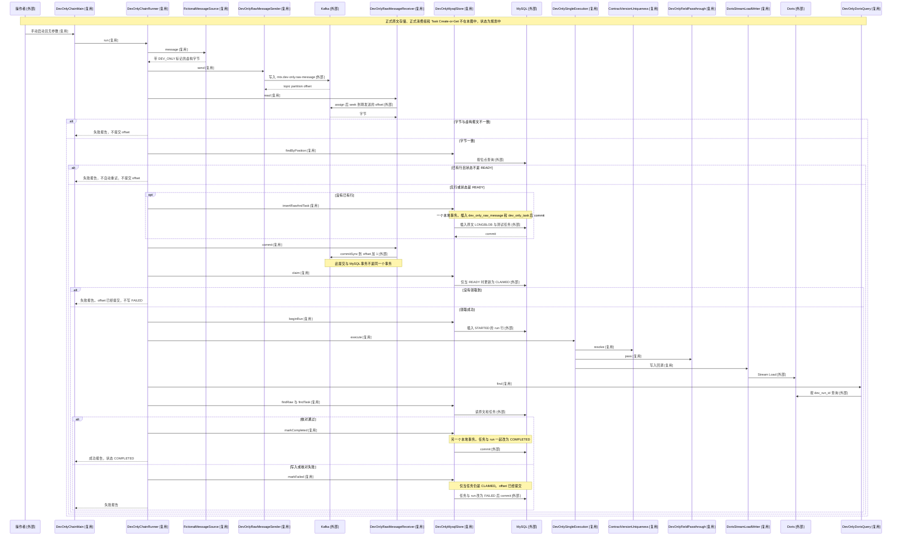

这条链路的最终状态只有测试含义：成功时 MySQL 任务为 `COMPLETED`，Doris 有对应测试行，Kafka 位点已提交。失败若发生在 `commit` 之前，位点不提交。失败若发生在 `commit` 之后，位点已经前进，任务不是 `COMPLETED`。`CLAIMED` 之后若进程退出且没有执行到 `markFailed`，任务会停在 `CLAIMED`，本方法不会自动再跑。

### 11.2 变更前：显式重跑 FAILED

入口是 `DevOnlyChainMain rerun-failed testTaskId`。不读 Kafka，不提交 offset，不重新保存原文。

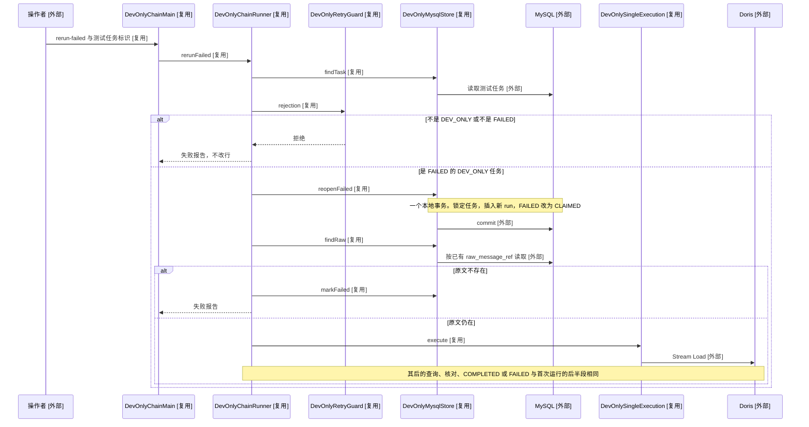

### 11.3 推荐最小切片与未来消费链路

DEV_ONLY 两张图的调用没有变化，本轮不重画。

下面第一张图是后来被收成 C1 的单调用方入口。C1 的设计已接受，图中的类仍未实现。入口不是正式消费组。不提交 offset，不创建 Task，不调用 Pipeline 或 Doris。先查后插只描述这一次调用，不提供多 Worker 保护。

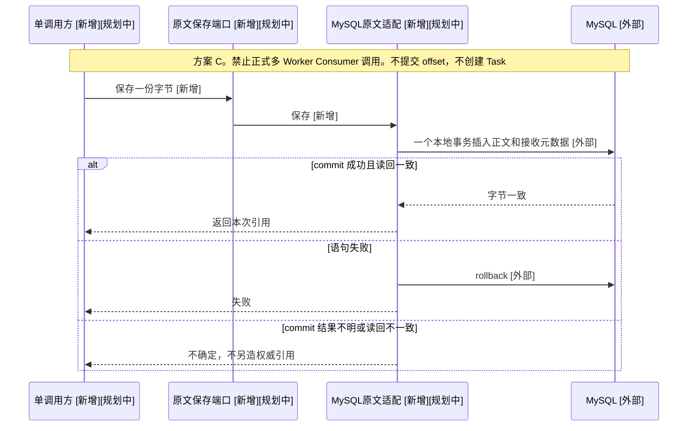

下面这张图不是 C1。它保留未来消费链路的入口，供和第 12 节对照。C1 禁止正式多 Worker Consumer 调用保存端口。保存后仍不提交 offset。offset 以后能否提交，取决于 IR-03 和 IR-09。这不是已经实现的正式消费链路，也不是 `DevOnlyRawMessageReceiver`。

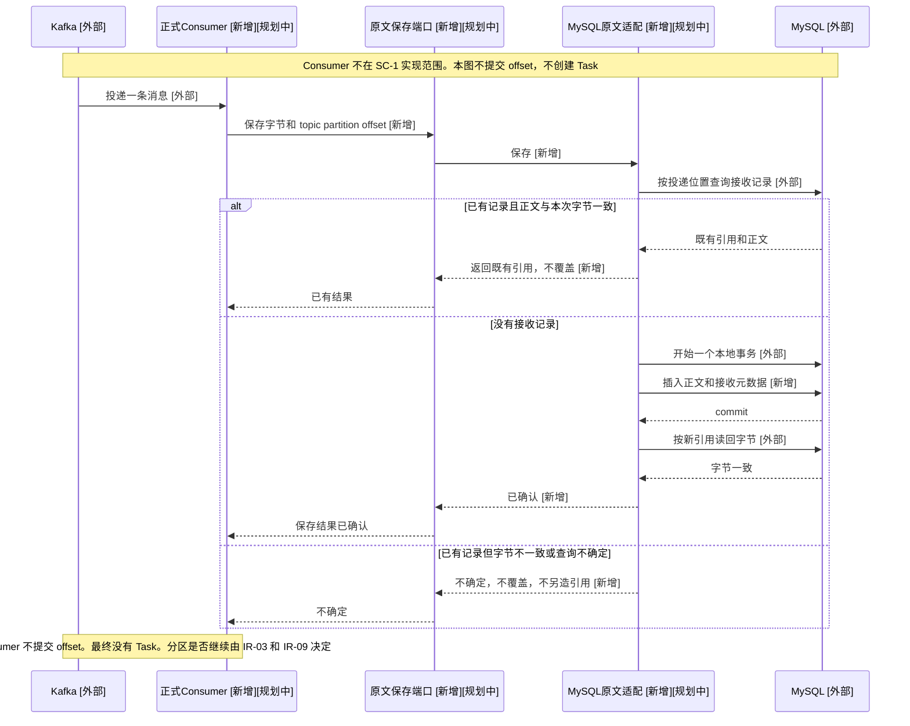

### 11.4 原文保存失败

语句失败时事务回滚。调用方得到失败。不提交 offset，不建 Task。`COMMIT` 若只是返回异常，不走这张「已经回滚」的图，改走第 11.6 节。

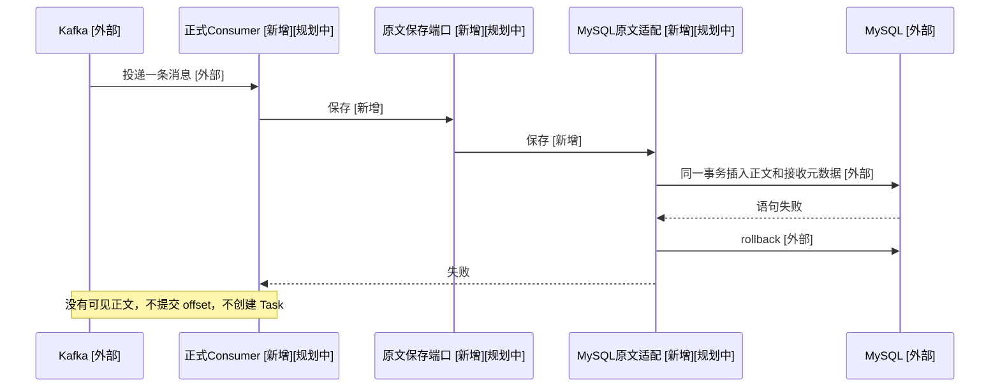

推荐候选里，正文和元数据是同一个事务。不存在「正文已经可见、元数据提交失败」这种分裂。若以后改选对象存储加 MySQL 元数据，才会出现孤儿对象。该方案不是推荐，这里不再单独画成成功路径。

### 11.5 同一投递的并发重复保存

这张图不是 C1 的成功路径。C1 禁止正式多 Worker 消费调用保存端口。若该禁止被打破，且投递位置唯一约束仍未批准，结果是不确定，可能留下两行。唯一约束分支仍未批准，不能画成已经具备的幂等。

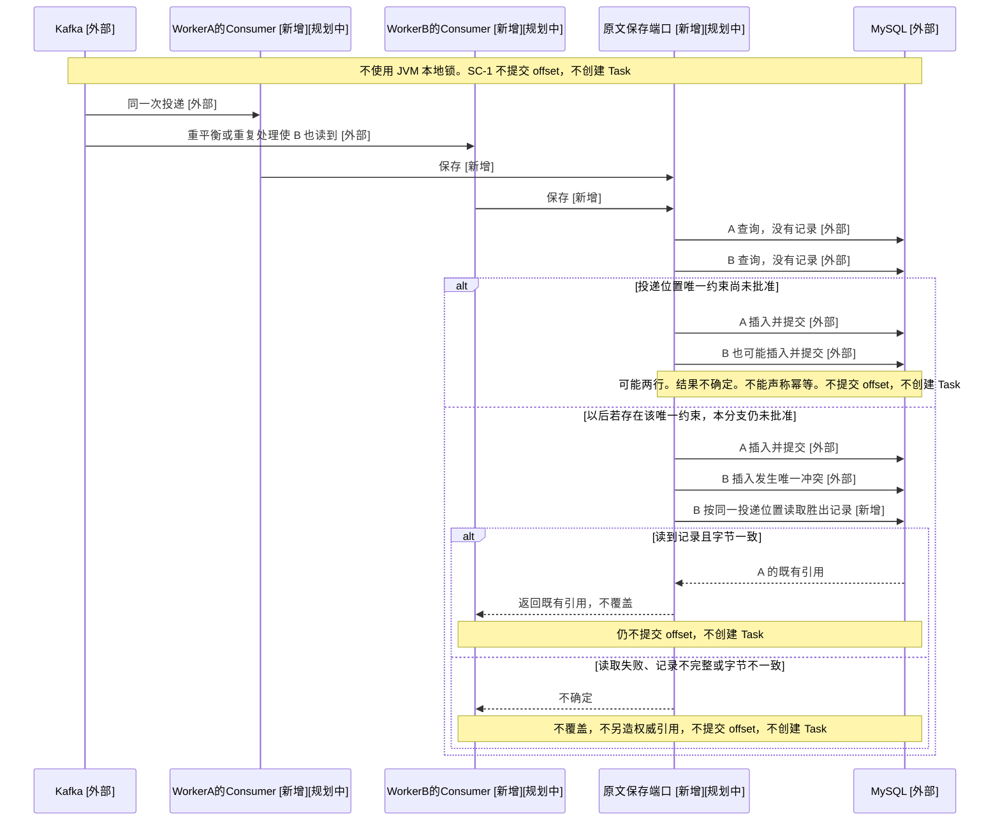

### 11.6 COMMIT 成功但调用方没有收到结果

数据库已经提交，不等于 Consumer 已经收到确认。之后同一投递再次进入时，先查找再核对。查不到记录也不解释成事务已回滚。

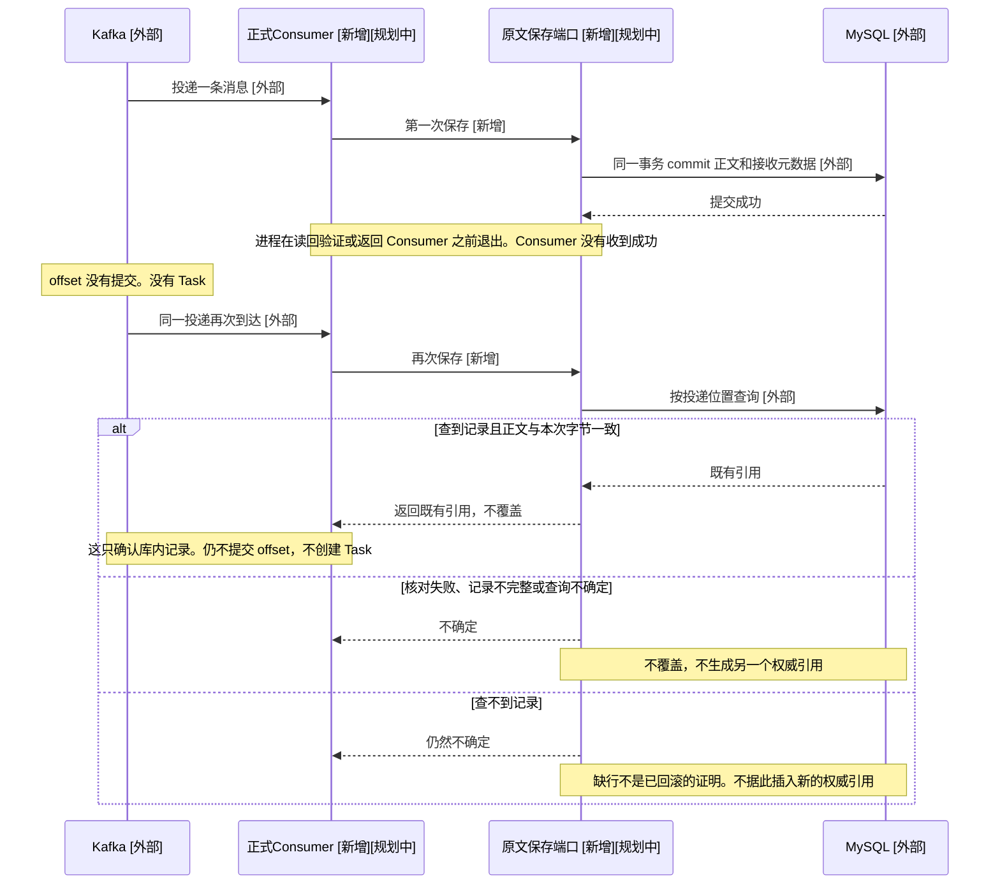

### 11.7 已有记录但字节不一致

这不是 Task 级业务事件冲突。本图不新增错误码。

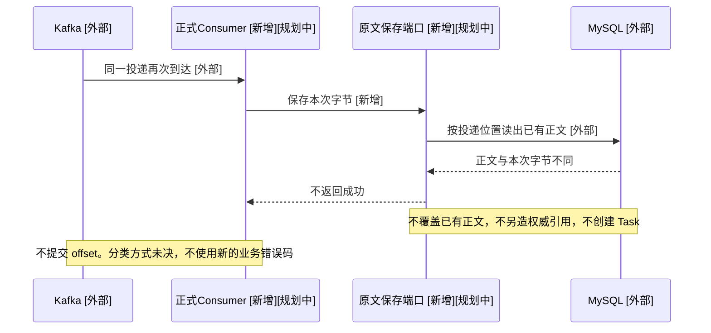

### 11.8 节点清单

| 标记 | 节点 | 模块 | 职责 |
| --- | --- | --- | --- |
| [新增][规划中] | 单调用方 | 不存在。C1 已接受这个入口约束，类仍未实现 | C1 的唯一入口。不是消费组，也不是 `DevOnlyChainRunner` |
| [新增][规划中] | 正式 Consumer | 未选定。不是 `DevOnlyRawMessageReceiver` | 未来消费链路的上游。C1 禁止它调用保存端口。不在这些图里提交 offset |
| [新增][规划中] | 原文保存端口 | 候选在 `platform-core`，未接受 | 保存、读回、按引用读取、拒绝覆盖。不出现 JDBC 类型。SC-1 若实施，只到这一端口和它的适配 |
| [新增][规划中] | MySQL 原文适配 | 未选定。由 `app-worker` 装配是既有边界，不是本轮决定 | 在一个 MySQL 事务中写正文和接收元数据。先查后插不是已证明的幂等 |
| [外部] | Kafka | 平台边界外的消息基础设施 | 提供投递。正式消费链路尚未实现。SC-1 不提交 offset |
| [外部] | MySQL | 已接受服务器版本，正式库表未接受 | 保存候选正文和接收元数据 |
| [外部][规划中] | 对象存储 | 无部署证据 | 不是本推荐路径的参与方 |

复用清单只覆盖变更前已经存在、且本候选不改变的节点：

| 节点 | 模块 | 说明 |
| --- | --- | --- |
| `DevOnlyChainMain` | `app-worker` | 手动测试入口。`WorkerApplication` 不调用它 |
| `DevOnlyChainRunner` | `app-worker` | 编排测试链路 |
| `FictionalMessageSource` | `platform-connector` | 虚构字节来源 |
| `DevOnlyRawMessageSender` | `platform-messaging` | 发送一条测试消息 |
| `DevOnlyRawMessageReceiver` | `platform-messaging` | 按指定位点读取并手动提交 |
| `DevOnlyMysqlStore` | `app-worker` | DEV_ONLY 原文、任务和 run |
| `DevOnlyRetryGuard` | `app-worker` | 只允许重跑 FAILED 的测试任务 |
| `DevOnlySingleExecution` | `platform-pipeline` | 测试执行 |
| `ContractVersionUniqueness` | `platform-core` | 在已固定夹具快照内解析契约版本 |
| `DevOnlyFieldPassthrough` | `platform-transform` | 原样传递非空字段 |
| `DorisStreamLoadWriter` | `platform-writer` | 测试 Stream Load |
| `DevOnlyDorisQuery` | `app-worker` | 按测试 run 查询 Doris |

修改清单为空。已有类没有新增调用，职责也没有变化。正式 Consumer 是新的规划节点，不是对 `DevOnlyRawMessageReceiver` 的修改。

对既有链路的影响：没有。候选路径不进入 `DevOnlyChainRunner`。不能把 `dev_only_raw_message`、测试 UUID 或「MySQL 成功后提交 offset」移到正式图里当作复用。`ContractVersionUniqueness` 与原文保存无关，不因它是正式代码就画进 SC-1。

## 12. 决策口径收敛：IR 归属、幂等语义与 SC-1 并发范围

本节核对台账、06-04-29 和 06-04-10 的原句。它不修改那些文件，不关闭 IR，也不创建实施授权。

### 12.1 已经一致的口径

- 原文保存成功不是 Task 已创建，也不是 offset 已提交。Kafka、MySQL 和对象存储没有统一事务。
- `rawPayloadRef` 是平台生成的逻辑引用。内容哈希只能作为字节校验候选。两者都不是 SourceEventIdentity。
- 同一业务事件可以有不同字节。不同业务事件可以有相同字节。字节相同不合并事件。
- 无稳定身份时不建 Task，不提交 offset。
- IR-02 只管观测、标准化结果和字段结果的物理唯一约束。接收记录的约束不并入 IR-02。
- DEV_ONLY 的 `(kafka_topic, kafka_partition, kafka_offset)` 唯一键只存在于测试表。它不是正式幂等已经完成。
- 先查后插和 JVM 本地锁都不是多 Worker 正确性依据。
- ADR-0003 禁止覆盖历史观测。它既不规定原文永远保留，也不授权删除。

### 12.2 IR-15 与介质选型

台账 IR-15 的题目是数据保留策略未写明。事实栏点名配置、冲突决定、审计和历史观测。风险栏担心执行库和原文被当成可覆盖缓存。06-04-29 第 3 节已核验：这行没有选定介质，没有定义异常隔离，也没有保留天数。

| 类别 | 内容 | 台账是否已经规定 |
| --- | --- | --- |
| A. 介质与引用 | 正文放在哪里，`rawPayloadRef` 如何生成，同一次投递如何避免覆盖 | 否。06-04-10 第 7 节把它写进 IR-15，06-04-29 第 3 节认为这是后续扩展 |
| B. 保留、归档、删除和审计 | 按实体列出保留和删除条件，被引用时不删，删除要有审计落点 | 是 IR-15 要解决的问题。天数和审计落点仍未决 |

B 未决，不表示 A 的技术调查不能进行。A 的任何选择也不能写成 IR-15 已经规定的事项。

建议：

- IR-15 继续负责 B：原文正文、接收元数据、哈希、投递位置记录、Task 关联各自的保留和删除条件。不在本报告里规定天数。
- A 用一份新的 ADR 或单独的局部批准作为决策载体。不靠关闭 IR-15 来选定介质。
- 依赖关系：介质决定可以不等待保留天数。归档和删除作业要等介质和 IR-15 的条件都接受之后才能做。介质决定不得提前写死天数。
- 需要用户单独接受的是：介质方向、单调用方边界、以及以后的保留条件。三件不能互相代替。

06-04-10 第 7 节第 3 步写「原文介质和保留期限仍是 IR-15」。这与 06-04-29 第 3 节对台账范围的核验不一致。本报告采用 06-04-29 第 3 节，不改 06-04-10。

### 12.3 两种幂等

| | SourceEventIdentity 业务事件幂等 | DeliveryIdentity 投递记录重复保护 |
| --- | --- | --- |
| 业务目标 | 同一来源事件回到原 Task，不替换权威引用 | 同一次 Kafka 投递不要留下两份接收记录 |
| 数据实体 | Task，以及任务上已绑定的权威 `rawPayloadRef` | 接收记录和它指向的正文 |
| 唯一性范围 | 来源契约已声明的稳定事件身份。当前没有 | 候选是 topic、partition、offset。未批准。topic 仍受 06-04-61 约束 |
| 失败场景 | 无身份时不能判断是不是同一事件。不同 offset 可能是同一事件，字节也可能不同 | 两个调用同时插入。没有唯一约束时可能两行。字节不一致时不能当成功 |
| 能否返回相同 `rawPayloadRef` | 只有按稳定事件身份返回同一引用的契约被批准后才可以。06-04-29 写明该契约未批准 | 只在同一投递且正文核对一致时，候选为返回已有引用。另一个 offset 不因此共用引用 |
| 能否创建或取回相同 Task | 这才是 Create-or-Get。IR-03 未解决 | 不能。返回接收引用不是取回 Task |

DeliveryIdentity 的物理唯一约束不能表述为已经解决 06-04-29 的业务事件幂等。

实质冲突在 06-04-29 第 6 节末句：原文存储层的幂等若要存在，依据只能是已经声明的稳定事件身份，不能是内容哈希、offset、`receivedAt` 或 `taskId`；当前没有这份身份，所以存储层幂等现在不能实现。

以 offset 为键的投递去重，和这句「不能是 offset」冲突。若按字面执行，方案 B 就是在 SourceEventIdentity 出现之前实现一种存储层幂等。本报告不改这句。

06-04-10 第 7 节「不能靠 offset 相等代替唯一约束」说的是任务身份，不是接收记录。它与「接收记录另有投递位置约束」不是同一句冲突。它也不授权用 offset 完成 Create-or-Get。

需要用户选择，本报告不代选：

1. 维持 06-04-29 的字面含义。SourceEventIdentity 出现之前，不实现任何称为存储幂等的能力，包括投递位置唯一约束。
2. 另作一份决定，把那句话里的「存储层幂等」限缩为业务事件幂等。投递记录去重不视为已经实现那句话。06-04-29 正文保持不动。
3. 两者都不接受，最小切片也继续只停留在调查。

在用户选择第 2 项之前，方案 B 不能实施。

### 12.4 三种并发方案

| | A. 保存端口，不承诺并发保护 | B. 加上投递唯一约束和失败方读取胜出行 | C. 只允许单调用方，禁止用于正式多 Worker 消费 |
| --- | --- | --- | --- |
| 能否独立实施 | 端口本身可以不依赖 IR-03。但没有使用限制时，第二个 Worker 就能调用 | 不能。要先有第 12.3 节的第 2 项，以及唯一约束和失败方读取规则 | 边界可以独立写清。写代码仍要另有接受决定和授权 |
| 前置决策 | 介质、模块落点 | A 的前置，再加投递唯一约束、06-04-61 对 topic 的比较语义、冲突后的读取规则 | 介质、模块落点、单调用方限制。不需要投递唯一约束 |
| 是否依赖 06-04-61 | 引用或 topic 一旦要做唯一索引或身份比较就依赖。只存字节、不做字符串唯一索引时，DDL 仍要字符集，但不是这行调查已经选定的排序规则 | 依赖。topic 在候选唯一键里 | 推荐切片不做投递唯一索引。正式 DDL 仍不能在字符集未决时创建字符串列 |
| 是否依赖 IR-03、IR-09 | 不提交 offset、不建 Task 时不依赖。一旦接入消费组就依赖 | 同左。投递去重不代替这两项 | 同左。禁止接入正式消费组，就是为了不把这两项卷进来 |
| 是否与 06-04-29 第 6 节冲突 | 只要不把先查后插称为存储幂等，字面冲突较轻 | 冲突。见第 12.3 节，除非用户选择第 2 项 | 不声称实现存储幂等，字面冲突较轻 |
| 重复记录 | 两个 Worker 同时插入时可能两行。没有已批准的恢复方法，不能当作可以安全恢复 | 同一投递在约束生效后不能两行。约束不存在或读取胜出行失败时仍不确定。不同 offset 的同一业务事件仍会有多份正文，这是允许的，不是故障 | 守住单调用方时，不因并发产生第二行。禁止被打破后，与 A 相同，可能留下无法安全合并的两行 |

三个方案都不用 JVM 锁。A 把并发边界留空，不能当作可以开始的正式切片。

### 12.5 推荐与最小切片

第 12 节当时推荐方案 C，第 13 节把它收成 C1。第 12 节保留为比较过程。C1 的接受记录在第 13.0 节，不是第 12 节作出的。

严格边界：

- 一个调用方调用保存端口。
- MySQL 同一事务写入正文和接收元数据。
- 返回本次引用，或返回失败、不确定。
- 不承诺多 Worker 并发去重。
- 不建投递位置唯一索引，因此不把方案 B 提前做掉。
- 不创建 Task，不做 Create-or-Get。
- 不提交 Kafka offset，不接入正式消费组。
- 不调用 Pipeline 或 Doris。
- 不规定保留天数，不运行删除或归档。
- 不把 DEV_ONLY 表或测试 UUID 升格。

这个边界不依赖来源业务身份，也不要求 IR-02、IR-03、IR-09、IR-15 先全部关闭。

C1 接受之后仍然不能实施。阻断不再是「没有设计决定」，而是没有单独的实施授权。06-04-01 第 9 节因此继续禁止正式持久化代码。字符集未决会挡住随后的正式 DDL。保留天数仍然不是这道阻断。

方案 B 留到用户选择第 12.3 节第 2 项之后再开。在那之前把唯一约束放进 SC-1，就是用 offset 去实现 06-04-29 尚未允许的存储幂等。第 13 节的 C2、C3 同样要另作决定，不能从 C1 里长出来。

## 13. 方案 C 的单调用方与恢复边界

本节先把第 12 节的方案 C 收成 C1，再记录用户对 C1 的接受。接受不关闭 IR，不批准 Stage C，也不授权写代码。DEV_ONLY 链路没有变化，第 11.1 节和第 11.2 节不重画。已有 Java 类的修改清单仍为空。

### 13.0 接受记录

| 项 | 记录 |
| --- | --- |
| 决定 | 接受 C1 受限设计 |
| 日期 | 2026-11-28 |
| 决策主体 | 用户 Wayne |
| 依据 | 用户在 ChatGPT 对话中明确表示接受。仓库内没有另一份审批单 |
| 范围 | 只接受第 13 节的 C1 设计 |
| 不代表 | SC-1 代码实施授权、SC-1 DDL 授权、开发服务器操作授权、Stage C 整体授权、IR-15 关闭，或其他 ADR、IR 的状态变更 |

没有分配 ADR 编号，也没有审批人签名。

| 项目 | 本次结果 |
| --- | --- |
| C1 受限设计 | 已接受 |
| SC-1 代码实施授权 | 未授权 |
| SC-1 DDL 实施授权 | 未授权 |
| 开发服务器操作授权 | 未授权 |
| IR-15 | 不关闭 |
| Stage C | 整体未获授权 |
| C2、C3 | 未决，需另行决策 |
| 原文保留天数和删除策略 | 未决 |

C1 已接受的内容是：

- MySQL 同一事务保存原始报文字节和接收上下文元数据。字节透明保存，不改写正文。
- 明确成功后返回逻辑引用 `rawPayloadRef`，并做可再读确认。生成算法未冻结。物理定位不是这个引用。
- 全环境同时只有一个活动调用方，并且该调用方串行。上一笔必须明确成功或明确失败，才能开始下一笔。
- 不用 JVM 本地锁、内存 Map 或单实例部署充当跨进程保证。不支持同进程并发或多实例并发。
- COMMIT 响应丢失、端口超时、进程异常退出等不确定结果不自动重试。不用缺行推断已经回滚。相同字节不是同一次操作。内容哈希不是业务身份，也不是幂等键。不能安全确定结果时停止自动处理，转人工核对。没有跨进程自动恢复。

C1 不提供同进程并发去重、多实例并发去重、DeliveryIdentity 唯一约束、SourceEventIdentity 推导、自动重试、自动恢复、Task Create-or-Get、Worker 领取、接管、fencing、Kafka offset 提交，以及保留天数、归档和删除作业。C2 或 C3 必须另作决定，不能从本次接受推出来。

06-04-01 第 9 节仍禁止正式持久化 Java 和 DDL。设计接受不解除这道实施阻断。后续写代码或建表之前，还要单独确认实施范围并取得实施授权。

下列文件没有按本次接受改写，读到它们时以各文件自己的正文为准：台账 IR-15 仍是待决策；06-04-29 仍写介质未选，并且存储幂等只能依据稳定事件身份；06-04-10 仍把介质和保留期限写在 IR-15 名下；06-04-01 第 9 节仍禁止持久化实现。本任务不修改这些文件。

核对过、且本轮不改写的材料：[06-04-29](../investigation/round-01/06-04/06-04-29%20MTX%20Data%20Platform%20V2%20IR-15%20原始报文存储、异常隔离与数据保留策略专项调查.md) 第 6 节，[06-04-10](../investigation/round-01/06-04-10%20MTX%20Data%20Platform%20V2%20Source%20Event%20Identity%20与%20Kafka%20消息接入幂等专项设计.md) 第 7 节，[06-04-61](../investigation/round-01/06-04-61%20MTX%20Data%20Platform%20V2%20MySQL%20字符身份比较语义与唯一索引键长专项调查.md)，[06-04-28](../investigation/round-01/06-04/06-04-28%20MTX%20Data%20Platform%20V2%20IR-09%20Kafka%20消费端接入设计与验收条件专项调查.md) 第 5、6 节，[06-04-19](../investigation/round-01/06-04-19%20MTX%20Data%20Platform%20V2%20物理唯一约束与并发%20Create-or-Get%20专项设计.md) 第 6.3 至第 6.5 节，[06-04-01](../investigation/round-01/06-04-01%20MTX%20Data%20Platform%20V2%20工程实施就绪度评估报告.md) 第 9 节，ADR-0002、ADR-0004、ADR-0005，以及台账 IR-03、IR-09、IR-15。

06-04-19 的加锁读和重新插入，只覆盖已经设计了完整身份和唯一约束的记录。原文接收记录没有这份已批准身份。C1 不能借用第 6.3 节「确认缺行后再插入」。普通查询缺行仍然不能证明事务已回滚。

### 13.1 单调用方指什么

| 说法 | 方案 C1 是否把它当作正确性保障 |
| --- | --- |
| 单个 JVM 实例 | 否。同一 JVM 里的多个线程仍会并发调用 |
| 单个应用进程 | 否。一个进程可以并发，部署里也可以再起一个进程 |
| 单个部署实例 | 否。第二个实例不受第一个实例的内存约束 |
| 整个部署环境只有一个活动调用方 | 是。这是调用方必须遵守的约束，不是数据库保证 |
| 该调用方内部串行调用 | 是。上一笔必须已经返回明确成功或明确失败，才能发出下一笔 |
| 该调用方内部并发调用 | 否。不提供 |
| 进程重启后的重复调用 | 否。内存里的进行中状态会丢失，重启本身不是恢复 |

JVM 本地锁、内存 Map 和「只部署一个实例」都不能证明跨进程只有一次写入。

| 场景 | C1 的行为 |
| --- | --- |
| 同一进程串行保存 | 支持。上一笔结果明确之后才能发下一笔。成功之后再保存同一份字节，是另一次保存，会再写一行 |
| 同一进程并发保存 | 不支持。发生了就可能两行，平台不能安全合并 |
| 多实例并发保存 | 不支持。同上 |
| 进程重启后重新保存 | 不支持自动重做。上次结果若未由调用方持久记下，重启后必须停止并人工核对 |
| 调用超时后再次提交 | 不允许自动再次提交 |
| 上次保存结果不确定 | 不允许自动重试 |
| 同一份字节再次提交 | 不视为同一操作。字节相同不是幂等键 |

调用方约束：全环境同时只有一个活动调用方；它不重叠调用；超时、崩溃或结果不确定时不再次调用保存端口。约束被打破后，C1 没有已批准的去重和合并办法。人工成本是：操作者只能在库里按时间和字节自行辨认，平台没有已批准的查找键。

### 13.2 输入和输出

下表的语义边界已经随 C1 接受。生成算法、列类型、字符集和唯一约束没有接受。C1 不因为需要定位本次操作就增加唯一约束或调用标识列。

| 项 | 谁提供 | 谁生成 | 是否业务事件身份 | 是否幂等键 | 能否靠它跨进程找回 | 状态 |
| --- | --- | --- | --- | --- | --- | --- |
| 原始报文字节 | 调用方 | 调用方持有，端口不改写 | 否 | 否 | 否。相同字节可以有多行 | 透明保存已接受 |
| 接收上下文 | 调用方可以附带 topic、partition、offset 或其他上下文 | 调用方 | 否。不是 SourceEventIdentity | 否。C1 不用它们做唯一约束 | 否 | 语义已接受。06-04-10 第 7 节已写 offset 不是业务身份 |
| 调用标识 | C1 不要求 | 不生成 | 否 | 否 | 否 | 不引入已接受。引入并当作幂等键属于未决的 C2 |
| `rawPayloadRef` | 端口在明确成功时交给调用方 | 平台。算法未冻结 | 否 | 否。它标识已经保存的正文，不标识这次调用 | 只有调用方已经把返回的引用持久记下时才能再读 | 逻辑语义已接受。算法未冻结 |
| 物理存储定位 | 适配层 | 适配层 | 否 | 否 | 否。不得直接当作 `rawPayloadRef` | 不得等同于引用，这一点已接受。具体定位方式未冻结 |
| 保存结果 | 端口 | 端口。取值为明确成功、明确失败或不确定 | 否 | 否 | 响应本身丢了就不能从内存恢复 | 三态已接受 |
| 可再读确认 | 适配层再读一次 | 端口比较读回字节。比较算法未冻结 | 否 | 否 | 确认响应丢了，不等于库里没有行 | 必须再读已接受。比较算法未冻结 |

### 13.3 COMMIT 与响应丢失

C1 使用 MySQL 同一事务，没有对象存储孤儿。危险是不确定时又插入一行。下表的「不能确定」表示现有规则不够自动判断。Kafka 下一条待消费位置沿用 06-04-28：保存成功也不是可以把位置前移的条件。SC-1 不创建可执行 Task。

| 故障 | 能否确定记录存在 | 能否确定记录不存在 | 能否自动重试 | 重复或孤儿 | 人工 | 可执行 Task | 消费位置前移 |
| --- | --- | --- | --- | --- | --- | --- | --- |
| COMMIT 前语句明确失败并且回滚完成 | 这次没有提交 | 这次没有留下行 | 否。以后的新调用是另一次保存，不是这次的重做 | 不会由这次失败本身产生第二行 | 否 | 否 | 否 |
| COMMIT 尚未发送时连接已断 | 不能 | 不能。缺行不是回滚证明 | 否 | 若擅自再插入，可能与尚未结束的原事务重叠 | 是 | 否 | 否 |
| COMMIT 已发送但响应丢失 | 不能 | 不能 | 否 | 再插入可能成为第二行。没有对象孤儿 | 是 | 否 | 否 |
| COMMIT 成功后进程立即崩溃 | 库里可以已有行，调用方没有引用 | 不能 | 否 | 再提交同一字节会再写一行 | 是。没有已批准查找键 | 否 | 否 |
| 保存端口超时，调用方不知道结果 | 不能 | 不能 | 否 | 再提交可能两行 | 是 | 否 | 否 |
| 调用方重启后再次提交相同字节 | 不能单靠字节确定 | 不能 | 否。C1 禁止这次自动提交 | 若仍然提交，就是新的一行 | 是 | 否 | 否 |
| 可再读确认已经成功，调用方没收到响应 | 确认当时读到过。调用方没有引用 | 不能 | 否 | 再提交会再写一行 | 是 | 否 | 否 |
| 原文已保存，Task 尚未创建 | 保存若已确认，行在。Task 不在 SC-1 内 | 不适用 | 不靠创建 Task 来恢复 | 行可以没有任务。06-04-29 不允许立刻当垃圾删除 | 建 Task 不在本切片 | 否 | 否 |

除第一行的明确失败以外，当前无法自动恢复。不用推测出来的收件箱、操作号或内存表填上这个缺口。

### 13.4 C1、C2、C3

| | C1 串行单调用方，不确定就停止 | C2 允许并发或重试，并持久化操作定位 | C3 投递位置唯一约束 |
| --- | --- | --- | --- |
| 正确性来自 | 全环境一个活动调用方，且串行，失败不确定时不再调用 | 持久化的操作定位和尚未设计的恢复读取 | 投递位置唯一约束，以及冲突后读取胜出行 |
| 数据库唯一约束 | 不需要，也不提供 | 需要。操作定位本身就是新的唯一约束 | 需要 topic、partition、offset。topic 受 06-04-61 约束 |
| 新字段或新表 | 本决定不增加。以后写 DDL 仍要单独批准 | 需要 | 需要 |
| 跨进程恢复 | 不提供 | 只有操作定位被接受后才可能。现在没有 | 只对同一投递位置。不是业务事件恢复 |
| 是否依赖 IR-03 | 否 | 否。但它会和 06-04-29 第 6 节「存储幂等只能依据稳定事件身份」冲突，除非另作限缩 | 冲突。第 12.3 节第 2 项未选择前不能做 |
| 复杂度与阻断 | 规则短。人工核对成本高，因为没有查找键。设计已接受。实施仍被 06-04-01 第 9 节挡住，因为没有单独的实施授权 | 比 C1 多一套身份和恢复。未决，不能从 C1 推出 | 还要另作决定处理 06-04-29 第 6 节的字面范围。未决 |

C1 的人工成本不能省掉：结果不确定时，平台不会自动找到那一行，也不会证明没有那一行。

C1 已是用户接受的受限设计。C2 和 C3 仍是以后的独立决定，不是这次接受的隐含部分。

### 13.5 时序

第 11.3 节第一张图是修订前的方案 C：它要求单调用方，但没有写明串行，也没有在结果不确定时禁止下一次调用。调用关系没有变成已有代码，所以不改 DEV_ONLY 图。下面先保留修订前的形状，再给出 C1。

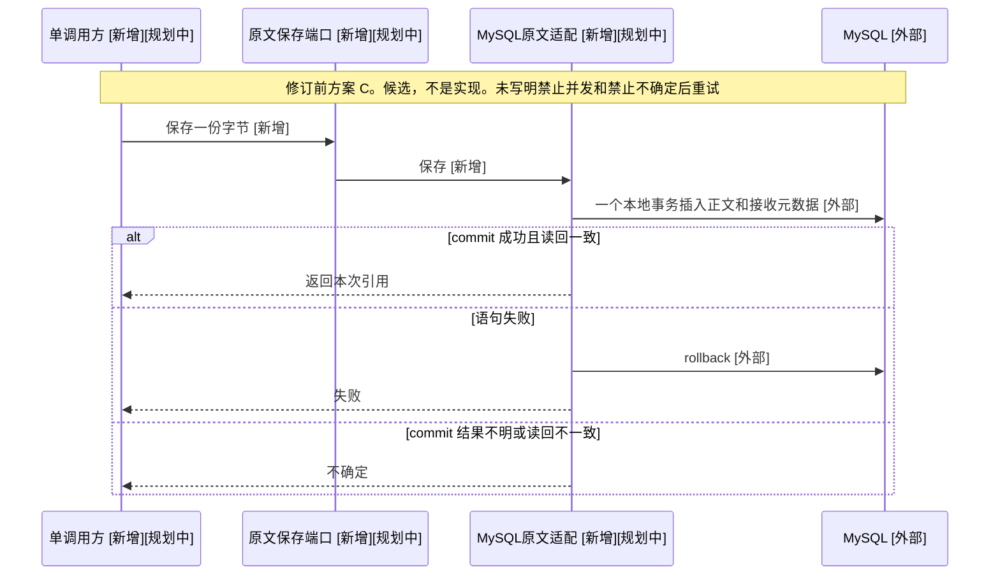

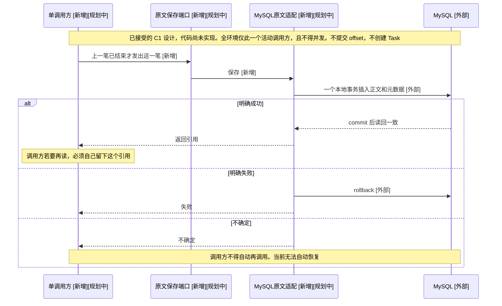

正常串行成功。这是已接受的 C1 设计，代码尚未实现。

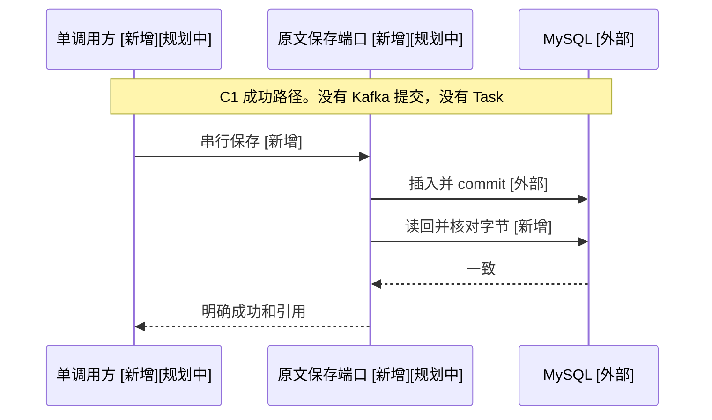

COMMIT 响应丢失。

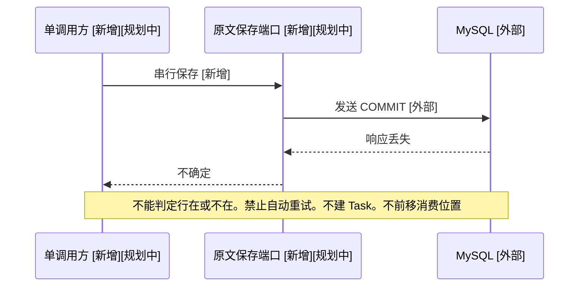

可再读确认的响应丢失。

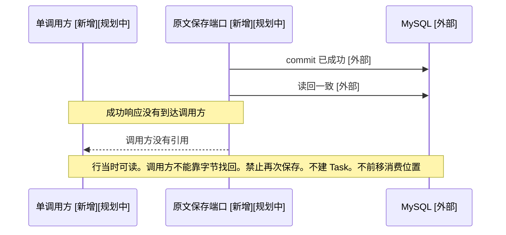

进程重启。

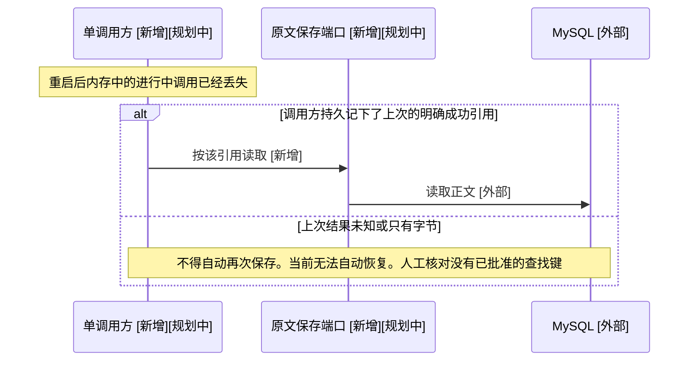

### 13.6 决策摘要

| 决策项 | 推荐值 | 当前状态 | 是否阻断实施 |
| --- | --- | --- | --- |
| 原文介质 | MySQL 同一事务保存正文和接收元数据 | 已接受的 C1 设计。不是 ADR | 实施仍阻断。设计接受不解除 06-04-01 第 9 节 |
| 单调用方定义 | 全环境只有一个活动调用方，且该调用方串行调用 | 已接受的 C1 设计 | 实施仍阻断 |
| 并发调用 | 不提供。进程内并发和多实例都不支持 | 已接受的 C1 设计 | 实施仍阻断 |
| 不确定结果处理 | 停止自动重试。除明确失败外，当前无法自动恢复 | 已接受的 C1 设计 | 实施仍阻断 |
| DeliveryIdentity | 不作为 C1 的唯一约束或幂等键 | 未批准 | 否。它不进入 C1。要做 C3 时才阻断 |
| `rawPayloadRef` | 平台生成的逻辑引用。算法不冻结 | 逻辑语义已接受。算法未冻结 | 实施仍阻断。写代码前还要单独授权 |
| 可再读确认 | 提交后再读一次。比较算法不冻结。响应丢失不等于没有行 | 再读要求已接受。算法未冻结 | 实施仍阻断 |
| Kafka offset | 不得越过未完成记录。C1 不提交 offset | 不提交是已接受的 C1 边界。06-04-28 的提交条件仍是既有候选 | 否。只要实现不提交 offset |
| Task 创建 | 不纳入 SC-1 | 已接受的 C1 边界 | 否。只要实现不建 Task |

1. C1 已是最小 SC-1 的已接受设计。这不等于可以写代码。06-04-01 第 9 节仍阻断实施，直到另有一份写明范围的实施授权。Stage C 整体没有获批。
2. C1 明确不提供：同一进程并发、多实例并发、超时或不确定后的自动重试、把相同字节当成同一次操作、跨进程自动找回没有记下的引用、投递位置去重、SourceEventIdentity 推导、Task Create-or-Get、Worker 领取、接管、fencing、offset 提交、保留天数、归档和删除作业。
3. 将来若要多 Worker 或自动恢复，需要一份新的独立决定。多 Worker 的同一投递去重是 C3，并要先处理 06-04-29 第 6 节的字面范围。自动重试是 C2，要单独接受操作定位和恢复读取。两者都不能从本次接受推出来。
