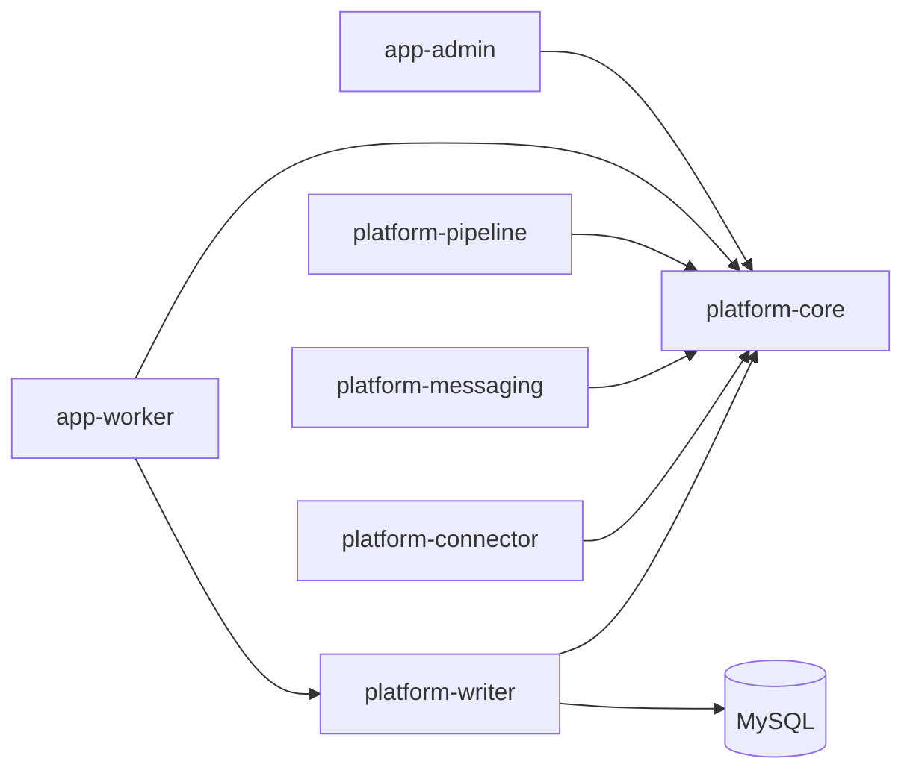
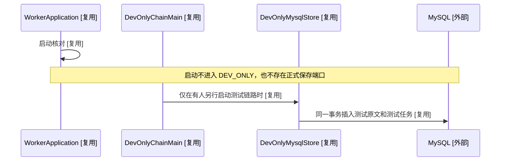
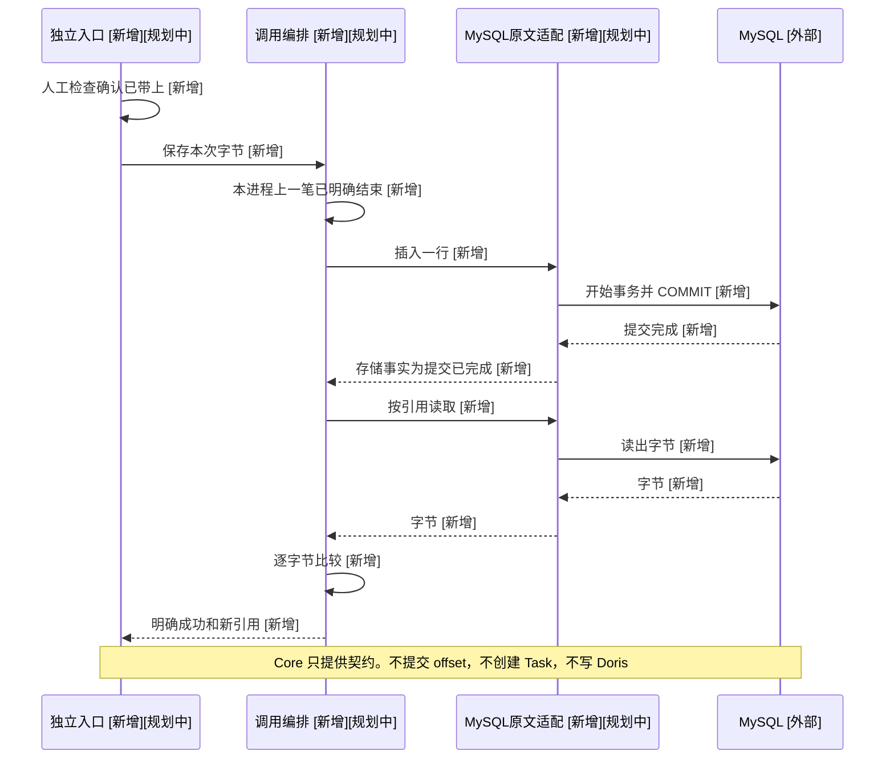
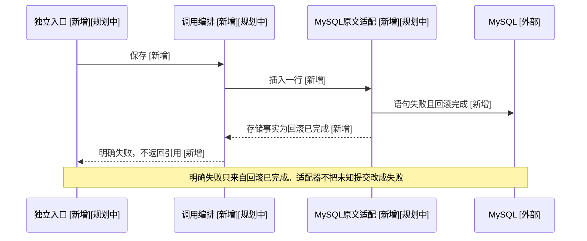
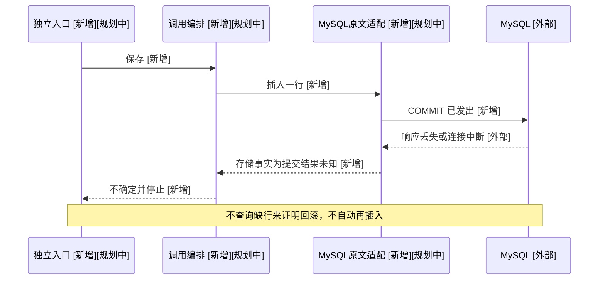

# SC-1 正式原文保存最小实施授权草案

- 状态：`DRAFT / 待用户审批`
- 代码基线：`2d4a14c038fcbfa78f99523987ee3b1dacc47c38`
- 已接受设计：[IR-15 正式原文保存介质与保留策略专项决策准备](IR-15-正式原文保存介质与保留策略专项决策准备.md) 第 13.0 节。用户 Wayne 于 2026-11-28 接受 C1 受限设计
- 效力：本文件是实施授权草案，不是已批准授权。它不构成 Java、DDL 或服务器操作许可。第 12 节的确认区保持空白。一项以后被批准，不带动另外两项

本文件不修改 ADR、IR 台账、06-04-01 第 9 节，也不关闭 IR-15。C1 的接受记录没有分配 ADR 编号。本草案同样不分配。

## 1. 决策背景与已接受的 C1 设计

C1 已经接受的范围只有这些：

- MySQL 同一事务保存原始报文字节和接收上下文元数据。字节透明保存，不改写正文。
- 明确成功后返回逻辑引用 `rawPayloadRef`，并做可再读确认。生成算法未冻结。物理定位不是这个引用。
- 全环境同时只有一个活动调用方，并且该调用方串行。上一笔必须明确成功或明确失败，才能开始下一笔。
- 不用 JVM 本地锁、内存 Map 或单实例部署充当跨进程保证。不支持同进程并发或多实例并发。
- `COMMIT` 响应丢失、端口超时、进程异常退出等不确定结果不自动重试。不用缺行推断已经回滚。相同字节不是同一次操作。内容哈希不是业务身份，也不是幂等键。不能安全确定结果时停止自动处理，转人工核对。没有跨进程自动恢复。

C1 明确不提供：同进程并发去重、多实例并发去重、DeliveryIdentity 唯一约束、SourceEventIdentity 推导、自动重试、自动恢复、Task Create-or-Get、Worker 领取、接管、fencing、Kafka offset 提交，以及保留天数、归档和删除作业。

06-04-01 第 9 节仍禁止正式持久化 Java 和 DDL。本草案不解除这道阻断。只有第 12 节某一项被另行批准之后，才允许做该项写明的动作。

下面四件事分开，不能互相代替：

1. C1 已接受的是 MySQL 同一事务保存这一设计。接受记录写明它不是 DDL 授权，也不关闭 IR-15。
2. IR-15 在台账里仍是待决策。保留策略没有关闭。C1 接受记录把原文保留天数和删除策略标为未决。
3. [Stage C 规划](Stage-C-正式落地前实现边界与最小切片规划.md) 第 7.1 节的原文是：阻断为 IR-15；在介质、保留和删除规则写明之前不能建表，也不能沿用 `dev_only_raw_message`。本草案不修改这句，也不把它解释成只阻止删除作业。
4. 现有材料不能证明 C1 的接受已经覆盖建表准入。用户若要在保留和删除规则仍未写明时建表，必须单独接受一项临时准入决定。本草案不代替该决定。未接受之前，DDL 授权不能批。

该项临时准入若以后被接受，也只表示审批人在已知第 7.1 节原文的前提下允许讨论建表。它仍然不是本文件已经作出的批准，也不自动批准 Java 或服务器操作。

## 2. 当前实现现状

核对对象是基线提交里的源码。本轮没有执行 Maven。

| 事实 | 依据 |
| --- | --- |
| 十个模块和依赖方向仍是 ADR-0002 | 根 POM 聚合十个模块。`platform-core` 只依赖 `platform-common`。`platform-writer` 只依赖 `platform-common` 与 `platform-core`。`app-admin` 不依赖 `platform-writer`。`platform-pipeline` 不依赖 Writer |
| 正式原文保存不存在 | 没有正式保存端口，没有正式 MySQL 原文表 |
| `platform-core` 已有代码只有契约版本唯一性 | `com.mtx.rdp.core.contract.ContractVersionUniqueness`。它不保存原文 |
| `platform-connector` 的原文存储是进程内模拟 | `com.mtx.rdp.connector.simulation.InMemoryRawMessageStore`。关闭后不可恢复，不是 IR-15 介质 |
| `platform-messaging` 只有 DEV_ONLY 的 Kafka 读取 | `DevOnlyRawMessageReceiver`。不是正式 Consumer，也不写 MySQL |
| `platform-writer` 只有 DEV_ONLY 的 Doris 写入 | `com.mtx.rdp.writer.devonly.DorisStreamLoadWriter`。Doris 不是原文库 |
| MySQL 驱动只出现在 `app-worker` | `app-worker/pom.xml` 的 `mysql-connector-j`。其他模块没有 JDBC 依赖。根 POM 的 MyBatis-Plus 只在 `dependencyManagement`，没有模块使用 |
| DEV_ONLY 原文与任务在同一事务 | `DevOnlyMysqlStore.insertRawAndTask` 同时插入 `dev_only_raw_message` 和 `dev_only_task`。库名白名单是 `mtx_rdp_dev_only`。表上有 `VARCHAR(64)` 引用和 `(kafka_topic, kafka_partition, kafka_offset)` 唯一键。这是测试表，不是 C1 |
| 默认启动不跑 DEV_ONLY | `WorkerApplication` 不调用 `DevOnlyChainMain` |

可复用的只有这条技术事实：MySQL 可以在一个事务里保存二进制正文。正式实现不得调用 `DevOnlyMysqlStore`，不得沿用 `dev_only_raw_message`，不得把 `task` 加 UUID 的写法带进来，也不得把测试表的 `utf8mb4` 默认排序规则当成正式字符规则。

[当前工程准入边界](当前工程准入边界与下一阶段实施路线评估.md) 的基线早于 DEV_ONLY 类进入 messaging、writer 和 pipeline。读到「这些模块没有 Java」时，以当前源码为准。本草案不改那份评估。

[持久化物理模型专项设计](持久化物理模型专项设计调查与方案比较.md) 仍把原文字节标为介质未选，并禁止把建议表写成已批准模型。C1 随后接受了 MySQL 同事务保存。该调查文件没有改写。本草案不把它的表建议升成 DDL。

## 3. 模块落点

06-04-29 第 11 节写明：端口可以放在 `platform-core`；产品适配必须放在现有模块并由 `app-worker` 装配；messaging、connector、writer 三处都不自然，该调查不选定。本草案不新增模块，也不改 ADR-0002。下面是待审批的推荐，不是已经接受的落点。

| 职责 | 推荐模块 | 依据 | 不放在 |
| --- | --- | --- | --- |
| 保存端口、引用类型、明确成功、明确失败、不确定三种结果的抽象契约 | `platform-core`，新包，与 `com.mtx.rdp.core.contract` 并列。类名审批前不定 | ADR-0002：Core 用抽象定边界。契约只使用字节数组和平台自己的引用类型，不出现 JDBC、Spring、MyBatis 或 MySQL 驱动 | `platform-common` 不承载这条契约。Core 不实现比较，也不把不确定改写成明确失败 |
| MySQL 事务写入，以及按引用读出字节 | `platform-writer`，新包，与 `com.mtx.rdp.writer.devonly` 分开 | Writer 是现有模块里负责目标存储写入的一处。它报告存储事实：回滚已完成、提交已完成，或提交结果未知。它也按引用返回读到的字节或读取失败 | 不放进 `devonly` 包。不放进 connector 或 messaging。适配器不把提交结果未知降级为明确失败，也不做逐字节比较 |
| 调用编排、进程内串行闸门、提交后再读、逐字节比较、三态结果 | `app-worker` | Worker 负责装配和这次调用的编排。比较发生在 Worker。只有比较一致才返回明确成功和引用 | `app-admin` 不装配、不调用。Pipeline、Messaging、Connector 不依赖 Writer 的适配器 |
| 独立入口 | `app-worker` 的另一个 `main`。见第 6.1 节 | 当前 `spring-boot-maven-plugin` 的 `mainClass` 是 `WorkerApplication`。正式保存不改这个默认主类 | 不从 `WorkerApplication.main` 进入，也不从 `DevOnlyChainMain` 进入 |
| 写入事务 | `platform-writer` | 一次插入使用适配器持有的一个 MySQL 事务。Core 不开始 JDBC 事务。Worker 不提交 Kafka offset | Pipeline、Connector、Messaging、Admin 都不持有这个事务 |

推荐落点的已知代价：`platform-writer` 以后会同时有 MySQL 原文适配和 Doris 写入。Doris 仍然不是原文库、任务库或事务协调器。批准本落点，不等于批准 Doris 客户端，也不等于把两种写入合成一次调用。

若审批人认为 Writer 不能承接 MySQL 原文，本草案没有第二个不冲突的模块。Connector 和 Messaging 的冲突已写在上表。此时不得新增 `platform-persistence`。落点保持未决，第 12 节的三项授权都不能批。

依赖方向保持 ADR-0002。代码授权若获批，只允许给 `platform-writer` 增加 `mysql-connector-j`，版本由 Spring Boot BOM 管理，不写版本号。不增加 MyBatis、Flyway、Redis、Kafka 客户端。`platform-core` 与 `platform-pipeline` 的依赖清单不变。

`platform-pipeline`、`platform-messaging`、`platform-connector` 和 `app-admin` 不得依赖 `platform-writer` 里的 MySQL 适配器。Messaging 即使以后要调用保存能力，也只能依赖 Core 端口。C1 在本次范围内禁止正式 Consumer 做这次调用。

## 4. 最小物理模型

本节是待审批的模型，不是 DDL。不写 `CREATE TABLE`。不使用 DEV_ONLY 的列宽和默认字符集。

### 4.1 原文字节

| 规则 | 草案 |
| --- | --- |
| 保存内容 | 调用方给出的字节序列，原样写入二进制列 |
| 禁止 | 按 UTF-8 解码后再编码、按 JSON 拆字段、把正文放进 `VARCHAR` 或 `TEXT` |
| 空数组 | 建议当作长度为 0 的一次正式保存，读回后仍是空数组。与未提供字节不同 |
| 未提供字节 | 建议在接触数据库之前明确失败，不插入行，不返回引用 |
| 一致性 | 适配器报告提交已完成后，Worker 再按引用读取，并与输入逐字节比较。比较发生在 Worker。除逐字节相等以外的比较算法仍未冻结 |
| 内容哈希 | 不作为列的身份，也不建唯一索引。SC-1 不保存哈希列 |

空数组和未提供字节的区分是本草案新增的可执行规则，C1 原文没有单独写。审批代码授权时要一并确认；未确认则不实现。

二进制列的具体类型仍未冻结。没有报文大小分布，不能另写一个业务字节上限。建议在审批 DDL 时明确选择：使用 `LONGBLOB`，并且不把这个类型写成已经证明业务报文放得下。不接受该选择，就不能批 DDL。

### 4.2 接收上下文与最小字段

接收上下文元数据不是业务事件身份，也不是投递身份。C1 接受了「同一事务保存字节和接收上下文元数据」这个类别，但没有列出必须落成的列。下表不把未确认的列写成已批准字段。

| 字段 | 是否 C1 必须保存 | 已接受的来源依据 | 是否业务身份或投递身份 | 是否涉及未决问题 | 是否要用户决定 |
| --- | --- | --- | --- | --- | --- |
| `rawPayloadRef` | 是。明确成功时返回，并要能按它再读 | C1 第 13.0 节和第 13.2 节。算法未冻结 | 否。不是 SourceEventIdentity，也不是幂等键 | 算法、最大长度、列类型未冻结。按引用读取要求一次引用对应一行，这个唯一索引尚未批准 | 字段属于已接受语义。算法和物理列仍要决定 |
| 原始报文字节 | 是 | C1 | 否。相同字节不是同一次操作 | 二进制类型未冻结 | 字段属于已接受语义。是否接受 `LONGBLOB` 仍要决定 |
| 接收时间 | 否 | 无。C1 没有把这一列列为必须 | 否 | 没有已接受的列类型 | 要。本草案不默认加入，也不为人工排查补上 |
| 来源平台标识 | 否 | 无已接受的来源契约 | 不是业务身份。本切片不把它做成唯一键 | 没有长度和比较规则 | 要。未决定前不进入最小集合 |
| 连接器或接入端标识 | 否 | 无 | 同上 | 同上 | 要。未决定前不进入最小集合 |
| 接收通道信息 | 否 | 无 | 不是投递身份，除非再加唯一约束。本切片不加 | 同上 | 要。未决定前不进入最小集合 |
| Kafka topic、partition、offset | 否。C1 允许调用方附带上下文，但没有要求落成列 | 06-04-10 第 7 节只说明它们定位一次投递 | 是投递位置，不是业务身份。禁止做成 DeliveryIdentity 唯一约束 | 若落成列，仍不得当作 IR-03 的事件身份。06-04-29 第 6 节不允许用 offset 做存储幂等 | 要。未决定前不进入最小集合 |

已有决策能够确定的最小集合只有两项：原始报文字节，以及 `rawPayloadRef`。内容哈希、字节长度单列、SourceEventIdentity、`taskId`、`taskAttemptId` 不在这个集合里。

这个最小集合还不能当成已经批准的表。C1 里的「接收上下文元数据」没有对应的列清单。用户需要单独决定两件事：最小表是否就只有上述两项；若不是，上表里每一个标成「要」的字段是加入、排除，还是留在 SC-1 之外。未决定之前不扩大本切片，也不批 DDL。

不把接收时间、来源平台、连接器、通道或 Kafka 位置写成查找键。C1 已经写明人工核对没有已批准的查找键。本草案不为了排查补这个键。

### 4.3 同表还是分表

| | 同表 | 分表，同一事务 |
| --- | --- | --- |
| 写入 | 一条插入包含引用和正文 | 至少两条插入 |
| 事务 | 一个 MySQL 事务 | 同一个 MySQL 事务才能避免一条成功、另一条未提交 |
| 明确回滚 | 两列一起不可见 | 两表一起回滚时也不可见 |
| 结果不确定 | 不能靠缺行证明没写上 | 同样不能。还可能出现只看到其中一表的中间状态，而 C1 不允许用查询把它解释成回滚 |
| 读取 | 按引用一次读出正文 | 按引用再关联正文 |
| 以后正文过大 | 要另作决定才能改成对象存储。本次接受不包括方案 D | 分表也不等于方案 D，不能靠分表绕过大小决定 |

推荐同表。理由是 C1 的原子性用一条插入就能表达，分表不减少不确定结果的人工成本。推荐不是已批准 DDL。

不暴露数据库自增键作为 `rawPayloadRef`。物理定位和引用保持两件事。引用列若使用字符类型，就落入第 7 节，不能靠默认排序规则建唯一索引。建议引用以平台生成的原始字节形式放进 `VARBINARY`，从而不使用字符排序规则。最大字节长度仍由尚未冻结的生成算法决定。算法未冻结时，不能批 DDL。

本切片不建二级唯一索引，不建前缀索引，不建内容哈希唯一索引。

## 5. 事务与异常语义

一次调用的写入事务只做：插入同表的一行。这个事务由 Writer 持有。Writer 只报告三类存储事实：语句在 `COMMIT` 发出前失败且回滚已完成、提交已完成、提交结果未知。它不把「提交结果未知」改成明确失败。

Worker 在收到「提交已完成」之后，再调用 Writer 按引用读取。这次读取不放进已经结束的写入事务。Worker 做逐字节比较，并给出三态：比较一致才是明确成功并返回新引用；回滚已完成才是明确失败；提交结果未知、读取失败或字节不同都是不确定。不确定不返回引用，不删除可能已经写下的行，不自动再插入。Writer 不负责把这些情况降级成明确失败。

| 观察 | 结果 | 是否返回引用 | 调用方下一步 |
| --- | --- | --- | --- |
| 未提供字节，或进程内已有未结束调用，或上一笔结果仍是不确定 | 明确失败 | 否 | 未提供字节可以改成一次新的、带字节的调用。上一笔不确定时不得再调用 |
| 语句在 `COMMIT` 发出前失败，并且回滚已经完成 | 明确失败 | 否 | 可以开始另一次新保存。那是新操作，不是本次重试 |
| `COMMIT` 已完成，再读字节逐字节相同 | 明确成功 | 是，返回本次新引用 | 可以把引用交给调用方自己保存。平台不创建 Task |
| `COMMIT` 尚未发出时连接已断 | 不确定 | 否 | 停止。缺行不是回滚证明 |
| `COMMIT` 已发出但响应丢失，或端口超时，或进程崩溃 | 不确定 | 否 | 停止。不自动重试 |
| 再读与输入不一致 | 不确定 | 否 | 停止。不把这次记成成功，也不自动删行 |
| 相同字节的下一次调用在上一笔明确成功之后发出 | 另一次保存 | 成功时是另一个引用 | 不合并、不覆盖上一行 |

保存成功不表示来源事件已经接入，也不表示以后一定能创建 Task。IR-03 仍禁止在没有稳定事件身份时建任务或提交 offset。

## 6. 单调用方运行约束

C1 的单调用方不是数据库约束，也不是本仓库已有的部署机制。四层要分开：

| 层 | 本草案能写什么 | 不能声称 |
| --- | --- | --- |
| 部署 | 运行前置条件：整个环境只允许一个进程调用该入口。第二进程不在授权内 | 平台没有集群锁，不能阻止有人启动第二个进程 |
| 应用 | 入口在本进程内拒绝重叠调用。上一笔不是明确成功或明确失败时，拒绝下一笔 | 这道闸门在进程退出后消失。它不是跨进程正确性 |
| 运维检查 | 启动前由操作者确认没有另一个活动调用方，并留下检查记录 | 仓库里没有检查系统。本草案不把「配置成一个实例」写成已经证明 |
| 失效后 | 结果不确定或闸门状态丢失时停止自动处理，转人工。人工不能要求平台按字节或 offset 找出唯一一行 | 不提供自动恢复 |

因此，用例 11 的「只有一个活动调用方」不能由自动化测试单独证明。部署和运维记录要由操作者负责。测试只能证明本进程内的拒绝。

### 6.1 独立入口如何启动

推荐一个最小入口，仍然只是方案。本轮不新增 Java 类，也不定类名。

当前 `app-worker` 的默认主类是 `com.mtx.rdp.worker.WorkerApplication`。`spring-boot-maven-plugin` 的 `mainClass` 写的就是它，`main` 只调用 `SpringApplication.run`。DEV_ONLY 的手动入口是同一个模块里的 `com.mtx.rdp.worker.devonly.DevOnlyChainMain.main`，由操作者另行指定，不从默认主类进入。

正式保存沿用这个「另一个 `main`、默认主类不变」的结构，但不用 `DevOnlyChainMain`，也不放进 `devonly` 包：

- 类放在 `app-worker` 的新包。只有操作者显式指定这个类的 `main` 时，进程才进入保存。不把它注册成 Spring Bean，不从 `WorkerApplication` 扫描或调用。
- 不修改 `spring-boot-maven-plugin` 的 `mainClass`。不接入 Kafka Consumer。不自动启动。
- 第一次保存之前，该 `main` 要求本次命令带有操作者的显式检查确认：全环境没有另一个活动调用方，并且不存在尚未人工核对的不确定结果。确认缺失就退出，不连接数据库。确认参数的名字尚未冻结，本草案不新造一个已批准的配置键，也不复用 DEV_ONLY 的环境变量。
- 这道确认只是本次人工声明。进程内串行闸门只拒绝本进程的重叠调用。两者都不是跨进程保证。
- 进程结束后闸门消失。若结果是不确定，下一次即使再次指定这个 `main`，入口也不能从内存知道上一笔的结果，也不得自行把上一笔当成已经失败。操作者未完成人工核对，就不得再次启动。平台不提供自动恢复。

## 7. 字符集和索引决策

只取 [06-04-61](../investigation/round-01/06-04-61%20MTX%20Data%20Platform%20V2%20MySQL%20字符身份比较语义与唯一索引键长专项调查.md) 里和本切片直接相关的结论。

- 未指定字符集时，服务器会落到 `utf8mb4` / `utf8mb4_0900_ai_ci`。该默认不区分大小写和重音。项目没有采用它。正式引用列不得靠这个默认保证身份。
- `VARCHAR` 会受客户端字符集转换影响。原文字节不用 `VARCHAR`。
- 前缀唯一索引只约束前缀，不能代替整列唯一。
- 内容哈希唯一索引不能代替业务身份。本切片两种索引都不建。
- 字符列的最大长度要由有权规定该身份的一方给出。平台自己的引用算法若被批准，长度由该算法决定。来源平台、连接器、通道和 Kafka topic 都没有已接受长度。第 4.2 节在用户决定前不把它们放进最小集合。用户若决定加入，必须先给出长度和排序规则，否则仍然不能建列。

| 参数 | 现在可以写进草案 | DDL 前必须有人确认 |
| --- | --- | --- |
| 正文使用二进制大对象，不用字符列 | 是 | 是否接受没有业务上限的 `LONGBLOB` |
| 引用不用 `utf8mb4_0900_ai_ci` | 是 | 生成算法，以及 `VARBINARY` 的最大字节数 |
| 不建投递唯一索引、前缀索引、哈希唯一索引 | 是 | 无。批准本草案也不能改成要建 |
| 引用一次对应一行 | 这是按引用读取的条件，不是已批准索引 | 算法、长度，以及是否建立整列唯一索引 |
| 接收时间和其他上下文列 | 第 4.2 节不默认加入 | 用户是否把该列纳入最小集合。纳入时还要列类型 |
| 隔离级别、库名、账号 | 不能定 | 服务器授权单独写明。本草案不选 |

DEV_ONLY 表的 `VARCHAR(64)` 和未写排序规则的 `utf8mb4` 不能拿来填上表的空格。

## 8. 时序图和模块依赖

变更前没有正式原文保存链路。`WorkerApplication` 启动不调用保存端口。DEV_ONLY 链路会在同一个 MySQL 事务里同时插入测试原文和测试任务，然后才提交 Kafka offset。那条链路保持原样，不作为本草案的前序，也不在获批后改成正式实现。

变更后的入口是尚未存在的独立 `main`。契约类型在 `platform-core`，图中不把它画成 JDBC 调用方。三张图都是草案，不是已实现行为。

| 标记 | 节点 | 模块 | 职责 |
| --- | --- | --- | --- |
| [新增][规划中] | 独立入口 | `app-worker` 新包的另一个 `main`。类仍未实现 | 启动前要求人工检查确认。不在默认主类中调用 |
| [新增][规划中] | 调用编排 | `app-worker` | 进程内串行闸门、提交后再读、逐字节比较、三态结果 |
| [新增][规划中] | 保存契约 | `platform-core` 新包 | 引用类型和三态语义。不出现 JDBC，不做比较 |
| [新增][规划中] | MySQL 原文适配 | `platform-writer` 新包 | 一个 MySQL 事务插入一行，按引用读出字节。不把未知提交降级为明确失败 |
| [复用] | `WorkerApplication` | `app-worker` | 默认启动行为不变 |
| [复用] | `DevOnlyChainMain` | `app-worker` | 测试入口不变。正式入口不调用它 |
| [复用] | `DevOnlyMysqlStore` | `app-worker` | 只出现在变更前的测试链路。正式适配不得调用它 |
| [外部] | MySQL | 平台外 | 保存正文。服务器版本目标仍是 8.0.46，接入尚未获批 |

修改清单：无。本草案不改既有类。

对既有链路的影响：没有。DEV_ONLY、契约版本唯一性、启动核对和 Doris 测试写入都不改变。

## 9. 验收标准

| 编号 | 用例 | 预期 | 验证方式 | 现在能否自动做 | 不能自动做时谁负责 |
| --- | --- | --- | --- | --- | --- |
| 1 | 保存任意二进制，包括含 `0x00` 和非 UTF-8 序列 | 读回逐字节相同 | 集成测试。需要已批准的表和开发库 | 否。DDL 和服务器都未批 | 获批后由实现任务补测试 |
| 2 | 空数组；未提供字节 | 空数组成功并读回空数组。未提供字节明确失败且无新行 | 空数组同用例 1。未提供字节可以在接触数据库前做单元测试 | 未提供字节可以在代码获批后单测。空数组还要集成测试 | 同上 |
| 3 | 相同字节连续两次，中间第一次已明确成功 | 两行、两个引用，正文都不被覆盖 | 集成测试 | 否 | 同上 |
| 4 | 正文和引用同一事务 | 提交后两者同时可读。测试不插入第二张业务表 | 集成测试 | 否 | 同上 |
| 5 | 插入语句失败且回滚完成 | 适配器报告回滚已完成，编排返回明确失败且不返回引用 | 集成测试。断言依据是这个存储事实，不是单独查询缺行 | 否 | 同上 |
| 6 | 正常提交后再读 | 明确成功才返回引用 | 集成测试 | 否 | 同上 |
| 7 | 明确回滚 | 不返回成功引用 | 与用例 5 相同 | 否 | 同上 |
| 8 | 提交响应丢失或超时 | Worker 得到「提交结果未知」后返回不确定，不再次插入。适配器不把该事实改成明确失败 | 单元测试使用伪造适配器。不在开发库上拔网线 | 代码获批后可以自动验证「不确定后不再调用」 | 真实连接中断仍由人工故障演练负责，且本草案不批准演练 |
| 9 | 同一进程重叠调用 | 第二笔被入口拒绝，不进入适配器 | 单元测试 | 代码获批后可以 | 无 |
| 10 | 正式 Task、Kafka offset、Doris | 本切片的调用点不写这些 | 代码审查加测试：新包不引用 Task、Kafka 和 Doris 类型 | 代码获批后可以做架构和引用检查 | 无 |
| 11 | 全环境只有一个活动调用方 | 本进程闸门能拒绝重叠。第二个进程不存在 | 闸门用单元测试。单进程部署用操作记录 | 跨进程部分不能自动证明 | 操作者。平台不提供证明 |

未获批前，这些用例都还没有测试代码。

## 10. 实施范围与非目标

以后的代码授权只覆盖：Core 的抽象契约、Writer 的 MySQL 读写、Worker 的编排和独立 `main`，以及对应测试。测试里的 MySQL 集成测试还要 DDL 授权和服务器授权都已批，否则只保留不连接数据库的单元测试。不改 `WorkerApplication` 的默认主类。

不包含：

- Kafka Consumer 和 offset 提交。
- SourceEventIdentity 与 DeliveryIdentity 唯一约束。
- Task 的创建或查询。
- Worker 领取、接管和 fencing。
- Pipeline 执行。
- Doris 写入。
- 自动重试和自动恢复。
- 原文保留天数、归档和删除作业。
- C2、C3。
- 修改 DEV_ONLY 类、表和启动路径。
- 把 `InMemoryRawMessageStore` 换成正式存储。

保存成功只表示这一行在当时被再读确认。它不表示正式业务事件已经接入。

## 11. 未决事项

下列事项未决时，对应授权不能批。本文件不替审批人填写。

| 事项 | 挡住哪一项 |
| --- | --- |
| 模块落点是否接受第 3 节。若不接受，又不能新增模块 | 代码、DDL、服务器全部 |
| `rawPayloadRef` 生成算法和最大字节数 | DDL。没有它不能声明引用列 |
| 是否接受无业务上限的 `LONGBLOB` | DDL |
| 第 4.2 节每个标成「要」的上下文字段是否进入最小表 | DDL。未决定前不能批。决定加入的字段还要另给长度和排序规则 |
| 空数组是否按第 4.1 节处理 | 代码 |
| 独立入口的确认参数名称 | 代码。未命名前不实现该 `main` |
| 正式库名、账号和允许执行的语句范围。不得使用 `mtx_rdp_dev_only`，也不得改 `dev_only_raw_message` | 服务器。当前没有已接受的正式库名 |
| 06-04-01 第 9 节仍禁止持久化 Java 和 DDL | 代码和 DDL 的批准语必须写明：只放开本文件点名的范围，不改写 06-04-01，不放开金额、Pipeline、领取和端到端 |
| Stage C 第 7.1 节仍写明保留和删除规则写明之前不能建表 | DDL。这是建表准入阻断。用户未单独接受临时准入之前，不能批 DDL |
| IR-02、IR-03、IR-07、IR-09、IR-10、IR-15 | 都不因本草案关闭。IR-03 继续挡住 Task 和 offset。IR-15 的保留策略继续未决。IR-02、IR-07、IR-09、IR-10 不进入本表 |

内容类型、内容哈希、归档、删除、多实例去重、自动恢复和对象存储不在本切片。第 4.2 节未决定的上下文字段也先留在切片外。这不表示建表已经被放行。

## 12. 三类独立授权确认区

三项分开批。下面的格子保持未填。本草案不伪造批准人、日期或签字。

### A. Java 代码实施授权

- 状态：未批准
- 批准人：
- 日期：
- 若批准，只允许：第 3 节的契约、适配器和第 6.1 节的独立 `main`，以及第 9 节里不连接数据库就能做的测试。类名在实施前单独列出。不改 `WorkerApplication` 的默认主类，不调用 `DevOnlyChainMain`。
- 若批准，仍不允许：DDL、连接开发服务器、Kafka、Doris、Task、领取、Pipeline。
- 批准前必须已经填写：模块落点、空数组规则、人工检查确认参数的名称。引用算法未填时，适配器不得创建表，也不得把某一列宽写进代码。代码批准不解除第 1 节的建表准入阻断。

### B. DDL 实施授权

- 状态：未批准
- 批准人：
- 日期：
- 若批准，只允许：第 4 节同表模型里已经在批准语中逐项确认的列。脚本位置在批准时写明。不使用 Flyway。
- 若批准，仍不允许：Task 表、观测表、审计表、DEV_ONLY 表的变更、DeliveryIdentity 唯一约束、删除作业。
- 批准前必须已经填写：第 1 节的临时建表准入、`LONGBLOB` 是否接受、引用算法和最大字节数、第 4.2 节每一个未决字段的取舍。只写「已知 Stage C 第 7.1 节」不能代替该项临时准入。未填写之前，本项保持不能批。

### C. 开发服务器操作授权

- 状态：未批准
- 批准人：
- 日期：
- 若批准，只允许：批准语中写出的那一台开发服务器、那一个非生产库、那一个账号，并且只创建第 B 项已批的表。
- 若批准，仍不允许：生产服务器、`mtx_rdp_dev_only`、修改 `dev_only_raw_message`、Kafka、Doris。
- 当前不能批。仓库没有已接受的正式库名。本轮也没有连接服务器去寻找库名。
