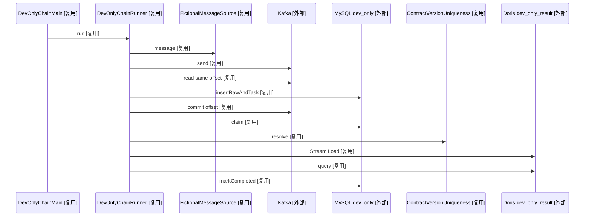
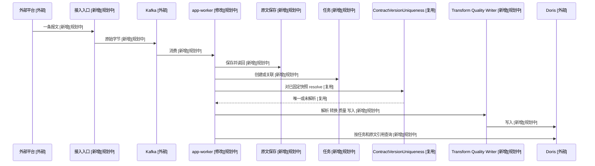
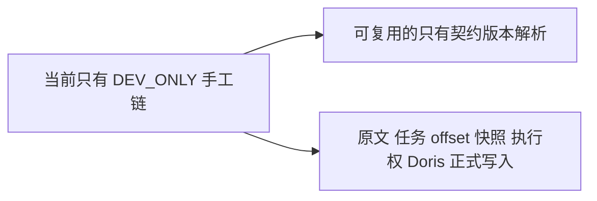
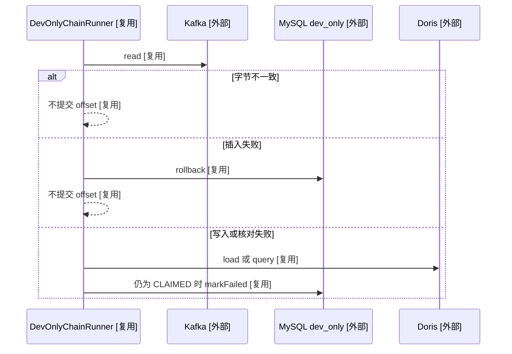
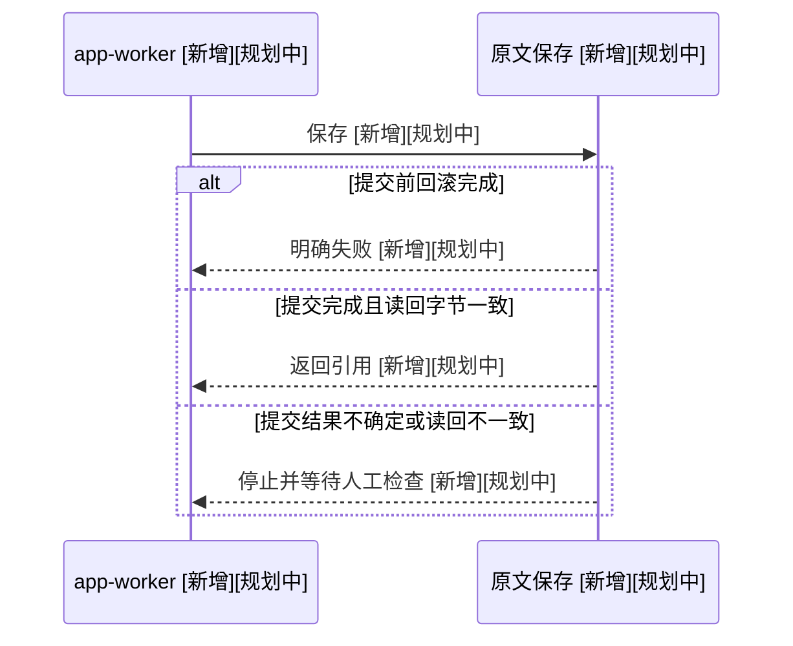

# Stage C 第一轮架构骨架落地路线与端到端链路规划

- 状态：工程盘点与实施规划。不是代码实施，不关闭任何 IR，不修改已接受 ADR
- 基线：`bb5004c30231`
- 范围：只读当前仓库源码、POM 和测试。不连接数据库，不连接开发服务器，不改 Java

本文不重复 Stage A、Stage B 和 IR 调查。已有边界仍以 [Stage C 正式落地前实现边界与最小切片规划](Stage-C-正式落地前实现边界与最小切片规划.md) 为准。该文第 11 节仍写现在不开始 Stage C 正式代码，并且不授权下一轮写 Java。本文件不改那一节。下面的路线是建议。标成「建议」的项都还不是用户已经批准的决定。

## 1. 当前代码实现状态

十个模块都在根 POM 的 `<modules>` 里。没有 `platform-persistence` 或 `platform-scheduler`。`platform-quality` 只有 POM，没有 Java 源文件。

| 模块 | 目标职责 | 当前实现 | 实现程度 | 缺失内容 | 下一步 |
| --- | --- | --- | --- | --- | --- |
| `platform-common` | 无框架的公共类型 | `ApplicationRole`、`StartupChecklist`、`StartupReport`、`PlatformConfigurationException`、`RuntimeModeConfirmationParser` | 部分实现 | 没有报文、任务或金额类型 | 保持无 Spring。不把业务流程放进来 |
| `platform-core` | 纯业务规则 | `ContractVersionUniqueness` 及契约标识类型。不选择快照，不访问存储 | 部分实现 | 没有金额观察、任务身份、执行权 | 复用已有解析。不在这里加 JDBC |
| `platform-messaging` | Kafka 接入与消费 | `devonly` 包：`DevOnlyRawMessageSender`、`DevOnlyRawMessageReceiver`。POM 有 `kafka-clients` | DEV_ONLY 实现 | 没有消费组、正式 offset 规则 | 不把测试主题改成正式主题 |
| `platform-connector` | 外部平台协议 | `simulation` 包：`FictionalMessageSource`、`InMemoryRawMessageStore` | DEV_ONLY 实现 | 没有 POS、京东、美团、淘宝闪购解析器 | 内存库没有进入 DEV_ONLY 主链，先保持孤立 |
| `platform-transform` | 标准化 | `DevOnlyFieldPassthrough`，原样返回字符串 | DEV_ONLY 实现 | 没有金额标准化或版本化规则 | 不把透传写成 ADR-0003 |
| `platform-quality` | 质量规则 | 无 Java | 尚未实现 | 规则、结果类型、调用方都没有 | P2 再加。现在不建空规则框架 |
| `platform-writer` | 目标存储写入 | `devonly` 的 `DorisStreamLoadWriter`。POM 说明仍写未包含 Doris 客户端 | DEV_ONLY 实现 | 没有正式 ODS 表、没有 MySQL 原文适配器 | 正式写入仍被未决事项挡住 |
| `platform-pipeline` | 组织处理流程 | `DevOnlySingleExecution`。只依赖 common 与 core，用调用方传入的函数做透传和写入 | DEV_ONLY 实现 | 没有正式单次编排类型 | 下一轮建议先把这条缝抽成不落库的正式编排 |
| `app-admin` | 管理入口 | `AdminApplication` 只启动 Spring。`AdminProcessStartup` 做启动核对。`AdminDemoDiagnosticCatalog` 是诊断目录 | 仅接口/骨架 | 没有配置或任务管理 API | 不参与报文链路 |
| `app-worker` | 执行装配 | `WorkerApplication.main` 只调用 `SpringApplication.run`。插件 `mainClass` 也是它。DEV_ONLY 链路在 `DevOnlyChainMain` | 部分实现 | 默认启动不消费、不写库 | 正式装配不要挂进默认启动 |

边界核对：

- 没有发现循环依赖。`platform-pipeline` 不依赖 connector、transform、quality、writer。`DevOnlyChainRunner` 在 `app-worker` 里同时调用这些模块，这是装配，不是 Pipeline 越权。
- `platform-core` 的源码只引用 `com.mtx.rdp.core` 和 JDK。没有 Spring、JDBC、Kafka。
- `app-admin` 的 POM 依赖 `platform-messaging`，但 admin 的 Java 没有引用 messaging 的类。依赖宽于当前调用，还没有形成调用。
- `app-worker` 的 POM 有 `mysql-connector-j`。JDBC 使用在 `DevOnlyMysqlStore`，不在 `WorkerApplication`。
- `InMemoryRawMessageStore` 没有被 `DevOnlyChainRunner` 引用。它是尚未接入主链的孤立代码。
- 原文保存有两套 DEV_ONLY 位置：内存库，以及 `dev_only_raw_message`。只有后者在主链上。不要把任何一套改名为正式原文表。
- `platform-writer` 的 POM 描述与 `DorisStreamLoadWriter` 不一致。描述落后于 DEV_ONLY 代码。正式 Writer 仍然没有。

## 2. 模块职责矩阵

允许依赖以各模块 POM 和 ADR-0002 为准。

| 模块 | 核心职责 | 不承担 | 当前对外类型 | 允许依赖 | 禁止依赖 | 输入 / 输出 | 失败边界 | 当前状态 |
| --- | --- | --- | --- | --- | --- | --- | --- | --- |
| `platform-common` | 角色、启动核对、配置异常 | 业务流程、基础设施 | 上表的公共类型 | 无内部模块 | Spring 和其他内部模块 | 启动参数进，核对结果出 | 配置不合法时抛 `PlatformConfigurationException` | 部分实现 |
| `platform-core` | 已固定快照内的契约版本解析 | 选快照、解析报文、写库 | `ContractVersionUniqueness.resolve` | `platform-common` | Spring、JDBC、Kafka、MyBatis、Quartz、Doris | 快照条目进，唯一或未解析出 | 零个或多个候选都是 `CONTRACT_VERSION_UNRESOLVED` | 部分实现 |
| `platform-messaging` | DEV_ONLY 的发送和按 offset 读取 | 业务身份、正式消费组 | sender、receiver | common、core | 不把 Kafka API 送进 core 或 pipeline | 字节进，分区和 offset 出 | 读到的字节与发出的不一致时不提交 offset | DEV_ONLY |
| `platform-connector` | 虚构报文和内存原文 | 真实平台协议 | `FictionalMessageSource` | common、core | 调度 API | 无外部调用。固定文本出 | 内存库不可用时返回不可用 | DEV_ONLY，且内存库孤立 |
| `platform-transform` | DEV_ONLY 字段透传 | 金额规则 | `DevOnlyFieldPassthrough.pass` | common、core | 调度 API | 字符串进，同一字符串出 | 无业务失败分类 | DEV_ONLY |
| `platform-quality` | 将来执行质量规则 | 现在没有任何行为 | 无 | common、core | writer、pipeline、调度 API | 无 | 无 | 尚未实现 |
| `platform-writer` | DEV_ONLY 的 Doris Stream Load | 正式库表、任务状态 | `DorisStreamLoadWriter.load` | common、core | Kafka、Quartz | JSON 字节进，HTTP 结果出 | 非成功状态不算写入成功 | DEV_ONLY |
| `platform-pipeline` | 一次 DEV_ONLY 编排 | 装配、选快照、访问数据库 | `DevOnlySingleExecution.execute` | common、core | connector、transform、quality、writer 的实现，以及 Quartz | 已固定夹具和两个函数进，执行结果出 | 未解析或写入失败时不返回完成 | DEV_ONLY |
| `app-admin` | 管理进程启动 | 数据处理、依赖 worker | `AdminApplication` | common、core、messaging | worker、connector、transform、quality、writer、pipeline | 进程参数进，进程起 | 启动核对失败则进程失败 | 仅骨架 |
| `app-worker` | 执行进程启动，以及 DEV_ONLY 装配 | 把规则写进 core | `WorkerApplication`、`DevOnlyChainMain` | 除 admin 外的既定模块 | admin | DEV_ONLY 环境变量进，运行报告出 | 见第 4 节 | 默认启动是骨架。链路是 DEV_ONLY |

Admin 与 Worker 的 POM 互不依赖。

## 3. 模块依赖关系

```text
platform-common
platform-core → common
platform-messaging → common, core, kafka-clients
platform-connector → common, core
platform-transform → common, core
platform-quality → common, core
platform-writer → common, core
platform-pipeline → common, core
app-admin → common, core, messaging, spring-boot-starter
app-worker → common, core, messaging, connector, transform, quality, writer, pipeline, mysql-connector-j, spring-boot-starter
```

`app-worker` 依赖 `platform-quality`，但没有 Java 调用它。这是预先接上的模块边，不是已实现的质量步骤。

## 4. 当前实际调用链

`WorkerApplication.main` 不调用 `DevOnlyChainMain`。当前唯一跑通外部字节到 Doris 的路径是手工入口 `DevOnlyChainMain`。

无参数走 `DevOnlyChainRunner.run`。`rerun-failed <testTaskId>` 走 `rerunFailed`，不再读 Kafka。

| 环节 | 谁负责 | 谁调用谁 | 输入 | 输出 | 事务 | 失败 | 状态 |
| --- | --- | --- | --- | --- | --- | --- | --- |
| 虚构来源 | connector | runner 调用 `FictionalMessageSource` | 无 | 固定字节 | 无 | 缺少 DEV_ONLY 标记则不发送 | DEV_ONLY |
| Kafka | messaging | runner 调用 sender，再按返回的 offset 调用 receiver | 字节 | 同一 offset 的字节 | 与 MySQL、Doris 都不是同一事务 | 字节不一致不提交 offset | DEV_ONLY |
| 原文和 Task | worker 的 `DevOnlyMysqlStore` | `insertRawAndTask` | topic、partition、offset、字节 | 测试用 UUID 引用和任务 | 一个本地事务，失败回滚 | 不提交 offset | DEV_ONLY |
| offset | messaging | MySQL 插入提交之后才 `commit` | offset | 位点加一 | 不在 MySQL 事务里 | 之后失败不撤回位点 | DEV_ONLY |
| 领取 | worker | `claim` 把 `READY` 改为 `CLAIMED` | 测试任务 | 一行更新 | 单条条件更新 | 更新行数不是 1 则不执行 | DEV_ONLY |
| 快照 | worker | `fixture()` 造固定夹具 | 无外部配置库 | `dev-only-snapshot` | 无 | 没有快照则 pipeline 不执行 | DEV_ONLY |
| 契约版本 | core | pipeline 调用 `ContractVersionUniqueness.resolve` | 已固定条目 | 唯一标识或未解析 | 无 | 未解析则不写 | 正式纯逻辑，被 DEV_ONLY 调用 |
| 透传 | transform | worker 把 `DevOnlyFieldPassthrough` 传进 pipeline | 夹具字段 | 同一字符串 | 无 | 无金额规则 | DEV_ONLY |
| 质量 | 无 | 无 | 无 | 无 | 无 | 无 | 尚未实现 |
| Doris | writer | worker 把写入函数传进 pipeline，成功后查 Doris | 一条 JSON | HTTP 成功且装载行至少 1 | 不参与 MySQL 事务 | 核对失败且仍为 `CLAIMED` 时记 `FAILED` | DEV_ONLY |
| 查询核对 | worker | `DevOnlyCompletion` | Doris 行和 MySQL 行 | 完成或失败 | 完成更新与 run 行同一事务 | 不把核对失败当成成功 | DEV_ONLY |

这不是 exactly-once，不是正式恢复，也不是正式幂等。offset 提交和 Stream Load 是两次独立副作用。

### 4.1 变更前时序图

变更前没有正式业务链路。下面只画已经存在的 DEV_ONLY 手工入口。



`rerunFailed` 不经过 Kafka。它只在任务已经是 `FAILED` 时重新领取并再执行后半段。

## 5. 目标 MVP 调用链

目标顺序是：外部报文、接入、Kafka、Worker 消费、原文保存、任务、固定快照、契约版本、解析、金额观察、转换、质量、Writer、Doris、按任务和原文引用查询。

除 `ContractVersionUniqueness.resolve` 以外，这些正式步骤都还不存在。图中全部标成规划中。不要把 DEV_ONLY 的测试表、测试主题和 `CLAIMED` 状态画成已经完成的正式链路。

| 环节 | 建议归属 | 输入 | 输出 | 事务 | 失败时的建议 | 状态 |
| --- | --- | --- | --- | --- | --- | --- |
| 外部平台 | 平台之外 | 一条业务报文 | 原始字节 | 无 | 本仓库不调用生产接口 | [规划中] |
| 接入 | connector 的将来解析入口。Worker 装配 | 原始字节 | 仍是原始字节。解析放在版本确定之后 | 无 | 未授权字节不进入正式保存 | [规划中] |
| Kafka | messaging | 原始字节 | 投递位置 | 与数据库分离 | 没有已批准身份时不提交正式 offset | [规划中]，当前只有 DEV_ONLY |
| Worker 消费 | app-worker | 一条投递 | 交给后续步骤 | 无 | 默认启动仍不消费 | [规划中] |
| 原文保存 | core 端口，writer 的 MySQL 适配，worker 编排 | 原始字节 | `raw_payload_ref` | 只包这一张表的插入 | 提交结果不确定则停止，不自动重试 | [规划中]，且 Java、DDL、服务器都未授权 |
| 任务 | core 身份规则，持久化由 worker 装配 | 已批准的来源身份和原文引用 | 一个非重放任务 | 与原文保存分开，直到另有批准 | 无身份则不建任务，也不提交 offset | [规划中] |
| 固定快照 | 尚未选定模块 | 已存在的配置 | 一份不可变快照 | 未定 | 本报告不选择「校验失败能否跳过快照」 | [规划中] |
| 契约版本 | core，已有 | 已固定快照内的条目 | 唯一版本或未解析 | 无 | 未解析则停止，不解析金额 | 已实现的纯逻辑 |
| 解析与金额 | connector 与 core | 原始字节和已解析版本 | 观察结果，含 unknown 或 conflict | 未定 | 遵守 ADR-0003，不在未确认时计算二十项 | [规划中] |
| Transform | transform | 观察结果 | 标准化记录 | 无 | 没有规则版本时不写成正式标准化 | [规划中] |
| Quality | quality | 标准化记录 | 通过或失败 | 无 | 失败则不写 Doris | [规划中] |
| Writer 与 Doris | writer | 通过质量的记录 | ODS 行。层次建议见第 8 节 | HTTP，不进 MySQL 事务 | 写入结果不确定则不标记任务完成 | [规划中] |
| 查询验证 | worker 或以后的 admin | 任务标识和原文引用 | 能对上的 Doris 行 | 只读 | 对不上则保持未完成 | [规划中] |

### 5.1 变更后时序图



### 5.2 差异

| 步骤 | 当前代码 | 目标 MVP |
| --- | --- | --- |
| 触发 | 手工 `DevOnlyChainMain` | Worker 消费。默认启动现在没有这条调用 |
| 报文 | 虚构文本 | 一条外部业务报文。仓库里还没有可入库的脱敏原文 |
| 原文引用 | 测试 UUID 字符串，和任务一起插入 | UUIDv4 的 `BINARY(16)` 主键。正文类型和最大字节数未定 |
| 任务 | `task` 加本次运行 UUID | 按来源身份创建或取回。身份规则未批准 |
| 快照 | 代码里的固定夹具 | 第一次选择规则未定 |
| 契约版本 | 已有纯函数 | 复用。不新增选择快照的逻辑 |
| 金额与质量 | 无 | 尚未实现 |
| Doris | `dev_only_result` | 正式层未建。建议先只落 ODS |
| 完成语义 | 核对通过才 `COMPLETED` | 不能把这套测试状态当成正式执行权 |



## 6. 失败路径

### 6.1 当前 DEV_ONLY 失败



`rerunFailed` 拒绝空任务、非 DEV_ONLY、已完成，以及不是 `FAILED` 的状态。这不是正式接管。

### 6.2 目标链路里已经接受的失败边界

C1 只接受单调用方、严格串行，以及提交结果不确定时停止。它不包含自动重试、自动恢复、并发去重或正式幂等。下面是规划，不是已有代码。



缺行不能当成已经回滚。相同字节再次保存仍是一次新的引用。这些句子来自已经接受的 C1，不是本轮新决定。

## 7. 节点清单

| 节点 | 模块 | 职责 | 标记 |
| --- | --- | --- | --- |
| `DevOnlyChainMain`、`DevOnlyChainRunner` | app-worker | 手工测试入口和装配 | [复用] |
| `FictionalMessageSource` | platform-connector | 虚构字节 | [复用] |
| Kafka、MySQL、Doris | 仓库之外 | DEV_ONLY 使用的基础设施 | [外部] |
| `ContractVersionUniqueness` | platform-core | 已固定快照内解析唯一版本 | [复用] |
| 正式接入、消费、原文、任务、转换、质量、写入 | 上表建议的现有模块 | 目标 MVP | [新增][规划中] |
| `WorkerApplication` | app-worker | 若以后接入正式消费，默认启动行为会变化 | [修改][规划中]。本轮不改 |

对既有链路的影响：本轮没有改代码。DEV_ONLY 链路保持原样。

## 8. 必须阻断、建议先做、以后再做

### 8.1 A. 必须阻断

| 问题 | 为什么阻断 | 是否需要用户决定 | 是否需要单独授权 |
| --- | --- | --- | --- |
| 原文正文类型、最大字节数、正式库名和表名 | 列类型和上限一旦写入，改变成本高 | 是 | Java、DDL、服务器仍是三份未批授权 |
| 正式原文保存的代码和 DDL | 设计决定不是实施授权。C1 不能扩展成并发、自动重试或保留策略 | 是 | 是 |
| 任务身份、物理唯一约束、offset 提交 | 没有身份就提交位点，会丢掉还不能关联的报文 | 是 | 是 |
| 第一次快照选择 | ADR-0004 不选择快照。跳过规则仍未决 | 是 | 是 |
| Worker 领取、接管、fencing | 没有验证过的执行权不能写成正式执行 | 是 | 是 |
| 把 Doris 测试行写成正式结果 | 正式写入记录仍未决 | 是 | 是 |
| 生产库、未授权 DDL、开发服务器操作 | 本轮任务禁止 | 是 | 是 |
| 关闭 IR 或改写已接受 ADR | 本轮任务禁止 | 是 | 不适用 |

[06-04-01](../investigation/round-01/06-04-01%20MTX%20Data%20Platform%20V2%20工程实施就绪度评估报告.md) 第 9 节仍禁止正式持久化 Java、Worker 领取和端到端集成。本文件不改那一节。

### 8.2 B. 建议，仍不是批准

| 问题 | 建议 | 理由 | 是否影响 MVP | 是否要用户决定 | 是否要单独授权 | 替换成本 |
| --- | --- | --- | --- | --- | --- | --- |
| 下一轮先写哪段代码 | 先写不落库的单次编排。见第 10 节 | 唯一已经存在的正式规则是契约版本解析。Pipeline 已经用函数缝避开了对 transform 和 writer 的依赖 | 只影响调用骨架，不产生正式数据 | 要。它和旧 Stage C 第 11 节、06-04-01 第 9 节的字面范围并列，本文件不选边代替那两份原文 | 要一句只允许内存编排、禁止数据库和 offset 的确认 | 删掉新类即可 |
| 原文适配器将来放哪 | core 放端口，writer 放 MySQL 实现，worker 做串行编排和读回比较 | 与已经写过的模块建议一致。不新增模块 | 影响正式原文，不影响内存骨架 | 要 | 要。现在不能写 | 换一个现有模块里的实现类 |
| MVP 第一张 Doris 表落哪一层 | 只写 ODS | DWD、DWS、ADS 需要已经稳定的标准化。现在没有 | 影响第一条可查询结果的位置 | 要 | 要，且在写入记录决定之后 | 多一层表，不改 ODS 原文 |
| 第一条报文用什么 | 仓库内的虚构夹具。不复制未脱敏业务报文 | 真实样本还不齐，也不能进 Git | 不阻止骨架。阻止「真实平台已接入」的声明 | 要 | 使用夹具不需要生产授权 | 以后换 connector 实现 |
| 调度 | MVP 最短链路不用 Quartz，也不引入 DolphinScheduler | 现在没有消费组，调度器解决不了身份和原文 | 不阻止 P0 到 P2 的单次调用 | 否，直到要定时运行 | 引入 Quartz 依赖时要单独决定 | 适配层外替换 |
| 质量失败的表达 | 用密封结果，不新造错误码表 | core 的契约结果已经是这种形状 | 影响调用方分支 | 否，直到要对外 API | 否，只要不建表 | 以后加码表时保留原结果 |
| 同表只有引用和正文两列 | 继续当作未批准建议 | 字段只有两项，还没有被接受成表结构 | 挡住 DDL，不挡住内存编排 | 是 | 是 | 加列必须另批 |

### 8.3 C. 后续迭代

不影响最短链路验证，因此不作为 P0 的前置条件：DolphinScheduler、Flink、Spark、HDFS、Hive、四个平台的正式解析器、DWD 到 ADS、并发、正式恢复、正式幂等、审计、数据保留和 Admin 管理 API。

## 9. MVP 最短实施路线

| 优先级 | 目标 | 修改模块 | 核心类 | 调用关系 | 验收 | 测试 | 前置阻断 | 授权 | 性质 |
| --- | --- | --- | --- | --- | --- | --- | --- | --- | --- |
| P0 | 模块之间有一条不落库的正式调用 | core、pipeline、worker 测试 | 建议新增单次编排类型。不改 `ContractVersionUniqueness` 的行为 | worker 测试把转换、质量、写入的内存函数传给 pipeline。pipeline 只调用 core | 未解析时不调用写入。解析成功时顺序固定 | 单元测试。不启动 Spring，不连 Kafka | 无数据库事项。仍要第 8.2 节的确认 | 要 | 全新。复用解析函数 |
| P1 | 一条夹具报文可追踪 | messaging、connector、worker | 不改 DEV_ONLY 类名 | 仍走 `DevOnlyChainMain`，或另写不提交正式 offset 的测试 | 能用测试引用找到测试行 | 现有 DEV_ONLY 测试。未在本轮运行 | 不把测试表当成正式表 | 运行开发链路时要服务器授权 | 已有 DEV_ONLY。不升格 |
| P2 | 标准化、质量和 Doris | transform、quality、writer | 正式规则类。名称等规则冻结 | pipeline 只通过函数或 core 端口调用 | 质量失败不写 Doris | 先用内存。真实 Doris 另测 | A 类的写入记录和列类型 | 要 | 全新。透传可作对照，不改成正式规则 |
| P3 | 端到端验证 | worker | 不把 `WorkerApplication` 作为唯一入口，除非任务写明 | 夹具到 Doris 查询 | 任务标识和原文引用能对上结果 | 集成测试。没有外部服务时不算通过 | P0 到 P2，以及相应授权 | 要 | 全新验证。DEV_ONLY 只作回归 |
| P4 | 并发、恢复、幂等、审计、调度、保留 | 仍用十个模块 | 执行权和保留策略 | 不与 P0 混在一次提交 | 有对应测试证据才允许宣称 | 并发测试 | IR 中对应项仍待决定 | 要 | 全新 |

已有实现的复用只包括 `ContractVersionUniqueness` 和启动核对。DEV_ONLY 类保持测试边界，不改名为正式类。

## 10. 下一轮可以直接执行的代码任务

在用户确认「只允许内存编排，不访问数据库，不提交 offset，不领取任务」之后，下一轮只做 P0：

1. 在 `platform-pipeline` 增加一个单次编排。输入是已经固定的快照条目、外部版本，以及转换、质量、写入三个函数。
2. 编排内部调用现有的 `ContractVersionUniqueness.resolve`。未解析时返回未解析，并且不调用后面的函数。
3. 解析成功后按转换、质量、写入的顺序各调用一次。质量失败时不调用写入。
4. 在 `app-worker` 的测试里用内存函数装配。不从 `WorkerApplication.main` 进入，不调用 `DevOnlyChainMain`。
5. `platform-pipeline` 的 POM 仍然只依赖 common 和 core。

不做的事：新表、MySQL、Kafka、Doris、正式任务、快照选择、金额计算、把 DEV_ONLY 类搬出 `devonly` 包。

验收条件：单元测试覆盖未解析、质量失败和一次成功。成功路径断言三个函数的调用次数都是 1，且顺序不变。

## 11. 本轮没有执行的验证

没有执行 `./mvnw`，没有运行单元测试，也没有运行 DEV_ONLY 链路。原因是本轮任务只允许盘点和规划，不允许连接服务器或改代码。文档链接已核对到本仓库存在的文件。没有 push。

## 12. 结论

下一轮应从 `platform-pipeline` 的单次内存编排写起，由 `app-worker` 的测试装配调用，并复用 `platform-core` 里已经存在的 `ContractVersionUniqueness`。

这是当前最短且风险可控的路径：模块和依赖方向已经在 POM 里，解析函数已经有测试，编排不需要新的一级模块，也不碰到未授权的正文类型、DDL、offset、执行权和 Doris。Kafka 到 Doris 的现成链路继续留在 `DevOnlyChainMain`，直到第 8.1 节的事项被单独授权。没有第 10 节那句确认之前，不要开始写这些类。
