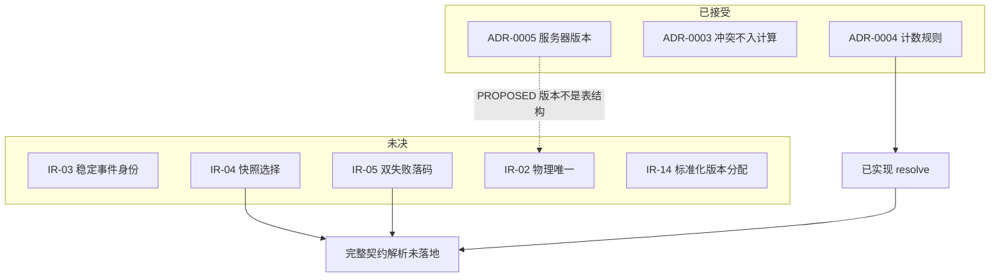
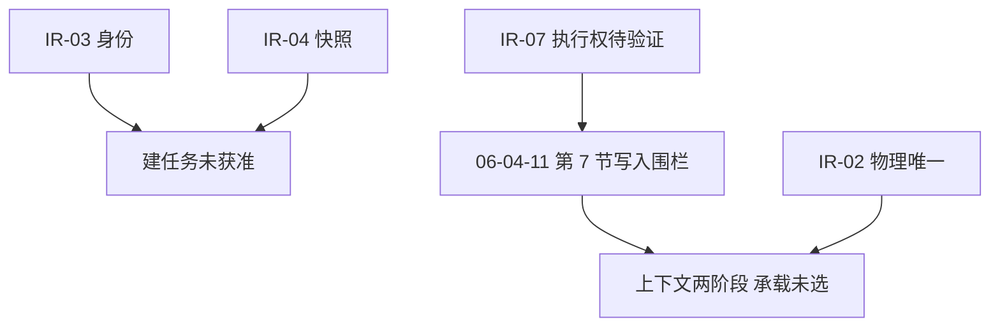
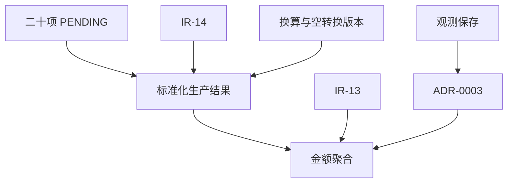
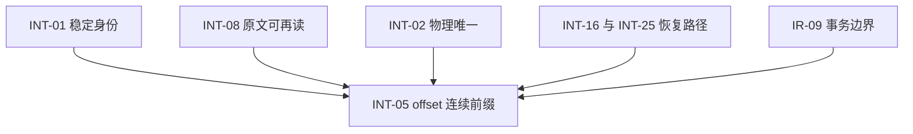

# Stage C 前置决策依赖图与解除阻断顺序

- 基线：`2a533c62fa1a4e5ab988d3bd2e2446a718cf1891`
- 分支：`main`
- 该提交说明：`docs(development): 修正Stage B总结报告台账链接`
- 工作区：调查开始时干净，没有未提交修改
- 状态：依赖设计。不改 ADR、IR、INT，也不批准 Stage C 实现

本文的 Stage C 指持久化、消息消费、执行权和 Pipeline 编排这一层实现。它不是 [06-04-24](../../investigation/round-01/06-04-24%20MTX%20Data%20Platform%20V2%20IR-02%20MySQL%208.0.46%20实验参数决策与物理身份列宽设计.md) 的实验阶段 C。仓库没有接受过名为 Stage C 的 ADR。

编号以台账原文为准。任务说明里的检索别名若与台账不同，下表采用台账，不改编号含义。

| 编号 | 台账中的问题 | 不采用的别名 |
| --- | --- | --- |
| IR-04 | 无子批次时如何选择快照，校验失败后能否跳过 | 不是契约身份校验 |
| IR-07 | 领取、所有权、心跳、租约和过期提交 | 不是泛称的数据约束 |
| IR-09 | 任务、观测、标准化、审计和消息消费之间的事务边界 | 不是一条独立的 Kafka 接入决策 |
| IR-10 | 审计记录的物理存储、保留和跨进程恢复 | 不是 Task 行锁。行锁写在 `06-04-11` |
| IR-13 | 金额计算身份未冻结 | 不是转换规则正文 |
| IR-14 | `normalizationRuleVersion` 的分配和发布 | 空 `conversionRuleVersion` 的用词并不相同 |
| IR-17 | 质量结果和 Writer 记录没有持久化实体 | 不是已经存在的质量规则 |

## 1. 执行摘要

| 问题 | 结论 |
| --- | --- |
| Stage C 能否整体启动 | 否 |
| 能否继续局部设计核对 | 能。只限不改状态、不发明语义、不写实现的调查和设计 |
| 能否新增 Stage C 代码 | 否 |
| 整体启动的最少条件 | 一份写明范围、纳入能力和排除项的单独批准。现有材料没有把任一 IR 写成这个整体门禁 |
| 下一步 | 只准备 IR-03 的决策选项。不发明事件身份，不改台账，不写消费或建任务代码 |

IR-03、IR-02、IR-04、IR-07 各自阻断一条实现路径。现有证据不足以把它们升成整个 Stage C 的全局门禁。金额二十项只阻断金额纯逻辑，不阻断执行内核的设计核对。

## 2. 当前基线

| 层级 | 状态 | 证据 |
| --- | --- | --- |
| 工程骨架 | 十模块 POM 和两个启动类已在。六个处理模块没有 Java | `AGENTS.md` 第 4、5 节 |
| `06-04-24` 阶段 A | 不连接数据库，实验未执行。这不是本文的 Stage A 或 Stage C | `06-04-24` 第 9 节 |
| Stage B | 五个领域的调查已收口。业务设计未冻结。独立业务纯逻辑只有契约版本唯一性计数 | [Stage B 总结](../stage-b/Stage-B整体能力盘点与阶段准入总结.md) 第 8 节 |
| Stage C | 没有已接受范围，没有实现 | 本文件；ADR-0001 至 ADR-0005 均未定义 Stage C |
| 已接受 ADR | ADR-0001 至 ADR-0005 | `docs/decisions/` |
| 已批准纯逻辑 | `ContractVersionUniqueness.resolve`。授权不覆盖身份、哈希、快照选择和持久化 | [实现授权](../契约版本唯一性解析纯逻辑实现授权.md) 第 2、3 节 |
| 关键未关决策 | 见第 11 节。状态均未在本文件中改写 | [06-04-02 台账](../../investigation/round-01/06-04-02%20MTX%20Data%20Platform%20V2%20工程实施未决设计决策台账.md) |

ADR-0005 只接受 MySQL 8.0.46 与 Doris 4.0.7 这两个服务器版本。台账 IR-01 写明不引入驱动、不执行 DDL。版本确定不是物理模型已批准。

## 3. 决策依赖总表

证据等级：`CONFIRMED` 是已接受 ADR 或已批准授权。`EVIDENCED` 是专项或审查已经写明的依赖。`INFERRED` 是本轮由多条已写约束推出的工程关系。`PROPOSED` 是本轮建议，尚未批准。

| ID | 前置 | 后置 | 类型 | 等级 | 证据 | 阻断范围 | 状态 |
| --- | --- | --- | --- | --- | --- | --- | --- |
| D01 | 来源契约中的稳定事件身份 | 非重放任务是否回到原任务 | 身份 | EVIDENCED | 台账 IR-03；Pipeline 第 4.2 节 | 建任务、重复投递。不阻断金额决策 | IR-03：部分确认 / 待决策 |
| D02 | 同上，且不发明通用键 | `taskId`、`replayRequestId` 算法 | 身份 | EVIDENCED | 台账 IR-03；INT-01 | 任务标识和重放标识。INT-01 未关闭 | 未关闭 |
| D03 | IR-03 的“无身份不建任务、不提交 offset” | Kafka offset 提交 | 消息消费 | EVIDENCED | 台账 IR-03 的建议列；INT-06 仍未关闭 | 只阻断 offset。不把“分区会停住”升成新的实现 | 未关闭 |
| D04 | INT-01、INT-02、INT-08、INT-16 与 INT-25，以及 IR-09 | 不超过连续前缀的 offset | 消息消费 | EVIDENCED | INT-05 的前置列 | 安全提交。五级都未满足 | INT-05 未关闭 |
| D05 | R15 的单独 ADR | 任务创建时写入哪份 `snapshotId` | 决策 | EVIDENCED | 台账 IR-04。ADR-0004 仍将 R15 标为待决 | 第一次快照选择。不阻断已经把 `snapshotId` 当入参的纯函数 | IR-04：待决策 |
| D06 | 调用方已经固定的快照和完整条目 | `ContractVersionUniqueness.resolve` | 决策 | CONFIRMED | 实现授权第 4 节；`platform-core` 中的该方法 | 只完成计数。不是完整契约链路 | 函数已实现 |
| D07 | 身份与哈希不同时失败时的已有码选择 | 该双重失败的错误表达 | 决策 | EVIDENCED | 台账 IR-05；Pipeline 第 4.1 节 | 只阻断这一类失败的落码。两种失败都不提取 | IR-05：待决策 |
| D08 | 成员资格、身份、哈希分别通过 | 权威 `contractVersionId` 进入提取 | 决策 | EVIDENCED | Pipeline 第 4.1 节；ADR-0004 分别给出两个已有码 | 提取之前的权威版本。Pipeline 尚未冻结 | 未实现 |
| D09 | 已持久化的两阶段上下文 | 金额提取开始 | 数据模型 | EVIDENCED | Pipeline 第 4.1 节 | 提取、匹配、观测。不是内存对象可以代替的 | 无 Java |
| D10 | A-12 在分支 A 与分支 B 中选定一个 | `TaskExecutionContext` 的可执行物理结构 | 数据模型 | EVIDENCED | `06-04-23` 第 6.2 节；`06-04-24` 第 8.1、10 节 | 只阻断这张承载。两种实验不能合成一个结论 | 待决策，不选 |
| D11 | `06-04-11` 第 7 节的任务行锁、代次、`CURRENT`、`RUNNING`、空阻断 | 上下文两阶段写入 | 执行权 | EVIDENCED | `06-04-23` 第 6.2 节 | 该写入。唯一索引不授予执行权 | IR-07：设计已明确 / 待验证 |
| D12 | 接受执行权候选，并在 MySQL 8.0.46 上验证 | 领取、接管和过期提交的实现 | 执行权 | EVIDENCED | 台账 IR-07；INT-04 | 执行权实现。设计稿存在不等于可编码。不使用 Redis 锁 | ADR 未接受 |
| D13 | IR-02、IR-03、IR-07 的台账依赖列得到满足 | IR-09 所写的事务边界可以关闭 | 事务与并发 | EVIDENCED | 台账 IR-09 的依赖列 | 终态、领域写入和 offset 的组合事务。不单因 Kafka 客户端缺失而关闭 | IR-09：设计已明确 / 待验证 |
| D14 | 逻辑身份落成物理唯一约束 | 把 Create-or-Get 当成并发下只有一行 | 事务与并发 | EVIDENCED | 台账 IR-02；INT-02；`06-04-24` 阶段 A | 观测、字段结果和任务上下文的物理唯一。行锁不能代替 | IR-02：待决策 |
| D15 | `CONFLICT` 保持为观测 | 不生成 `NormalizedAmount`、不进入计算 | 决策 | CONFIRMED | ADR-0003 决策约束 | 冲突金额的计算。不含标准化算法 | 已接受 |
| D16 | 二十项变为 `CONFIRMED` 且设计稿已改 | 金额分类、拒绝路径和 `Money` | 决策 | EVIDENCED | `06-03-03-11` 第 11、13 节 | 金额纯逻辑。不阻断执行内核设计 | 二十项均为 `PENDING` |
| D17 | 已发布计算规则和未冻结的计算身份 | 金额聚合 | 决策 | EVIDENCED | 台账 IR-13；Pipeline 第 8 节 | 计算。标准化身份不是计算身份 | IR-13：待决策 |
| D18 | `normalizationRuleVersion` 的分配机制 | 标准化生产结果 | 决策 | EVIDENCED | 台账 IR-14 | 生产标准化结果。未分配时不编造版本号 | IR-14：待决策 |
| D19 | 空 `conversionRuleVersion` 的非哨兵表示 | `normalizationIdentity` 唯一索引 | 数据模型 | EVIDENCED | `06-04-19` 第 5.1 节；`06-04-24` 第 9 节 | 该索引。不把台账 IR-14 的句子自动当成这个表示 | A-01N 阻塞 |
| D20 | 质量结果先被定义 | 质量表和 Writer 账本 | 数据模型 | EVIDENCED | 台账 IR-17 | 质量持久化和 Doris 表。不阻断任务状态库的讨论 | IR-17：待决策 |
| D21 | 审计存储、保留和恢复被单独决定 | 审计补写与跨进程恢复 | 恢复与重放 | EVIDENCED | 台账 IR-10；INT-03 | 审计实现。定义 B 与规则 C 的架构栏仍空。不决定上下文承载 | IR-10：待决策 |
| D22 | 显式重放任务，而不是原任务重试 | 改用另一份快照 | 恢复与重放 | CONFIRMED | ADR-0004 重试与重放节 | 原任务不得换快照。重放标识算法仍看 D02 | 规则已接受，实现未做 |
| D23 | 一份写明范围和排除项的批准 | 把工作称为 Stage C 整体启动 | 决策 | PROPOSED | Stage B 总结第 8 节只说明当前没有这份批准。本行是本文件的门禁建议 | 整体启动这个名称。不自动阻断第 8 节的并行调查 | 未批准 |
| D24 | Pipeline 第 16 节的冻结条件 | 把 Pipeline 第 4 节当成可编码契约 | 验收 | EVIDENCED | Pipeline 第 16 节写明尚未冻结 | Pipeline 实现。不取消 ADR-0004 已接受的八条规则 | 未冻结 |

D04 不是“IR-09 单独等于可以提交 offset”。INT-05 写明五级当前都不满足。D19 不并入 D18：`06-04-24` 第 9 节写明两处用词不完全相同，当时不选一句覆盖另一句。

没有画出的关系：IR-10 不指向领取；IR-13 不指向建任务；Doris 服务器版本不指向任务状态；`resolve` 不指向快照选择。两个问题同属执行讨论，不构成依赖边。

## 4. 关键路径依赖图

实线只表示上表中的证据依赖。虚线是 `PROPOSED`，不是已接受门禁。

### 4.1 决策依赖

### 4.2 执行内核

### 4.3 金额领域

`ALLOWED_IF_CONTRACT_DEFINES` 出现在 Pipeline 第 2 节和第 5.6 节，也出现在 `06-03-03-03`。Pipeline 第 16 节尚未冻结，`06-03-02-03` 也写明还不是冻结设计。因此它是设计稿中的资格句，不是 ADR 已接受的实现许可。生产映射数量在 `06-03-03-04` 第 1 节仍是 0。

### 4.4 从消费到任务

INT-05 的状态列是事实冲突，不是已批准的提交流程。本图不增加 Inbox、Outbox 或 DLQ。

## 5. Stage C 整体启动门禁

现有 ADR 和台账都没有“Stage C 整体启动”这个判定项。本节能列为整体门禁的只有一项，而且等级是 `PROPOSED`。

| 条件 | 为什么列为整体门禁 | 证据 | 不满足的风险 | 解除判断 |
| --- | --- | --- | --- | --- |
| 单独批准写明 Stage C 的范围、纳入能力和排除项 | 没有范围时，“整体启动”没有可验收边界。Stage B 总结第 8 节已经写明现有 ADR 没有这份批准 | 无 Stage C ADR；Stage B 总结第 8 节。等级 `PROPOSED` | 把局部调查或某个 IR 的设计稿说成 Stage C 已经开始 | 批准文本列出纳入项和排除项，并写明它不关闭未点名的 IR |

下列事项证据不足，不能升成整体门禁：

| 事项 | 实际阻断 | 为什么不是整体门禁 |
| --- | --- | --- |
| IR-03 | 建任务、重放标识、无身份来源的 offset | 不阻断金额二十项、质量规则缺席和 Doris 版本讨论 |
| IR-02、A-12 | 物理唯一和上下文承载 | 不阻断纯函数，也不代替执行权 |
| IR-04、IR-05 | 第一次快照和双失败落码 | 不阻断启动核对，也不阻断 IR-03 的身份核对 |
| IR-07、IR-09 | 领取实现和事务关闭 | 设计稿已写明，验证未做。这不使金额或审计变成同一门禁 |
| 二十项、IR-13、IR-14、IR-17、IR-10 | 金额、质量、审计各自的实现 | 台账把它们留在各自专项 |

## 6. 能力域门禁

| 能力域 | 最小启动条件 | 等级 | 现在不能做的实现 |
| --- | --- | --- | --- |
| 任务身份与创建 | IR-03 对“无身份不建任务”有单独接受记录，且不新增通用键。IR-04 用单独 ADR 关闭 R15 之后，才写第一次 `snapshotId` | EVIDENCED | Task Create-or-Get |
| MySQL 持久化 | 字符集、排序规则、隔离级别和列宽先被确认。`06-04-24` 阶段 A 结束前不连接数据库 | EVIDENCED | DDL、唯一索引、驱动 |
| Worker 执行权 | INT-04：若立 ADR，正文同时写代次大于 0 和 `CURRENT`，并写明 MySQL 尚未验证。立 ADR 不等于实验通过 | EVIDENCED | 领取、接管、租约和 fencing 代码 |
| Pipeline | 第 16 节冻结，且编排只依赖 `platform-common` 与 `platform-core` | EVIDENCED | 流程实现。Quartz API 不进入 Pipeline |
| Kafka 消费 | INT-05 的五级都有书面规则和对应实验或保存证明 | EVIDENCED | 消费者、offset 提交 |
| 金额处理 | 二十项先 `CONFIRMED` 并改完设计稿，才回到纯逻辑。生产标准化还要 IR-14。聚合还要 IR-13 | EVIDENCED | 标准化、换算、计算 |
| Doris 写入 | 服务器版本已接受。库表、客户端和与 MySQL 的一致性都未批准。IR-17 未定义质量结果 | CONFIRMED 只到版本 | 客户端依赖和分析表 |
| Replay 与恢复 | D22 的“显式重放才换快照”已接受。`replayRequestId` 仍看 IR-03。审计恢复看 IR-10，且 INT-03 架构栏仍空 | 规则 CONFIRMED，实现 EVIDENCED 未获准 | 重放任务和审计补写 |
| E2E 验收 | 台账 IR-19 写明 E2E-001 至 E2E-183 只有设计预期，未执行 | EVIDENCED | 不能把骨架测试当成链路验收 |

IR-11 只阻断 `parserVersion` 的登记和重放，不进入上表的整体门禁。IR-12 的现文是不要另造通用阶段实体，它是禁止项，不是一条待实现能力。IR-06、IR-08、IR-21 仍待决策，分别阻断来源不一致的落码、自动重试分类和取消发起者。它们不打开其他能力域。

## 7. 解除阻断顺序

顺序按依赖，不按编号。每一步的交付都是决定或证明，不是代码。

| 步 | 目标 | 前置 | 交付 | 验收 | 可并行 | 不能提前做 |
| --- | --- | --- | --- | --- | --- | --- |
| 1 | 整理 IR-03 已有证据中的选项 | 无。INT-01 的前置列是“无” | 只列出 `06-04-10` 已经核对过的来源和“不能建任务”的现句。不新增身份字段 | 选项能对应到现有句子。空缺仍标未决 | 第 8 节各组 | 消费者、建任务、offset |
| 2 | 单独决定 R15 | 不依赖第 1 步的结论 | IR-04 所要求的单独 ADR 稿。关闭前不选择跳过失效快照 | ADR 被接受，或明确继续待决 | 第 1 步 | 在代码里选择快照 |
| 3 | 决定双失败留哪一个已有码 | 无 | IR-05 的选择。不新增错误码 | 决定只使用已有两码之一，或写明记录方式 | 第 1、2 步 | 提取实现 |
| 4 | 冻结物理参数并只做被授权的实验 | 第 1 步若涉及任务键，则任务键实验还要等身份决定。观测键不依赖事件身份 | `06-04-24` 写明须先确认的字符集、排序规则、隔离级别和列宽 | 阶段 A 的禁止仍然有效，直到另有实验授权 | 金额决策准备 | DDL、哨兵、把两个上下文分支合成一个结论 |
| 5 | 接受或明确拒绝执行权候选 | 台账 IR-07 的依赖列含 IR-03 | 候选 ADR 同时包含代次和 `CURRENT` | INT-04 的验收句。实验仍单独保留 | 审计的 INT-03 填写 | Worker 代码、Redis 锁 |
| 6 | 再判断 IR-09 与 INT-05 | 第 1、4、5 步以及 INT-08、INT-16、INT-25 | 事务边界和 offset 前缀是否具备五级证据 | 缺任何一级则仍不提交 offset | 无 | 消费实现 |

Stage B 总结第 9 节把金额二十项放在第一位。那是纯逻辑再入的顺序。本表第 1 步改放 IR-03，因为 INT-05 和建任务都从它开始。金额决策不因此取消，它留在并行组，也不提前进入 Stage C。

## 8. 并行工作组

| 组 | 输入 | 输出 | 交叉依赖 | 现在允许的深度 |
| --- | --- | --- | --- | --- |
| 执行内核核对 | `06-04-11`、IR-07 | 不新增第二套执行权 | 实现等待第 7 节第 5 步。不依赖金额二十项 | 只读核对。不写领取代码 |
| 物理约束 | `06-04-19`、`06-04-23`、`06-04-24` | 参数仍标为建议或待决策 | A-12 不授予执行权。任务键实验看 IR-03 | 不连接数据库 |
| 消费安全 | INT-05、INT-06、INT-07 | 保持五级依赖，不升格 `06-04-09` 的转述 | 提交等待第 6 步 | 不增加客户端 |
| 金额决策准备 | `06-03-03-11` 第 13 节 | 记录仍为 `PENDING`，直到负责人填写 | 不代替 IR-14。不进入执行权 | 不改设计稿，不写 `Money` |
| 版本用词核对 | 台账 IR-14 与 `06-04-24` 第 9 节 | 只判断两句是不是同一事项 | 不选哨兵，不覆盖另一句 | 不改台账 |
| Doris 与恢复研究 | ADR-0005、IR-17、IR-10 | 服务器版本保持已接受。表和恢复仍未决 | Doris 不承接任务状态，见台账 IR-01 | 不引入客户端，不建表 |
| 文档层级 | IR-18A、IR-18B | 八条规则按现行正文理解。引用时分层 | IR-18A 不授权改 ADR | 不把待验证写成规则冲突已关闭 |

这些组可以同时阅读。它们的输出不能合并成一次实现，也不能互相关闭。

## 9. 当前允许与禁止

允许继续的调查：第 8 节各组，以及 IR-06、IR-08、IR-11、IR-12、IR-21 的边界核对。

允许的设计：在现有专项内补齐已经点名的空栏，例如 INT-03 要求分项填写的架构决议。填写本身要另有授权，本文件不代填。

可以准备的测试方案：只保留 `06-04-23` 已有编号和“阶段 A 不执行”的句子。不把方案写成已经执行。

禁止的代码：Task、Worker、Pipeline、Kafka 消费者、Replay、金额标准化、质量引擎、Doris 写入，以及扩展 `resolve` 的职责。

禁止的数据库变更：DDL、唯一索引、驱动、哨兵值、把上下文两个分支做成一张已选表。

禁止的状态变更：关闭或降级任何 IR、INT；把 `PENDING` 改成 `CONFIRMED`；把定义 B 或规则 C 的空白栏写成已批准；修改 ADR。

## 10. Stage C 准入判据

| 级别 | 可以判定启动的条件 | 明确不够的条件 |
| --- | --- | --- |
| 整体启动 | D23 的范围批准已接受，并且该范围点名的每一条依赖都已离开待决或待验证 | 本文件被合并；Stage B 调查已收口；任一 IR 单独关闭 |
| 任务创建 | D01 与 D05 都已有接受记录，D14 对任务上下文有选定分支和实验记录 | 只有 `resolve`；只有业务单号看起来唯一 |
| 执行权实现 | D12 的 ADR 已接受，且 MySQL 8.0.46 的并发记录覆盖领取、不确定提交和过期接管 | `06-04-11` 已经写得很长；用 Redis 锁代替行锁 |
| offset 提交 | INT-05 的五级都有书面规则和实验或保存证明 | 只引入 Kafka 客户端；只因为分区可能停住就提交 |
| 金额纯逻辑 | `06-03-03-11` 第 11 节的两个前提都成立 | Pipeline 里已经出现 `NO_CONVERT` 或资格枚举 |
| 金额生产结果 | 上一行之外，D17、D18、D19 各自关闭，且不互相替代 | 空转换版本被写成哨兵 |
| Doris | 库表、客户端和一致性有单独接受记录 | ADR-0005 已经接受 4.0.7 |
| E2E | 对应 E2E 行在目标版本上执行并保留记录 | 两个应用的上下文测试已经存在 |

## 11. 风险与未决事项

本轮没有关闭、合并或降级下列事项。

| 事项 | 台账或审查状态 | 仍不能判断的影响 |
| --- | --- | --- |
| IR-02 | 待决策 | 物理索引类型未指定。阶段 A 没有实验记录 |
| IR-03 | 部分确认 / 待决策 | 四类来源仍无稳定身份。不能判断将来哪份契约会声明它 |
| IR-04 | 待决策 | 校验失败后能否跳过，ADR 仍标待决 |
| IR-05 | 待决策 | 双失败留哪一个已有码 |
| IR-07 | 设计已明确 / 待验证 | 列类型、锁范围和并发结果都未在 8.0.46 上验证 |
| IR-09 | 设计已明确 / 待验证 | 依赖列中的 IR-02、IR-03、IR-07 都未满足 |
| IR-10 | 待决策 | INT-03 的架构栏仍空。空白不是批准 |
| IR-11 | 待决策 | 解析器登记和重放 |
| IR-12 | 待决策 | 不能借此新增阶段实体 |
| IR-13 | 待决策 | 计算身份 |
| IR-14 | 待决策 | 与空转换版本是不是同一事项，仍未选择 |
| IR-17 | 待决策 | 质量结果未定义 |
| IR-18A | 待验证 | 八条规则一致，旧说明仍在。不授权改 ADR |
| IR-18B | 已确定 | 只约束引用方式 |
| INT-01 至 INT-27 | 状态列都仍以未关闭开头 | 本文件只使用了其中写明依赖的行，其余行不重新裁判 |
| 二十项 | 全部 `PENDING` | 确认人、日期和批准结论都没有 |

INT-06 与 INT-07 是文档待修订。修订前不选边实现，也不在本轮改原文。

## 12. 下一步唯一建议

下一步只准备 IR-03 的决策选项说明：摘录 `06-04-10` 和第 4.2 节已经写明的来源核对结果，列出“无身份则不建任务、不提交 offset、不发明通用键”这一现句，并标明哪些来源仍然没有身份声明。

不新增身份字段，不改台账，不联系新的确认动作，不与 IR-04、金额二十项或 Worker 实现并案。选项说明经过审阅之前，不把它写成已接受决定。
