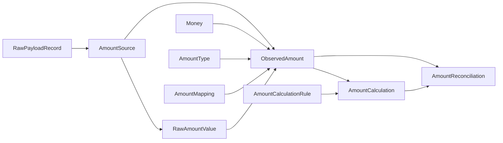
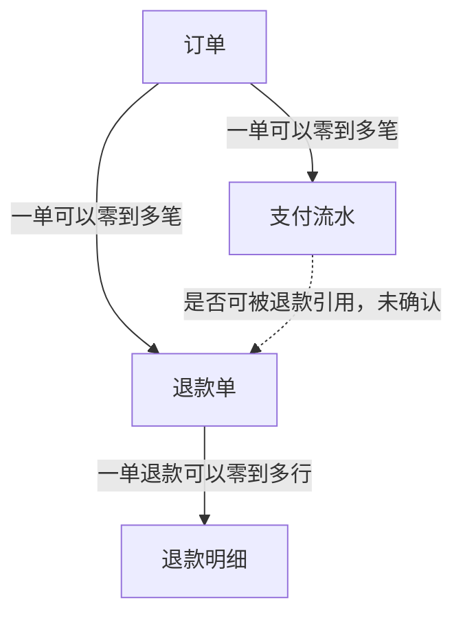
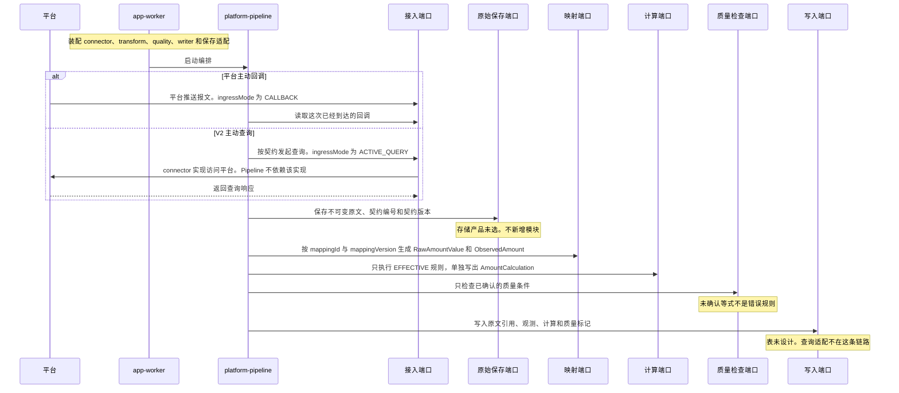
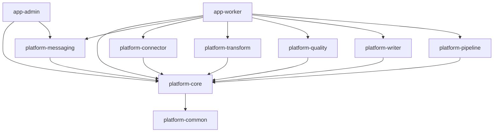

# 06-03-01 MTX Data Platform V2 多平台订单金额领域模型设计

- 文档性质：领域设计建议。未经评审，不是已确认架构，也不是实现说明。
- 存放位置：`docs/investigation/round-01/06-03/`。不写入 `docs/design/`、`docs/database/`，不覆盖已有文档。
- 代码状态：本文不修改 V2 代码，不提供建表 SQL。当前仓库没有金额领域类。
- 调查基线：R-09 收尾修订后的主报告和矩阵，以及 SRC-01、SRC-02、SRC-03。
- 架构基线：ADR-0002 的十模块。`docs/architecture/module-plan.md` 里的 `rdp-*` 规划不作为本设计的模块事实。

trade-flow 是旧系统证据。它的字段名、公式和 Doris 列都不是 V2 已经具备的能力。

## 0. 资料冲突

下列冲突并列保留。本文不选其中一份把另一份改写成事实。

| 冲突 | 一份资料怎么说 | 另一份资料怎么说 | 本设计怎么用 |
| --- | --- | --- | --- |
| 模块名单 | ADR-0002 与根 POM 是十模块，含 `platform-common`、`platform-messaging` | 本任务列举的边界没有这两个模块。`module-plan.md` 还保留已作废的 `rdp-*` 规划，并让 pipeline 依赖具体能力模块 | 模块归属以 ADR-0002 和当前 POM 为准。不新增第 11 个模块。历史规划只作冲突记录 |
| 工程审计与当前骨架 | `docs/10-engineering-audit/03`、`05` 写模块不存在，链路均未实现，并仍出现 `rdp-common`、`rdp-server` | 当前根 POM 已聚合十模块。Java 源码只有 `AdminApplication`、`WorkerApplication` 及对应测试 | 审计文档视为当时扫描结果，不作为“模块不存在”的当前事实。当前事实是：模块目录在，金额领域实现不在 |
| 设计与库表 | `docs/design/README.md`、`docs/database/README.md` 写明尚无已评审设计和已确认库表 | 本任务要求给出金额模型和数据流，并写到 Doris | 本文只给领域对象和层职责。表名、分桶、SQL 保持未设计 |
| 证据等级用词 | R-09 收尾修订把官方页标成 E1-A，仓库摘录标成 E1-B | SRC-01、SRC-03 正文仍写“E1”。SRC-02 的“与 trade-flow”把详情读取收成 Normalizer 117–145 行 | 页面上实际读到的原文以 SRC 为准。等级名称和美团写入链路以 R-09 收尾报告为准。SRC 没有在本轮改写 |
| 美团回调身份 | SRC-02 是“APP方 URL 推送已确认订单”页 | trade-flow 回调事件名是 `managedCancelAndConfirmOrder`，R-09 写明不能证明回调报文就是该页 | 同名字段可以对照。回调是否该接口，保持待平台确认 |
| 京东金额来源 | SRC-03：`orderCreated` 消息体没有金额 | 仓库查询摘录有金额字段，E1-B。R-09 的 SRC-002 仍是待平台确认 | 两条文档都保留。不把查询摘录写成这则消息的字段 |
| 代码名与业务名 | trade-flow 把多个平台字段写入 `userPayAmount` | R-09：该名字不是官方定义。京东摘录是用户应付。美团官方是总价 | V2 标准类型按语义分开。代码字段名只出现在“旧系统映射”列 |

## 1. 金额领域术语

“是否已确认”只表示业务或官方定义是否成立。trade-flow 已经这样映射，只记为旧系统代码行为，不升级为已确认。

| 术语 | 业务含义 | 数据来源 | 是否已确认 | 适用平台 | 与其他金额的关系 |
| --- | --- | --- | --- | --- | --- |
| 原始订单金额 | 报文或接口里的数值，保留原字段名、原单位、原文字 | 平台报文。V2 尚未保存 | 保存动作未实现。字段是否存在见第 4 节 | 四平台各自不同 | 标准化之后仍要能还原它。不能被计算结果覆盖 |
| 订单原价 | 平台所称的原价或销售价总额。具体包含哪些费用，以该字段的官方说明为准 | 美团 `original_price` 有 E1-A。京东 `orderTotalMoney` 只有摘录“销售价总额”，E1-B。淘宝 `originalPrice` 无官方定义 | 美团部分确认。京东待摘录有效性确认。淘宝待平台确认 | 见来源列。富智云摘录用 `orderDisAmt` 描述不含快递和若干优惠的原单金额，不是本术语的已确认同义词 | 美团说明含 1 对 1 急送费。不能把它写成商家应收或结算额 |
| 订单总价 | 平台所称的总价 | 美团 `total`：总价，含 1 对 1 急送费，E1-A。该行未写单位“元” | 美团官方语义部分确认。是否等于用户实付，未确认 | 目前只有美团有这个官方词 | 旧系统把它写入 `userPayAmount` 和支付事实。这是冲突，不是定义 |
| 订单优惠金额 | 订单上记录的优惠，含哪些子项必须按平台说明 | 京东摘录 `orderDiscountMoney`：订单级优惠，不含单品和运费优惠，E1-B。美团 `extras.reduce_fee` 与骑手费用元素混在同一数组，E1-A。富智云有多列优惠名，正负规则不完整 | 都未形成跨平台定义 | 四平台字段不能合并成一个优惠额 | 未确认前不与用户应付、总价做减法等式 |
| 用户应付金额 | 下单时平台要求用户应付的金额。不一定等于最终支付成功额 | 京东摘录 `orderBuyerPayableMoney`：用户应付金额，单位分，E1-B。未写是否含餐盒和运费 | 仅京东有此官方或摘录用词，且摘录版本有效性未证 | 京东。其他平台不要借用这个名字 | 旧系统写入 `userPayAmount` 并生成原收款。不能因此等于用户实付或支付成功合计 |
| 用户实付金额 | 用户最终实际付出的金额 | 四个平台都没有被 R-09 确认的唯一定义。富智云摘录把 `payAmt` 写成实付并给出组成，E1-B，仍不是跨平台定义 | 未确认 | 不能把美团总价、京东应付、淘宝 `totalPrice` 直接叫实付 | 与用户应付、支付成功金额分开 |
| 支付成功金额 | 状态为支付成功的流水金额合计 | 旧系统没有统一校验订单侧金额等于流水合计，PAY-001 | 未确认。单条流水的生成条件只是旧代码行为 | 富智云按 `paySsn` 一行。美团、淘宝、京东在旧系统里多数是一单一行 | 与订单侧支付相关字段的差异只记录，不自动判错 |
| 商家应收金额 | 平台定义的商家应收 | 美团 `wmPoiReceiveCent`：商家应收，单位分，可空，不等于总价，E1-A | 美团官方语义已读到。是否每笔订单都有，未证实 | 美团。淘宝代码字段 `income`、京东另一条收入补齐、富智云“实付减退款和赠送”都不是这个官方定义 | 不是结算额，不是营业额，不能用总价填充 |
| 结算金额 | 按平台结算或财务结算规则确认的金额 | R-09 没有结算公式。生产结算行未抽样 | 未确认 | 四平台都未确认 | 不能用商家应收、用户实付或旧营业额代替 |
| 配送费 | 订单上的配送相关金额。各平台字段名和包含项不同 | 美团 `shipping_fee` 为门店配送费，E1-A。京东摘录 `orderFreightMoney` 为“用户实际支付运费”，E1-B。淘宝 `deliverFee` 无官方定义。富智云 `expressAmt` 为摘录字段 | 含什么费，多数未确认。美团春节服务费 `phf_ssf` 已在配送费内，E1-A，不能再加一次 | 四平台 | 旧营业额对美团、淘宝、富智云减的是配送费字段。这是代码行为。急送费是否也在配送费内，未证明 |
| 包装费 | 餐盒、包装或打包袋。这些不是同一个数 | 京东摘录同时有 `canteenMoney` 与 `packagingMoney`。美团有商品餐盒、`package_bag_fee`、`package_bag_money`，E1-A，口径不同 | 京东旧代码只用餐盒费，待确认。美团 mode 1/2 与商品行求和冲突 | 京东、美团已看到多列。淘宝、富智云 `lunchBoxFee` 未形成统一包装定义 | 打包袋结算字段不是订单打包费 |
| 退款金额 | 某一笔退款单上的金额，不表示已经成功 | 京东售后字段不在 SRC-03。旧代码 `longValue()` 会截断小数，REF-001 待平台确认 | 未确认 | 四平台规则不同，不能合成一条 | 不等于退款成功金额 |
| 退款成功金额 | 状态已确认成功的退款合计 | 旧代码按退款号累加成功额。低版本不覆盖。成功不被随后的非成功撤销。REF-003 只确认到代码行为 | 业务上是否就等于最终应退，待财务确认 | 四平台 | 不自动从经营成交额里扣除。富智云旧收入会减已完成退款，那是另一条代码 |
| 经营成交额 | 业务确认后用于经营分析的成交额 | 没有书面口径 | 未确认 | 未指定平台公式 | 不是 `OrderTurnoverCalculator` 的结果 |
| 净成交额 | 经营成交额再考虑退款或其他扣减后的结果 | R-09 没有这个公式 | 未确认。退款是否改营业额是 REF-004，待业务确认 | 未指定 | 不能把“原额减退款”直接命名为净成交额 |

调查里另外两个标识只作对照，不升格为上表术语：

- `turnover_v1_trade_flow`：旧计算器当前结果。
- 团购核销八个金额、储值赠送：不进入订单金额对象。团购单位未确认。储值赠送不参与旧营业额。

## 2. 金额领域对象

候选名称先看职责。能用一句话说明独立职责的才保留。当前没有这些类，下面是建议放进 `platform-core` 的模型，不是已有代码。

| 候选 | 职责 | 决定 |
| --- | --- | --- |
| Money | 解析后的金额值：数值、币种、单位、标度。不保存报文字面，也不表示业务含义 | 采用。币种和单位分开。没有声明时分别为 `UNKNOWN`，不从“分”推出人民币，也不默认成分 |
| RawAmountValue | 某个字段在报文里的原始文字和未换算取值 | 采用。标准化之后仍靠它还原原文。它不是 Money |
| AmountType | 第 1 节术语在模型里的类型码 | 采用。未确认术语也可以作为类型存在，但实例必须带确认状态 |
| AmountSource | 这条金额来自哪个平台、哪份报文、哪个原始字段、哪一版接口说明 | 采用 |
| AmountUnit | 分、元或未知 | 不单独成对象。作为 Money 的属性 |
| AmountPrecision | 标度、舍入、截断 | 不单独成对象。原始精度记在 Money 上。舍入只出现在计算规则里 |
| AmountMapping | 某平台某原始字段打算映射到哪个 AmountType，以及这条映射是否已确认 | 采用。一条映射不能服务两个语义 |
| AmountCalculationRule | 一条可版本化的计算定义 | 采用 |
| AmountRuleVersion | 规则版本 | 不单独成对象。版本号、生效时间是规则的标识部分。单独建对象只做转发 |
| AmountCalculation | 某次用某版规则算出的结果，含输入引用和空值原因 | 采用。它是一次执行记录，不是规则本身 |
| AmountReconciliation | 两个金额观测之间的差异记录 | 采用。在等式未确认前，它只记录差异，不表示账已经错 |

关系如下。实线是“拥有或引用”。这是建议模型，不是现有类图。

`RawPayloadRecord`、`RawAmountValue` 和 `ObservedAmount` 仍只放在 `platform-core`，不是新 Maven 模块。原文保存、标准金额映射、业务计算是三份记录，不用一个字段同时表示三件事。Money 只回答“数值是多少、什么币、什么单位、几位小数”。

## 3. 核心对象属性

属性是领域设计，不是表结构。空值用“无”表示，不写成 0。

### 3.1 Money

Money 是金额值，不是报文片段。

| 属性 | 含义 | 约束 |
| --- | --- | --- |
| decimalValue | 解析后的十进制数 | 解析失败则这条 Money 不建立。不截断小数来凑整数。原始文字不放在这里 |
| currency | 币种，例如 `CNY` | 与单位分开。当前业务以人民币为主，但字段没写币种时用 `UNKNOWN`。不能因为单位是分就写成人民币 |
| unit | `FEN`、`YUAN`、`UNKNOWN` | 元和分是计量单位，不是币种。官方或摘录没写单位时必须是 `UNKNOWN` |
| scale | 该数值的小数位数 | 未知则为无。不得为了统一提前四舍五入 |
| signed | 是否允许负数 | 未说明的字段不默认只能为正 |

未知单位的 Money 不能参与相加或换算。这是保护建议，不是已确认的业务公式。

### 3.1a RawAmountValue

RawAmountValue 记录字段在原文里的形态。下面几种形态不能互相顶替。

| presence | 含义 | 不能当成 |
| --- | --- | --- |
| `ABSENT` | 该路径在报文中不存在 | `NULL`，也不能当成 0 |
| `PRESENT_NULL` | 路径存在，值是 null | 字段不存在，也不能当成 0 或空字符串 |
| `EMPTY_STRING` | 路径存在，值是空字符串 | 不存在、null 或数字 0 |
| `NUMERIC_ZERO` | 路径存在，值是数字 0 | 字段缺失。0 是一个真实取值 |
| `NUMERIC_TEXT` | 值是字符串，内容像数字，尚未按数值解析 | 已经解析好的 Money。是否允许把字符串当数字，要由该契约的映射单独写明 |
| `OTHER_TEXT` | 其他字符串 | 数字 |
| `NON_SCALAR` | 数组或对象 | 一个金额标量 |

| 属性 | 含义 | 约束 |
| --- | --- | --- |
| presence | 上表七种形态之一 | 必填。不允许用一个空的 rawText 同时表示不存在、null 和空字符串 |
| rawText | 只在有字面量时保留原文 | `ABSENT` 和 `PRESENT_NULL` 没有字面量。`EMPTY_STRING` 的字面量是空字符串。`NUMERIC_ZERO` 保留原始 token，例如 `0` 或 `0.00` |
| fieldPath | 字段在该报文中的路径 | 同名不同路径不能合成一个值 |
| declaredUnitText | 来源材料里的单位原文 | 没有就空着。不在这里换成 `FEN` 或 `YUAN`，也不从单位推出币种 |

RawAmountValue 不承载业务类型。只有 `NUMERIC_ZERO` 或映射明确允许的 `NUMERIC_TEXT` 才可能产生 Money。解析失败时保留 RawAmountValue，Money 为空。空的 Money 不是数字 0。

### 3.2 ObservedAmount

ObservedAmount 把一次原始取值、可选的标准金额、金额类型和来源连在一起。它不覆盖更早的观测。后到的支付或退款报文新增观测，不改写已经保存的观测。

| 属性 | 是否放入 | 属于哪一层 | 理由 |
| --- | --- | --- | --- |
| observationId | 放入 | 领域标识 | 区分每一次取值。生成算法未设计 |
| businessObjectType | 放入 | 领域关联 | 订单、支付流水、退款单、退款明细必须分开。金额类型不能代替业务对象 |
| businessObjectId | 放入 | 领域关联 | 和上一列一起，才能把金额连到具体订单、支付或退款。标识来源未设计 |
| rawValue | 放入 | 领域 | 指向 RawAmountValue。原文不因映射成功而丢掉 |
| money | 放入，可空 | 领域 | 指向 Money。尚未解析或单位未知时为空。空不是 0 |
| proposedType | 放入 | 领域 | 建议语义。语义是否成立看 SemanticStatus，不看证据等级 |
| evidenceStatus | 放入 | 证据 | 这条观测依赖的材料属于哪一等。取值沿用 R-09：`E1-A`、`E1-B`、`E2`、`E3`、`E4`、`E5`、`E6`、`NONE`。有 E1-A 不表示业务已确认 |
| semanticStatus | 放入 | 业务语义 | `部分确认`、`待平台确认`、`待业务确认`、`待财务确认`、`存在冲突`、`无法验证`。它不是证据等级 |
| mappingId | 放入 | 映射引用 | 使用了哪一条映射定义 |
| mappingVersion | 放入 | 映射引用 | 该 mappingId 的哪一版正文。它不是契约版本，也不是规则版本 |
| mappingStatus | 放入 | 映射执行 | `MAPPED`、`UNMAPPED`、`CONFLICT`。只说明这次映射的结果，不说明原文是否已保存，也不说明计算是否已产生 |
| source | 放入 | 领域关联 | AmountSource |
| evidenceRef | 放入 | 追溯 | SRC、R-09 问题编号或仓库摘录路径 |
| tenantId | 不放入本对象的金额语义 | 业务身份，模型未设计 | 连锁平台以后很可能要按租户隔离。租户对象本身尚未定义。观测只保留 businessObject 关联，不单造一个无法解释的租户字段 |
| sourceEventId | 不重复放入 | 来源关联，放在 AmountSource | 需要能回到触发这次取值的事件。它是来源身份，不是金额值 |
| sourceMessageId | 不重复放入 | 来源关联，放在 AmountSource，可空 | 平台消息号和事件号不一定相同。京东 `billId` 不是金额。有则记录，没有不编造 |
| sourceFieldPath | 不重复放入 | 已在 RawAmountValue.fieldPath | 避免同一路径存两份 |
| receivedAt | 放入 AmountSource，不放入 Money | 技术元数据 | 接收时间用于追溯和重试，不改变金额含义。保存产品未设计 |

因此一条支付金额观测关联支付流水，一条退款金额观测关联退款单或退款明细，两者都不覆盖订单上更早的金额观测。订单、支付、退款之间的金额是否相等，仍然由未确认的对账关系表达。

三个生命周期分开记录：

| 记录 | 生命周期问题 | 不回答的问题 |
| --- | --- | --- |
| RawPayloadRecord | 这份原始报文是否已经不可变保存 | 字段有没有标准语义 |
| ObservedAmount | 某个字段是否已经按某一版映射产生观测 | 经营额有没有算出来 |
| AmountCalculation | 某一版生效规则是否已经产出结果 | 原文在不在，映射完没完成 |

不再用一个字段同时表示原文已保存、标准金额已映射和业务结果已生成。

### 3.2a AmountSource

AmountSource 把观测追溯到平台、接口、消息、契约版本和原始报文。它不描述数值。

| 属性 | 理由 |
| --- | --- |
| platform | `JD`、`MEITUAN`、`TAOBAO_FLASH`、`FUIOU` 之一 |
| sourceInterface | 接口或页面名称。创建消息和订单查询不是同一个接口 |
| sourceMessageType | 消息号或消息名。查询可以空。京东 `orderCreated` 与订单查询摘录不能填成同一种消息 |
| sourceContractId | 契约身份。多条映射可以引用同一契约。它不是 mappingId |
| sourceContractVersion | 该契约材料上的版本或更新时间。没有则写“未提供”。它不是 mappingVersion |
| rawPayloadRef | 指向已保存的 RawPayloadRecord。只要求能取回当时原文。存储产品未定，这里不写库表或路径方案 |
| ingressMode | `CALLBACK` 表示平台主动推送。`ACTIVE_QUERY` 表示 V2 主动查询。两种来源不能因为订单号相同就合成一次观测 |
| sourceEventId | 回到 V2 侧触发事件。没有则空，不编造 |
| sourceMessageId | 平台消息号。与事件号不同才填写。京东 `billId` 不是金额 |
| receivedAt | 接收或取回时间。技术元数据，不进入 Money |

### 3.2b 四个编号和三种状态

| 名称 | 标识的东西 | 变化时发生什么 | 不能代替 |
| --- | --- | --- | --- |
| mappingId | 一条映射定义的稳定身份：平台、契约、字段路径、目标类型 | 同一条映射的正文修订不换这个编号 | 契约、规则、某一次观测 |
| mappingVersion | 该 mappingId 的正文版本 | 单位声明、目标类型或确认结论变了，就增加版本。旧观测仍指向旧版本 | sourceContractVersion、规则版本 |
| sourceContractId | 平台接口或消息契约的身份 | 创建消息和订单查询接口各有一个编号 | mappingId。一份契约下可以有多条映射 |
| sourceContractVersion | 契约材料自身的版本 | 平台更新文档或接口时变化。是否因此新建映射版本，要单独决定 | mappingVersion。契约没变，映射仍可能修订 |

| 状态 | 回答的问题 | 允许的取值 | 不能回答的问题 |
| --- | --- | --- | --- |
| EvidenceStatus | 材料从哪来、能证明到哪一层 | `E1-A`、`E1-B`、`E2`、`E3`、`E4`、`E5`、`E6`、`NONE` | 业务是否承认这个语义 |
| SemanticStatus | 业务或平台是否承认这个含义 | `部分确认`、`待平台确认`、`待业务确认`、`待财务确认`、`存在冲突`、`无法验证` | 证据等级。E4 不能升成已确认口径 |
| MappingStatus | 这次或这条映射是否采用 | 定义侧：`DRAFT`、`ACTIVE`、`RETIRED`。执行侧：`MAPPED`、`UNMAPPED`、`CONFLICT` | 原文是否保存，计算是否完成 |

### 3.3 AmountMapping

映射的身份必须包含接口契约，不能只包含字段名。京东 `orderCreated` 没有金额，查询摘录里才有同主题的金额字段。若两份契约共用一条只按字段名匹配的映射，就会把消息页上不存在的字段当成已经出现。美团回调是不是 SRC-02 那一页，也还没证明。同名字段在未证明是同一契约之前，不能共用语义。

| 属性 | 是否放入 | 理由 |
| --- | --- | --- |
| mappingId | 放入 | 映射编号 |
| platform | 放入 | `JD`、`MEITUAN`、`TAOBAO_FLASH`、`FUIOU` |
| sourceContractId | 放入 | 一份契约一个身份。创建消息和订单查询即使平台相同，也是两份契约 |
| sourceInterface | 放入 | 接口或页面名称。SRC-03 是创建新订单消息，不是订单查询 |
| sourceMessageType | 放入，可空 | 消息类契约要写消息号或消息名，例如淘宝 217、京东 `orderCreated`。查询接口可以空，但不能因此和消息契约合并 |
| sourceContractVersion | 放入 | 材料上的版本或更新时间。没有版本时写“未提供”，不假设永远有效。京东消息页有更新时间。淘宝目录页没有 |
| effectiveFrom | 放入，可空 | 这条映射被批准使用的开始时间。未确认映射没有生效时间 |
| effectiveTo | 放入，可空 | 停止使用的时间。过期映射保留，供旧观测解释，不删 |
| rawField | 放入 | 原始字段名，保持平台拼写 |
| fieldPath | 放入 | 该契约内的路径。只有字段名不够 |
| targetType | 放入 | 一个 AmountType。禁止一字段在同一契约版本里映射成两个已确认语义 |
| unitDeclaration | 放入 | 来源声明的单位。没有声明则为未知。单位不是币种 |
| lossPolicy | 放入 | 只允许“保留原始标度”。不允许“先转分再丢掉小数”作为默认 |
| evidenceStatus | 放入 | 这条映射依据的材料等级。官方页是 `E1-A`，仓库摘录是 `E1-B`，只有旧代码是 `E4` |
| semanticStatus | 放入 | 目标语义是否已被平台或业务确认。未确认也可以有映射，但目标类型旁必须保持待确认 |
| mappingStatus | 放入 | `DRAFT`、`ACTIVE`、`RETIRED`。只有 `ACTIVE` 能用于新观测。停用后的版本仍解释旧观测 |
| oldSystemField | 放入，可空 | trade-flow 代码字段。只作对照，不参与匹配 |

### 3.4 AmountCalculationRule

规则除了公式，还要能说明它有没有被批准、从何时到何时有效、定义有没有被改过。下面先判断每个候选属性，再列出采用结果。

| 候选 | 决定 | 理由 |
| --- | --- | --- |
| ruleStatus | 采用 | 把“草稿、已批准、生效中、已停用”分开。只有生效中的规则能产出业务计算结果。参照规则保持草稿或单独的“仅旧代码”，不进入生效 |
| approvedBy | 不作为计算属性 | 批准人是审计信息。当前没有审批制度，不能虚构批准人。若以后要追溯，放在规则之外的审批记录，不参与求值 |
| approvedAt | 不作为计算属性 | 同上。生效时间已经表达何时可用，不能用一个空的批准时间假装已经批准 |
| effectiveFrom | 采用 | 生效起点。未批准或仅旧代码的规则没有这个时间 |
| effectiveTo | 采用 | 停用时间。空表示尚未停用。停用后旧计算结果仍指向原版本 |
| ruleDefinitionHash | 采用 | 规则正文的摘要。同一版本号下正文变化必须能被发现。算法未选定，本文不规定哈希函数 |
| evaluatorVersion | 采用 | 解释规则的程序版本。规则正文没变，求值程序变了，也要能区分。当前没有求值器 |
| calculationPrecision | 采用 | 计算过程保留的小数精度。它不是币种，也不是输入字段自己的 scale |
| roundingMode | 采用 | 未确认时为“不舍入”。不把旧系统元转分的四舍五入写成默认 |
| roundingScale | 采用 | 与舍入方式成对。不舍入时为空 |

采用后的属性：

| 属性 | 含义 |
| --- | --- |
| ruleId | 规则编号 |
| version | 版本号。与 ruleDefinitionHash 一起标识正文 |
| name | 规则名称 |
| ruleStatus | `DRAFT`、`APPROVED`、`EFFECTIVE`、`RETIRED`，或 `LEGACY_CODE_ONLY`。后一个只给 trade-flow 参照规则 |
| platform | 一个平台，或明确写成跨平台。不能用一个公式偷偷覆盖四平台 |
| targetObject | 订单、支付、退款或退款明细 |
| inputs | 输入的 AmountType 列表。输入观测的业务对象必须与 targetObject 相容。支付成功额的输入是支付观测，不是订单观测 |
| strategy | 表达式或“暂不计算” |
| outputType | 输出类型 |
| calculationPrecision | 计算精度。输入单位未知时规则不能生效 |
| roundingMode | 舍入方式。未确认则为不舍入 |
| roundingScale | 舍入位数。不舍入时为空 |
| nullPolicy | 输入的 presence 不是可解析数字时的动作。建议默认输出为空并写原因。`ABSENT`、`PRESENT_NULL`、`EMPTY_STRING` 都不补 0。`NUMERIC_ZERO` 是合法的 0，不能当成缺失 |
| currencyConstraint | 参与同一次计算的 Money 币种必须相同且已知。不允许从单位推断币种。币种转换没有已确认规则，因此 `UNKNOWN` 或币种不一致时不计算 |
| unitConstraint | 单位必须已知。`FEN` 与 `YUAN` 不能直接相加。把元换成分必须写在该规则的策略里。当前没有这样一条已确认规则。trade-flow 的元转分只属于参照规则 |
| precisionConstraint | 输出不得低于 calculationPrecision 所声明的小数位。不允许为了变成整数而截断。京东售后截断仍是未确认问题，REF-001 |
| effectiveFrom | 生效时间。未批准的规则没有生效时间 |
| effectiveTo | 停用时间。可空 |
| ruleDefinitionHash | 正文摘要。算法未定 |
| evaluatorVersion | 求值器版本。实现未定 |
| evidenceStatus | 证据等级。参照规则是 `E4`。没有材料则是 `NONE` |
| semanticStatus | `仅旧代码`、`待业务确认`、`待财务确认` 或以后的已确认。当前经营成交额、净成交额、用户实付、结算额都不是已确认 |

### 3.5 AmountCalculation

AmountCalculation 是计算结果自己的记录。它引用规则编号、规则版本、ruleDefinitionHash、evaluatorVersion、输入观测标识、输出 Money 或空、空值原因、计算时间。重算生成新记录，不改 RawPayloadRecord，也不改已有 ObservedAmount。

计算记录用自己的 `calculationState`：`NOT_RUN`、`PRODUCED`、`SUPERSEDED`。`PRODUCED` 只表示这条规则已经跑出结果。它不表示原文已保存，也不表示映射已完成。参照规则即使被人工拿来对照，也不把经营成交额标成已确认。

### 3.6 AmountReconciliation

| 属性 | 含义 |
| --- | --- |
| left | 左侧观测或计算结果 |
| right | 右侧观测或计算结果 |
| difference | 两者之差。任一侧为空则差异为空 |
| businessMeaning | 例如“订单侧金额与支付成功合计”。等式未确认时，含义栏写“待确认，仅观测” |
| disposition | 未确认的业务等式不得登记成错误规则。可以记成“仅观测”。是否告警、是否阻断，都还没定 |

## 4. 四平台金额字段映射矩阵

确认状态使用 R-09 的证据，不把旧代码映射升为官方定义。

### 4.1 京东

| 原始字段 | 来源说明 | 单位 | 证据 | 建议类型 | 状态 | 旧代码对照 | 不能合并为 |
| --- | --- | --- | --- | --- | --- | --- | --- |
| 无。`orderCreated` 消息体只有 `venderId`、`billId`、`statusId`、`timestamp` | SRC-03，支付后触发 | 无 | E1-A | 不产生金额 | 已读到：这则消息没有金额 | 金额不来自该消息 | 查询接口字段 |
| `orderTotalMoney` | 摘录称销售价总额 | 摘录未在 R-09 把单位单独写成该字段的结论，使用前要再核对摘录原文 | E1-B | 订单原价候选 | 待确认摘录仍有效 | `orderDiscountBaseAmount` | 用户应付、商家应收 |
| `orderBuyerPayableMoney` | 用户应付金额 | 分 | E1-B | 用户应付金额 | 字段用词已摘录。是否等于最终实付，未确认 | `userPayAmount`，并用于原收款 | 用户实付、支付成功合计、结算额 |
| `orderDiscountMoney` | 订单级优惠，不含单品和运费优惠 | 摘录有列，组成未完 | E1-B | 订单优惠金额候选 | 待确认 | `totalDiscountAmount` | 单品优惠、包装优惠 |
| `orderFreightMoney` | 用户实际支付的运费 | 摘录有列 | E1-B | 配送费候选 | 待确认。它不是整单应付 | `userDeliveryFeeAmount` | 用户应付 |
| `canteenMoney` | 商品总餐盒费 | 摘录有列 | E1-B | 包装费候选 | 旧代码选用它。与包装金额二选一未确认 | `packingFeeAmount` | `packagingMoney` |
| `packagingMoney` | 包装金额 | 摘录有列 | E1-B | 另一项包装候选 | 旧代码不使用 | 无 | `canteenMoney` |
| 售后 `refundUserMmoney`、`cashMoney` | SRC-03 没有这些字段 | 旧代码按整数截断 | 无官方页 | 退款金额候选 | 待平台确认，REF-001 | 退款事实 | 订单应付 |

SRC-002 仍待平台确认：创建消息和查询摘录是不是同一契约。映射只能挂在被证明的那份文档上。

### 4.2 美团

官方页是已确认订单推送。回调事件是不是这一页，未证明。下表描述的是该页字段，不是已经验明的回调报文。

| 原始字段 | 来源说明 | 单位 | 证据 | 建议类型 | 状态 | 旧代码对照 | 不能合并为 |
| --- | --- | --- | --- | --- | --- | --- | --- |
| `original_price` | 原价，含 1 对 1 急送费 | 页上为 double，示例 23.1。该行未写“元” | E1-A | 订单原价 | 语义部分确认。单位字样未写死 | 同时写入原价和营业额基数 | 商家应收、经营成交额 |
| `total` | 总价，含 1 对 1 急送费 | double，示例 22.1。该行未写“元”，也未写用户实付 | E1-A | 订单总价 | 与“用户实付”存在冲突，AMT-003 | `userPayAmount` 和支付金额 | 用户实付、商家应收 |
| `shipping_fee` | 门店配送费 | float | E1-A | 配送费 | 部分确认 | `userDeliveryFeeAmount` | 春节服务费的第二次加计 |
| `phf_ssf` | 已含在配送费内 | 页上为金额示例 | E1-A | 不单独再加 | 部分确认，AMT-008 | 旧代码不读 | 配送费之外的加项 |
| `wmPoiReceiveCent` | 商家应收。可空。急送营销由商家承担时已扣 | 分 | E1-A | 商家应收金额 | 语义已读到。不是每单都已证实有值 | 仅详情路径写入收入列 | 总价、营业额、结算额 |
| `package_bag_mode` | 0 商品餐盒，1 订单总价，2 订单口袋。可空。未返回不是 0 | 无金额 | E1-A | 包装口径开关 | 已读到。旧代码不读 | 无 | 金额本身 |
| `package_bag_fee` | 有该字段则直接使用，不用商品行覆盖 | 页上为金额 | E1-A | 订单打包费 | 与旧代码商品行求和冲突，AMT-007 | 旧代码不读 | 商品餐盒合计、打包袋结算 |
| `package_bag_money`、`package_bag_money_yuan` | 打包袋 | 分，以及字符串元 | E1-A | 另一项包装 | 已读到不是 `package_bag_fee` | 旧代码不读 | 订单打包费 |
| `extras.reduce_fee` 及 `poi_charge`、`mt_charge` | 优惠元素。同一数组可有只有 `rider_fee` 的元素 | 页上为金额元素 | E1-A | 订单优惠候选 | 与旧代码“每个元素都要优惠额”冲突，AMT-009 | 优惠事实 | 骑手费用 |
| `consumer_prepays` | 与优惠元素按顺序对应 | 列表 | E1-A | 未命名预付 | 无加减公式。旧代码不读 | 无 | 总价或优惠额的重复扣减 |

详情缺少 `wmPoiReceiveCent` 时，旧代码不改用 `total`。本设计建议 V2 保持同样的保护：应收为空就为空。这是建议，不是生产已经丢数的结论。

### 4.3 淘宝闪购

SRC-01 只有消息目录。下表的金额字段来自旧代码，官方定义为空。

| 原始字段或消息 | 来源说明 | 单位 | 证据 | 建议类型 | 状态 | 旧代码对照 |
| --- | --- | --- | --- | --- | --- | --- |
| 消息 217 | 订单生效，店铺可以看到新订单 | 无 | E1-A，仅名称 | 不产生已确认金额 | 名称部分确认。是否带金额字段，待平台确认，SRC-001 | 旧代码把 217 或详情当快照 |
| `originalPrice` | 本次官方页没有 | 无 | 无 | 订单原价候选 | 待平台确认，AMT-004 | 原价与优惠基数 |
| `totalAmount` | 本次官方页没有 | 无 | 无 | 未命名订单金额 | 待平台确认 | 订单原价列 |
| `totalPrice` | 本次官方页没有 | 无 | 无 | 不能叫用户实付 | 待平台确认 | 优惠后金额和 `userPayAmount` |
| `deliverFee` | 本次官方页没有 | 无 | 无 | 配送费候选 | 待平台确认 | 配送费 |
| `income` | 本次官方页没有 | 无 | 无 | 收入候选，不是已确认的商家应收 | 待平台确认 | 详情查询写入收入列 |

### 4.4 富智云

来源是仓库摘录，E1-B。没有在本轮打开的官方页。

| 原始字段 | 摘录说明 | 单位 | 建议类型 | 状态 | 旧代码对照 | 不能合并为 |
| --- | --- | --- | --- | --- | --- | --- |
| `orderDisAmt` | 不含快递和若干优惠的原单金额 | 分 | 订单原价候选 | 待摘录有效性确认 | 订单金额 | 实付 |
| `payAmt` | 实付，摘录给出组成 | 分 | 用户实付候选 | 摘录有组成，仍未成为跨平台定义。组合支付未拆 | `userPayAmount` | 支付成功合计、结算额 |
| `payAmtExtra` | 旧调查只确认到类型 | 未确认 | 组合支付候选 | 待业务确认，PAY-002 | 不拆成第二行 | 主 `payAmt` |
| `expressAmt` | 快递 | 摘录有列 | 配送费候选 | 待确认 | 配送费 | 实付 |
| `fullOrderDisAmt` | 整单优惠类名称 | 摘录有列 | 订单优惠候选 | 待确认 | 优惠 | 套餐调整 |
| `packagePriceDisAmt` | 只有名称，没有正负说明 | 未确认 | 有符号调整候选 | 待业务确认，AMT-005 | 保留符号的套餐调整 | 经营成交额 |
| `lunchBoxFee` | 餐盒 | 分 | 包装费候选 | 待确认 | 包装 | 配送费 |
| `wipeZeroAmt` | 旧调查记到可以是负数 | 未在本设计重开摘录逐字核对 | 调整项候选 | 待确认 | 不单列进本术语表的已确认项 | 实付 |
| 支付 `payAmt`、`feeAmt` | 支付摘录写 Long，未写分 | 单位未确认 | 支付流水金额、手续费 | 手续费待财务确认，PAY-003 | 成功、已退款、未知都可写事实 | 订单结算额 |
| 团购核销金额 | 无官方单位 | 旧列为十进制，注释写分但代码不换算 | 不进入订单金额 | 待平台确认，GBV-001 | 独立同步 | 订单实付 |

## 5. 金额计算规则模型

规则可以登记，但未确认的规则没有生效时间，不能当正式口径跑出经营指标。

旧系统四套公式只作为“参照规则”，EvidenceStatus 为 `E4`，SemanticStatus 为 `仅旧代码`。禁止把它们改名为经营成交额或结算额。

| 规则编号 | 名称 | 平台 | 对象 | 输入 | 策略 | 输出 | 单位与精度 | 空值 | 舍入 | 版本 | 生效 | 证据 | 状态 |
| --- | --- | --- | --- | --- | --- | --- | --- | --- | --- | --- | --- | --- | --- |
| REF-TF-JD-01 | 旧系统京东营业额参照 | 京东 | 订单 | 代码字段意义上的支付额、订单级优惠 | 两数相加 | 旧营业额参照，不是经营成交额 | 旧系统按分的整数路径 | 非法或溢出则空 | 旧路径不在此重写 | tf-observed | 无 | R-09，E4 | 仅旧代码 |
| REF-TF-MT-TB-01 | 旧系统美团淘宝营业额参照 | 美团、淘宝 | 订单 | 优惠基数、配送费 | 基数减配送费 | 同上 | 同上 | 同上 | 元转分发生在旧映射，不作为 V2 默认舍入 | tf-observed | 无 | R-09，E4 | 仅旧代码 |
| REF-TF-FY-01 | 旧系统富智云营业额参照 | 富智云 | 订单 | 上一式结果、有符号套餐调整 | 再加上套餐调整 | 同上 | 同上 | 快照不齐则为空 | 保留符号，不取绝对值 | tf-observed | 无 | R-09，E4，AMT-005 | 仅旧代码 |
| RULE-BIZ-TURNOVER | 经营成交额 | 未指定 | 订单 | 未指定 | 暂不计算 | 经营成交额 | 未定 | 保持空 | 未定 | 无 | 无 | 无书面口径 | 待业务确认 |
| RULE-BIZ-NET | 净成交额 | 未指定 | 订单 | 未指定 | 暂不计算 | 净成交额 | 未定 | 保持空 | 未定 | 无 | 无 | REF-004 | 待业务确认 |
| RULE-FIN-SETTLE | 结算金额 | 未指定 | 订单或结算单 | 未指定 | 暂不计算 | 结算金额 | 未定 | 保持空 | 未定 | 无 | 无 | 无 | 待财务确认 |
| RULE-PAY-SUM | 支付成功合计 | 按平台 | 支付流水 | 成功流水 | 只有成功状态的定义确认后才能加总 | 支付成功金额 | 未定 | 状态未知的行不计入，也不当成 0 成功 | 未定 | 无 | 无 | PAY-001 | 待业务确认 |
| RULE-REFUND-SUM | 退款成功合计 | 按平台 | 退款单 | 成功退款 | 旧代码按退款号累加。是否采用，待确认 | 退款成功金额 | 京东小数精度未确认 | 未成功不计入 | 禁止用截断代替规则 | 无 | 无 | REF-001、REF-003 | 待财务确认 |

保护性建议，尚未变成规则：

- 输入缺失不补 0。美团应收缺失不用总价填。
- 优惠元素缺少金额时，不把该元素当成 0 加进合计。骑手费用怎么进模型，待报文确认。
- 单位是 `UNKNOWN` 的 Money 不能进入相加或相减。
- 重算使用新规则版本，保留旧计算结果。

## 6. 支付与退款的领域关系

建议的业务对象是订单、支付流水、退款单、退款明细。V2 还没有这些类。关系只表达“可以对应”，不表达金额一定相等。

| 场景 | 已有证据 | 模型里怎么放 | 状态 |
| --- | --- | --- | --- |
| 一单多次支付 | 富智云旧代码一行一个 `paySsn`。美团、淘宝、京东旧代码多数写成一单主键一行 | 模型允许多笔。某平台若被证明只能一笔，用约束实例，不改模型 | 哪些平台真有多笔，待业务确认 |
| 组合支付 | `payAmtExtra` 不拆行，PAY-002 | 组合成分是支付流水下的未确认子项。未确认前不拆，也不当成没有 | 待业务确认 |
| 一单多次退款 | 旧代码按退款号分别保留再累加成功额 | 退款单以平台退款号区分。合计是规则，不是退款单本身 | 累加是否为最终额，待财务确认，REF-003 |
| 退款部分成功 | R-09 没有确认“部分成功”状态 | 不新增该状态。状态集保持未定 | 待平台确认 |
| 退款状态变更 | 旧代码：较低来源版本不覆盖；成功不被后来的非成功撤销 | 可作为候选一致性策略。未批准前不写成业务规则 | 待业务确认 |
| 退款金额累计 | 见多次退款 | 输出放在 AmountCalculation，类型为退款成功金额 | 待财务确认 |
| 订单金额与支付流水差异 | 旧代码不做相等校验。京东订单事实和原收款用的是同一应付字段，仍不能证明等于流水合计 | AmountReconciliation 记录差异，处置为告警候选 | 待业务确认，PAY-001 |
| 退款大于订单侧金额 | 仅京东在原收款齐全时旧代码会拒绝。其他平台无此限制 | 不把这一条推广到四平台 | 待财务确认，REF-002 |
| 退款是否冲减成交额 | 旧营业额不减。富智云旧商家收入会减 | 两条都保留为旧行为。净成交额规则不生效 | 待业务确认，REF-004 |

京东原收款在旧系统里用应付字段生成，类型仍是用户应付的一次使用，不是已经对账的支付成功流水。

### 6.1 状态、观测和结果

支付状态、退款状态不是金额类型。`支付成功金额` 只有在状态集合被确认、并且某条支付观测的状态落入“成功”之后，才允许被合计规则读取。状态未知时，这条观测保留，金额不改成 0，也不算进成功合计。退款成功金额同样只读取已被确认的成功状态。R-09 没有确认“部分成功”状态，这里不补这个状态。

支付金额观测和退款金额观测是追加的。新报文产生新的 ObservedAmount。它不覆盖更早的支付观测、退款观测或订单金额观测。旧系统里“低版本不覆盖、成功不被非成功撤销”只是 trade-flow 的代码行为，还不是 V2 规则。

原文保存、映射、计算仍然是第 3.2 节的三份记录。支付状态变化不会把已保存原文改写成另一种 presence，也不会把 `NUMERIC_ZERO` 改成缺失。

## 7. 金额处理时序

V2 当前没有这条链路。下图是建议的目标顺序，实现前每一框都未验收。

下图里的箭头只指向 `platform-core` 中的端口。`platform-pipeline` 不依赖 Connector、Transform、Quality、Writer。这些实现由 `app-worker` 在启动时装配到端口上。能力模块之间没有调用箭头。原始保存是待设计的端口，图中不把它画成新的 Maven 模块，也不把它画成 Doris。

平台主动回调和 V2 主动查询共用后面的保存、映射、计算、检查、写入。差别只在接入端口的调用方向。Pipeline 仍然只调用 core 端口。访问平台的动作发生在已经装配好的 connector 实现里。

各层职责：

| 层 | 负责 | 不负责 |
| --- | --- | --- |
| 平台原始报文 | 平台给出的内容和版本 | V2 不能改写平台原文 |
| 接入端口 | 接收平台回调，或接受 Pipeline 的查询请求再由 connector 实现访问平台 | 不解释实付或应收。不把回调和主动查询合成一种来源 |
| 原始保存端口 | 保存 RawPayloadRecord：原文、接收时间、平台、接口、消息类型、契约编号和契约版本 | 不解释金额。存储产品未选。不新增模块 |
| 映射端口 | 生成 RawAmountValue 和 ObservedAmount。填写 EvidenceStatus、SemanticStatus、MappingStatus | 不执行经营公式，不调用质量或写入模块，不把缺失补成 0 |
| 计算端口 | 只对 `EFFECTIVE` 规则生成 AmountCalculation。检查币种、单位和精度约束 | 不把参照规则的结果写成经营成交额、净成交额、用户实付或结算额 |
| 质量检查端口 | 单位未知、契约混用、已确认的质量条件 | 未确认的业务等式不能登记成错误规则，也不能因为应付不等于流水合计就判失败 |
| 写入端口 | 原字段、标准类型、规则版本、质量标记一起交给写入实现 | 不在写入时现算另一套口径。表尚未设计。写入实现不反调用 transform 或 quality |
| 查询 | 本链路不包含查询 | Doris 查询适配器的模块归属待后续设计。本文不把它定在 `app-admin` |

错误、重试和升级：

- 解析失败：RawPayloadRecord 仍保留。对应字段的 presence 保持原形态，Money 为空，MappingStatus 为 `UNMAPPED`。不丢报文。
- 映射冲突：SemanticStatus 为 `存在冲突`，MappingStatus 为 `CONFLICT`。美团 `total` 对应用户实付就是这种。不选一个当事实。
- 重试：从已保存原文重新映射。不向平台重放一笔新的业务支付。重试幂等键未设计。
- 重新计算：新的 AmountCalculation 指向新规则版本。旧结果保留。
- 规则版本升级：新版本没有生效时间之前，写入仍只带原始金额和明确标成“未计算”的标准槽位。升级不改历史行，除非另有一次已批准的重算。谁触发重算，调度归属未定，见 `docs/architecture/scheduling.md`。
- 详情后到：若以后采用“空值不覆盖已有非空”的写入策略，那是写入设计，本文件不规定 SQL。美团应收不能用总价补空，这条保护建议仍然有效。

## 8. 模块职责与依赖

ADR-0002 允许的依赖方向：

`app-admin` 还允许依赖 `platform-common`。`app-worker` 同样允许。图中略去这两条，避免线交叉。Admin 与 Worker 互不依赖。Pipeline 不依赖 Connector、Transform、Quality、Writer 的实现。

| 模块 | 金额相关职责 | 不放入的内容 |
| --- | --- | --- |
| platform-common | 无金额语义。若以后只有与业务无关的错误码，才考虑放这里 | Money、平台字段、规则 |
| platform-core | Money、RawAmountValue、RawPayloadRecord、ObservedAmount、AmountType、AmountSource、AmountMapping、规则、计算记录、对账记录，以及接入、原始保存、映射、计算、质量检查、写入的端口 | Spring、Kafka、JDBC、某平台报文解析、具体存储产品 |
| platform-messaging | 投递和消费原文。消息体仍是原始载荷 | 金额计算 |
| platform-connector | 取得报文并填写 AmountSource 的来源事实：平台、接口名、看到的版本 | 判断用户实付等于某字段 |
| platform-transform | 实现映射端口和计算端口。未确认映射产出“待确认”观测 | 写 Doris，不调用质量模块 |
| platform-quality | 实现检查端口，读取 core 里的观测和规则状态 | 修改金额，不调用 transform |
| platform-writer | 实现写入端口。写入内容含规则版本 | 现场决定经营公式 |
| platform-pipeline | 只通过 core 端口编排：接入、保存、映射、计算、检查、写入 | 依赖 connector、transform、quality、writer 的实现。不内嵌公式 |
| app-worker | 把上述实现和尚未定位的保存适配装配到端口上，再启动 Pipeline | 第二套金额规则。不让能力模块互相引用 |
| app-admin | 与金额写入链路无关。查询适配器归属待后续设计 | 执行 Pipeline，依赖 worker，提前绑定 Doris 查询 |

这样没有循环：能力模块只指向 core，worker 在最外层装配。不新增 `platform-domain` 或指标模块。

与历史规划的差别要保持：不能按 `module-plan.md` 让 pipeline 去依赖 transform 的实现。那样会违反 ADR-0002。

## 9. 未确认业务口径

以下各项禁止写成已确认公式或已确认字段语义。

| 编号 | 未确认内容 | 来源 |
| --- | --- | --- |
| AMT-001 | 旧营业额不是经营成交额 | R-09 |
| AMT-002 | 京东餐盒费与包装金额取哪一列 | R-09 |
| AMT-003 | 美团总价是不是用户支付金额 | R-09，与 E1-A 冲突 |
| AMT-004、SRC-001 | 淘宝四个金额字段的定义，217 是否带这些字段 | R-09，SRC-01 |
| AMT-005 | 富智云套餐调整能否为负的业务含义 | R-09 |
| AMT-006、AMT-010 | 美团应收只在详情路径出现。完整回调可能没有应收。生产是否已经为空，未抽样 | R-09 |
| AMT-007 | 打包费按模式还是按商品行 | R-09，SRC-02 |
| AMT-008 | 急送费是否也在配送费内 | R-09 |
| AMT-009 | 骑手费用元素和顾客预付如何入账 | R-09，SRC-02 |
| PAY-001 | 订单侧金额与支付成功合计是否相等。含京东应付 | R-09 |
| PAY-002 | 组合支付是否要拆开 | R-09 |
| PAY-003 | 富智云手续费单位 | R-09 |
| REF-001 | 京东售后能否有小数 | R-09，SRC-03 无售后字段 |
| REF-002 | 退款能否大于订单侧金额 | R-09 |
| REF-003 | 多次成功退款相加是不是最终额 | R-09 |
| REF-004 | 退款是否改变经营成交额，净额是否另算 | R-09 |
| GBV-001 至 GBV-003 | 团购单位、平衡式、跨月旧行 | R-09。团购不进入本订单模型 |
| SRC-002 | 京东创建消息与查询摘录是否同一契约 | R-09，SRC-03 |
| 结算 | `settlement_amount` 无公式 | R-09 |
| 报文与抽样 | 真实报文为无。生产金额行为未抽样 | R-09 |

## 10. 架构决策与待决策

### 10.1 本文件作出的设计建议

这些建议尚未评审，不改变 ADR。

1. 金额语义模型放在 `platform-core`。`platform-common` 不放金额。
2. 原始观测和标准类型同时保留。标准类型可以是“待确认”。
3. 经营成交额、净成交额、结算额、用户实付都有类型，没有生效规则。
4. trade-flow 四套公式登记为参照规则，默认不生效。
5. 对账对象只记录差异。未确认的等式不阻断写入。
6. 不新增 Maven 模块。原始保存是 core 里的端口，适配实现的模块归属待设计。
7. Pipeline 只依赖 core 端口。Worker 负责装配。能力模块互不调用。
8. Doris 查询适配器的归属待后续设计，不定在 `app-admin`。

### 10.2 尚未决策

| 事项 | 为什么不能在本文定 |
| --- | --- |
| Doris 库表、主键、更新时空值是否覆盖 | `docs/database/README.md` 写明未确认。本文不写 SQL |
| 原文存在 MySQL、对象存储还是 Doris | 事务产品版本已是 MySQL 8.0.46，但原文介质仍未选定。不能据此把正文放进 MySQL 或 Doris |
| 幂等键、重算任务由谁触发 | 调度归属未设计 |
| 未确认差异是告警还是以后改成阻断 | 需要业务确认 |
| 美团回调是否等于 SRC-02 那一页 | 没有报文 |
| 京东查询摘录能否作为金额来源 | SRC-002 待平台确认 |
| 淘宝金额字段名是否继续使用旧代码里的名字 | 没有官方字段页 |
| 原始保存适配放在 connector、writer 还是其他现有模块 | 只确定端口在 core。不能为保存新增模块 |
| Doris 查询适配器放在哪个现有模块 | 上一轮若读成“交给 app-admin”，本轮撤销该归属 |
| 租户标识是否进入金额观测 | 租户模型尚未定义。本轮不把 tenantId 放进金额对象 |
| 规则摘要算法和求值器版本如何生成 | 属性已留出。实现未定 |
| 支付成功、退款成功的状态值 | 没有官方状态表。不能把旧代码的状态数字写成 V2 枚举 |

## 11. 文档自检

| 检查 | 结果 |
| --- | --- |
| 证据来源 | R-09 主报告与矩阵、SRC-01、SRC-02、SRC-03、ADR-0002、当前根 POM、`docs/design/README.md`、`docs/database/README.md`、`docs/architecture/scheduling.md`。工程审计 03、04、05 只用于标明与当前骨架的冲突 |
| 未把旧实现写成 V2 能力 | 文中旧公式和旧字段均标为 trade-flow 对照或参照规则 |
| 未把代码字段当成业务定义 | `userPayAmount` 只出现在旧代码对照 |
| 五个易混概念 | 用户应付、用户实付、商家应收、结算额、经营成交额分列。净成交额另列且无公式 |
| 未虚构官方字段 | 淘宝金额字段标明无官方定义。京东消息页标明无金额。美团字段限于 SRC-02 已读内容 |
| 未写 SQL、未改代码 | 本轮只改本文件 |
| 时序与 ADR-0002 | Pipeline 只调用 core 端口。回调与主动查询在接入端口处分流。Worker 装配实现。能力模块之间没有调用 |
| 文件名 | 本文件名为 `06-03-01 MTX Data Platform V2 多平台订单金额领域模型设计.md`。调查目录文件名不再使用外围《》 |
| 引用 | 全仓库检索 `06-03-01` 与“领域模型设计”，除本文件标题外没有相对链接或目录索引 |
| 查询归属 | 已改为待后续设计，没有定在 app-admin |
| 未覆盖已有设计 | 未改 `docs/design/`、`docs/database/`、R-09 和 SRC |
| 未确认清单 | 第 9 节保留原问题编号 |

本轮未执行测试。未提交 Git，未推送。

## 12. 上一轮修订记录

上一轮只修订当时审查指出的设计问题，没有重做四平台矩阵，也没有把建议改成已确认决策。其中“三项就绪状态”已被第 13 节拆成三份记录，不再作为当前模型。

| 问题 | 修订 |
| --- | --- |
| 时序图像能力模块互相调用 | 改为 Worker 装配、Pipeline 按 core 端口编排。原始保存明确为待设计端口，不新增模块 |
| Money 同时装了原文和数值 | Money 只保留数值、币种、单位、标度。原文改由 RawAmountValue 保存。币种与元、分分开 |
| 观测连不上订单、支付、退款 | ObservedAmount 增加业务对象类型和标识、映射版本。事件号和接收时间归来源或技术元数据。当时曾用一个就绪字段，第 13 节已拆开 |
| 同名字段会跨接口串语义 | AmountMapping 增加契约编号、接口、消息类型、契约版本和生效区间 |
| 规则缺少生命周期 | 增加状态、生效止期、定义摘要、求值器版本、计算精度和舍入。批准人不进入计算属性 |
| 状态和金额类型容易混在一起 | 写明成功状态才允许进入成功合计。支付和退款观测不覆盖历史。保存、映射、计算是三种状态 |
| 质量检查可能把未确认等式当错误 | 对账处置改为不能登记成错误规则 |
| 查询被提前放到 app-admin | 改为归属待后续设计 |

未决问题见第 9 节和第 10.2 节。其中第 9 节的 AMT、PAY、REF、GBV、SRC 编号保持原样。

## 13. 第二轮收尾修订记录

本轮仍是设计建议，不新增架构决策，也不把 trade-flow 写成 V2 能力。

| 问题 | 修订 |
| --- | --- |
| 一个字段同时表达保存、映射、计算 | 拆成 RawPayloadRecord、ObservedAmount、AmountCalculation 三份记录 |
| 四个编号容易混用 | 写明 mappingId、mappingVersion、sourceContractId、sourceContractVersion 各标识什么 |
| 证据等级和业务确认写在同一状态里 | 拆成 EvidenceStatus、SemanticStatus、MappingStatus |
| 来源追不回原文 | AmountSource 补齐平台、接口、消息类型、契约版本、原始报文引用和接入方式 |
| 缺失、null、空字符串和 0 分不清 | RawAmountValue.presence 分成七种形态 |
| 计算可能悄悄换单位 | 规则增加币种、单位、精度约束。未确认的换算不执行 |
| 时序图把回调和查询合成一步 | 分成平台主动回调和 V2 主动查询，后面的端口顺序相同 |

未决事项仍以第 9 节和第 10.2 节为准。本轮未执行测试，未提交，未推送。
