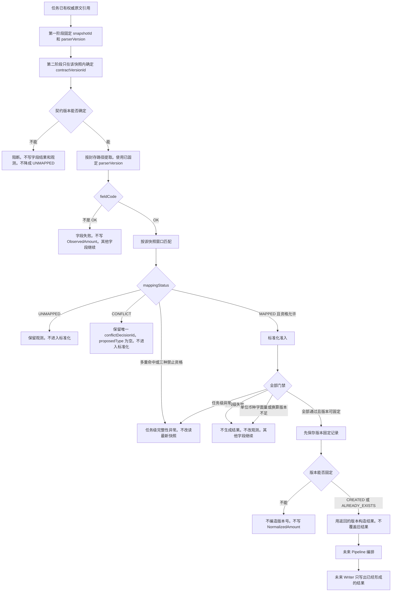

# 06-03-03-04 第二轮代码落地前架构审查报告

本文审查金额标准化能否进入纯 Java 实现。它不修改 [06-03-03-04 金额标准化与约束校验设计](06-03-03-04%20MTX%20Data%20Platform%20V2%20金额标准化与约束校验设计.md)，也不把该初稿写成已冻结规范。

[上一轮审查](06-03-03-04%20代码落地前架构审查报告.md) 已经核对准入矩阵、十进制冲突和模块归属。本轮不覆盖那份报告。本轮补上映射结果、冲突决定和字段结果的身份，写出从提取结果到未来持久化的完整分支，并按下面的 A/B/C/D 重新分级。两份报告的分级口径不同：上一轮把业务确认放在 D；本轮的 D 只表示依赖 Pipeline、Kafka、Writer 或 Doris 的集成。业务未决改记在 B。这是审查口径，不是新的 ADR。

结论标记：

| 标记 | 含义 |
| --- | --- |
| 已确认事实 | 已接受 ADR，或当前仓库可以核对到的代码与文档原文 |
| 设计决定 | 设计稿里已经写出的选择。它还不是 ADR |
| 待确认 | 规则不足，或两份文档不一致。本文不选边 |
| 审查建议 | 本轮对能否写代码的判断。它不是已批准决策 |

## 1. 审查范围和依据

【已确认事实】当前 `main` 与 `origin/main` 都在 `70f68e519f5a7d08c9c8553f8616f06436b922e6`，工作区干净。该提交只新增上一轮审查报告。`platform-core`、`platform-transform`、`platform-pipeline`、`platform-writer` 仍只有 POM，没有金额 Java 类型。四个 POM 的内部依赖仍是 ADR-0002 允许的范围：Core 只依赖 `platform-common`；Transform、Pipeline、Writer 只依赖 `platform-common` 和 `platform-core`。

【已确认事实】标准类型除 `AMT.FEE.DELIVERY` 为 `RETIRED` 外都是 `DRAFT`，没有 `ACTIVE`。06-03-02-02 的映射全部是 `DRAFT`。转换策略只有 `NO_CONVERT`。

范围是标准化代码落地前的设计审查：领域对象、准入、数值解析、单位与精度、三个版本、四类身份、十模块内的候选结构、未来调用流程、实现分级和测试策略。

不在范围：激活类型、发布映射、元分转换、舍入、Pipeline 编排、Writer、DDL、Kafka、Doris。

依据：

| 文件 | 用途 |
| --- | --- |
| [AGENTS.md](../../../../AGENTS.md) | 十模块和“调查文档不是已实现能力” |
| [.cursor/rules/05-code-quality.mdc](../../../../.cursor/rules/05-code-quality.mdc) | 未明确规则先记录，不自行假设 |
| [.cursor/rules/06-git-commit.mdc](../../../../.cursor/rules/06-git-commit.mdc) | 提交说明格式 |
| [ADR-0002](../../../decisions/0002-v2-module-architecture.md) | 模块边界 |
| [ADR-0003](../../../decisions/0003-unmapped-conflict-observation.md) | 未识别与冲突观测保留；冲突不生成标准化结果 |
| [ADR-0004](../../../decisions/0004-external-contract-version-resolution.md) | 快照固定后、提取前解析契约版本。不含标准化算法 |
| [06-03-01](06-03-01%20MTX%20Data%20Platform%20V2%20多平台订单金额领域模型设计.md) 至 [06-03-03-06](06-03-03-06%20MTX%20Data%20Platform%20V2%20金额处理%20Pipeline%20集成与端到端处理设计.md) | 金额领域、类型、映射、提取、观测、匹配、标准化、冲突和 Pipeline |
| [06-04-19](../06-04-19%20MTX%20Data%20Platform%20V2%20物理唯一约束与并发%20Create-or-Get%20专项设计.md) | 字段结果键和冲突决定标识的已有表述 |
| [06-04-02](../06-04-02%20MTX%20Data%20Platform%20V2%20工程实施未决设计决策台账.md) | IR-11、IR-14 |

【已确认事实】ADR-0004 接受时不修改 06-03-02-03、06-03-03-01、06-03-03-03 和 06-03-03-06。本轮也不修改它们。

## 2. 逐项审查结论

### 2.1 领域对象和模块归属

| 对象 | 种类 | 模块 | 不应进入的位置 |
| --- | --- | --- | --- |
| 标准金额类型定义 | 【已确认事实】目录定义。生命周期、资格、语义在 06-03-02-01 | 稳定领域类型放 `platform-core` | 不放进 Transform 当成可随实现改写的配置，也不在本轮改成 `ACTIVE` |
| `RawAmountValue` | 【设计决定】内存过程对象。不单独落库 | `platform-core` | 不放进 Writer |
| `ObservedAmount` | 【已确认事实】ADR-0003 要求保存的不可变领域记录。物理表未设计 | 类型在 `platform-core` | 匹配结果不拆成第二个领域实体。Writer 以后只写出，不拥有定义 |
| 映射结果 | 【设计决定】06-03-03-03 把 `MAPPED`、`UNMAPPED`、`CONFLICT` 写在观测上。06-04-19 写明匹配不单独占一条唯一键 | 随观测放在 `platform-core` | 不新建 `MappingResult` 持久化实体，除非以后的存储 ADR 改变这句。本轮不改变 |
| `MappingConflictDecision` | 【已确认事实】ADR-0003：创建后不可修改。06-04-19：与 ConflictDecision 是同一逻辑记录 | 决定模型在 `platform-core`。它是配置决定，不是某次任务的标准化输出 | 不把决定正文放进 Transform，也不把观测和决定合成一行 |
| `NormalizedAmount` | 【设计决定】初稿中的逻辑结果。物理表未决定 | 类型在 `platform-core` | 成功对象现在不创建。Writer 不推断它 |
| 标准化请求、字段失败、任务级完整性异常 | 【设计决定】过程返回值。不新增状态枚举 | `platform-core` | 不放进 `platform-common`。Common 没有金额语义 |
| 执行上下文 | 【设计决定】06-03-03-06：一次任务固定的 `snapshotId`、`parserVersion`、随后的 `contractVersionId` | 任务上下文不是金额值。将来由执行应用持有；金额类型不内嵌调度 API | 不进入 Core 的基础设施依赖，也不把 Quartz 放进 Pipeline |
| 版本固定记录、物理行、锁 | 持久化模型。【待确认】存储设计未批准 | 不属于本轮任何模块的实现 | 不进入 Core |

【审查建议】纯规则放在 `platform-transform`：给定不可变输入，返回拒绝或将来的结果。Pipeline 只编排端口。Core 不依赖 Spring、JDBC、MyBatis、Kafka、Quartz。

### 2.2 标准化准入

【已确认事实】ADR-0003：`UNMAPPED` 和 `CONFLICT` 都保留观测。`CONFLICT` 的 `proposedType` 为空，不生成 `NormalizedAmount`，也不进入计算。ADR-0004 的版本解析失败不写观测，不降成 `UNMAPPED`。

【设计决定】06-03-03-06 第 5.6 节：只有 `mappingStatus = MAPPED` 进入标准化。资格必须是 `ALLOWED_IF_CONTRACT_DEFINES`。语义必须是 `部分确认`，且没有未排除的第二种解释，含义限于当前契约写明的字段。其余五种语义出现在 `MAPPED` 上，是任务级完整性异常。`extractionFieldCode` 必须为 `OK`。`presence` 只能是 `NUMERIC_ZERO` 或 `NUMERIC_TEXT`。类型按该观测引用的快照目录判断，目录中不是 `ACTIVE` 则不生成新结果。三种禁止资格 `NOT_UNTIL_CONFIRMED`、`DISALLOWED`、`CONFLICT_ONLY` 是任务级异常，不降成字段失败。

【设计决定】证据要分两句，不能合成一句。06-03-02-03 第 13 节的发布门槛是“不是只靠 `E4`、`E5`、`E6`”，该句没有写 `NONE`。06-03-03-04 的运行时表是：证据只是 `E4`、`E5`、`E6` 之一、仅由它们构成的组合，或 `NONE` 时，不能据此标准化；已是 `MAPPED` 则任务失败。含有其他证据等级、同时出现 `E4` 的组合，不因此被这条规则禁止。`E1-A`、`E1-B`、`E2`、`E3` 没有优先顺序。

【待确认】“第二种解释”和“证据组合”没有落在可读取字段上。06-03-01 的 `evidenceStatus` 是单一取值。本文不把组合编成新结构，也不放宽上述门禁。

【审查建议】一个字段的字段级失败不自动阻断其他独立字段。任务级异常不能记成某个字段的普通失败。

### 2.3 数值解析

【设计决定】提取只分类，不建 `Money`。标准化只读观测上已经写下的 `rawText`。`12` 与 `12.0` 标度不同。前后空格是 `OTHER_TEXT`，不 trim。非法字符不修复。`RAW_TEXT_UNRETAINABLE` 不形成正常观测。禁止 `double` 和 `new BigDecimal(double)`。解析失败不改观测。

【待确认】06-03-01 把 `NUMERIC_TEXT` 写成字符串；06-03-03-01 把非零 JSON 数字也标成 `NUMERIC_TEXT`。科学计数法没有被提取稿定义为十进制，但“非零 JSON 数字”会包含带指数的 JSON 数字。带正负号的字符串没有提取例子。技术溢出没有位数界限。本文不确定这些策略。

【审查建议】现在没有可以返回 `Money` 的解析器。无限制的 `new BigDecimal(String)` 会接受指数和正号，不能拿来充当已批准语法。

### 2.4 单位、币种、精度与舍入

【设计决定】已有拒绝：不按字段名推断单位；不默认 `CNY`；团购八字段的 DDL 注释不是单位；不使用 `HALF_UP` 或其他未经批准的舍入；不截断；不补零；不取绝对值；不把负数改成 0；不用存储列宽当业务精度；没有业务最值时不判超限。`NO_CONVERT` 是当前唯一转换策略。没有封存转换规则时，不生成换算结果。

【待确认】`declaredUnitText` 到 `YUAN` 或 `FEN` 的识别表、币种文字所在字段、业务允许精度、目标精度、业务最值、非人民币最小单位、负优惠是否允许、京东摘录中的“分”是否现行。本文不引入元分转换、默认币种、默认精度或舍入方式。

### 2.5 版本

三个版本不合并。

| 版本 | 职责 | 生命周期和固定时点 | 历史重放 | 现状 |
| --- | --- | --- | --- | --- |
| `parserVersion` | 读取报文并形成字面量的解析器。不进入观测身份，也不进入标准化身份 | 【设计决定】任务第一阶段与 `snapshotId` 一起固定。重试复用。不因后来发布的解析器改正在执行的任务 | 【待确认】注册、发布、兼容和重放策略未设计。IR-11 仍待决策。已有观测不重新解析；尚未形成观测时，不能声称换解析器后字面量相同 | 不能实现报文解析器 |
| `normalizationRuleVersion` | 标准化规则版本。`NO_CONVERT` 不是这个号 | 【设计决定】全部门禁通过之后才固定。未分配时不编造。版本固定记录成功之后才允许写结果 | 重试读已固定版本，不改用后发布的规则 | 【待确认】尚未分配。IR-14 仍待决策 |
| `conversionRuleVersion` | 单位转换规则版本。不转换时为空 | 没有封存规则就没有版本。调用方要求转换则该字段失败 | 新版本是新的标准化身份，旧结果保留 | 【待确认】没有封存正文，也没有空版本的物理表示 |

【设计决定】`versionFixKey` 是观测身份、`taskId` 和标准化阶段。它用来固定一次尚未确定的版本。它不是 `normalizationIdentity`。

### 2.6 身份和幂等

本文不修改这些定义，也不发明 ID 算法。

| 身份 | 已有组成 | 注意 |
| --- | --- | --- |
| `ObservedAmount` | 【设计决定】`rawPayloadRef + snapshotId + contractVersionId + fieldPath`。不含 `taskId`、`parserVersion`、业务对象标识 | 逻辑身份。物理唯一索引未实现 |
| `NormalizedAmount` | 【设计决定】观测身份 + `normalizationRuleVersion` + `conversionRuleVersion`。不含 `taskId` | 未分配版本时，同一观测在“不转换、转换版本为空”这一档只有一个逻辑结果。这不是物理幂等 |
| 内存字段结果 | 【设计决定】06-03-03-01：`rawPayloadRef + snapshotId + contractVersionId + fieldPath`。提取是纯函数，不单独落库 | 与下面的持久化键不是同一个键 |
| `ExtractedFieldResult` | 【设计决定】06-03-03-06 与 06-04-19：`taskId + contractVersionId + fieldPath`。不含 `taskAttemptId` | 权威字段结果。内容不同是完整性异常。失败不写观测。`UNMAPPED` 和 `CONFLICT` 是合法业务结果，不是字段失败 |
| `MappingConflictDecision` | 【已确认事实】ADR-0003 与 06-04-19：身份是决定自己的 `conflictDecisionId`。不是 `contractVersionId + fieldPath`，也不是 `taskAttemptId` | 【待确认】生成算法未冻结。正文、证据、窗口和 `bodySha256` 不进入这条唯一键。观测只引用决定，不回写决定 |

【待确认】内存字段结果含 `rawPayloadRef` 和 `snapshotId`，持久化的 `ExtractedFieldResult` 含 `taskId`、不含原文引用。两边都写了“字段结果”，但是键不同。本文不把它们合并，也不选择用哪一个代替另一个。标准化纯函数若只接收已经形成的观测，它使用观测身份，不使用 `taskId` 键。

## 3. 已确认规则和未决规则

已确认、实现时不能放宽：

- 未识别和冲突保留观测，并且不进入标准化。
- 契约版本在已固定快照内解析。解析失败不写观测，不降成 `UNMAPPED`。
- 只有 `MAPPED` 且资格为 `ALLOWED_IF_CONTRACT_DEFINES` 才可能继续标准化。
- 三种禁止资格、非 `部分确认` 的已映射语义、未排除的第二种解释，以及运行时证据表禁止的证据，是任务级完整性异常。
- 观测不可变。失败不写回观测。
- 三个版本分开。解析器版本不进入两条金额身份。
- 不默认币种，不按字段名或 DDL 注释推断单位，不舍入，不截断，不取绝对值。

仍未决，不能在代码里补上：

- `NUMERIC_TEXT` 是否包含 JSON 数字，以及科学计数法和带符号字符串的分类。
- 技术溢出界限、单位识别表、币种字段、业务精度和最值。
- 第二种解释和证据组合的可读取表示。
- 两个规则版本的分配，以及解析器版本的注册和重放。
- `conflictDecisionId` 的生成算法。
- 物理唯一索引、事务、失败是否落库、任务级失败后已写出结果是否撤销。

## 4. 候选 Java 类结构及职责

【审查建议】下表是候选，不是已批准类型，本轮不创建。包名若将来使用，Core 为 `com.mtx.rdp.core.amount`，Transform 为 `com.mtx.rdp.transform.amount`。

| 类名 | 模块 | 职责 | 输入 | 输出 | 调用方 | 被调用方 | 为什么需要 | 现在能否实现 |
| --- | --- | --- | --- | --- | --- | --- | --- | --- |
| `AmountPresence` | Core | 七种已有形态的值 | 无 | 形态 | 观测、拒绝判断 | 无 | 避免用空字面量同时表示缺失、null 和空字符串 | 名称已有。可以只作为拒绝判断的输入，不扩展第八种 |
| `ObservedAmountFacts` | Core | 标准化要读的不可变事实：身份四段、形态、字面量、字段码、执行状态、资格、语义、证据、类型在该快照目录中的生命周期 | 调用方组装的已有事实 | 不可变输入 | Transform 的拒绝判断 | 无 | 纯函数不能依赖数据库行 | 可以只覆盖 A 所需字段。不建完整观测持久化对象 |
| `NormalizationRefusal` | Core | 返回“不生成结果”，并指向已有门禁 | 第 2.2 节已写明的条件 | 字段级或任务级拒绝 | Transform | 无 | 初稿要求 Pipeline 能拿到原因，且不新造错误码 | 只能表达已经写明的拒绝。第二种解释仍不可判定，先不要装成可成功的原因码 |
| `AmountNormalizationGate` | Transform | 执行 A 中的拒绝 | `ObservedAmountFacts`，以及调用方是否要求换算 | `NormalizationRefusal`，或“其余条件不足以产生结果” | 将来的 Core 端口；现在只有单元测试 | 无基础设施 | 把已写明的禁止条件收成可测试纯函数 | 具备拒绝路径。不具备成功路径 |
| `Money` | Core | 数值、币种、单位、标度 | 已确认十进制和已识别币种、单位 | 不可变值 | 将来的解析器 | 无 | 06-03-01 已有形状 | 不具备。语法未决 |
| `DecimalLiteralParser` | Transform | 无修改地解析已确认 token | `rawText` | 未标度整数和标度，或字段失败 | 门禁通过之后的标准化 | JDK。禁止 `double` | 初稿要求十进制中间表示 | 不具备 |
| `SourceUnitRecognition` | Transform | 把契约单位原文识别为 `YUAN` 或 `FEN` | `declaredUnitText` 和已发布识别表 | 来源单位或字段失败 | 解析之后、构造结果之前 | 无 | 不转换时 `Money.unit` 用来源单位 | 不具备。没有识别表 |
| `NormalizedAmount` | Core | 通过全部门禁后的结果 | 观测身份和两个已固定版本 | 不可变结果 | 将来的构造步骤 | 无 | 结果与观测分开 | 不具备。版本未分配，且没有已发布映射 |
| `AmountNormalization` | Core 端口，Transform 实现 | 一次字段的标准化 | 请求 | 拒绝、任务级异常，或将来的结果 | 将来的 Pipeline | 门禁、解析、单位识别 | 06-03-03-04 第 12 节的分工 | 端口现在会诱导实现成功路径，先不建 |
| Pipeline 编排 | Pipeline | 按第 6 节顺序调用端口 | 已固定任务上下文 | 把拒绝交给任务流程 | Worker | Core 端口 | 流程编排 | 不具备。属于 D |
| Writer 端口实现 | Writer | 写出已经形成的结果 | 一条结果 | 存储返回 | Pipeline | 存储 | 持久化 | 不具备。属于 D，且物理模型属于 C |

【审查建议】不建 `AmountCalculation`、转换规则引擎、舍入策略、ID 生成器或持久化适配器。

## 5. 模块依赖关系

【已确认事实】依赖方向保持 ADR-0002：

```text
platform-common
    <- platform-core
        <- platform-transform
        <- platform-pipeline
        <- platform-writer
```

【审查建议】Transform 实现 Core 端口，Pipeline 只看见端口。Worker 以后负责装配，Admin 不执行这条链路。Quality 不把未确认关系改写成标准化错误。不新增模块，不把 JDBC、Kafka 或 Doris 客户端放进 Core。

## 6. 完整调用流程

【设计决定】下面是未来流程，不是已经存在的代码。未知金额和冲突金额在匹配之后停止，不进入数值解析和结果构造。



文字顺序：

1. 原始字段提取结果只来自已固定快照内、已经确定的契约版本。ADR-0004 的解析失败停在提取之前。
2. 字段码不是 `OK` 的路径不进入匹配，也不写观测。
3. 匹配只读该快照。未命中是 `UNMAPPED`。恰好一条冲突决定且没有映射同时命中，是 `CONFLICT`。两种都不进入标准化，也不做金额计算。
4. 多重命中、两种命中同时存在，或唯一映射却是三种禁止资格，是任务级失败。不挑选一条，不降成 `UNMAPPED`。
5. 只有 `MAPPED` 才做准入。语义、证据、快照目录中的类型生命周期、单位、币种和是否要求换算都在这一步。任一失败都不生成结果，也不为了失败补版本号。
6. 数值解析只发生在准入通过之后，并且只读已有 `rawText`。当前语法未决，所以这一步还不能实现。解析失败是字段级失败，观测保持原样。
7. 单位识别失败不补成元、分或人民币。要求换算但没有 `conversionRuleVersion` 时，不生成换算结果。
8. 结果构造使用版本固定记录返回的两个版本。内存里落选的版本不能写入。相同逻辑身份不插入第二条。
9. Pipeline 编排和 Writer 持久化都是以后的集成。它们不能反过来决定类型、单位或舍入。

版本无法确定时有三种停法，不能混用：契约版本无法确定，则整次提取不开始；标准化规则版本无法确定，则不写 `NormalizedAmount`；解析器版本尚未设计，则不实现会重新读取报文的解析器。已有观测的重试返回原观测，不因为解析器后来升级而重算字面量。

## 7. A/B/C/D 实现分级

本轮口径：A 可以独立实现和测试；B 要先补决策；C 依赖尚未完成的持久化、事务或执行权；D 依赖 Pipeline、Kafka、Writer 或 Doris，不进入本阶段。

| 项 | 级 | 依据 | 前置条件 | 验收标准 |
| --- | --- | --- | --- | --- |
| `UNMAPPED`、`CONFLICT` 不生成结果 | A | ADR-0003；06-03-03-06 第 5.6 节 | 输入里已经有执行状态 | 测试断言没有结果对象，观测输入不被修改 |
| 字段码不是 `OK`，或形态不是两种数字形态 | A | 06-03-03-04 第 4、9 节 | 输入含字段码和 presence | 不改成 0，不读取其他字段来补值 |
| 要求换算但没有封存转换版本 | A | 初稿第 6 节。当前没有封存版本 | 调用参数明示是否要求换算 | 恒为拒绝，不乘除 100 |
| 拒绝默认币种、字段名推断单位、DDL 注释、舍入、截断、取绝对值、列宽判超限 | A | 初稿第 6 至 8 节；06-03-02-01 | 这些动作根本不出现在实现里 | 测试或审查能指出代码中没有这些分支 |
| 十进制语法、符号、指数、溢出界限 | B | 第 2.3 节冲突 | 提取稿和标准化稿先合成一条语法 | 语法外的 token 被拒绝；语法内的 token 不改标度 |
| 单位识别表、币种字段、业务精度和最值 | B | 第 2.4 节 | 明确规则或业务确认 | 未列出的文字不得识别成功 |
| 第二种解释和证据组合的表示 | B | 第 2.2 节 | 观测或映射模型给出可读取字段 | 不新增错误码 |
| 两个规则版本的分配和空转换版本的表示 | B | IR-14；06-04-23 A-01N | 分配规则写成设计，且不用哨兵冒充空版本 | 未分配时不生成生产结果 |
| `parserVersion` 体系 | B | IR-11；06-03-03-02 第 4.3 节 | 登记、发布、兼容和重放写明 | 未完成前不实现报文解析器 |
| `conflictDecisionId` 生成 | B | 06-04-19：算法未冻结 | 另有身份设计 | 本阶段不生成决定标识 |
| 物理唯一索引、版本固定事务、执行权围栏、失败落库 | C | 06-04-09、06-04-11、06-04-19 | 存储和并发设计批准 | 未批准前不写 DDL，也不声称物理幂等 |
| Pipeline 编排、Kafka 接入、Writer、Doris | D | ADR-0002 只定模块，未定这些实现 | 前面的 A/B 已有可调用端口，且 C 的写出模型已定 | 本阶段不新增这些依赖，也不在 Pipeline 模块写编排 |

【审查建议】A 的验收只证明拒绝。通过 A 的测试不能写成“标准化已实现”。

## 8. 单元测试与边界测试建议

【审查建议】测试放在 `platform-transform`，不启动 Spring，不连接数据库。只在实现 A 时添加。现在没有这些测试，本轮也不添加。

建议覆盖：

| 用例 | 输入 | 预期 |
| --- | --- | --- |
| 未识别 | `UNMAPPED` | 无结果 |
| 冲突 | `CONFLICT`，`proposedType` 为空 | 无结果。不挑选候选 |
| 非数字形态 | `ABSENT`、`PRESENT_NULL`、`EMPTY_STRING`、`OTHER_TEXT`、`NON_SCALAR` | 无结果，不写成 0 |
| 字段失败码 | `TYPE_MISMATCH`、`PATH_NOT_UNIQUE`、`RAW_TEXT_UNRETAINABLE` | 无观测标准化。不保存截断字面量 |
| 零值 | `NUMERIC_ZERO`，但映射未发布或其余门禁不足 | 零不是缺失，也仍然没有结果 |
| 要求换算 | 任意已识别单位，没有转换版本 | 无换算结果 |
| 独立字段 | 一个字段失败，另一个字段仍是 `UNMAPPED` | 第二个字段按自己的状态拒绝，不继承第一个字段的失败类型 |
| 任务级样本 | 输入明示三种禁止资格已经出现在 `MAPPED` 上 | 返回任务级异常，而不是字段级 `UNMAPPED` |

边界先不要写成成功用例：`12` 与 `12.0`、负数、科学计数法、带符号字符串、单位原文“元”或“分”、默认 `CNY`。这些要么语法未决，要么会把未批准规则编码进测试。

【已确认事实】06-03-03-04 的 T01 至 T36，以及 Pipeline 的 E2E 用例，原文都写明未执行。本轮不把它们勾成通过。

## 9. 不应提前实现的内容

- 不激活标准金额类型，不发布生产映射。
- 不返回 `Money` 或 `NormalizedAmount`。
- 不实现元分转换、舍入、默认精度、默认币种。
- 不决定科学计数法、带符号字符串和溢出界限。
- 不生成 `parserVersion`、`normalizationRuleVersion`、`conversionRuleVersion` 或 `conflictDecisionId`。
- 不把三个版本合成一个字段，也不把两种字段结果键合成一个键。
- 不实现 Pipeline、Kafka 消费、Writer、Doris、DDL、锁和事务。
- 不把 trade-flow 的 `HALF_UP`、取绝对值和负数收成 0 写成 V2 规则。
- 不把本报告的候选类写成已经批准的接口。

## 10. 后续代码落地顺序和验收门禁

【审查建议】顺序如下。前一门禁未过，不开始下一项。

1. 保持设计稿未冻结。若要改 `NUMERIC_TEXT`、证据或身份，先改对应设计文档，不在 Java 里选边。
2. 若业务负责人确认只落地拒绝，再在 Transform 实现第 7 节的 A，并补第 8 节的单元测试。验收：测试通过；生产代码没有 `Money` 的成功构造；没有新依赖；Core 仍不依赖 Spring 和 JDBC。
3. B 的语法、单位、币种、证据字段和版本分配分别关闭后，才允许解析器和成功结果。验收：每条新规则能指回已经修订的设计句子；未列出的 token 和单位不能识别成功。
4. C 的存储、事务和执行权批准后，才允许版本固定记录和物理幂等。验收：逻辑身份与物理键一致；空转换版本不使用哨兵；相同身份不覆盖。
5. D 最后做。验收：Pipeline 只依赖 Core 端口；Writer 只接收已经形成的结果；Kafka 和 Doris 仍由各自模块接入，不进入 Core。

【审查建议】当前停在第 1 步之后、第 2 步之前。第 2 步本身还要一次明确确认。本文没有把这次确认写成已经获得。
