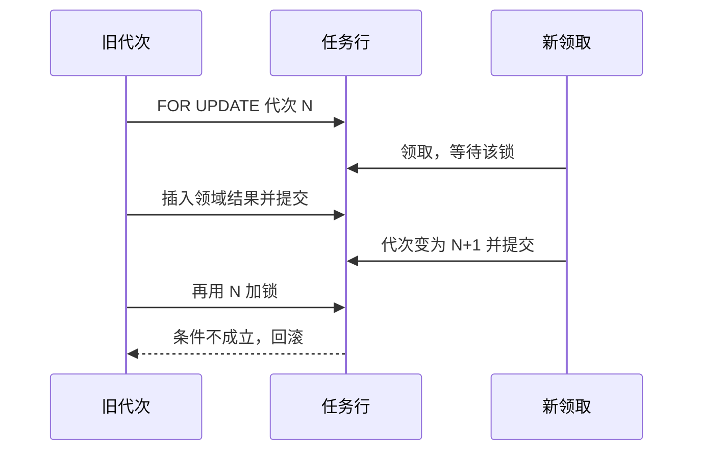

# 06-04-11 MTX Data Platform V2 Worker Task Ownership 与并发执行控制专项设计

本文是 Worker 执行权的第五轮核对。前四轮已经写明尝试生命周期、终态与执行权同一事务释放、阻断任务只做终态收敛、无当前尝试时的取消，以及正常 Pipeline 的写入围栏。第五轮只核对任务生命周期用哪一个字段表达。事务边界仍与 [06-04-09](06-04-09%20MTX%20Data%20Platform%20V2%20MySQL%208.0.46%20事务边界与故障恢复专项设计.md) 相同。

它仍不是已接受的 ADR，也没有 DDL 或并发测试。第六轮基线是 `df652e3bfcaacc83e1896e63708486093d7abdb6`。那一轮只把 Pipeline 第 11 节的取消转换改成与本文相同，并核对 IR-09 的依赖。没有执行测试，也没有执行构建。没有重新设计任务状态。

第七轮的基线是 `b5abafae71f790a6d0902dc24667e441188ad7e7`。它只处理审查报告 06-04-13 的 R-01、R-02 和 R-03：阻断仲裁只保留第 8 节这一套，创建时代次为 0，到期接管有一条候选调用链。没有执行 SQL，没有引入 Quartz，也没有关闭 IR-02、IR-03、IR-07、IR-09 或 IR-21。

## 1. 审查问题

| 编号 | 第一轮缺陷 | 第二轮选择 |
| --- | --- | --- |
| P1-01 | 阻断和终态都要求有效阻断为空。阻断先成功后，终态永远写不进 | 登记与 `FAILED` 落库使用不同条件 |
| P1-02 | 写领域结果前读一次代次，中间可以被新代次插入 | 权威写入事务内对任务行加锁，直到提交 |
| P1-03 | 尝试单独提交，和 06-04-09 的拆分互相矛盾 | 领取与尝试同一事务。06-04-09 第 8 节已改成同一说法 |
| P1-04 | 租约到期像是立刻失去执行权，又像是要等新代次 | 租约只控制何时可以尝试领取。旧代次在新代次提交前仍然有效 |
| P1-05 | 尝试的执行结果、执行权和任务终态混在一起 | 三套字段分开。任务状态不新增取值 |

## 2. 术语

| 术语 | 含义 |
| --- | --- |
| Task | 一次逻辑处理任务。身份是 `taskId` |
| TaskAttempt | 该任务的一次执行尝试。历史行不覆盖 |
| Worker | 执行进程。`workerInstanceId` 只是审计属性 |
| `executionGeneration` | 任务行上的非负整数。创建时为 0，0 不是执行权。成功领取才加一。当前有效执行权是已提交且大于 0 的这一代 |
| Lease | 用 MySQL `NOW()` 写出的到期时刻。它决定其他 Worker 何时可以尝试领取，不是执行权本身 |
| 有效阻断 | 任务行上已经记下的那一条阻断。`status` 仍可以是 `RUNNING` |
| 终态 | `status` 已经取到 `SUCCESS`、`PARTIAL_SUCCESS`、`ALL_FIELDS_FAILED`、`FAILED` 或 `CANCELLED`。不是另一列。只进入一次 |

`taskId` 和 `taskAttemptId` 的生成算法仍未设计。代次列、租约列和尝试上的结果列都还不是已建的表字段。

## 3. Task 状态

任务生命周期只有一个逻辑字段，记为 `status`。取值就是 Pipeline 第 11 节已经列出的八个：`PENDING`、`RUNNING`、`RETRY_WAITING`、`SUCCESS`、`PARTIAL_SUCCESS`、`ALL_FIELDS_FAILED`、`FAILED`、`CANCELLED`。不增加“阻塞中”。

后文说“终态为空”或“尚未终态”，是指 `status` 仍是 `PENDING`、`RUNNING` 或 `RETRY_WAITING`。说“提交终态”，是把这一个 `status` 改成五个终态值之一，并且只改一次。

第四轮文稿把“任务状态”和“终态列”写成了两个都要持久化的字段，五个终态值会存两遍。06-04-05 和 06-04-08 只把 Task 写成逻辑实体，没有这种第二列，也没有 DDL。本轮撤回第二列。有效阻断标识仍然单独保存，它不是任务状态，也不是终态。

| 要保存的事实 | 放在哪里 |
| --- | --- |
| 任务生命周期 | 只有 `status` |
| 有效阻断 | 任务行上的阻断标识。空或一条。`status` 为 `RUNNING` 时也可以已经有值 |
| 执行代次、租约 | 任务行上的另外两列。不是状态 |
| 尝试结果、执行权 | 尝试行。不是任务状态 |

四个处理终态互斥，沿用 Pipeline 第 11 节：`SUCCESS`、`PARTIAL_SUCCESS`、`ALL_FIELDS_FAILED`、`FAILED`。`CANCELLED` 也是生命周期的最终位置，一个任务只能停在其中一个。它不是业务处理成功或失败，也不需要再设一个 `outcome` 字段。处理细节留在字段结果、有效阻断和已有的 `pathStatus`。`CONTRACT_PATHS_EMPTY` 仍是带空路径标记的 `SUCCESS`。

不采用“运行状态”和“终态结果”两列。那样 `status` 停在 `RUNNING`，同时另一列再写 `SUCCESS` 或 `CANCELLED`，两列可以不一致，条件更新也要改两次。Pipeline 第 11 节没有这第二列。`CANCELLED` 放进结果列，仍然和处理结果挤在同一个字段里，语义并没有分开。

`status` 一旦进入五个终态值，后续条件更新匹配不到，不能覆盖。阻断已登记而 `status` 仍是 `RUNNING`，就是“有阻断、尚未终态”。`CONTRACT_VERSION_UNRESOLVED` 仍先登记阻断，再把 `status` 改成 `FAILED`。不进入 `RETRY_WAITING`，不换快照。

### 3.1 状态转换

下表是逻辑转换。列都还没有 DDL。每一行都未在 MySQL 8.0.46 上执行。

| 场景 | 原 status | 目标 status | 新建尝试 | 更新尝试 | 代次 | 租约 | 任务行锁 | 要求当前代次 | 要求阻断为空 | 与领域结果同事务 | 允许自动重试 |
| --- | --- | --- | --- | --- | --- | --- | --- | --- | --- | --- | --- |
| 创建任务 | 无 | `PENDING` | 否 | 否 | 写入 0。0 不是执行权，不得为 NULL | 否 | 插入新行。重复投递按 06-04-08 加锁读胜出行，不把已有代次改回 0 | 否 | 新行没有阻断 | 否。只写任务和权威引用 | 否。重复投递回到原任务 |
| 首次领取 | `PENDING` | `RUNNING` | 是，`OPEN` / `CURRENT`，代次为 1 | 无旧行 | 由 0 加一，得到 1 | 用 `NOW()` 写到期 | 是 | 条件是当前值等于 0。加一之后才形成执行权 | 不改阻断。新任务通常为空 | 否 | 否 |
| 正常执行 | `RUNNING` | 仍是 `RUNNING` | 否 | 否 | 不变 | 否 | 是，持有到提交 | 是，且该尝试为 `CURRENT` | 是 | 是 | 短事务失败可整笔重做。不因此进入 `RETRY_WAITING` |
| 租约续期 | `RUNNING` | 仍是 `RUNNING` | 否 | 否 | 不变 | 只延长，且当前到期晚于 `NOW()` | 是 | 是 | 否。已有阻断也可以续租 | 否 | 条件失败不另开代次 |
| 执行失败尚未归类 | `RUNNING` | 不变 | 否 | 否 | 不变 | 否 | 无单独事务 | 不适用 | 不适用 | 否 | 否。可重试走下一行，不可重试走阻断登记。崩溃不走本行 |
| 进入重试等待 | `RUNNING` | `RETRY_WAITING` | 否 | 当前行改为 `FAILED` / `RELEASED` | 不变 | 否 | 是 | 是，且该尝试为 `CURRENT` | 是 | 否。不删除已提交领域结果 | 只有 IR-08 允许的类别。本行不是下一次执行 |
| 重试领取 | `RETRY_WAITING` | `RUNNING` | 是，新的 `OPEN` / `CURRENT` | 历史 `FAILED` / `RELEASED` 不改 | 由已提交的正整数加一 | 写新到期 | 是 | 否。调用方不需要已持有旧代次 | 不改阻断。进入等待时本来没有阻断 | 否 | 否。不换已固定快照和契约 |
| 处理成功 | `RUNNING` | `SUCCESS` | 否 | 当前行改为 `SUCCEEDED` / `RELEASED` | 不变 | 否 | 是 | 是，且该尝试为 `CURRENT` | 是 | 否。领域结果已在此前提交 | 否 |
| 部分成功 | `RUNNING` | `PARTIAL_SUCCESS` | 否 | 当前行改为 `SUCCEEDED` / `RELEASED` | 不变 | 否 | 是 | 是，且该尝试为 `CURRENT` | 是 | 否 | 否 |
| 全字段失败 | `RUNNING` | `ALL_FIELDS_FAILED` | 否 | 当前行改为 `SUCCEEDED` / `RELEASED` | 不变 | 否 | 是 | 是，且该尝试为 `CURRENT` | 是 | 否 | 否 |
| 确定性阻断 | `RUNNING` | 仍是 `RUNNING` | 否 | 仍是 `OPEN` / `CURRENT` | 不变 | 否 | 是 | 是，且该尝试为 `CURRENT` | 是。登记成功后不再为空 | 否。同一事务只写阻断 | 否。不换快照 |
| 阻断收敛为 `FAILED` | `RUNNING`，阻断已在 | `FAILED` | 否。接管时的新尝试已在领取中创建 | 当前行改为 `FAILED` / `RELEASED` | 不变 | 否 | 是 | 是，且该尝试为 `CURRENT` | 否。阻断必须等于已登记的那一条 | 否。不写正常领域结果 | 否 |
| `PENDING` 取消 | `PENDING` | `CANCELLED` | 否 | 无行 | 不变 | 否 | 是 | 否 | 是 | 否 | 否 |
| `RETRY_WAITING` 取消 | `RETRY_WAITING` | `CANCELLED` | 否 | 历史行不改 | 不变 | 否 | 是 | 否 | 是 | 否 | 否 |
| `RUNNING` 取消 | `RUNNING` | `CANCELLED` | 否 | 当前行改为 `CANCELLED` / `RELEASED` | 不变 | 否 | 是 | 否。不要求调用方持有代次 | 是 | 否。与尝试释放同一事务 | 否 |
| 领取与取消并发 | `PENDING` 或 `RETRY_WAITING` | 取消先则 `CANCELLED`。领取先则 `RUNNING`，取消再把它写成 `CANCELLED` | 只有领取先提交才新建一条 | 领取先提交后，取消再释放这条新行。历史 `FAILED` 行不改 | 只有领取提交才写代次 | 只有领取写租约 | 是，同一行 | 取消不要求 | 是 | 否 | 否。失败一方改变 0 行 |
| 取消与领域写入并发 | `RUNNING` | 最终可以是 `CANCELLED` | 否 | 取消提交时释放当前行 | 不变 | 否 | 是，同一行 | 领域写入要求。取消不要求 | 两边都要求为空 | 领域写入是自己的事务。取消不并入该事务 | 否。取消先提交则领域事务回滚 |
| 取消与阻断登记并发 | `RUNNING` | 取消先则 `CANCELLED`。登记先则仍是 `RUNNING`，随后只能 `FAILED` | 否 | 取消先则释放。登记先则尝试仍是 `OPEN` / `CURRENT`，直到 `FAILED` | 不变 | 否 | 是，同一行 | 登记要求。取消不要求 | 两边的更新都要求当时为空 | 否 | 否。不能写成带阻断的 `CANCELLED` |
| 终态响应丢失 | 可能已经是某个终态值 | 保持已提交的那个值 | 否 | 已提交则已是 `RELEASED`，不再改 | 不变 | 否 | 重读。未提交才重做原事务 | 重做时才要求 | 与原来那次终态事务相同 | 否 | 已提交则停止。未提交才整笔重试 |
| 崩溃且租约到期 | `RUNNING` | 仍是 `RUNNING`，直到新领取提交 | 否 | 仍是 `OPEN` / `CURRENT` | 不变 | 不改写。到期只被下次领取读到 | 无新事务 | 旧代次在新领取提交前仍然有效 | 不因崩溃清空 | 否 | 否。不记成 `RETRY_WAITING` |
| 新代次接管 | `RUNNING`，租约已到期 | 仍是 `RUNNING` | 是，`OPEN` / `CURRENT` | 旧的 `OPEN` 改为 `INTERRUPTED` / `SUPERSEDED` | 由已提交的正整数加一 | 写新到期 | 是 | 否。条件是旧租约已到期，不是调用方持有旧代次 | 不改阻断。有阻断时新尝试只做收敛 | 否 | 否 |
| 旧代次迟到写入 | 已是新代次提交后的 `status` | 不变 | 否 | 否 | 不变 | 否 | 旧事务加锁失败 | 旧代次已不等于任务代次 | 即使阻断为空也不能写 | 否。整笔回滚 | 否 |

已进入终态的 `status` 不再转到另一个值。Pipeline 第 11 节现在同样画出 `PENDING`、`RETRY_WAITING` 和 `RUNNING` 到 `CANCELLED`。四种处理终态的判定条件没有改。

## 4. 尝试的两套字段

执行结果和执行权都写在尝试行上。任务终态不写进尝试结果，避免一轮终态把历史尝试改写成另一次执行的结果。

执行结果是持久化列：

| 值 | 含义 | 何时写入 |
| --- | --- | --- |
| `OPEN` | 尚未完成。对应“未结束”，不用另一个名字 | 领取事务插入时 |
| `SUCCEEDED` | 这一代提交了成功类终态 | 与该终态同一事务 |
| `FAILED` | 这一代提交了已知的执行失败，或提交了任务终态 `FAILED` | 与 `RETRY_WAITING` 或 `FAILED` 终态同一事务 |
| `CANCELLED` | 运行中的取消落到这一代。没有当前尝试时不写这个值 | 与任务 `CANCELLED` 同一事务。只改当时的 `OPEN` / `CURRENT` 行 |
| `INTERRUPTED` | 进程消失，结果不确定。不是已知的业务失败 | 只由后一次领取事务，把仍为 `OPEN` 的旧尝试改写 |

执行权是另一列：

| 值 | 含义 | 持久化方式 |
| --- | --- | --- |
| `CURRENT` | 这一代仍持有执行权 | 只由领取事务写到新插入的尝试。不能仅由代次相等推导 |
| `SUPERSEDED` | 更新的代次已经提交 | 新领取事务写旧行 |
| `RELEASED` | 这一代主动放弃，没有被抢走 | 终态、进入 `RETRY_WAITING` 或运行中取消写当时的 `CURRENT` 行 |

“已失去执行权”不是第四个存储值。它由执行权列不是 `CURRENT` 看出来。租约到期但新代次尚未提交时，旧行仍是 `CURRENT`，执行权仍在。终态、等待重试和运行中取消之后，尝试代次仍等于任务代次，但执行权已经是 `RELEASED`，所以代次相等不等于 `CURRENT`。

历史尝试的执行结果只由该代次自己的终态或重试事务写最终值，或由接管事务把仍是 `OPEN` 的行改成 `INTERRUPTED`。已经写成 `SUCCEEDED`、`FAILED` 或 `CANCELLED` 的旧行不再改写。

四种事实不能混用。已知执行失败会把结果写成 `FAILED`。进程崩溃时旧行保持 `OPEN`，直到接管才写成 `INTERRUPTED`，不补写成成功或失败。数据库提交结果不确定时先重读任务终态和该尝试的执行权，不按超时猜测。新代次提交后，旧尝试是 `SUPERSEDED`，不再是可写的 `CURRENT`。

哪些失败可以进入 `RETRY_WAITING` 仍是 IR-08。这里只规定一旦进入，当前尝试在同一事务里成为 `FAILED` 和 `RELEASED`。不决定重试次数、退避和调度。离开 `RETRY_WAITING` 只发生在下一次领取，那次领取创建新尝试，沿用已固定快照和契约版本。

### 4.1 状态转换

| 场景 | 前任务 | 旧结果 / 执行权 | 新尝试 | 后代次 | 后任务 | 后尝试 | 事务 | 失败后 |
| --- | --- | --- | --- | --- | --- | --- | --- | --- |
| 首次成功 | `RUNNING`，无阻断 | `OPEN` / `CURRENT` | 否 | 不变 | 成功类终态 | 同一条变为 `SUCCEEDED` / `RELEASED` | 终态与释放同一事务 | 整笔回滚后仍是 `OPEN` / `CURRENT`，可再终态 |
| 已知失败且允许重试 | `RUNNING`，无阻断 | `OPEN` / `CURRENT` | 否 | 不变 | `RETRY_WAITING` | `FAILED` / `RELEASED` | 状态与释放同一事务 | 回滚后仍可再判断。类别仍看 IR-08 |
| 已知失败且不可重试 | `RUNNING` | `OPEN` / `CURRENT` | 否 | 不变 | 先有阻断，再 `FAILED` | 终态事务把它写成 `FAILED` / `RELEASED` | 登记一次，终态另一次 | 有阻断无终态时只做收敛 |
| 执行中崩溃 | `RUNNING` | 仍是 `OPEN` / `CURRENT` | 否 | 不变 | 不变 | 不变 | 无新事务 | 不猜结果。到期后才接管 |
| 租约到期尚未接管 | `RUNNING` | `OPEN` / `CURRENT` | 否 | 不变 | 不变 | 仍是 `CURRENT` | 无 | 旧代次仍可写，直到新代次提交 |
| 新 Worker 领取成功 | 可领取且终态为空 | `OPEN` 改为 `INTERRUPTED` / `SUPERSEDED` | 是，`OPEN` / `CURRENT` | 加一 | 仍是 `RUNNING`。阻断列保留 | 旧行被取代，新行当前 | 领取、插入、取代同一事务 | 提交前无新代次 |
| 旧 Worker 恢复 | 看新代次是否已提交 | 未取代则仍 `CURRENT` | 否 | 不变或已是新代次 | 不变 | 已取代则不能写 | 无自动事务 | 代次不匹配就停止 |
| 取消尚未领取的任务 | `PENDING`，无阻断 | 没有尝试 | 否 | 不变 | `CANCELLED` | 仍然没有行 | 只更新任务 | 回滚后仍是 `PENDING`，仍无尝试 |
| 取消等待重试的任务 | `RETRY_WAITING`，无阻断 | 历史行已是 `FAILED` / `RELEASED` | 否 | 不变 | `CANCELLED` | 历史行不改 | 只更新任务 | 回滚后仍可领取。不把历史行改成 `CANCELLED` |
| 取消运行中的任务 | 终态空且无阻断 | `OPEN` / `CURRENT` | 否 | 不变 | `CANCELLED` | `CANCELLED` / `RELEASED` | 取消与释放同一事务 | 回滚后任务仍无终态，尝试仍是 `OPEN` / `CURRENT` |
| 阻断登记 | `RUNNING` | `OPEN` / `CURRENT` | 否 | 不变 | 仍是 `RUNNING`，阻断已记下 | 仍是 `OPEN` / `CURRENT` | 只登记，不释放 | 崩溃后走收敛，不重跑 Pipeline |
| 终态事务提交前崩溃 | 终态仍空 | `OPEN` / `CURRENT` | 否 | 不变 | 不变 | 不变 | 未提交则回滚 | 同一代次重做整笔终态事务 |
| 进入 `RETRY_WAITING` | `RUNNING`，无阻断 | `OPEN` / `CURRENT` | 否 | 不变 | `RETRY_WAITING` | `FAILED` / `RELEASED` | 同上表第二行 | 不把崩溃记成这一行 |
| 重试后的新尝试结束 | `RUNNING`，由 `RETRY_WAITING` 领取而来 | 上一行已是 `FAILED` / `RELEASED`，不改 | 领取时已创建 | 领取时已加一 | 成功类终态、`FAILED` 或再次 `RETRY_WAITING` | 只改新行 | 与对应终态或重试事务相同 | 旧行保持上次的 `FAILED` |

### 4.2 执行权的权威来源

执行权以任务行上已经提交、且大于 0 的 `executionGeneration` 为准。创建时的 0 没有对应尝试，不能当作执行权。调用方还要看到该代次的尝试仍是 `CURRENT`，才可以做这一代的权威写入。两个条件缺一个都不能写。

`CURRENT` 保留为尝试行上的独立值。它不是从代次相等推导出来的第二套读法。终态提交、进入 `RETRY_WAITING` 和运行中取消都释放执行权，任务代次却不加一。若只比较代次，这条已经 `RELEASED` 的尝试会被看成仍是 `CURRENT`。`PENDING` 取消和 `RETRY_WAITING` 取消之后也没有 `CURRENT` 行，不能靠“找代次相等的尝试”把历史行叫回来。

逻辑上这样保持一致，本轮不为此设计 DDL：

1. 只有领取事务插入 `CURRENT`。新尝试的代次就是这次提交写上的任务代次。
2. 同一事务把上一条仍为 `OPEN` 的尝试写成 `INTERRUPTED` / `SUPERSEDED`。`SUPERSEDED` 记在尝试行上，表示被新代次取代。单独读尝试时不必再猜。
3. `RELEASED` 只写到当时那条 `CURRENT`。写入事务是成功类终态、`FAILED` 终态、进入 `RETRY_WAITING`，或第 9 节的运行中取消。
4. 不把 `SUPERSEDED` 或 `RELEASED` 改回 `CURRENT`。
5. 同一任务同时最多一条 `CURRENT`。领取在提交前已经改掉旧的 `OPEN` 行。取消不插入尝试，所以不会为了取消多出一条 `CURRENT`。
6. `CURRENT` 行的代次必须等于任务行代次。二者不一致是完整性异常，不把这条尝试当成另一个可写代次。

任务生命周期只看 `status`。处理终态不是另一列，尝试结果也不是任务状态。正常 Pipeline 写入要同时看到：代次匹配、尝试为 `CURRENT`、`status` 为 `RUNNING`、有效阻断为空。已经进入终态，或阻断已在，都不能靠改读法绕过。

`SUPERSEDED` 和 `RELEASED` 都保留。前者是被新代次抢走，后者是同一代次自己放弃。合成一个“已经不是当前”就分不出这两种历史。已完成的 `SUCCEEDED`、`FAILED`、`CANCELLED` 结果列仍不改写。

## 5. 领取事务

一个显式事务内：

1. 条件更新任务行。代次加一，写下 Worker 实例和用 `NOW()` 计算的到期时刻。`PENDING` 或 `RETRY_WAITING` 改为 `RUNNING`。已经是 `RUNNING` 时保持 `RUNNING`。创建时的代次是 0，首次领取得到 1。以后每次成功领取都从已提交整数加一。0 不是执行权，NULL 不允许，加一不得回绕。
2. 插入 `OPEN`、`CURRENT` 的新尝试。
3. 把上一代 `OPEN` 的尝试改为 `INTERRUPTED`、`SUPERSEDED`。

`WHERE` 要求 `status` 是 `PENDING` 或 `RETRY_WAITING`，或者 `status` 是 `RUNNING` 且到期时刻不晚于这句语句的 `NOW()`。已登记的有效阻断保留，领取语句不把它改回空。`status` 已经是终态值，则改变行数为 0，不创建尝试。

领取提交后按任务行分流，不另加尝试类型列。类型列会和任务行上的阻断、终态各记一份，两份可能不一致。

| 路径 | 领取时读到的行 | 新尝试允许做的事 |
| --- | --- | --- |
| 正常执行 | `status` 为 `RUNNING`，尝试为 `CURRENT`，有效阻断为空 | 按 Pipeline 继续尚未完成的阶段 |
| 阻断收敛 | `status` 为 `RUNNING`，有效阻断已有 | 只核对这条阻断并提交 `FAILED`。不固定快照，不解析契约，不提取，不写观测，不标准化 |
| 已有终态 | `status` 已是五个终态值之一 | 领取失败。不创建尝试，不重跑 Pipeline |

阻断收敛再次崩溃时，行仍是“有阻断、无终态”，尝试仍是 `OPEN`。到期后下一次领取再创建一条收敛尝试，仍走同一路径。两个 Worker 同时收敛时，只有领取成功的那一代能提交 `FAILED`。后写的终态更新改变 0 行，再读到已经是 `FAILED` 且尝试已 `RELEASED`，按幂等返回，不插入第二套结果。

收敛时核对任务行上的阻断标识与阻断记录一致。不一致是完整性异常，不改终态，不换一条阻断。`FAILED` 的条件仍是 `status` 为 `RUNNING` 且有效阻断等于这一条，所以不会覆盖成功类终态或 `CANCELLED`。

实际改变行数不是 1，就回滚，不插入尝试。MySQL 8.0 的 `UPDATE` 只把实际发生变化的行计入返回值，见 [15.2.17](https://dev.mysql.com/doc/refman/8.0/en/update.html)。代次必须增加，否则原值更新会被当成没有改变。

提交前崩溃：整笔回滚，没有新代次。提交后崩溃：新代次和尝试已经在。这就是 06-04-09 第 8 节收回“尝试单独提交”的原因。

### 5.1 代次初值

比较过两种写法。方案 A：创建时写入 0，每一次成功领取都执行加一。方案 B：创建时不写有效代次，首次领取用赋值写下第一代，以后才加一。

采用方案 A。首次、重试和接管共用同一句加一，不给第一次领取单独一条赋值语句。0 表示还没有执行权，也没有代次为 0 的尝试。方案 B 要在 NULL 和整数之间分叉，而 `NULL + 1` 仍是 NULL，不能满足第 5 节「代次必须实际变化」。不再把初值留给实现者自选。

规则如下：

1. 创建提交后，`executionGeneration` 的逻辑值是 0。重复 Create-or-Get 读到已有任务时，不把已经增大的代次改回 0。
2. 首次领取前是 0。该事务提交后是 1，新尝试的代次也是 1。
3. 重试领取前是上一次成功领取留下的正整数。提交后是该数加一。进入 `RETRY_WAITING` 本身不加代次。
4. 租约到期后的接管领取同样加一。到期本身不改代次。
5. 领取条件不成立、改变行数不是 1，或事务回滚时，已提交的代次不变。
6. 新尝试插入失败时，同一事务回滚，代次不加。
7. 旧尝试改为 `SUPERSEDED` 失败，或影响行数不符合下面的规则时，同一事务回滚，代次不加，新尝试也不留下。
8. 代次更新、新尝试插入和旧尝试取代在同一个显式事务中提交。
9. 不允许 NULL。读到 NULL 是完整性异常，不执行加一，不插入尝试。
10. 不允许回绕。若当前整数加一不能按当时的列类型保存，领取失败并整笔回滚，不得变成 0、负数或 NULL。列类型本轮不选定，因此不写死最大值。

`PENDING` 或 `RETRY_WAITING` 上不存在 `OPEN` / `CURRENT`。这两类领取的取代语句必须影响 0 行。`RUNNING` 且租约已到期时，必须恰好把一条代次等于旧值的 `OPEN` / `CURRENT` 改成 `INTERRUPTED` / `SUPERSEDED`。行数不符则回滚。

下面是逻辑伪 SQL，不是已执行语句，也不是 DDL。到期时长仍未选定，所以不写秒数。`:workerInstanceId` 只是审计属性。

```sql
START TRANSACTION;

SELECT status, execution_generation, lease_expiry, effective_block_id
FROM task
WHERE task_id = :taskId
FOR UPDATE;

-- 仅当读到的代次是大于等于 0 的整数，
-- 且 status 为 PENDING 或 RETRY_WAITING，
-- 或 status 为 RUNNING 且 lease_expiry <= NOW()。
-- 否则 ROLLBACK，已提交代次不变。

UPDATE task
SET execution_generation = execution_generation + 1,
    worker_instance_id = :workerInstanceId,
    lease_expiry = <由 NOW() 写出的到期时刻，时长未选>,
    status = 'RUNNING'
WHERE task_id = :taskId
  AND execution_generation = :observedGeneration
  AND (
        status IN ('PENDING', 'RETRY_WAITING')
        OR (status = 'RUNNING' AND lease_expiry <= NOW())
      );

-- MySQL 8.0 的 UPDATE 只把实际变化的行计入返回值，见 15.2.17。
-- 协议要求这个返回值是 1。不是 1 则 ROLLBACK，不插入尝试。
-- JDBC 把该返回值报成改变行数还是匹配行数，尚未验证，仍是未决项。

INSERT INTO task_attempt (
  task_attempt_id, task_id, execution_generation,
  execution_result, ownership
) VALUES (
  :taskAttemptId, :taskId, :observedGeneration + 1,
  'OPEN', 'CURRENT'
);

-- 插入失败则 ROLLBACK，代次加一也不留下。

UPDATE task_attempt
SET execution_result = 'INTERRUPTED',
    ownership = 'SUPERSEDED'
WHERE task_id = :taskId
  AND execution_generation = :observedGeneration
  AND execution_result = 'OPEN'
  AND ownership = 'CURRENT';

-- 领取前是 PENDING 或 RETRY_WAITING：这一句必须影响 0 行。
-- 领取前是 RUNNING：这一句必须影响 1 行。
-- 语句失败或行数不符则 ROLLBACK，新插入的尝试一并撤销。

COMMIT;
```

插入失败、取代失败或提交前崩溃，都是整笔回滚：代次仍是领取前的值，没有新的 `CURRENT`。提交成功后响应丢失时，重读任务代次和尝试。代次已经是预期的新值且该尝试为 `OPEN` / `CURRENT`，按已提交处理，不再次加一。两处都还是旧值，才整笔重试。不猜测连接中断后的提交结果。

## 6. 租约

租约是接管时机，不是执行权的判据。执行权的线性化边界是新代次那次 `COMMIT`。

| 时刻 | 旧代次能否开始新的权威写入 |
| --- | --- |
| 到期时刻已过，还没有新的领取事务提交 | 能。旧行仍是当前代次 |
| 新领取事务已开始，但尚未提交，旧事务已持有任务行锁 | 旧事务可以提交。新领取等待这把锁 |
| 新代次已经提交 | 不能。后续事务锁任务行时会看到新代次 |

因此到期不会立刻撤销写入权。暂时失联的 Worker 在别人的领取提交之前，只要还能连上数据库，仍可以续租或提交本代次的事务。领取一旦提交，它必须停止。本机时钟不参与比较。比较使用语句里的 `NOW()`，时区是会话时区，见 [12.7](https://dev.mysql.com/doc/refman/8.0/en/date-and-time-functions.html)。会话时区尚未统一，这是未决项。

续租语句只延长到期时刻，条件是代次仍是这一代、终态仍为空，并且当前到期时刻晚于 `NOW()`。它和领取锁同一行：

- 续租先提交：领取的到期条件失败，改变 0 行。
- 领取先提交：续租的代次条件失败，Worker 停止再写。

进程暂停或网络延迟只影响哪一边先拿到锁并提交。不根据 Worker 本地“我还在租约内”继续写。

### 6.1 到期接管的调用链

租约到期只允许下一次领取开始，不会自己调用领取，也不会撤销旧代次。调用链必须落在现有十个模块里。

模块职责按 ADR-0002：`platform-core` 只定义抽象，不依赖 Quartz 或 JDBC。`platform-pipeline` 不依赖 Quartz，也不负责发现到期任务。`app-admin` 只依赖 `platform-common`、`platform-core` 和 `platform-messaging`，不能装配领取所需的数据库写入。`app-worker` 负责执行能力装配。调度文档禁止把 Quartz API 传入 Pipeline、Connector、Transform 和 Writer，也禁止为这一项新增模块。Kafka 分区再分配不是执行权接管。不使用 Redis 锁。

因此候选归属是：

| 职责 | 归属 |
| --- | --- |
| 执行权端口：领取条件、代次加一、领取后的正常或收敛分流 | `platform-core` 的抽象。没有 Quartz 类型，没有 SQL |
| 该端口的 MySQL 实现 | `app-worker` 装配。SQL 留在 Worker，不进入 Core 或 Pipeline |
| 周期性发现到期任务 | `app-worker` 里的调度适配。Quartz 类型只出现在这个适配中，通过 Core 端口协作 |
| 正常 Pipeline | 领取提交并且阻断为空之后，由 Worker 调用 `platform-pipeline`。Quartz 不传入 Pipeline |
| 阻断收敛 | 同一个领到任务的 Worker。只提交 `FAILED` |
| Admin | 不参与自动接管 |
| Kafka 消费 | 不扫描租约，不改变代次 |

不在 `app-admin` 或 `app-worker` 的业务类里直接创建 Quartz `Scheduler`。本轮也不引入 Quartz 依赖，不创建调度器实例。扫描间隔和租约时长都未选定。DolphinScheduler 不得再对同一批任务触发这次扫描。

调用顺序：

1. 调度适配按尚未选定的周期触发一次扫描。触发本身不改任务行。
2. Worker 读取 `status` 为 `RUNNING` 且到期时刻不晚于语句 `NOW()` 的任务标识。这次读取不加任务行锁，也不是执行权。
3. 对每个标识调用 Core 的执行权端口。端口由 Worker 装配成第 5.1 节的领取事务。
4. 领取事务锁定该任务行，条件不成立则改变 0 行并结束，不插入尝试。
5. 条件成立时，代次加一，`status` 保持 `RUNNING`。
6. 同一事务插入新的 `OPEN` / `CURRENT`。
7. 同一事务把旧的 `OPEN` / `CURRENT` 写成 `INTERRUPTED` / `SUPERSEDED`。行数必须是 1，否则整笔回滚。
8. 提交后若有效阻断已在，该尝试只核对阻断并提交 `FAILED`。不固定快照，不解析契约，不提取，不写观测，不标准化。
9. 只有 `status` 为 `RUNNING`、新尝试为 `CURRENT` 且有效阻断为空，Worker 才调用 Pipeline 的正常阶段。
10. 旧 Worker 在新代次提交前仍可完成已经持有任务行锁的事务。新代次提交后，旧代次的下一笔权威写入在加锁时失败并回滚。

多个 Worker 同时扫描时，不靠进程内锁。同一任务只有一个领取事务能把代次加一并提交。其余事务等待这把行锁，随后改变 0 行。扫描读到的标识在领取前已经续租或进入终态时，领取条件失败，不产生第二代。

扫描或领取事务失败时，已提交代次不变。下一次触发再扫描。领取提交成功但响应丢失时，按第 5.1 节重读，不凭超时再加一代。Worker 在领取提交后崩溃，任务仍是 `RUNNING`，新租约到期后由同一次扫描再次进入本链。没有稳定来源身份的消息仍然不创建任务，本链不给它补一个可领取的任务。

这是候选调用链，不是已接受 ADR，也不是 Quartz 已经集成。编码前 IR-07 仍要单独的 ADR。本轮不创建该 ADR。

## 7. 领域结果围栏

正常 Pipeline 的权威写入同时满足：调用方代次等于任务行已提交代次，该代次的尝试仍是 `CURRENT`，`status` 为 `RUNNING`，有效阻断为空，在同一个显式事务里锁定任务行并完成写入，提交前不释放这把锁。`status` 为 `RUNNING` 已经表示还没有进入终态。下表里快照固定、契约版本固定、`ExtractedFieldResult`、观测与匹配、版本固定记录、`NormalizedAmount` 和将来的计算结果都是这一类。阻断收敛、终态提交、迟到审计和管理操作不套用这整组条件。

| 写入 | 谁写 | 锁任务行并校验代次 | 与结果同一事务 | 已有独立幂等 | 新代次提交后旧代次还能写 | 特殊恢复 |
| --- | --- | --- | --- | --- | --- | --- |
| 快照固定 | 当前尝试 | 是，且 `status` 为 `RUNNING`、尝试为 `CURRENT`、阻断为空 | 是 | Create-or-Get | 否 | 已固定则只读 |
| 契约版本固定 | 当前尝试 | 是，且 `status` 为 `RUNNING`、尝试为 `CURRENT`、阻断为空 | 是 | Create-or-Get | 否 | 确定性失败不换快照 |
| `ExtractedFieldResult` | 当前尝试 | 是，且 `status` 为 `RUNNING`、尝试为 `CURRENT`、阻断为空 | 是 | 字段键 | 否 | 冲突后读胜出行 |
| 观测与匹配 | 当前尝试 | 是，且 `status` 为 `RUNNING`、尝试为 `CURRENT`、阻断为空 | 是，二者同事务 | 观测身份 | 否 | 已有则不重新匹配 |
| 版本固定记录 | 当前尝试 | 是，且 `status` 为 `RUNNING`、尝试为 `CURRENT`、阻断为空 | 是 | `versionFixKey` | 否 | 失败则不写标准化结果 |
| `NormalizedAmount` | 当前尝试 | 是，且 `status` 为 `RUNNING`、尝试为 `CURRENT`、阻断为空 | 是 | `normalizationIdentity` | 否 | 只读已固定版本 |
| 计算结果 | 当前不写 | 将来与上表相同 | 是 | 身份未冻结 | 不适用 | IR-13 |
| 阻断登记 | 当前尝试 | 是 | 是，含阻断记录 | 阻断身份 | 否 | 登记后只收敛 |
| 任务终态 | 当前尝试 | 是 | 是，含尝试结果和 `RELEASED` | 终态只从空变为非空 | 否 | 重读，不拆开两列 |
| 尝试结果与执行权 | 领取、终态、重试或取消事务 | 领取、终态和重试校验代次。取消只锁任务行，不要求调用方代次 | 是 | 只改本代次，且不改已结束旧行 | 旧代次不能把自己改回 `CURRENT` | 提交不确定就重读 |
| 进入 `RETRY_WAITING` | 当前尝试 | 是，且 `status` 为 `RUNNING`、尝试为 `CURRENT`、阻断为空 | 是，含 `FAILED` 和 `RELEASED` | 终态必须仍为空 | 否 | 类别未定，IR-08 |
| 迟到审计、拒绝审计 | 终态提交之后的追加 | 否。不要求调用方仍是 `CURRENT` | 只写审计行 | 审计身份 | 不改任务和领域结果 | 失败只重试审计 |
| 取消 | 尚未定义的调用方 | 锁任务行，但不要求调用方持有代次。条件是终态为空且有效阻断为空 | 是。有 `CURRENT` 时含 `CANCELLED` / `RELEASED`；没有当前尝试时只改任务 | 终态只写一次。不创建尝试 | 领取和领域写入要等这把锁 | 发起者是 IR-21。见第 9 节 |
| 配置发布幂等 | 管理操作，不是 Worker 执行 | 否 | 沿用配置文档自己的事务 | 请求号 | 不适用 | 不写入观测 |
| Kafka offset、Doris 副本 | 事务外 | 否 | 否 | 否 | 不能代表执行权 | 06-04-09、06-04-10 |

正常 Pipeline 权威写入的协议与上表要求 `status` 为 `RUNNING`、尝试为 `CURRENT`、阻断为空的那些行一致，不用于阻断收敛、`FAILED` 落库、取消、迟到审计和管理操作：

1. 显式事务内 `SELECT ... FOR UPDATE` 任务行。条件同时为任务、代次等于调用方持有的代次、`status` 为 `RUNNING`、该代次尝试为 `CURRENT`、有效阻断为空。
2. 锁不到符合条件的行，就回滚，不插入领域结果。已有有效阻断时整笔回滚，不改成收敛事务里的提取。
3. 在同一事务里做 06-04-08 的 Create-or-Get。
4. 提交前不释放锁。

其余路径分开：

| 路径 | 允许写入 | 锁条件 |
| --- | --- | --- |
| 正常 Pipeline | 快照、契约、字段结果、观测与匹配、版本固定、`NormalizedAmount`，以及将来按同一围栏写的计算结果 | 当前代次、该尝试为 `CURRENT`、`status` 为 `RUNNING`、有效阻断为空 |
| 阻断收敛 | 只核对已登记阻断并提交 `FAILED`。不写上表正常领域结果 | 当前代次、该尝试为 `CURRENT`、`status` 为 `RUNNING`、有效阻断等于已登记的那一条 |
| 终态提交 | 只提交当时合法的那一个终态，并在同一事务把当前尝试改为对应结果和 `RELEASED` | 成功类终态要求阻断为空。`FAILED` 要求阻断已经是这一条 |
| 迟到审计 | 只追加审计，不修改已提交业务结果和终态 | 不要求调用方仍是 `CURRENT` |
| 管理操作 | 沿用该操作自己的事务。配置发布不写观测 | 不套用 Worker 代次 |
| 取消 | 见第 9 节。不创建正常 Pipeline 尝试 | `status` 仍是 `PENDING`、`RETRY_WAITING` 或 `RUNNING`，且有效阻断为空。不要求调用方持有代次 |

新领取也要这把任务行锁才能增加代次。旧事务先持锁时，新代次只能等待，旧写入可以提交。新代次先提交时，旧事务随后加锁失败并回滚。连接中断不猜测提交结果，重读任务行和这次要写的幂等键。死锁则整笔回滚后重试。锁等待超时默认只回滚当前语句，参数仍未选定，不能把超时当成覆盖。

管理操作不套用 Worker 代次。迟到审计只能在终态已经提交后追加，不能把终态改回去。取消靠任务行锁排队，不靠执行进程的内存标记。

推荐方案是数据库行锁，不是写前查询。上面第 1 到第 4 步只约束正常 Pipeline 权威写入。阻断登记、终态和进入 `RETRY_WAITING` 仍校验代次，但阻断是否必须为空按第 8 节各自的 `WHERE`，不把“有效阻断为空”套到 `FAILED` 落库上。

[17.7.2.4](https://dev.mysql.com/doc/refman/8.0/en/innodb-locking-reads.html) 写明：普通一致性读忽略行锁，不能保护随后的更新。加锁读在事务提交或回滚时释放，并且必须处于显式事务。因此事务外先读代次，再在另一个事务里插入，中间的领取可以先提交。那不是围栏。

和“只在 `WHERE` 里写代次、不持有锁到插入完成”相比，加锁读覆盖的是插入发生前的整段事务。条件更新适合只改任务行的领取、续租、终态和阻断。领域插入要改另一行，所以用同一事务里的 `FOR UPDATE` 把两行的提交绑在一起。

旧代次在新代次提交之后不能提交有效业务结果，因为：

1. 新领取要给任务行加排他锁才能把代次加一。
2. 旧写入要先拿到同一行的锁才能插入。
3. 两边排队。先提交的一方留下的行对后一方可见。
4. 新代次先提交时，旧事务随后加锁，条件不成立，插入回滚。
5. 旧事务先持有锁并提交时，这次写入发生在新代次之前，结果保留。新领取随后才能提交。Create-or-Get 不覆盖这一行。

隔离级别仍未选定。加锁读看最新已提交行，不使用更早的普通快照。死锁回滚整个事务，调用方重试整笔短事务。锁等待超时默认只回滚当前语句，`innodb_rollback_on_timeout` 仍未选定。连接在提交结果未知时，按 06-04-09 重试 Create-or-Get，不先假定插入已成功，也不再使用已经失败的代次。

`SKIP LOCKED` 不用于围栏。手册写明它的结果视图不一致。

## 8. 阻断与终态

两条条件更新：

| 语句 | `WHERE` | 成功后的行 |
| --- | --- | --- |
| 登记阻断 | 代次匹配，尝试为 `CURRENT`，`status` 为 `RUNNING`，有效阻断为空 | 阻断已写下，`status` 仍是 `RUNNING` |
| 落成 `FAILED` | 代次匹配，尝试为 `CURRENT`，`status` 为 `RUNNING`，有效阻断等于刚登记的那一条 | `status` 是 `FAILED` |
| 落成成功类终态 | 代次匹配，尝试为 `CURRENT`，`status` 为 `RUNNING`，有效阻断为空，并且计算不是阻断 | `status` 是 `SUCCESS`、`PARTIAL_SUCCESS` 或 `ALL_FIELDS_FAILED` |

登记事务在更新任务行成功后，于同一事务插入阻断记录。此时尝试仍是 `OPEN` / `CURRENT`。落成 `FAILED` 是下一次事务，并且必须在同一事务把该尝试写成 `FAILED` / `RELEASED`。阻断先成功不再挡住终态，因为第二句要求阻断已经存在。成功类终态同一事务把尝试写成 `SUCCEEDED` / `RELEASED`。

连接中断时重读。`status` 已经是终态值且该尝试已是 `RELEASED`，视为这一笔已经提交，返回已终态，不新建尝试。`status` 仍是 `RUNNING` 且尝试仍是 `CURRENT`，整笔重试。不存在只提交其中一边的恢复分支，因为 `status` 和尝试释放在同一个 InnoDB 事务里。重复提交时 `status` 不再变化，按 Pipeline 返回 `ALREADY_FINALIZED`。

合法组合：

| `status` | 有效阻断 | 含义 |
| --- | --- | --- |
| `PENDING`、`RETRY_WAITING` 或 `RUNNING` | 空 | 尚未进入终态 |
| `RUNNING` | 已有 | 阻断已登记，`status` 仍不是终态。可恢复 |
| `FAILED` | 与该终态同一条 | 阻断路径完成 |
| `SUCCESS`、`PARTIAL_SUCCESS` 或 `ALL_FIELDS_FAILED` | 空 | 无阻断的处理终态 |
| `CANCELLED` | 空 | 取消先于阻断登记 |
| 成功类或 `CANCELLED` | 已有 | 不允许。后写的条件匹配不到 |
| `FAILED` | 空 | 不允许。`FAILED` 只从已登记阻断落库 |

登记成功后本进程崩溃：行上是“有阻断、无终态”。任何后来读到该行的 Worker，包括新代次，都只执行 `FAILED` 那句更新，不重新提取，不换快照。新领取不得清空阻断。

重复登记同一身份且内容相同，更新不会把列改成新值，返回的改变行数是 0。调用方再读，按 Pipeline 返回 `ALREADY_BLOCKED`，不插入第二条。终态已经是同一个 `FAILED` 时，再次更新也是 0 行，再读后返回 `ALREADY_FINALIZED`。不能把“改变 0 行”直接当成第一次成功。

终态先提交时，登记匹配 0 行，只写迟到审计。两条不同阻断在终态前仍只有第一条能成为有效阻断。

## 9. 取消

取消不读取 Worker 内存，也不要求调用方持有执行代次。谁可以发起、从哪个入口发起，仍是 IR-21。没有这个决定之前，不把任意 Worker 都写成已经有权取消。Pipeline 第 11 节的三条取消转换与下面的事务相同。

共同事务是：显式事务内锁定任务行，条件为终态仍为空且有效阻断仍为空。匹配不到行就整笔结束，不插入尝试，不清除阻断。改变行数是 0 时先重读。终态已经是 `CANCELLED` 则按已终态返回。终态是别的值则不覆盖。有效阻断已在而终态仍空，则取消失败，后面只走 `FAILED` 收敛。已提交的观测和标准化结果都不删除。

按锁住之后读到的任务状态分支：

| 场景 | 是否允许 | 本事务写入 | 尝试 |
| --- | --- | --- | --- |
| `PENDING`。尚未领取 | 允许 | 只把任务写成 `CANCELLED` | 本来没有行，本事务不插入。终态任务可以没有尝试，只限这一条取消路径 |
| `RETRY_WAITING`。上一次已是 `FAILED` / `RELEASED`，下一次还没领 | 允许 | 只把任务写成 `CANCELLED` | 历史行保持 `FAILED` / `RELEASED`，不改成 `CANCELLED`。不为取消创建新尝试 |
| `RUNNING`，且有一条 `OPEN` / `CURRENT` | 允许 | 任务 `CANCELLED`，以及这条尝试的 `CANCELLED` / `RELEASED` | 两列与终态同一事务。任一步失败则整笔回滚 |
| `RUNNING` 但没有 `CURRENT` | 不允许当普通取消提交 | 不写终态 | 完整性异常。领取本应在进入 `RUNNING` 的同一事务插入尝试。不补插一条来圆场 |
| 有效阻断已登记 | 不允许写成 `CANCELLED` | 不写终态，不清除阻断 | 不创建正常 Pipeline 尝试。终态仍由收敛路径提交 `FAILED` |

不会同时留下一条未预期的 `CURRENT`。取消事务不插入尝试。领取的 `WHERE` 要求终态为空。两边锁的是同一任务行：取消先提交，领取改变 0 行，没有新的 `CURRENT`；领取先提交，取消再按当时的 `RUNNING` 把那条刚插入的 `CURRENT` 改成 `RELEASED`。`RETRY_WAITING` 上的历史行已经不是 `CURRENT`，取消不动它。

与其他事务的先后由这把锁和条件更新决定，不看 JVM 里谁先调用：

| 并发 | 先提交 | 后一方 |
| --- | --- | --- |
| 取消与首次领取 | 取消则任务 `CANCELLED`、无尝试，领取匹配 0 行 | 领取先则任务变为 `RUNNING` 并有一条 `OPEN` / `CURRENT`，取消再按运行中路径释放它 |
| 取消与 `RETRY_WAITING` 之后的领取 | 取消则任务 `CANCELLED`，历史 `FAILED` / `RELEASED` 不动，领取匹配 0 行 | 领取先则新代次是 `OPEN` / `CURRENT`，旧行仍是 `FAILED` / `RELEASED`。取消只释放新行 |
| 取消与当前代次领域写入 | 领域写入先提交则结果保留，取消随后把终态写成 `CANCELLED` 并释放当前尝试 | 取消先提交则领域写入的加锁条件失败，整笔回滚，不留下这次领域行 |
| 取消与阻断登记 | 取消先则登记匹配 0 行，只可写迟到审计 | 登记先则取消匹配 0 行。阻断保留，终态只走 `FAILED` |
| 取消与 `FAILED` 终态 | 两边谓词不能同时成立。无阻断时取消可以先成功，随后的 `FAILED` 匹配 0 行 | 阻断已在时取消匹配 0 行，`FAILED` 仍可提交。不会出现带阻断的 `CANCELLED`，也不会出现没有阻断的 `FAILED` |
| 两个取消 | 先提交者把终态从空写成 `CANCELLED`。有当前尝试时同一事务释放一次 | 后一方改变 0 行，再读到已经是 `CANCELLED`，按已终态返回。不插入第二行尝试，不把结果再写一遍 |

## 10. 崩溃

| 时刻 | 已提交的事实 | 恢复 |
| --- | --- | --- |
| 领取提交前 | 无新代次 | 重新领取 |
| 领取提交后、业务前 | 新代次，尝试为 `OPEN` | 未到期则原代次继续。到期后新代次把旧尝试写成 `INTERRUPTED` |
| 领域事务未提交 | 无这次插入 | 用当前代次重做该短事务 |
| 领域事务已提交、终态未提交 | 领域结果在 | 按已提交结果做终态。不覆盖 |
| 阻断已登记、终态未提交 | 阻断在，终态空 | 只落 `FAILED` |
| 终态已提交 | 终态在 | 不再执行 |
| 续租失败 | 到期时刻未后移 | 若代次仍在且未到期，可以再续。若代次已变，停止 |

不把确定性契约失败放进自动重试。

## 11. 并发场景

| 场景 | 竞争点 | 先提交的一方 | 后一方 |
| --- | --- | --- | --- |
| 两个 Worker 同时领取 | 任务行 | 代次加一，一条 `CURRENT` 尝试 | 改变 0 行 |
| 续租与领取 | 任务行 | 续租则领取失败。领取则续租失败 | 读当前代次 |
| 旧写入持锁，新 Worker 领取 | 任务行 | 旧写入可以提交 | 领取等待，然后成为下一代 |
| 新代次已提交，旧 Worker 再写 | 任务行加锁条件 | 新代次 | 旧事务回滚 |
| 终态与阻断登记 | 任务行两句不同条件 | 终态则阻断变迟到审计。阻断则终态只能是 `FAILED` | 再读后走对应路径 |
| 取消与领域写入 | 任务行 | 见第 9 节 | 见第 9 节 |
| 取消与首次领取 | 任务行 | 见第 9 节。只有一边能留下终态或新尝试 | 改变 0 行的一方再读，不另插 `CURRENT` |
| 取消与重试后的领取 | 任务行 | 见第 9 节。历史 `FAILED` 行不改 | 新 `CURRENT` 只来自领取 |
| 取消与阻断登记 | 任务行 | 见第 9 节 | 有阻断则终态只能是 `FAILED` |
| 取消与 `FAILED` 落库 | 任务行上两句不同条件 | 见第 9 节 | 不会两句都成功 |
| 两个取消 | 任务行 | 一个终态 | 另一方按已终态返回 |



## 12. 不变量

全部尚未在 MySQL 8.0.46 上执行。验证方式都是以后的并发测试，不是本轮记录。

| 不变量 | 依据 | 验证 |
| --- | --- | --- |
| 同一任务同时只有一个已提交的当前代次 | 领取把代次加一，条件含旧代次 | 并发领取后只有一行代次增加 |
| 新代次提交后，旧代次不能再提交有效业务结果 | 第 7 节的锁顺序 | 新代次提交之后的旧插入回滚 |
| 尝试与领取同时提交 | 第 5 节一个事务 | 不存在有新代次却没有对应尝试的提交 |
| 终态只确定一次，且当前尝试同时失去执行权 | 终态与 `RELEASED` 同一事务 | 终态已在时，尝试不是 `CURRENT` |
| 阻断任务被接管后不重跑 Pipeline | 第 5 节路径表。正常阶段的锁还要求阻断为空 | 收敛尝试的事务不插入快照、观测或标准化行 |
| 旧尝试不覆盖新尝试的结果 | 结果只写在本代次行。接管只把 `OPEN` 改为 `INTERRUPTED` | 已是 `SUCCEEDED` 的旧行保持 |
| 重试不换已固定快照和契约版本 | ADR-0004 与 Pipeline | 新代次读取原任务上的固定值 |
| 崩溃不留下无法识别的中间行 | 领取前无残留。阻断未落终态可由两列识别 | 杀掉进程后按第 10 节读到入口 |
| 取消不依赖 Worker 内存 | 第 9 节条件更新 | 执行进程已退出时，条件仍可提交 |
| 没有当前尝试时，取消不制造 `CURRENT` | 第 9 节不插入尝试 | `PENDING` 或 `RETRY_WAITING` 取消后，该任务没有 `CURRENT` 行 |
| 同一任务最多一条 `CURRENT` | 第 4.2 节。只有领取插入，并在同一事务取代旧的 `OPEN` | 并发领取后只有一条 `CURRENT` |
| 正常 Pipeline 写入在有效阻断存在时不能提交 | 第 7 节五条围栏 | 加锁条件不成立则整笔回滚，库里没有这次领域行 |
| 恢复不破坏幂等身份 | Create-or-Get 与权威引用规则仍按 06-04-08、06-04-10 | 重试不第二行覆盖观测 |

## 13. 验收场景

每一行都是设计预期，未执行。

| 场景 | 初始 | 顺序 | 竞争点 | 预期 | 旧代次还能写 | 恢复 |
| --- | --- | --- | --- | --- | --- | --- |
| 同时领取 | `PENDING` | 两边都更新同一行 | 任务行 | 一个代次，一条当前尝试 | 失败者不能 | 失败者再读 |
| 到期后接管 | `RUNNING`，已到期 | B 领取提交 | 任务行 | 代次加一。旧尝试为 `INTERRUPTED` | 提交前可以，提交后不可以 | 新代次继续 |
| 新代次提交前旧 Worker 写入 | 旧事务已持锁 | 旧事务先提交 | 任务行 | 该次领域结果保留 | 这次可以 | 新领取在其后提交 |
| 新代次提交后旧 Worker 写入 | 新代次已提交 | 旧事务再加锁 | 任务行 | 旧事务回滚 | 不可以 | 不再使用旧代次 |
| 旧事务执行中，新 Worker 领取 | 旧事务持锁 | 领取等待 | 任务行 | 旧事务结束后领取才提交 | 持锁的这次可以 | 见上两行 |
| 领取提交前崩溃 | 事务未提交 | 回滚 | 无残留 | 仍是原状态 | 不适用 | 重新领取 |
| 领取提交后、业务前崩溃 | 代次已提交 | 进程退出 | 无 | 尝试仍是 `OPEN` | 原代次在被取代前可以 | 到期后接管 |
| 阻断后、终态前崩溃 | 阻断已提交 | 进程退出 | 无 | 终态为空，阻断非空 | 当前代次只可落 `FAILED` | 再执行 `FAILED` 更新 |
| 领域结果提交后、成功终态前崩溃 | 结果已提交 | 进程退出 | 无 | 结果保留，终态为空 | 当前代次可落终态 | 按已提交结果终态 |
| 取消与领域写入并发 | 都无终态 | 抢任务行锁 | 任务行 | 先提交者按其第 9 节结果成立 | 取消先提交则不可 | 再读终态 |
| 续租与领取并发 | 即将到期 | 抢任务行锁 | 任务行 | 只有一边的条件成立 | 领取先提交则不可 | 再读代次 |
| 提交结果不确定 | 连接中断 | 不假设已提交 | 任务行或唯一键 | 重读。终态与 `RELEASED` 要么都在，要么都可整笔重试 | 代次已变则不可 | 先读权威行 |
| 终态事务提交后响应丢失 | 可能已提交 | 重读终态和尝试 | 同一事务的两列 | 已是终态且尝试为 `RELEASED` 则停止 | 否 | 不新建尝试 |
| 两个 Worker 收敛同一阻断 | 有阻断、无终态 | 先领取再落 `FAILED` | 任务行 | 一个新代次，终态 `FAILED`，该尝试 `FAILED` / `RELEASED` | 未领到的一方不可 | 后写者读到已终态 |
| 收敛再次崩溃 | 阻断仍在，终态仍空 | 进程退出 | 无新提交 | 尝试仍 `OPEN` / `CURRENT` | 该代次只能再收敛 | 到期后新的收敛尝试 |

### 13.1 第四轮验收场景

下面每一行都是设计预期，未执行。不表示 MySQL 并发测试已经通过。

| 场景 | 初始状态 | 并发参与方 | 事务执行顺序 | 锁定对象 | 条件更新结果 | 允许提交的数据 | 最终 Task | 最终 TaskAttempt |
| --- | --- | --- | --- | --- | --- | --- | --- | --- |
| `PENDING` 取消，无尝试 | `PENDING`，终态空，阻断空，没有任何尝试 | 一个取消请求 | 锁行后只把任务写成 `CANCELLED`，然后提交 | 任务行 | 改变 1 行 | 任务终态。不插入尝试 | `CANCELLED`，阻断仍空 | 无行 |
| `RETRY_WAITING` 取消，历史已释放 | `RETRY_WAITING`，终态空，阻断空。上一条是 `FAILED` / `RELEASED`，没有 `CURRENT` | 一个取消请求 | 锁行后只把任务写成 `CANCELLED`。不改历史行，不插入 | 任务行 | 改变 1 行 | 任务终态 | `CANCELLED` | 历史行仍是 `FAILED` / `RELEASED`。无新行 |
| `RUNNING` 取消，同步释放 | `RUNNING`，终态空，阻断空，一条 `OPEN` / `CURRENT` | 一个取消请求 | 锁行后同一事务写任务终态和该尝试的 `CANCELLED` / `RELEASED`。一步失败则整笔回滚 | 任务行 | 任务行改变 1 行，尝试行同时提交 | 终态和这条尝试的结果、执行权 | `CANCELLED`，阻断仍空 | 该行 `CANCELLED` / `RELEASED` |
| 已登记阻断时取消 | `RUNNING`，终态空，有效阻断已在，一条 `OPEN` / `CURRENT` | 取消请求，以及随后的收敛尝试 | 取消条件匹配不到行，不提交。收敛事务核对同一条阻断后提交 `FAILED` | 任务行 | 取消改变 0 行。收敛的 `FAILED` 改变 1 行 | 只有 `FAILED` 终态和该尝试的 `FAILED` / `RELEASED`。不清除阻断，不写正常领域结果 | `FAILED`，阻断仍是原来那一条 | 收敛的那条为 `FAILED` / `RELEASED`。取消没有新建行 |
| 取消先持锁，领域写入随后失败 | `RUNNING`，终态空，阻断空，一条 `OPEN` / `CURRENT` | 取消，以及当前代次的领域写入 | 取消先取得锁并提交。领域写入再按代次、终态空、阻断空加锁 | 任务行 | 取消改变 1 行。领域写入匹配 0 行并回滚 | 取消的终态和尝试释放。没有这次领域行 | `CANCELLED` | `CANCELLED` / `RELEASED` |
| 领域写入先提交，取消随后提交 | `RUNNING`，终态空，阻断空，一条 `OPEN` / `CURRENT` | 当前代次的领域写入，以及取消 | 领域事务先持锁，插入结果并提交，终态仍空。取消再持锁并提交 | 任务行 | 两边先后都改变到自己的行。取消改变终态 1 行 | 已提交的领域结果保留。取消只追加终态和尝试释放 | `CANCELLED`。领域结果仍在 | `CANCELLED` / `RELEASED` |
| 两个取消并发 | `RUNNING`，终态空，阻断空，一条 `OPEN` / `CURRENT`。`PENDING` 和 `RETRY_WAITING` 用同一把锁，只是没有 `CURRENT` 可改 | 两个取消请求 | 先拿到锁的一方提交。后一方再更新 | 任务行 | 先方改变 1 行。后方改变 0 行，再读为已终态 | 一份终态。运行中的那条尝试只释放一次 | `CANCELLED` 一次 | 该行 `CANCELLED` / `RELEASED`。无第二行 |
| 取消先于领取 | `PENDING`，终态空，阻断空，无尝试 | 取消，以及首次领取 | 取消先提交。领取再按终态为空更新 | 任务行 | 取消改变 1 行。领取改变 0 行 | 任务终态。领取不插入尝试 | `CANCELLED` | 无行，因此没有 `CURRENT` |
| 领取先于取消 | `PENDING` 或 `RETRY_WAITING`，终态空，阻断空 | 领取，以及取消 | 领取先提交，代次加一并插入 `OPEN` / `CURRENT`。取消再按运行中路径提交 | 任务行 | 领取改变 1 行。取消随后改变终态 1 行并释放新尝试 | 新代次、新尝试，然后是 `CANCELLED` 与释放。`RETRY_WAITING` 的历史 `FAILED` 行不改 | `CANCELLED` | 新行 `CANCELLED` / `RELEASED`。旧的 `FAILED` 行保持原样 |
| 正常写入发现有效阻断 | 终态空，有效阻断已在。调用方仍按正常 Pipeline 去写 | 一个正常阶段写入，例如观测 | `FOR UPDATE` 要求阻断为空。匹配不到则整笔回滚 | 任务行 | 改变 0 行 | 不提交观测、匹配或其他正常领域行 | 仍是有阻断、无终态 | 原 `OPEN` / `CURRENT` 不变 |
| 阻断收敛不写正常领域行 | 终态空，有效阻断已在 | 一条收敛尝试 | 只核对已登记阻断，同一事务提交 `FAILED` 和 `FAILED` / `RELEASED` | 任务行 | `FAILED` 条件改变 1 行 | 终态和尝试释放。不创建快照、契约版本、`ExtractedFieldResult`、`ObservedAmount`、`NormalizedAmount` | `FAILED` | 该收敛行 `FAILED` / `RELEASED` |
| 旧代次在新代次提交后写入 | 新代次已提交。旧尝试已是 `INTERRUPTED` / `SUPERSEDED` | 旧代次的领域写入 | 旧事务按旧代次、终态空、阻断空加锁 | 任务行 | 代次条件不成立，整笔回滚 | 不提交新的领域行。此前已提交的结果保留 | 保持新代次提交后的状态 | 旧行仍是 `SUPERSEDED`。新行仍是当时的 `CURRENT` 或已被后续事务释放 |
| 终态响应丢失后重读 | 终态事务可能已经提交，客户端没有看到响应 | 原调用方重试 | 先重读任务终态和该尝试的执行权。终态已在且执行权已是 `RELEASED` 则停止。两列都还没提交才整笔重试原来的终态事务 | 任务行 | 已提交则再次更新改变 0 行 | 不插入新尝试。不把已释放的行改回 `CURRENT` | 已提交的那个终态 | 已是 `RELEASED`。不是第二条 `CURRENT` |

## 14. 与 06-04-09 的分工

06-04-09 写每个 MySQL 提交点、失败后读哪一行，以及 Kafka、Doris 不在事务内。06-04-11 写代次、租约、尝试的两列，以及阻断和终态的两句条件。领取事务、领域写入的加锁、阻断登记和 `FAILED` 落库在两份文档中是同一套。正常 Pipeline 写入在两边都要求当前代次、该尝试为 `CURRENT`、`status` 为 `RUNNING`、有效阻断为空。终态只写入这一个 `status`。取消在没有当前尝试时只改 `status`，有当前尝试时同一事务释放。06-04-09 第 8 节记录了各轮调整，没有删掉原有故障行。

## 15. 兼容

ADR-0004 未改。先固定快照，确定性解析失败不降成 `UNMAPPED`，不靠重试换快照，新快照仍是显式重放。

金额规则未改。观测和匹配仍一次提交。标准化身份仍不含 `taskId`。未识别和冲突仍保留，并且不算字段失败。重试和接管都不覆盖已提交观测。版本固定仍先于 `NormalizedAmount`，且不因此合成一个长事务。

06-04-08 的 Create-or-Get 未改。唯一约束仍未建成。06-04-10 的来源身份结论未改。没有稳定身份时仍然没有可领取的任务。offset 仍不是执行权。

调度器仍只触发。Quartz 与 DolphinScheduler 不保存平台任务状态，也不进入 Pipeline。到期扫描的候选调用链在第 6.1 节，不新增模块。没有稳定来源身份时仍然没有可领取的任务。

## 16. 尚未解决

- `status`、代次、租约、尝试结果都没有 DDL，也没有 8.0.46 并发测试。本轮不另设终态列。代次的逻辑初值是 0，列类型和溢出上限未选。
- 到期扫描的调用链是候选。Quartz 仍未进入模块依赖，扫描间隔未选。该项进入实现前仍要 IR-07 的 ADR。本轮不创建 ADR。
- IR-03 仍是来源事件身份未决。本轮的状态模型没有验证它，也不能代替它。
- JDBC 是否报告“实际改变的行数”未验证。
- 会话时区未统一。心跳间隔、租约长度、重试次数未测量。
- 隔离级别和 `innodb_rollback_on_timeout` 未选。
- 取消的发起者未定义。三条取消转换已经写入 Pipeline 第 11 节，调用者仍是 IR-21。
- `taskId`、`taskAttemptId` 生成算法未定。
- IR-03、IR-08 仍开着。无稳定来源身份时执行权无从开始。
- MySQL 8.0.46 的生命周期风险接受责任仍未指定。

候选 ADR 仍是：执行权等于已提交的任务行代次，租约只控制领取时机，权威领域写入必须在持有该行锁的事务里提交。本轮不创建 ADR。

## 17. 本轮未做的事

- 不修改 Java、POM、模块、DDL、Kafka 配置和 ADR。
- 不把第二轮、第四轮或第五轮条件写成已经跑过的测试。
- 不新增任务状态取值，也不新增终态列。
- 不关闭 IR-02、IR-03、IR-07、IR-09，也不决定 IR-21 的调用者。
- 不把第 5.1 节的伪 SQL 写成已经执行的语句，也不把第 6.1 节写成 Quartz 已经集成。
