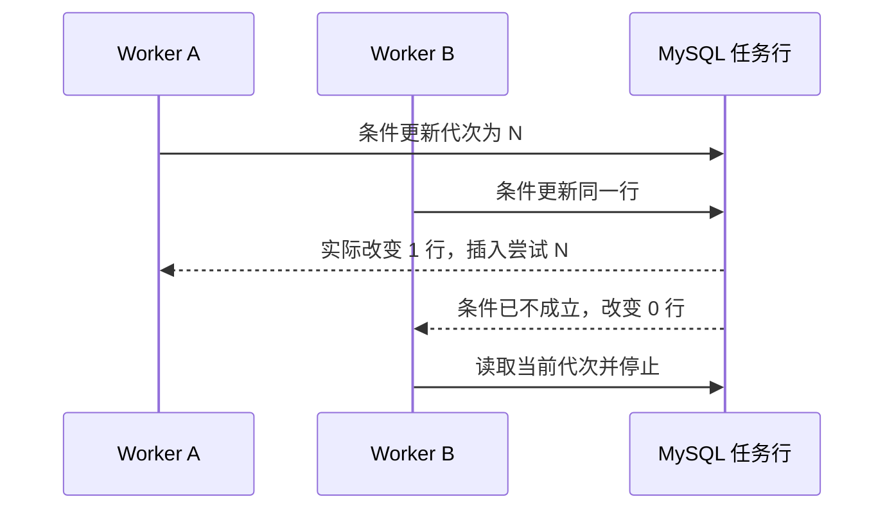
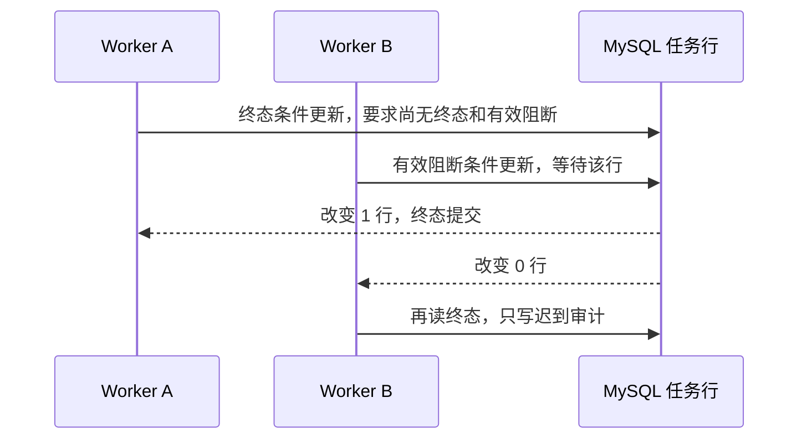
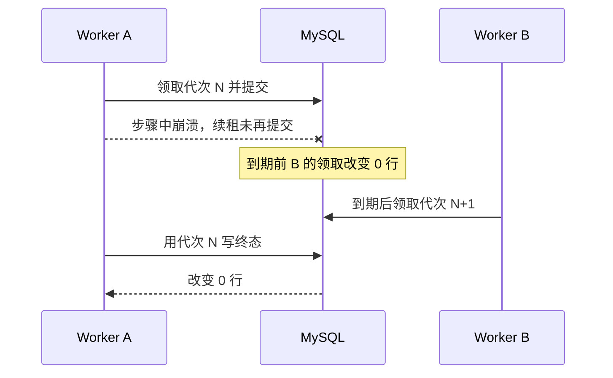
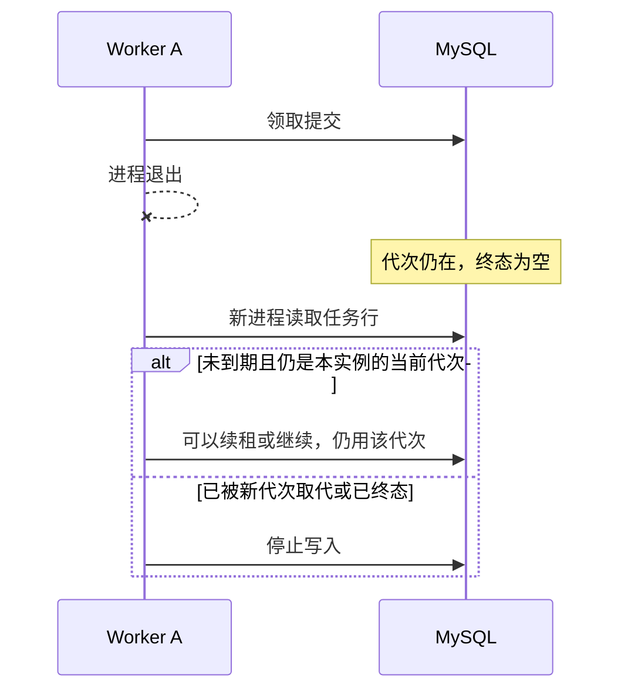

# 06-04-11 MTX Data Platform V2 Worker Task Ownership 与并发执行控制专项设计

本文给出 Worker 执行权、失效后的旧写入拒绝，以及任务终态和有效阻断如何在 MySQL 8.0.46 上仲裁的候选设计。它不是已接受的 ADR，也不是已经实现的领取协议。

基线提交是 `bf0b2551c892ed43963bdb7e5e4017edee425053`。核对时分支是 `main`，工作区干净。

本轮没有执行测试，也没有执行构建。没有选定心跳周期、租约时长或最大重试次数。

## 1. 目标

在不增加模块、不把调度器当成任务状态权威的前提下，说明：

- 一个逻辑任务怎样只被一个当前执行代次写入。
- Worker 失联后，原来的进程恢复时怎样不能覆盖新代次。
- 终态提交和有效阻断怎样不再只靠进程内先读后写。

## 2. 范围

做的是文档设计。不做 Java、POM、DDL、Kafka 配置和 ADR 修改。不引入 Redis、Inbox、Outbox 或 DLQ。不把 trade-flow 写成 V2 能力。

不改 Pipeline 已有任务状态的含义，不新增任务终态。`SUCCESS`、`PARTIAL_SUCCESS`、`ALL_FIELDS_FAILED`、`FAILED` 仍互斥。`RETRY_WAITING` 仍不是终态。`CANCELLED` 仍只存在于状态表，取消协议仍不定义。

06-04-09 的业务规则不在本轮改写。第 11 节只记录它尚未证明的交错，以及候选的数据库仲裁。差异留在第 21 节。

## 3. 基线与依赖

| 依据 | 本轮使用的事实 |
| --- | --- |
| [ADR-0002](../../decisions/0002-v2-module-architecture.md) | 十个模块。Core 不依赖 JDBC、Kafka、Quartz。Pipeline 不依赖调度器 API。不新增模块 |
| [ADR-0004](../../decisions/0004-external-contract-version-resolution.md) | 先固定快照。`CONTRACT_VERSION_UNRESOLVED` 是确定性失败，重试不换快照 |
| [ADR-0005](../../decisions/0005-mysql-doris-storage-baseline.md) | MySQL 8.0.46 与 Doris 4.0.7。生命周期风险的接受责任仍未指定 |
| [调度边界](../../architecture/scheduling.md) | Quartz 与 DolphinScheduler 都还不是执行实现。二者不得调度同一个任务。不得在应用里直接创建 Quartz `Scheduler` |
| Pipeline 第 4.2、11、11.1 节 | `taskId` 是逻辑任务，`taskAttemptId` 是一次尝试。终态提交后不重开 |
| [06-04-08](06-04-08%20MTX%20Data%20Platform%20V2%20MySQL%208.0.46%20持久化机制与幂等约束专项设计.md) | 幂等靠数据库唯一约束和 Create-or-Get，不靠 JVM 锁 |
| [06-04-09](06-04-09%20MTX%20Data%20Platform%20V2%20MySQL%208.0.46%20事务边界与故障恢复专项设计.md) | 领域结果短事务提交。Kafka 与 Doris 不在 MySQL 事务内 |
| [06-04-10](06-04-10%20MTX%20Data%20Platform%20V2%20Source%20Event%20Identity%20与%20Kafka%20消息接入幂等专项设计.md) | 没有来源稳定事件身份时不能建可去重任务。offset 不是执行权 |

IR-03 仍是部分确认。没有任务行时，本节的领取无处发生。IR-02 的物理唯一约束仍未验证。隔离级别仍未选定。

和任务描述的差异：台账里的 IR-10 是审计保留，不是 Kafka 隔离；IR-17 是质量结果和 Writer 记录尚未定义；IR-19 是 E2E 未执行。本轮不改这三行的题目。

## 4. MySQL 8.0 证据

手册版本是 MySQL 8.0。8.0.46 属于该系列。语句没有在本仓库实例上执行。8.4 手册不作为证据。

| 行为 | 手册结论 | 对本设计的用法 | 章节 |
| --- | --- | --- | --- |
| 普通读 | 一致性读忽略记录上的锁，使用读视图。不能靠它保护随后的更新 | 领取和终态仲裁不能先普通 `SELECT` 再决定写入 | [17.7.2.4](https://dev.mysql.com/doc/refman/8.0/en/innodb-locking-reads.html) |
| `SELECT ... FOR UPDATE` | 对读到的索引记录加锁，方式与 `UPDATE` 相同。锁在事务提交或回滚时释放。自动提交开启时不能做加锁读 | 需要在同一事务里先读任务行再写多行时使用。必须处于显式事务 | 同上 |
| `SKIP LOCKED` | 不等待，直接跳过已锁行。手册写明结果视图不一致，不适合一般事务工作 | 不作为执行权正确性的依据 | 同上 |
| `UPDATE` | 按 `WHERE` 修改行。返回的是实际发生变化的行数。把列设成原值时，MySQL 不把它算作更新 | 条件更新必须改掉代次或其他仲裁列，不能只靠“匹配到了行” | [15.2.17](https://dev.mysql.com/doc/refman/8.0/en/update.html) |
| `NOW()` | 返回语句开始时的服务器时间，时区是会话时区。同一语句里多次调用值相同。`SYSDATE()` 才是函数执行瞬间 | 租约比较写在 SQL 里使用 `NOW()`。不用 Worker 本机时钟 | [12.7](https://dev.mysql.com/doc/refman/8.0/en/date-and-time-functions.html) |
| 死锁 | 整个事务回滚，应用重试整个事务 | 领取或仲裁碰到死锁时重做该短事务 | [17.21.5](https://dev.mysql.com/doc/refman/8.0/en/innodb-error-handling.html) |
| 锁等待超时 | 默认只回滚当前语句 | 超时后先确认事务是否还在，再重试。`innodb_rollback_on_timeout` 仍未选定 | 同上 |

以上是官方行为。代次列、租约列和“影响行数为 0 就拒绝”是项目推论，尚未在 8.0.46 上验证。未来 JDBC 驱动如何报告“实际改变的行数”也未验证。

## 5. 五种身份

| 身份 | 含义 | 不是什么 |
| --- | --- | --- |
| `taskId` | 一次逻辑处理任务 | 不是来源事件身份，也不是执行权 |
| `taskAttemptId` | 该任务的一次执行尝试 | 不是任务终态 |
| `workerInstanceId` | 某个 Worker 进程实例 | 不是执行权凭证。同一实例的新旧代次无法靠它区分 |
| `executionGeneration` | 任务行上的单调执行代次。候选字段，Pipeline 里还没有这一列 | 不是 Worker 编号 |
| 租约到期时刻 | 当前代次允许被重新领取的服务器时间条件 | 不是围栏本身 |

一个任务有零个或多个历史尝试。同一时刻最多一个当前代次。新尝试不覆盖已经提交的终态，也不覆盖已提交的观测、标准化结果和权威 `rawPayloadRef`。

`taskId`、`taskAttemptId` 的生成算法仍未设计，沿用 06-04-10 的缺口。本轮不选定算法。

## 6. Task 状态

状态值只使用 Pipeline 第 11 节已有取值。

| 当前状态 | 触发 | 下一状态 | 禁止 |
| --- | --- | --- | --- |
| `PENDING` | 领取事务把代次从空变为第一代，并插入尝试 | `RUNNING` | 未领取就写终态 |
| `RUNNING` | 终态事务按已提交依据计算 | 四个互斥终态之一 | 终态提交后再回到 `RUNNING` |
| `RUNNING` | 租约到期后的重新领取。代次加一，状态可以仍是 `RUNNING` | `RUNNING` | 旧代次继续写 |
| `RUNNING` | 已批准的可重试技术故障。类别仍是 IR-08 | `RETRY_WAITING` | 把确定性契约失败放进这里 |
| `RETRY_WAITING` | 新的领取 | `RUNNING` | 换快照、换契约版本、换已固定规则 |
| 四个终态 | 无 | 保持 | 新尝试覆盖终态。迟到阻断只写审计 |
| `CANCELLED` | 未定义 | 未定义 | 本轮不新增进入或离开它的转换 |

`UNMAPPED` 和 `CONFLICT` 仍算字段成功。空路径仍是带 `CONTRACT_PATHS_EMPTY` 的 `SUCCESS`。

## 7. TaskAttempt

Pipeline 只定义了尝试标识，没有尝试状态机。下面的尝试阶段是候选，不是新的任务状态。

| 阶段 | 何时写入 | 含义 |
| --- | --- | --- |
| 当前 | 与领取同一事务插入，带上新代次 | 这一代可以写 |
| 已被取代 | 重新领取的同一事务里标记旧尝试 | 旧代次的后续写入必须失败 |
| 已结束 | 该代次的终态事务提交时 | 终态在任务行上，不在尝试上另造一套终态 |

创建时机是领取成功的那次提交，不是任务 Create-or-Get 的那次提交。任务可以先存在而尚无尝试。

技术重试和执行权失效后的重新领取都新建尝试，沿用原 `taskId`、原权威输入和已固定上下文。显式重放是另一个任务，不占用原任务的代次。

普通重复投递不新建尝试，也不创建 `replayRequestId`。

## 8. 领取

领取的候选事务同时完成三件事：

1. 条件更新任务行：代次加一，记下 `workerInstanceId` 和用服务器 `NOW()` 算出的到期时刻，可领取状态变为 `RUNNING`。
2. 插入带这个新代次的尝试。
3. 若存在上一代尝试，把它标成已被取代。

`WHERE` 只接受 `PENDING`、`RETRY_WAITING`，或 `RUNNING` 且到期时刻已经不晚于语句开始时的 `NOW()`，并且终态为空。影响行数不是 1 就整笔回滚，不插入尝试。

两个 Worker 或同一 Worker 的两个线程都执行这句更新时，InnoDB 对同一行的排他锁把它们排开。先提交的一代获胜。另一代的条件不再成立。正确性不依赖 JVM 锁、Redis 或单线程。

领取失败：调用方重新读取任务行。已有当前代次就停止，不再建尝试。

同一 Worker 重启后是新的进程事实，但执行权仍看任务行上的代次。旧进程若还活着，只持有旧代次。

网络中断本身不释放执行权。只有到期后的下一次成功领取，或本代次提交终态，才改变代次。

06-04-09 把“新建尝试”写成单独提交。那里的目的是尝试行不改终态。本轮候选把领取和尝试插入收进同一个短事务，避免出现有执行权却没有尝试，或有尝试却没有执行权。领域结果、Kafka 和 Doris 仍在这个事务之外。这是对 06-04-09 拆分方式的候选收紧，本轮不改那份文档。

## 9. 心跳与租约

心跳的候选语义只是续租：在当前代次上把到期时刻往后移。它不证明业务步骤已经完成，也不推进 Kafka offset。

租约的候选语义只是“何时允许另一代领取”。它不单独证明旧进程已经死亡，也拦不住旧进程在被领取之前写入。

暂时失联和崩溃在数据库里无法区分。两者都表现为续租没有提交。未到期时不重新领取。到期后允许新代次。旧进程可能仍会尝试写入，所以还要靠第 10 节的代次条件。

续租和完成若同时发生，都按同一任务行更新。完成把终态写上且条件含当前代次。续租的条件是终态仍为空且代次仍是这一代。先提交的一方使另一方的条件失败。完成后的续租影响行数为 0，Worker 停止再写。续租先成功不阻止同一代次随后的合法完成。

执行时间超过预期时，不在本轮自动取消或自动成功。到期只说明可以被重新领取。是否延长租约取决于尚未测量的执行时间。

时钟以 MySQL `NOW()` 为准。Worker 本机时间不参与比较。会话时区是否在所有连接上一致，尚未选定，这是租约判断的前提缺口。

下列数字都不选定：心跳间隔、租约长度、锁等待超时、最大重试次数、退避时间。以后要在 MySQL 8.0.46 上测量任务耗时分布、数据库往返、进程停顿、会话时区偏差、误抢率和锁等待，再单独决定。本轮没有这些测量。

长时间 GC、网络隔离和数据库短时不可用都只导致续租提交失败。数据库恢复前不能判断代次。恢复后按任务行重新领取或停止。不根据 Worker 本地“我还没超时”继续写。

## 10. 旧执行权拒绝

场景是：A 持有代次 N，失联后 B 领取为 N+1，A 恢复并提交 N 的结果。

比较两种机制。

| 机制 | 正确性 | MySQL 复杂度 | 恢复 | 前提 |
| --- | --- | --- | --- | --- |
| 只比较 `workerInstanceId` 和租约 | 能拒绝另一个实例。不能拒绝同一实例上的旧请求，因为实例编号没变 | 只更新所有者列 | 旧请求在新代次仍写同一所有者时会成功 | 不成立。用户要求区分同一 Worker 的新旧代次 |
| 任务行单调代次。之后每条会改变任务、尝试、终态或有效阻断的写入都带 `generation = N` | A 的更新匹配 0 行。B 的代次保持 | 每次仲裁写都要改代次或依赖已改变的终态列，并检查实际改变行数 | 死锁则重做整笔短事务。匹配 0 行则读取当前代次并停止 | 所有写入路径都带代次。漏一条路径则围栏失效。驱动对“实际改变行数”的报告尚未验证 |

推荐第二种。租约只决定能不能产生 N+1，不代替代次条件。`workerInstanceId` 只作为审计属性。

围栏要覆盖的写入：领取、续租、重新领取、终态、有效阻断、把任务改成 `RETRY_WAITING`。已经按 06-04-08 做成不可变 Create-or-Get 的观测、字段结果、版本固定和标准化结果，仍不覆盖已有内容。旧代次不应再发起新的领域写入；若它在失联前已经提交，那些行保留。旧代次失联后新插入的领域行没有单独的代次列，这是尚未关闭的缺口：领域表还没有批准的物理列。在列存在之前，不能声称旧 Worker 的每一条领域插入都已被围栏挡住。任务状态和有效阻断则必须带代次。

同一 Worker 的两个线程使用同一个实例编号时，仍靠代次和行锁区分。

## 11. 并发领取

普通读看到旧状态没有关系。决定权在条件更新，不在那次读取。`SKIP LOCKED` 不用于这个判断。

领取提交前崩溃：事务回滚，没有残留代次，也没有尝试。任务仍可领取。

领取提交后、业务步骤开始前崩溃：代次和尝试已经提交。未到期前其他 Worker 不能领取。到期后按第 9 节重新领取，旧尝试标成已被取代。

## 12. 崩溃恢复

| 场景 | 已提交 | 恢复 | 分类 |
| --- | --- | --- | --- |
| 领取前崩溃 | 无执行权 | 原状态可再领取 | 可以再领取 |
| 领取提交前崩溃 | 无 | 无残留代次 | 可以再领取 |
| 领取提交后崩溃 | 代次和尝试 | 到期前不抢。到期后新代次 | 先读任务行 |
| 尝试已建、步骤未开始 | 当前尝试 | 不把它当成业务成功 | 先读任务行 |
| 步骤中崩溃 | 已提交的领域短事务保留 | 不回滚已提交观测。新代次沿用已固定上下文 | 先读领域结果和代次 |
| 领域写入事务中崩溃 | 该短事务未提交 | 按 06-04-09 重做该短事务。不重做已提交观测 | 可以重试该短事务 |
| 终态提交后崩溃 | 终态 | 不再执行业务。offset 仍按 06-04-09，且受 IR-03 限制 | 禁止再执行 |
| 续租失败 | 旧到期时刻 | 停止再写。匹配 0 行就不再续 | 先读代次 |
| 旧 Worker 恢复 | 新代次可能已提交 | 旧代次的状态写入匹配 0 行 | 禁止用旧代次写入 |

确定性契约失败、完整性冲突和终态已提交，不允许自动再执行。没有稳定来源身份时根本没有可恢复的任务，见 06-04-10。人工取消仍无协议。

## 13. 终态与阻断

06-04-09 的风险可以发生在没有共同行锁或共同条件更新的实现里：A、B 都先普通读，A 提交成功终态，B 再插入一条有效阻断。进程内的先后不能阻止这个交错。Pipeline 第 11.1 节的协调边界当时也没有给出数据库实现。

仲裁对象是同一条任务行上的两列候选：终态，以及当前有效阻断标识。历史阻断、迟到审计和拒绝审计不是这两列。

两种方案：

| 方案 | 做法 | 能否挡住所述交错 | 代价 |
| --- | --- | --- | --- |
| 任务行条件更新 | 写终态的语句要求终态为空且有效阻断为空。写有效阻断的语句要求终态为空且有效阻断为空。实际改变行数不是 1 就重新读取 | 能。后写的一方匹配 0 行 | 语句必须真的改变列。驱动行数语义未验证 |
| 只靠“每个任务一条有效阻断”的唯一约束 | 阻断行单独插入，终态另一次无条件更新 | 不能。唯一约束挡得住两条阻断，挡不住“终态已成功又插入一条阻断” | 不采用为唯一手段 |

推荐条件更新。写有效阻断的事务在更新任务行成功之后，于同一事务插入阻断记录再提交。写终态的事务只更新任务行。两者锁的是同一行，后到者等待。死锁时整笔回滚并重试。锁顺序固定为先任务行、后插入记录，避免两边以相反顺序锁两张表。

交错结果：

- 终态先提交：阻断语句改变 0 行。调用方再读到终态，只插入迟到审计，不改终态。
- 有效阻断先提交：终态语句改变 0 行。调用方再读到阻断，终态只能是 `FAILED`。
- 两边都认为自己读到空白：只有条件更新实际改变的那一方成立。

这不把整条 Pipeline 放进一个长事务。观测和字段结果仍先按 06-04-09 各自提交。终态计算读的是已经提交的字段结果。

阻断允许写入有效列的条件只有：终态尚未提交，且该任务还没有有效阻断。否则是迟到审计、已有阻断或内容冲突，规则仍按 Pipeline 第 11.1 节，不新增返回码。

## 14. RETRY_WAITING

| 类别 | 处理 |
| --- | --- |
| 执行权到期 | 不改成新的任务状态。原状态为 `RUNNING` 时重新领取，代次加一 |
| Worker 崩溃 | 与上一行相同。不删除已提交领域结果 |
| 临时基础设施失败 | 可以成为以后进入 `RETRY_WAITING` 的候选。哪些字段级失败允许进入，仍是 IR-08 |
| `CONTRACT_VERSION_UNRESOLVED` 和其他确定性契约失败 | 任务阻断为 `FAILED`。不进入自动重试，不换快照 |
| 完整性错误 | 不自动重试，不覆盖胜出行 |
| 人工重放 | 新 `taskId` 和调用方 `replayRequestId`。不是 `RETRY_WAITING` |
| 人工取消 | 仍无协议 |

不选定最大次数和延迟。原任务重试继续使用原快照、原契约版本和原解析器。

## 15. 事务边界

| 事务 | 读取 | 修改 | 原子要求 | 冲突 | 提交后 | 提交前崩溃 | 重试副作用 |
| --- | --- | --- | --- | --- | --- | --- | --- |
| 领取 | 任务行条件 | 代次、所有者、到期时刻、`RUNNING`，并插入尝试 | 三件同时提交 | 改变行数不是 1 则回滚 | 只有这一代可写 | 无残留 | 再领一次。不会有两代 |
| 续租 | 当前代次且终态为空 | 到期时刻 | 只动这一代 | 0 行则停止 | 到期后移 | 旧到期时刻仍在 | 再续一次 |
| 执行权失效 | 无单独事务 | 无 | 到期不是一次写 | 不适用 | 不适用 | 不适用 | 由下一次领取实现 |
| 重新领取 | 旧代次已到期 | 新代次，旧尝试改为已被取代 | 与领取相同 | 只有一个新代次 | 旧代次失效 | 无残留 | 同领取 |
| 尝试结束 | 不单独提交终态 | 随终态事务标记尝试结束 | 不制造第二套终态 | 旧代次 0 行 | 任务终态已在 | 终态未提交则可再终态 | 不新开终态 |
| 终态 | 已提交字段结果。条件在任务行 | 四个终态之一 | 终态只出现一次 | 0 行则再读阻断或已有终态 | 不重开 | 领域结果保留 | 再计算一次。不覆盖 |
| 有效阻断 | 任务行条件 | 有效阻断列和阻断记录 | 列和记录同事务 | 0 行则改迟到或冲突路径 | 终态事务必须能看见 | 无有效阻断 | 同一身份再写 |
| `RETRY_WAITING` | 当前代次，且类别已被 IR-08 允许 | 非终态状态 | 不删除领域结果 | 终态已存在则 0 行 | 仍用原上下文 | 状态不变 | 不换快照 |

观测、版本固定、标准化、Kafka offset 和 Doris 写入的边界仍以 06-04-09 为准，不并入上表。

## 16. 调度器

Quartz 只负责触发 Worker。触发记录不是平台任务状态。重复触发落到第 8 节的条件领取：已经有当前代次就不再执行一遍业务。Pipeline 不引用 Quartz API。当前仍禁止在应用里直接创建 `Scheduler`。

Worker 重启不由 Quartz 恢复执行权。恢复看 MySQL 任务行。Quartz 重启只影响下一次触发有没有发出。

DolphinScheduler 仍未引入。将来也只能调用 Core 里的领取端口，不能成为执行权的权威，也不能和 Quartz 同时调度同一任务。端口实现放在 Worker 装配的一侧，不放进 Pipeline，也不新增加模块。

Kafka 分区分配同样不是执行权。消费者尚未实现。重新投递仍按 06-04-10：有稳定身份才回到原任务，然后还要通过代次条件才能写。

## 17. 崩溃时序

## 18. 验收场景

全部是设计预期，未执行。

| 场景 | 预期 |
| --- | --- |
| 两个 Worker 同时领取 | 只有一个代次和一条当前尝试 |
| 同一 Worker 两个线程同时领取 | 同上 |
| 领取后立即崩溃 | 未到期不能被第二人领取。到期后新代次，旧尝试被取代 |
| 旧代次在新代次提交后续写终态 | 改变行数为 0，终态仍是新代次的结果 |
| 只匹配 Worker 编号、不匹配代次 | 本设计不接受。同一实例的旧请求仍可能写中 |
| 续租与终态同时提交 | 后失败的一方改变 0 行。已完成则不能续租后再改终态 |
| A 普通读无阻断，B 普通读无终态，然后交叉写入 | 只有条件更新改变 1 行的那一方成为权威。另一方改走迟到审计或 `FAILED` |
| 终态提交后崩溃 | 不第二次执行业务 |
| `CONTRACT_VERSION_UNRESOLVED` | `FAILED`，不换快照，不进入自动重试 |
| Quartz 对同一任务触发两次 | 第二次领取失败或看到已有代次。任务不因此出现两个终态 |
| 无稳定来源身份 | 没有任务可领取。不把 offset 推进当成执行权 |

## 19. 结论

候选结论是：执行权是任务行上的单调代次，租约只用服务器时间决定能否产生下一代，Worker 编号不是凭证。终态和有效阻断用同一行上的条件更新仲裁。调度器只触发，不保存平台任务状态。

这些结论依赖尚未存在的列、尚未验证的驱动行数语义，以及尚未测量的时间参数。因此不是已接受决策。

## 20. 尚未解决

- 心跳间隔、租约长度、重试次数都没有测量依据。
- 会话时区是否一致未选定。
- 领域结果表还没有代次列，旧代次在失联后新增领域行的围栏不完整。
- `taskId` 和 `taskAttemptId` 生成算法未定。
- 哪些失败可以进入 `RETRY_WAITING` 仍是 IR-08。
- 隔离级别、`innodb_rollback_on_timeout` 和 JDBC 行数语义未验证。
- 无稳定来源身份时没有任务行，执行权无从开始。
- MySQL 8.0.46 的生命周期风险接受责任仍未指定。
- 第 18 节没有执行记录。

## 21. 对已有文档和台账

不修改 ADR，不修改 06-04-09 正文。建议以后若采纳本设计，再单独说明 06-04-09 里“尝试单独提交”和“阻断与终态两次提交”如何改成第 8 节和第 13 节的短事务。那是实现差异，不是金额规则或 ADR-0004 的变化。

候选 ADR 的内容是：执行权采用任务行单调代次和条件更新，租约不作为唯一围栏，调度器不是执行权权威。本轮不创建该 ADR。

台账只更新 IR-07，并把 IR-09 的证据指到本节的仲裁缺口。IR-07 仍不关闭。IR-03、IR-02、IR-08、IR-10、IR-15、IR-17、IR-19 的状态不改。

## 22. 本轮未做的事

- 不修改 Java、POM、模块、DDL、Kafka 配置和 ADR-0002 至 ADR-0005。
- 不把候选代次写成已经存在的列。
- 不把未执行场景写成测试通过。
- 不关闭 MySQL 8.0.46 的生命周期风险。
