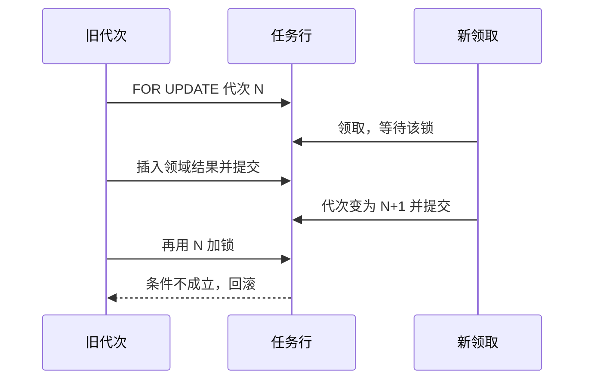

# 06-04-11 MTX Data Platform V2 Worker Task Ownership 与并发执行控制专项设计

本文是 Worker 执行权的第二轮设计。第一轮用任务行代次拒绝旧的任务状态写入，但阻断登记和终态更新使用了同一个“有效阻断必须为空”的条件，而且领域结果只在事务外读代次。这两处都不能支撑多 Worker。本轮改正提交条件，并与 [06-04-09](06-04-09%20MTX%20Data%20Platform%20V2%20MySQL%208.0.46%20事务边界与故障恢复专项设计.md) 使用同一组事务边界。

它仍不是已接受的 ADR，也没有 DDL 或并发测试。基线是第二轮开始时仓库中的 06-04-11 第一轮稿。本轮没有执行测试，也没有执行构建。没有选定心跳周期、租约时长或最大重试次数。

## 1. 审查问题

| 编号 | 第一轮缺陷 | 第二轮选择 |
| --- | --- | --- |
| P1-01 | 阻断和终态都要求有效阻断为空。阻断先成功后，终态永远写不进 | 登记与 `FAILED` 落库使用不同条件 |
| P1-02 | 写领域结果前读一次代次，中间可以被新代次插入 | 权威写入事务内对任务行加锁，直到提交 |
| P1-03 | 尝试单独提交，和 06-04-09 的拆分互相矛盾 | 领取与尝试同一事务。06-04-09 第 8 节已改成同一说法 |
| P1-04 | 租约到期像是立刻失去执行权，又像是要等新代次 | 租约只控制何时可以尝试领取。旧代次在新代次提交前仍然有效 |
| P1-05 | 尝试的执行结果、执行权和任务终态混在一起 | 三套字段分开。任务状态不新增取值 |

## 2. 术语

| 术语 | 含义 |
| --- | --- |
| Task | 一次逻辑处理任务。身份是 `taskId` |
| TaskAttempt | 该任务的一次执行尝试。历史行不覆盖 |
| Worker | 执行进程。`workerInstanceId` 只是审计属性 |
| `executionGeneration` | 任务行上的单调代次。当前有效执行权就是已提交的这一代 |
| Lease | 用 MySQL `NOW()` 写出的到期时刻。它决定其他 Worker 何时可以尝试领取，不是执行权本身 |
| 有效阻断 | 任务行上已经记下的那一条阻断。终态可以仍为空 |
| 终态 | `SUCCESS`、`PARTIAL_SUCCESS`、`ALL_FIELDS_FAILED`、`FAILED`、`CANCELLED` 之一。只写入一次 |

`taskId` 和 `taskAttemptId` 的生成算法仍未设计。代次列、租约列和尝试上的结果列都还不是已建的表字段。

## 3. Task 状态

只使用 Pipeline 第 11 节已有取值。不增加“阻塞中”这个任务状态。阻断已经登记而终态还没写上，任务状态仍是 `RUNNING`，另由有效阻断列看出。

| 持久化字段 | 来源 |
| --- | --- |
| 任务状态 | Pipeline 已有取值，持久化 |
| 终态列 | 四个处理终态或 `CANCELLED`。空表示尚未落库。持久化 |
| 有效阻断标识 | 空或一条。持久化。不是新的任务状态名 |

| 当前 | 条件 | 下一状态 |
| --- | --- | --- |
| `PENDING` | 领取提交 | `RUNNING` |
| `RUNNING` | 无阻断的终态提交 | `SUCCESS`、`PARTIAL_SUCCESS` 或 `ALL_FIELDS_FAILED` |
| `RUNNING` 且阻断已登记 | 终态提交 | `FAILED` |
| `RUNNING` | 租约到期后新领取提交 | 仍是 `RUNNING`，代次加一 |
| `RUNNING` | IR-08 允许的技术失败 | `RETRY_WAITING` |
| `RETRY_WAITING` | 新领取提交 | `RUNNING` |
| `RUNNING` 且尚无阻断、尚无终态 | 取消条件更新提交 | `CANCELLED` |
| 已有终态 | 无 | 保持 |

`CONTRACT_VERSION_UNRESOLVED` 仍先登记阻断，再落成 `FAILED`。不进入 `RETRY_WAITING`，不换快照。

## 4. 尝试的两套字段

执行结果和执行权都写在尝试行上。任务终态不写进尝试结果，避免一轮终态把历史尝试改写成另一次执行的结果。

执行结果是持久化列：

| 值 | 含义 | 何时写入 |
| --- | --- | --- |
| `OPEN` | 尚未完成 | 领取事务插入时 |
| `SUCCEEDED` | 这一代把任务终态提交成功 | 终态事务，只更新这一代尝试 |
| `FAILED` | 这一代确认了不可继续的执行失败，任务终态未必已经是 `FAILED` | 该代次自己的失败事务 |
| `CANCELLED` | 这一代因任务取消而停止 | 取消事务更新当前尝试 |
| `INTERRUPTED` | 这一代没有自己写完。接管时由新领取事务写上 | 新代次的领取事务 |

执行权是另一列：

| 值 | 含义 | 持久化方式 |
| --- | --- | --- |
| `CURRENT` | 尝试上的代次等于任务行当前代次 | 领取时写成。也可由两列相等推导 |
| `SUPERSEDED` | 更新的代次已经提交 | 新领取事务写旧行 |
| `RELEASED` | 这一代主动放弃，没有被抢走 | 释放事务写当前行 |

“已失去执行权”不是第四个存储值。它由执行权不是 `CURRENT` 推导出来。租约到期但新代次尚未提交时，旧行仍是 `CURRENT`，执行权仍在。

历史尝试的执行结果只由该代次自己的终态事务，或接管事务把 `OPEN` 改成 `INTERRUPTED`。新尝试不改写更早一次已经写成的 `SUCCEEDED` 或 `FAILED`。

## 5. 领取事务

一个显式事务内：

1. 条件更新任务行。代次加一，写下 Worker 实例和用 `NOW()` 计算的到期时刻。`PENDING` 或 `RETRY_WAITING` 改为 `RUNNING`。已经是 `RUNNING` 时保持 `RUNNING`。
2. 插入 `OPEN`、`CURRENT` 的新尝试。
3. 把上一代 `OPEN` 的尝试改为 `INTERRUPTED`、`SUPERSEDED`。

`WHERE` 要求终态为空，并且要么状态是 `PENDING` 或 `RETRY_WAITING`，要么状态是 `RUNNING` 且到期时刻不晚于这句语句的 `NOW()`。已登记的有效阻断保留，领取语句不把它改回空。

实际改变行数不是 1，就回滚，不插入尝试。MySQL 8.0 的 `UPDATE` 只把实际发生变化的行计入返回值，见 [15.2.17](https://dev.mysql.com/doc/refman/8.0/en/update.html)。代次必须增加，否则原值更新会被当成没有改变。

提交前崩溃：整笔回滚，没有新代次。提交后崩溃：新代次和尝试已经在。这就是 06-04-09 第 8 节收回“尝试单独提交”的原因。

## 6. 租约

租约是接管时机，不是执行权的判据。执行权的线性化边界是新代次那次 `COMMIT`。

| 时刻 | 旧代次能否开始新的权威写入 |
| --- | --- |
| 到期时刻已过，还没有新的领取事务提交 | 能。旧行仍是当前代次 |
| 新领取事务已开始，但尚未提交，旧事务已持有任务行锁 | 旧事务可以提交。新领取等待这把锁 |
| 新代次已经提交 | 不能。后续事务锁任务行时会看到新代次 |

因此到期不会立刻撤销写入权。暂时失联的 Worker 在别人的领取提交之前，只要还能连上数据库，仍可以续租或提交本代次的事务。领取一旦提交，它必须停止。本机时钟不参与比较。比较使用语句里的 `NOW()`，时区是会话时区，见 [12.7](https://dev.mysql.com/doc/refman/8.0/en/date-and-time-functions.html)。会话时区尚未统一，这是未决项。

续租语句只延长到期时刻，条件是代次仍是这一代、终态仍为空，并且当前到期时刻晚于 `NOW()`。它和领取锁同一行：

- 续租先提交：领取的到期条件失败，改变 0 行。
- 领取先提交：续租的代次条件失败，Worker 停止再写。

进程暂停或网络延迟只影响哪一边先拿到锁并提交。不根据 Worker 本地“我还在租约内”继续写。

## 7. 领域结果围栏

需要和执行权放在同一事务里的写入：

- `ExtractedFieldResult`
- `ObservedAmount` 与匹配结果
- 版本固定记录
- `NormalizedAmount`
- 以后若有计算结果，同样处理。当前没有已发布计算规则，不写

不在此列的是 Kafka offset、Doris 副本、应用日志，以及已经提交后的不可变行的普通重读。

推荐方案是数据库行锁，不是写前查询。每个上述事务：

1. `SELECT ... FOR UPDATE` 任务行，条件为任务、代次等于调用方持有的代次、终态为空。
2. 锁不到符合条件的行，就回滚，不插入。
3. 在同一事务里做 06-04-08 的 Create-or-Get。
4. 提交后才释放锁。

[17.7.2.4](https://dev.mysql.com/doc/refman/8.0/en/innodb-locking-reads.html) 写明：普通一致性读忽略行锁，不能保护随后的更新。加锁读在事务提交或回滚时释放，并且必须处于显式事务。因此事务外先读代次，再在另一个事务里插入，中间的领取可以先提交。那不是围栏。

和“只在 `WHERE` 里写代次、不持有锁到插入完成”相比，加锁读覆盖的是插入发生前的整段事务。条件更新适合只改任务行的领取、续租、终态和阻断。领域插入要改另一行，所以用同一事务里的 `FOR UPDATE` 把两行的提交绑在一起。

旧代次在新代次提交之后不能提交有效业务结果，因为：

1. 新领取要给任务行加排他锁才能把代次加一。
2. 旧写入要先拿到同一行的锁才能插入。
3. 两边排队。先提交的一方留下的行对后一方可见。
4. 新代次先提交时，旧事务随后加锁，条件不成立，插入回滚。
5. 旧事务先持有锁并提交时，这次写入发生在新代次之前，结果保留。新领取随后才能提交。Create-or-Get 不覆盖这一行。

隔离级别仍未选定。加锁读看最新已提交行，不使用更早的普通快照。死锁回滚整个事务，调用方重试整笔短事务。锁等待超时默认只回滚当前语句，`innodb_rollback_on_timeout` 仍未选定。连接在提交结果未知时，按 06-04-09 重试 Create-or-Get，不先假定插入已成功，也不再使用已经失败的代次。

`SKIP LOCKED` 不用于围栏。手册写明它的结果视图不一致。

## 8. 阻断与终态

两条条件更新：

| 语句 | `WHERE` | 成功后的行 |
| --- | --- | --- |
| 登记阻断 | 代次匹配，终态为空，有效阻断为空 | 阻断已写下，终态仍为空 |
| 落成 `FAILED` | 代次匹配，终态为空，有效阻断等于刚登记的那一条 | 终态是 `FAILED` |
| 落成成功类终态 | 代次匹配，终态为空，有效阻断为空，并且计算不是阻断 | 终态是 `SUCCESS`、`PARTIAL_SUCCESS` 或 `ALL_FIELDS_FAILED` |

登记事务在更新任务行成功后，于同一事务插入阻断记录。落成 `FAILED` 是下一次事务。阻断先成功不再挡住终态，因为第二句要求阻断已经存在。

合法组合：

| 终态 | 有效阻断 | 含义 |
| --- | --- | --- |
| 空 | 空 | 尚未裁决 |
| 空 | 已有 | 阻断已登记，终态未落库。可恢复 |
| `FAILED` | 与该终态同一条 | 阻断路径完成 |
| 成功类终态 | 空 | 无阻断的终态 |
| `CANCELLED` | 空 | 取消先于阻断登记 |
| 成功类或 `CANCELLED` | 已有 | 不允许。后写的条件匹配不到 |
| `FAILED` | 空 | 不允许。`FAILED` 只从已登记阻断落库 |

登记成功后本进程崩溃：行上是“有阻断、无终态”。任何后来读到该行的 Worker，包括新代次，都只执行 `FAILED` 那句更新，不重新提取，不换快照。新领取不得清空阻断。

重复登记同一身份且内容相同，更新不会把列改成新值，返回的改变行数是 0。调用方再读，按 Pipeline 返回 `ALREADY_BLOCKED`，不插入第二条。终态已经是同一个 `FAILED` 时，再次更新也是 0 行，再读后返回 `ALREADY_FINALIZED`。不能把“改变 0 行”直接当成第一次成功。

终态先提交时，登记匹配 0 行，只写迟到审计。两条不同阻断在终态前仍只有第一条能成为有效阻断。

## 9. 取消

取消不读取 Worker 内存。它是任务行条件更新：代次匹配、终态为空、有效阻断为空，则终态写成 `CANCELLED`，并把当前尝试的执行结果写成 `CANCELLED`、执行权写成 `RELEASED`。已提交的观测和标准化结果不删除。

与正在写入的领域事务锁同一任务行。领域事务先提交，取消仍可在终态为空时成功，已写入的结果保留。取消先提交，领域事务的加锁条件失败并回滚。阻断已经登记时取消匹配 0 行，终态路径仍是 `FAILED`。

谁可以发起取消、从哪个入口发起，还没有设计。见台账新增的 IR-21。没有这个决定之前，不把任意 Worker 都写成已经有权取消。

## 10. 崩溃

| 时刻 | 已提交的事实 | 恢复 |
| --- | --- | --- |
| 领取提交前 | 无新代次 | 重新领取 |
| 领取提交后、业务前 | 新代次，尝试为 `OPEN` | 未到期则原代次继续。到期后新代次把旧尝试写成 `INTERRUPTED` |
| 领域事务未提交 | 无这次插入 | 用当前代次重做该短事务 |
| 领域事务已提交、终态未提交 | 领域结果在 | 按已提交结果做终态。不覆盖 |
| 阻断已登记、终态未提交 | 阻断在，终态空 | 只落 `FAILED` |
| 终态已提交 | 终态在 | 不再执行 |
| 续租失败 | 到期时刻未后移 | 若代次仍在且未到期，可以再续。若代次已变，停止 |

不把确定性契约失败放进自动重试。

## 11. 并发场景

| 场景 | 竞争点 | 先提交的一方 | 后一方 |
| --- | --- | --- | --- |
| 两个 Worker 同时领取 | 任务行 | 代次加一，一条 `CURRENT` 尝试 | 改变 0 行 |
| 续租与领取 | 任务行 | 续租则领取失败。领取则续租失败 | 读当前代次 |
| 旧写入持锁，新 Worker 领取 | 任务行 | 旧写入可以提交 | 领取等待，然后成为下一代 |
| 新代次已提交，旧 Worker 再写 | 任务行加锁条件 | 新代次 | 旧事务回滚 |
| 终态与阻断登记 | 任务行两句不同条件 | 终态则阻断变迟到审计。阻断则终态只能是 `FAILED` | 再读后走对应路径 |
| 取消与领域写入 | 任务行 | 见第 9 节 | 见第 9 节 |

## 12. 不变量

全部尚未在 MySQL 8.0.46 上执行。验证方式都是以后的并发测试，不是本轮记录。

| 不变量 | 依据 | 验证 |
| --- | --- | --- |
| 同一任务同时只有一个已提交的当前代次 | 领取把代次加一，条件含旧代次 | 并发领取后只有一行代次增加 |
| 新代次提交后，旧代次不能再提交有效业务结果 | 第 7 节的锁顺序 | 新代次提交之后的旧插入回滚 |
| 尝试与领取同时提交 | 第 5 节一个事务 | 不存在有新代次却没有对应尝试的提交 |
| 终态只确定一次 | 终态列从空变为非空。再次更新改变 0 行 | 第二个终态值写不进去 |
| 阻断与终态可恢复 | 第 8 节两种条件 | 阻断已在、终态为空时，下一次更新得到 `FAILED` |
| 旧尝试不覆盖新尝试的结果 | 结果只写在本代次行。接管只把 `OPEN` 改为 `INTERRUPTED` | 已是 `SUCCEEDED` 的旧行保持 |
| 重试不换已固定快照和契约版本 | ADR-0004 与 Pipeline | 新代次读取原任务上的固定值 |
| 崩溃不留下无法识别的中间行 | 领取前无残留。阻断未落终态可由两列识别 | 杀掉进程后按第 10 节读到入口 |
| 取消不依赖 Worker 内存 | 第 9 节条件更新 | 执行进程已退出时，条件仍可提交 |
| 恢复不破坏幂等身份 | Create-or-Get 与权威引用规则仍按 06-04-08、06-04-10 | 重试不第二行覆盖观测 |

## 13. 验收场景

每一行都是设计预期，未执行。

| 场景 | 初始 | 顺序 | 竞争点 | 预期 | 旧代次还能写 | 恢复 |
| --- | --- | --- | --- | --- | --- | --- |
| 同时领取 | `PENDING` | 两边都更新同一行 | 任务行 | 一个代次，一条当前尝试 | 失败者不能 | 失败者再读 |
| 到期后接管 | `RUNNING`，已到期 | B 领取提交 | 任务行 | 代次加一。旧尝试为 `INTERRUPTED` | 提交前可以，提交后不可以 | 新代次继续 |
| 新代次提交前旧 Worker 写入 | 旧事务已持锁 | 旧事务先提交 | 任务行 | 该次领域结果保留 | 这次可以 | 新领取在其后提交 |
| 新代次提交后旧 Worker 写入 | 新代次已提交 | 旧事务再加锁 | 任务行 | 旧事务回滚 | 不可以 | 不再使用旧代次 |
| 旧事务执行中，新 Worker 领取 | 旧事务持锁 | 领取等待 | 任务行 | 旧事务结束后领取才提交 | 持锁的这次可以 | 见上两行 |
| 领取提交前崩溃 | 事务未提交 | 回滚 | 无残留 | 仍是原状态 | 不适用 | 重新领取 |
| 领取提交后、业务前崩溃 | 代次已提交 | 进程退出 | 无 | 尝试仍是 `OPEN` | 原代次在被取代前可以 | 到期后接管 |
| 阻断后、终态前崩溃 | 阻断已提交 | 进程退出 | 无 | 终态为空，阻断非空 | 当前代次只可落 `FAILED` | 再执行 `FAILED` 更新 |
| 领域结果提交后、成功终态前崩溃 | 结果已提交 | 进程退出 | 无 | 结果保留，终态为空 | 当前代次可落终态 | 按已提交结果终态 |
| 取消与领域写入并发 | 都无终态 | 抢任务行锁 | 任务行 | 先提交者按其第 9 节结果成立 | 取消先提交则不可 | 再读终态 |
| 续租与领取并发 | 即将到期 | 抢任务行锁 | 任务行 | 只有一边的条件成立 | 领取先提交则不可 | 再读代次 |
| 提交结果不确定 | 连接中断 | 不假设已提交 | 任务行或唯一键 | 用同一代次重试 Create-or-Get 或再读终态 | 代次已变则不可 | 先读权威行 |

## 14. 与 06-04-09 的分工

06-04-09 写每个 MySQL 提交点、失败后读哪一行，以及 Kafka、Doris 不在事务内。06-04-11 写代次、租约、尝试的两列，以及阻断和终态的两句条件。领取事务、领域写入的加锁、阻断登记和 `FAILED` 落库在两份文档中是同一套。06-04-09 第 8 节记录了相对第一轮的三处调整，没有删掉原有故障行。

## 15. 兼容

ADR-0004 未改。先固定快照，确定性解析失败不降成 `UNMAPPED`，不靠重试换快照，新快照仍是显式重放。

金额规则未改。观测和匹配仍一次提交。标准化身份仍不含 `taskId`。未识别和冲突仍保留，并且不算字段失败。重试和接管都不覆盖已提交观测。版本固定仍先于 `NormalizedAmount`，且不因此合成一个长事务。

06-04-08 的 Create-or-Get 未改。唯一约束仍未建成。06-04-10 的来源身份结论未改。没有稳定身份时仍然没有可领取的任务。offset 仍不是执行权。

调度器仍只触发。Quartz 与 DolphinScheduler 不保存平台任务状态，也不进入 Pipeline。不新增模块。

## 16. 尚未解决

- 代次、租约、尝试结果列都没有 DDL，也没有 8.0.46 并发测试。
- JDBC 是否报告“实际改变的行数”未验证。
- 会话时区未统一。心跳间隔、租约长度、重试次数未测量。
- 隔离级别和 `innodb_rollback_on_timeout` 未选。
- 取消的发起者未定义。
- `taskId`、`taskAttemptId` 生成算法未定。
- IR-03、IR-08 仍开着。无稳定来源身份时执行权无从开始。
- MySQL 8.0.46 的生命周期风险接受责任仍未指定。

候选 ADR 仍是：执行权等于已提交的任务行代次，租约只控制领取时机，权威领域写入必须在持有该行锁的事务里提交。本轮不创建 ADR。

## 17. 本轮未做的事

- 不修改 Java、POM、模块、DDL、Kafka 配置和 ADR。
- 不把第二轮条件写成已经跑过的测试。
- 不新增任务状态取值。
