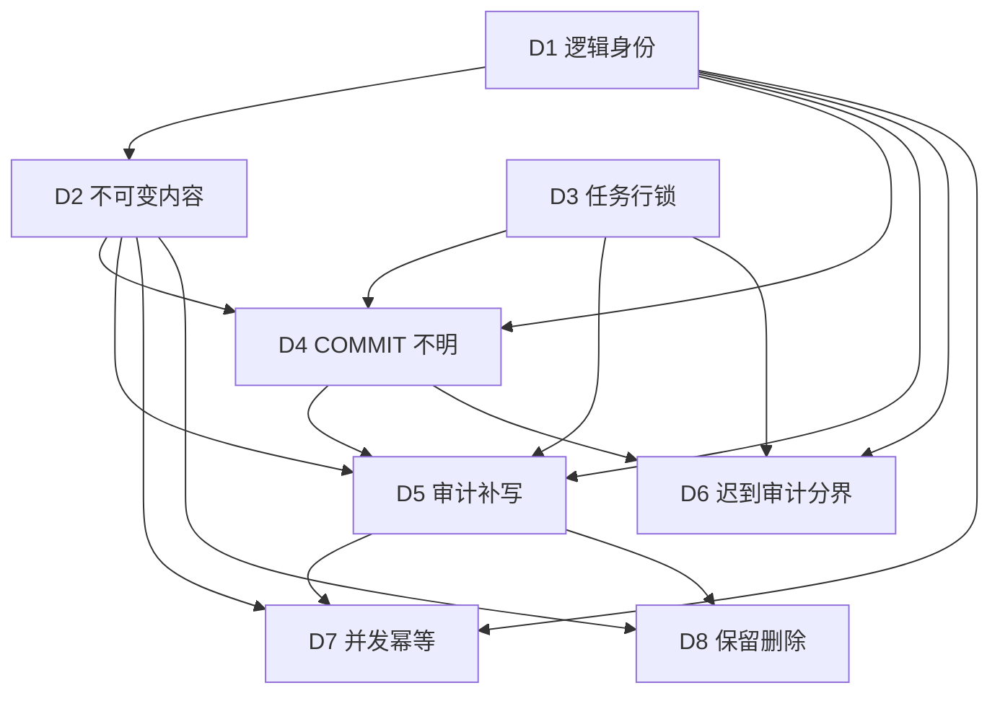

# 06-04-42 MTX Data Platform V2 IR-10 架构批准阻塞项拆解与技术决策顺序审查

本文把 [06-04-41](06-04-41%20MTX%20Data%20Platform%20V2%20IR-10%20定义B与规则C架构批准前技术方案审查.md) 的架构批准候选拆成八项技术决策，并排定评审顺序。它不是新一轮完整 IR-10 调查，不是 ADR，也不是架构批准。技术方向 A 仍是候选，尚未实现，尚未验证。本轮不修改 Java、Maven、DDL、模块、已接受 ADR、台账或 06-04-35 至 06-04-41。没有执行 MySQL 实验或 E2E 测试。没有创建责任事实实体，没有指定物理唯一索引。

## 1. 调查目的与范围

目的有七个：把候选方案拆成独立技术决策；写明每项的前置和后续影响；画出依赖；排出评审顺序；分出真正阻塞架构批准的事项；分开「批准前必须确定的原则」和「批准后才能写的详细设计」；列出后续专项。

不重开定义 B 与规则 C 的业务选择。不把技术困难改回定义 A、定义 C、规则 A 或规则 B。

章节：

1. 调查目的与范围
2. 仓库基线与证据清单
3. 当前业务确认与架构状态
4. 技术决策拆解
5. 决策依赖关系图
6. 决策顺序与批准责任
7. 架构批准前置条件
8. 架构批准后的详细设计
9. 实施前实验验证
10. P0、P1、P2 阻塞项
11. 后续专项调查路线图
12. 本轮结论与禁止事项

## 2. 仓库基线与证据清单

检查日期：2026-11-26。分支 `main`。HEAD 是 `68848e8d2e3b5063b89f1d377cdcae78abf546c7`，工作区干净。编号 06-04-42 未被占用。写本文时，06-04-43、06-04-44、06-04-45、06-04-46 也未被占用。这些空号只在本 HEAD 下成立。下一份专项动笔前必须重新检查，不得沿用本文预留。

仓库根目录有 [AGENTS.md](../../../../AGENTS.md)。`docs/investigation/` 下没有第二份 `AGENTS.md`。

| 资料 | 本轮采用的事实 |
| --- | --- |
| [06-04-40](06-04-40%20MTX%20Data%20Platform%20V2%20IR-10%20业务语义决策确认记录.md) | 2026-11-26 业务决策负责人确认定义 B 与规则 C。架构批准人仍待填写。实验未执行。第 6 节标题是「架构批准后的技术设计与验证事项」。第 1 节目录仍是旧标题。本轮不改那份记录 |
| 06-04-41 | 候选是责任事实独立持久化、任务行锁协调、审计另一次补写。第 13 节的阻塞项都未关闭。技术方向 B、C、D 不能满足已确认语义 |
| [06-04-39](06-04-39%20MTX%20Data%20Platform%20V2%20IR-10%20正式决策确认与待批准事项登记.md) | 九种组合仍在。本文不改登记，也不从其余八格里另选 |
| [06-04-11](../06-04-11%20MTX%20Data%20Platform%20V2%20Worker%20Task%20Ownership%20与并发执行控制专项设计.md) 第 7、8、9 节 | 成功类终态、`FAILED`、取消都写明先锁任务行。拒绝审计和迟到审计不锁任务行，且不写 `status`。同时改任务和尝试时禁止先锁尝试行 |
| [06-04-19](../06-04-19%20MTX%20Data%20Platform%20V2%20物理唯一约束与并发%20Create-or-Get%20专项设计.md) 第 3、6 节 | `blockIdentity` 是 `taskId`、稳定阻断码、阻断主体，不含 `taskAttemptId`。A 类不锁 `RUNNING` 任务。B 类要求阻断为空。审计不在可执行清单 |
| [06-04-09](../06-04-09%20MTX%20Data%20Platform%20V2%20MySQL%208.0.46%20事务边界与故障恢复专项设计.md) 第 3.3、4 节 | 拒绝审计单独提交。响应丢失重读，不覆盖。该文件没有第 5.2 节 |
| [Pipeline 第 11.1 节](../06-03/06-03-03-06%20MTX%20Data%20Platform%20V2%20金额处理%20Pipeline%20集成与端到端处理设计.md) | 被拒绝身份的审计内容是四个字段。跨进程恢复未选。`BLOCK_IDENTITY_REJECTED` 不表示审计已写入 |
| [06-04-02](../06-04-02%20MTX%20Data%20Platform%20V2%20工程实施未决设计决策台账.md) | IR-10 待决策、P1。IR-02 待决策、P0。IR-15 待决策、P2。本轮不改状态 |
| [06-04-30](06-04-30%20MTX%20Data%20Platform%20V2%20IR-15%20数据实体保留与删除规则专项调查.md) | 三类审计只追加。没有保留天数。责任事实不在该文实体表中 |
| [ADR-0001](../../../decisions/0001-technology-baseline.md) 至 [ADR-0005](../../../decisions/0005-mysql-doris-storage-baseline.md) | 未选定拒绝发生时点，也未增加第十一模块 |

[06-04-35](../06-04-35%20MTX%20Data%20Platform%20V2%20IR-10%20拒绝审计发生时点与恢复补写分类规则专项调查.md) 至 [06-04-38](06-04-38%20MTX%20Data%20Platform%20V2%20IR-10%20业务语义决策与拒绝审计方案比较.md) 仍是调查和比较。06-04-36 的复审方案字母与 06-04-41 的技术方向字母不是同一套。仓库没有名为 `BlockDecision` 的现行实体。

## 3. 当前业务确认与架构状态

已确认的只有业务语义，日期 2026-11-26：

1. 权威发生时点是拒绝责任事实那次数据库事务成功 `COMMIT`。
2. 该 `COMMIT` 前的故障，不认定权威拒绝事件已经发生。
3. 该 `COMMIT` 之后，即使审计记录尚未创建，也允许按已提交责任事实补写。
4. 责任事实事务锁定任务行，持锁重读任务状态和有效阻断，在同一事务插入并提交。
5. 任务终态事务使用同一把任务行锁。
6. 补写只消费已经 `COMMIT` 的责任事实，不按恢复时的任务状态重新分类。

架构状态：06-04-41 的技术方向 A 是架构批准候选。架构批准人、批准日期空白。IR-10 在台账中仍是待决策、P1。实验全部未执行。

## 4. 技术决策拆解

八项都未批准。下面的「候选原则」只供专项继续回答，不是正式设计。

### 4.1 D1 责任事实逻辑身份

一条责任事实代表一次已经在锁内分类、并且成功 `COMMIT` 的拒绝。它不是有效阻断，不是审计行，也不是一次 Worker 进程内的仲裁。

身份要分开，不能互相借用：

| 身份 | 现行含义 | 能否当作责任事实身份 |
| --- | --- | --- |
| 任务身份 | `taskId`。创建算法未定，IR-03 仍开 | 它已经出现在 `blockIdentity` 里。不另造第二套任务键 |
| 阻断身份 `blockIdentity` | `taskId`、稳定阻断码、阻断主体。不含 `taskAttemptId` | 被拒绝的这一组是候选身份。证据来自 06-04-19 第 3 节和 Pipeline 第 11.1 节 |
| 审计身份 | 拒绝审计使用被拒绝的 `blockIdentity` 和四个内容字段 | 内容是不可变载荷，不是另一套身份。补写要能按同一身份找到审计 |
| 尝试身份 | `taskAttemptId` 与执行权 | 不能。现行阻断身份明确排除它 |
| Worker 实例身份 | 没有已批准的审计身份字段 | 不能。实例重启后身份会变，不能用来判定重复 |

候选原则，尚未批准：不新增 `rejectionIdentity`。重复判定用被拒绝的 `blockIdentity`。同身份、同四个内容字段是同一次事实的重复。同身份、内容不同是冲突，不覆盖，沿用 `BLOCK_CONTENT_CONFLICT`，不新造错误码。不同的 `blockIdentity` 是不同事实。是否允许写入，由 D3 的锁内重读决定，不由身份本身决定。

未决：稳定阻断码和主体的生成规则仍在来源契约和 IR-03 一侧，D1 不新选算法。物理唯一索引属于 IR-02，D1 不指定。

### 4.2 D2 责任事实不可变内容

已确认语义要求这行能独立表达，使补写不必回任务当前状态：

- 任务身份。
- 被拒绝的 `blockIdentity`。
- 被拒绝阻断的四个内容字段：`snapshotId`、`contractVersionId`、`contractBodySha256`、`conditionCode`。
- 当时有效阻断的身份和四个内容字段。
- 锁内读到的任务 `status`。这里要保存的是那次读到的非终态值，不是恢复时再读的当前值。
- 分类结果：按锁内状态确定的拒绝。不是迟到。

这些构成不可变快照。有效阻断若只存一个指针，以后那行不可读时，历史事实就无法核对。现行设计不允许覆盖有效阻断的内容，这仍不够：补写必须能在不打开任务行的情况下比对内容。因此快照里要带上当时的身份和四个字段。本轮不规定列和序列化格式。

辅助诊断，不能当权威：Worker 实例、本地时钟、`receivedAt`、日志时间、`taskAttemptId`。它们可以以后出现在日志里，不进入身份，也不参与分类。

同身份内容不一致：保持先写入的快照，不覆盖。后到的不同内容是冲突。

与审计的可验证关联：补写出的拒绝审计使用同一被拒绝身份和同一四个内容字段。相等则是这一事实的审计。缺少审计只说明补写未完成，不说明责任事实不存在。不建物理外键。

### 4.3 D3 任务锁协调协议

候选协议仍是 06-04-41 第 6 节：责任事实事务先锁任务行，持锁重读 `status` 和有效阻断，条件成立才插入，锁保持到 `COMMIT` 或回滚，不改终态、不改有效阻断、不改尝试执行权。锁内检查和插入在同一事务、同一把锁里，中间不释放锁。这样不存在「放下锁再插入」的空隙。事务外先读到的 `RUNNING` 不是围栏。06-04-11 已引用 MySQL 8.0 手册 17.7.2.4：普通一致性读忽略行锁。

现行设计文本里，写入五个终态值的路径都写了任务行锁：

| 终态 | 06-04-11 的锁 | 条件 |
| --- | --- | --- |
| `SUCCESS`、`PARTIAL_SUCCESS`、`ALL_FIELDS_FAILED` | 先锁任务行，再改尝试 | 有效阻断为空 |
| `FAILED` | 先锁任务行，再改尝试 | 有效阻断等于已登记的那一条 |
| `CANCELLED` | 锁任务行。`PENDING` 与 `RETRY_WAITING` 不改尝试；`RUNNING` 再改当时的 `CURRENT` | 终态为空且有效阻断为空 |

进入 `RETRY_WAITING` 也先锁任务行，但它不是五个终态值之一。它要求有效阻断为空，因此与「已有有效阻断才拒绝另一身份」不会在同一已提交状态上同时成立。责任事务若在等待后重读到 `RETRY_WAITING`，必须用锁内结果，不能沿用等待前的 `RUNNING`。

拒绝审计和迟到审计不锁任务行。它们不写 `status`，所以不是终态入口。若以后有人用审计事务改 `status`，现行文本没有这条路径。

文本覆盖不等于已经证明。仓库没有实现，无法逐个入口核对代码。MySQL 8.0.46 没有执行过这些语句。06-04-11 只证明已经取锁的事务会排队，没有证明尚未存在的责任事务会取锁。隔离级别和 `innodb_rollback_on_timeout` 都未选。因此 D3 的阻塞点是：第三类协议尚未写成可批准的不变量，以及「所有终态入口都走这把锁」只有设计文本、没有实现核对、没有实验。

锁顺序：终态路径是先任务行、后尝试行。责任事务不改尝试，也不先锁尝试行，否则与终态交叉。先碰责任事实唯一索引再锁任务行，同样可能交叉。死锁未验证。锁定后读取失败或读不完整：整笔回滚，不插入。插入语句成功而 `COMMIT` 尚未成功，按 D4 处理，不把语句成功当成权威事实。

本项不改 `FAILED` 与成功类的 `WHERE`。

### 4.4 D4 责任事实 `COMMIT` 不确定性

权威责任事实是否形成，只看该事务是否已经成功 `COMMIT`。`INSERT` 语句有没有执行完，是另一件事。语句执行状态不明，不等于权威事实的 `COMMIT` 结果不明。尚未进入 `COMMIT` 的事务，不能写成已经形成权威责任事实。

客户端没有收到成功响应，只说明调用方还不知道结果。不能因此把事务写成失败。结果还不能分类时，不重新 `INSERT`。独立读取不完整或不能分类时，保持不确定，停止写入。

| 客户端所见 | 属于哪一类 | 权威事实 |
| --- | --- | --- |
| `INSERT` 前故障 | 尚未执行语句 | 未形成 |
| `INSERT` 执行期间断连，并且尚未进入 `COMMIT` | 语句执行不确定。不是 `COMMIT` 不确定 | 不能写成已形成。事务还没有进入 `COMMIT` |
| 可以确定 `COMMIT` 尚未发送 | `COMMIT` 确定未发送 | 未形成。未发送不等于已经回滚。06-04-19 把这一态与「`COMMIT` 已发送」分开 |
| `COMMIT` 可能已发送，客户端无法确认 | `COMMIT` 不确定 | 保持不确定。读完之前，不写成已提交，也不写成确定未提交 |
| 独立读取确认该身份已有已提交行，且不可变内容一致 | 已确认提交 | 已形成。复用，不覆盖。内容比较使用 D2 的快照 |
| 独立读取没有完成，或读完后不能分类 | 读取不确定 | 保持不确定。不插入，不把缺页或残缺行写成没有这行 |

可以确定没有已提交行时，才讨论再插入。缺行本身不够：新事务还要重新锁任务行，并按 D3 重读。这一读法仍未批准。

可复用的一般原则，来自 06-04-09 和 06-04-19：语句成功不是事务已提交；语句执行期间断连、`COMMIT` 尚未发送、`COMMIT` 已发送，三者不互相改名；胜出读取未完成则停止；不用更早的普通快照；不覆盖已提交内容。胜出责任事实要按 D2 的不可变内容比较，所以 D4 依赖 D2。

不能直接复用的实体规则：06-04-19 第 6.3 节在确认缺行后允许 A 类再插入，且 A 类不锁 `RUNNING` 任务。责任事实若在终态已经提交后按缺行再插入，会写成终态前事实。B 类再插入还要求阻断为空、`CURRENT` 和 `RUNNING`，与已有有效阻断相反。06-04-11 第 5.2 节只判定领取是否不确定，读的是代次和尝试，不是拒绝身份。

### 4.5 D5 审计补写与恢复执行

补写前先按 D1 的身份读到已提交责任事实，再对同一审计身份做一次完整读取。读不完整时停止，不得把它写成没有审计。读完整之后只有三种结果：

1. 同一审计身份没有审计记录：允许进入补写。内容只从责任事实快照重建。
2. 已有审计记录，且不可变内容与责任事实一致：审计补写已经完成。不再插入。
3. 已有审计记录，但不可变内容与责任事实不一致：完整性冲突，沿用 `BLOCK_CONTENT_CONFLICT`，停止补写。不新造错误码。

第三种禁止把内容不一致解释成审计缺失，禁止再次 `INSERT`，禁止覆盖已有审计，禁止改判为迟到审计，禁止把恢复标成成功。它也不是审计义务已经完成。停止在这一冲突上，不构成 D8 的删除许可。

现行仓库没有扫描器、租约、恢复队列或分布式锁。Pipeline 第 11.1 节的三个跨进程机制都未选。不得用这个缺口引入 Inbox、Outbox、DLQ、Redis 锁或第十一模块。

模块边界候选，尚未批准：补写的装配留在 `app-worker`。`platform-core` 不依赖 JDBC。`platform-pipeline` 不依赖具体恢复实现，也不依赖 Quartz。`app-admin` 不执行补写。包名和调度频率不在批准前确定。

多个执行者同时看见同一行时，重复审计靠 D7 的唯一约束挡住，不靠谁先在内存里登记。审计内容只从责任事实快照重建：被拒绝身份和四个内容字段。不读取恢复当时的任务 `status` 来改分类。

审计补写自己的 `COMMIT` 不明时，沿用 D4 的原则，对象换成审计身份。语句是否执行完，仍不等于这次审计 `COMMIT` 是否成功。不明期间不把恢复标成完成。完成的含义是：拒绝审计那次 `COMMIT` 已经确认，内容与责任事实一致。Pipeline 要求成功保存后把责任标成已完成。标记放在哪，是批准后的详细设计。停止自动恢复，或记下恢复异常，都不等于审计义务已经完成。在审计补写确认完成之前，D8 不允许因异常标记归档或物理删除这条责任事实。

### 4.6 D6 终态后首次到达的迟到审计

任务已经是五个终态值之一，并且该身份没有已提交责任事实、也没有审计时，现行首次写入是迟到审计。Pipeline 的 `LATE_BLOCK_RECORDED` 和 06-04-19 第 3 节写的是这一条。E2E-095、E2E-088 未执行。

四类必须分开：

| 类 | 状态 | 处理候选 |
| --- | --- | --- |
| 1 | 责任事实已提交，审计未补写 | 只补拒绝审计。不因为任务现在已终态改成迟到 |
| 2 | 责任事实的 `COMMIT` 调用方无法确认 | 这是 D4 的不明。先独立读取。不得把它当成第 3 类 |
| 3 | 从未形成已提交责任事实，终态后该身份第一次到达 | 迟到审计。终态前崩溃、且 `COMMIT` 没有成功的内存仲裁属于「尚未发生」，不能补成拒绝 |
| 4 | 读取后仍不能判断有没有已提交责任事实 | 保持不确定。不写迟到，也不写拒绝 |

分类依据不是 `receivedAt`、Worker 本地时间或日志时间。

### 4.7 D7 并发恢复与幂等

D7 分成两层。本轮不关闭 IR-02，也不指定索引字段或名称。

P0 是架构原则，批准前要成立：

- 同一审计身份最多形成一条权威审计记录。
- 并发补写必须有数据库层面的唯一性约束。
- 审计幂等不能只靠 Worker 进程内判断、内存租约或任务行锁。任务行锁协调的是 D3 的分类，不是补写去重。
- 唯一冲突之后必须读取胜出记录，并按 D2 核对不可变内容。内容一致才是第 4.5 节的已完成；内容不一致是 `BLOCK_CONTENT_CONFLICT`，不是缺失行。
- 无法完整读取时保持不确定，不覆盖已有记录，也不进入补写。

P1 是物理实现和验证，原则批准之后、实施之前要完成：

- 具体唯一索引的字段和名称。
- DDL 与 SQL。
- 唯一冲突后的胜出读取实现。
- MySQL 8.0.46 并发实验。
- IR-02 上与这条审计身份相关的设计决策。IR-02 本身仍是待决策、P0，不因本行而关闭。

在 P1 完成之前，不能声称并发补写只会留下一行。

| 情况 | 靠什么 | 不靠什么 |
| --- | --- | --- |
| 多个恢复进程同时发现同一责任事实 | 各读已提交行。发现本身可以重复 | 不靠内存租约 |
| 同时补写同一审计 | P0 要求数据库唯一约束。败者读胜出记录并核对内容 | 不靠进程内判断、内存租约或任务行锁 |
| 审计已提交但响应丢失 | D4：先读已提交审计。内容一致则复用 | 不把丢失当成失败后再插入 |
| 恢复进程崩溃后重启 | 仍按已提交责任事实和已提交审计重新分类 | 不从进程本地队列恢复 |
| 审计在，内容与责任事实不一致 | 与第 4.5 节第三种相同：`BLOCK_CONTENT_CONFLICT`，停止补写 | 不解释成审计缺失，不再次 `INSERT`，不覆盖，不改成迟到审计，不把恢复标成成功 |
| 责任事实在，审计读取失败 | 保持不确定，不插入 | 不把失败读成没有审计 |

`COUNT(*) ... CURRENT` 只是领取事务里的候选完整性检查。06-04-11 写明它不代替 IR-02，也不证明锁范围。它不能当作责任事实或审计的唯一约束。

### 4.8 D8 IR-15 保留和删除

责任事实一旦成功 `COMMIT`，就是权威事实。审计补写尚未完成时，这行继续保留。不得仅凭恢复异常标记删除它。停止自动恢复，只表示当前不再自动补写，不等于审计义务已经完成，也不等于责任事实可以删。异常标记不能替代审计完成。

P0 原则：未完成审计补写的责任事实，不得因异常标记而被删除。

责任事实和拒绝审计的保留必须一起看。只留下审计、删掉责任事实，会拆掉发生时点的证据。只留下责任事实、删掉审计，会把未完成补写伪装成没有审计义务。归档若使身份、内容或核验读不到，补写和核对都不能做。

将来只有在一项已经批准的归档机制仍然完整保留权威事实、身份、内容以及核验能力时，才允许讨论物理删除。读不完整则不能删。06-04-30 没有批准审计的物理删除，也没有责任事实的保留行。本轮不决定保留天数、归档产品或删除语句。IR-15 仍是待决策、P2。

## 5. 决策依赖关系图

原先列出的依赖都成立。图上相对那份清单多三条：D1 到 D6、D2 到 D4、D3 到 D5。理由如下：

- D1 还影响 D6。迟到和拒绝的分界要先知道「同一个身份」指哪一组字段。
- D2 还影响 D4。`COMMIT` 不确定之后的恢复要比较胜出责任事实的不可变内容，内容范围来自 D2。
- D3 还影响 D5。补写不再锁内重分类，是因为分类已经在 D3 的那次提交里固定。补写若再锁任务行，锁顺序会和终态交叉。

D4 到 D6 仍在原清单里：`COMMIT` 不确定不能当成从未形成。语句执行不确定也不写成权威事实已发生。

没有循环。D2 指向 D4，D4 不指回 D2。D4 仍在 D5、D6 之前。D7 和 D8 都停在恢复与保留，不回指 D1。IR-02 是 D7 物理实现的外部前提，IR-15 是 D8 天数和删除条件的外部前提。它们不因本图而关闭。

## 6. 决策顺序与批准责任

顺序按依赖，不按字母把八项并列。D1 与 D3 互不依赖，可以并行调查。D2 等 D1。D4 等 D1、D2 和 D3。D6 等 D1、D3、D4。D5 等 D1、D2、D3、D4。D7 的 P0 原则等 D1、D2、D5；它的索引、DDL 和实验还受 IR-02 约束，且不关闭 IR-02。D8 等 D2、D5；天数和删除语句还受 IR-15 约束。

| 顺序 | 决策 | 输入 | 输出 | 批准责任领域 | 验证方式 | 未解决时 |
| --- | --- | --- | --- | --- | --- | --- |
| 1，可与 D3 并行 | D1 | 06-04-19 第 3 节，Pipeline 第 11.1 节，06-04-40 | 身份原则：用被拒绝的 `blockIdentity`，或不采用它的反证 | 架构。不由业务确认代替 | 文档核对身份是否与阻断、审计、尝试混用 | 无法定义重复、冲突和补写查找 |
| 1，可与 D1 并行 | D3 | 06-04-11 第 7 至 9 节，06-04-41 第 6 节 | 第三类锁的不变量，以及终态入口覆盖表 | 架构 / 事务 | 先做文本覆盖核对。MySQL 实验在实施前，不在本项批准前 | 序列 A 的锁内分类没有可批准协议 |
| 2 | D2 | D1 的身份 | 不可变快照清单和诊断字段清单 | 架构 | 核对补写能否不读当前 `status` 仍重建审计 | 历史事实会被后写行或指针失效改写 |
| 3 | D4 | D1、D2、D3，06-04-09，06-04-19 第 6 节 | 语句执行不确定与 `COMMIT` 不确定分开。已形成只来自已确认的 `COMMIT` | 故障恢复 | 故障注入在实施前。原则审查在批准前 | 会把语句不明写成 `COMMIT` 不明，或把未进入 `COMMIT` 写成权威事实 |
| 4 | D6 | D1、D3、D4 | 四类到达分别走补写、停止或迟到 | 审计分类 | E2E 在实施前 | 终态后的首次到达会被补成拒绝 |
| 5 | D5 | D1、D2、D3、D4，Pipeline 第 11.1 节 | 无审计记录才补写；内容一致算完成；内容不一致是 `BLOCK_CONTENT_CONFLICT` 并停止 | 架构 / Worker | 并发补写实验在实施前 | 内容冲突被当成审计缺失后再插入，或被标成补写成功 |
| 6 | D7 | D1、D2、D5，IR-02 | P0：同一审计身份一条权威记录，且必须有数据库唯一约束。P1：索引、DDL、实验，仍不关闭 IR-02 | 幂等原则归架构。索引形态仍属 IR-02 | P0 做文本审查。胜出读取和并发实验在实施前 | 只用内存或任务行锁去重，会留下两条审计 |
| 7 | D8 | D2、D5，06-04-30，IR-15 | 未完成补写的责任事实不得因异常标记删除。天数仍空 | 保留。天数仍属 IR-15 | 删除或归档的演练不在本轮 | 异常标记被当成删除许可，权威事实消失 |

业务负责人不再对这八项作语义选择。架构负责人批准的是原则是否成立。实验负责人不能用未执行的行代替批准。

## 7. 架构批准前置条件

批准前必须确定的是不变量，不是表结构。

- D1：一条责任事实是一次锁内拒绝的已提交事实。逻辑身份原则要写明是否就是被拒绝的 `blockIdentity`。不批准生成算法和物理索引。
- D2：不可变快照至少包含第 4.2 节那一组业务事实。诊断字段不当权威。
- D3：责任事实事务和每一个终态 `status` 写入使用同一任务行锁。持锁重读之后才插入。不改成功类和 `FAILED` 的条件。该事务保持为 A 类、B 类之外的第三类。文本里的终态入口已经列出；实现核对和 8.0.46 实验不作为批准前置，但批准文本必须写明尚未验证。
- D4：语句执行不确定和 `COMMIT` 不确定分开。尚未进入 `COMMIT` 的事务不是权威事实。`COMMIT` 可能已发送而结果无法确认时保持不确定。没有成功响应不是事务失败。结果不明时不盲目再插入。独立读取不完整则保持不确定。
- D5 的原则：补写只消费已提交责任事实，内容从快照重建，不按当前任务状态重分类。同一审计身份没有记录才进入补写；内容一致视为已经完成；内容不一致是 `BLOCK_CONTENT_CONFLICT`，停止，不插入、不覆盖、不改迟到、不标成功。不新增模块，不用 Inbox、Outbox、DLQ 或 Redis 锁。扫描批次和频率不在批准前确定。
- D6：第 2 类 `COMMIT` 不确定不能当成第 3 类迟到。没有已提交责任事实的终态后首次到达才是迟到。
- D7 的 P0：同一审计身份最多一条权威审计。并发补写必须有数据库唯一约束。不能只靠进程内判断、内存租约或任务行锁。冲突后读胜出记录并核对不可变内容：一致视为已完成，不一致按第 4.5 节第三种停止，不当成缺失。读不完整则保持不确定，不覆盖。索引字段、DDL 和实验是 P1，不在本门槛里关闭 IR-02。
- D8 的 P0：未完成审计补写的责任事实不得因异常标记而被删除。停止自动恢复不等于审计完成。天数、归档产品和删除语句不在批准前确定。只有将来的批准归档仍能完整核验权威事实时，才讨论物理删除。
- 模块与 ADR：仍是十个模块。Core 不依赖 JDBC。Pipeline 不依赖调度器实现。Doris 不是这条事实的权威库。

关键一致性在设计上可以表达：发生时点是责任事实的 `COMMIT`，分类在那次持锁事务里固定，审计是另一次提交。这还不是实验结论。06-04-41 已经说明技术方向 B、C、D 做不到这组不变量。批准若否决技术方向 A，要回到业务语义重新评估，本审查不改选。

## 8. 架构批准后的详细设计

只在不改变第 7 节不变量时后置：

- 物理表名、字段类型、字符集、索引名称。
- 身份的生成算法，以及 IR-02 的索引形态。这是 D7 的 P1，不是把「必须有数据库唯一约束」推迟掉。
- 唯一冲突后的胜出读取 SQL、DDL，以及 MySQL 8.0.46 并发实验。
- 完成标记放在责任事实、审计还是两侧都能读到的关联上。异常标记的物理位置也在这里，但它不能变成删除条件。
- 扫描批次大小、恢复调度频率、放在 Worker 里的哪个包。
- 监控指标名称、日志字段。
- 保留天数、归档产品、删除语句。讨论删除的前提仍是第 7 节的 D8：批准后的归档必须仍能核验权威事实、身份和内容。

这些后置项一旦改变「谁是身份」「哪次 `COMMIT` 算发生」「补写不得重分类」「终态与责任事务共锁」「未完成补写不得因异常标记删除」「审计去重必须靠数据库唯一约束」，就不再是详细设计，必须回到第 7 节。

## 9. 实施前实验验证

下列各项阻塞实施，不阻塞第 7 节的原则批准。06-04-40 把实验放在架构批准之后、实现之前。批准文本不能把它们写成已经通过。

| 实验 | 阻塞什么 | 状态 |
| --- | --- | --- |
| MySQL 8.0.46 上责任事务与终态事务抢同一任务行 | 实施。不阻塞原则批准 | 未执行 |
| 终态先提交后，责任事务必须重读，不得插入终态前事实 | 实施 | 未执行 |
| `INSERT` 执行期间断连且尚未进入 `COMMIT` | 实施。核对接下来的分类仍是语句执行不确定，不是权威事实已形成 | 未执行 |
| `COMMIT` 已发送但响应丢失 | 实施。结果保持不确定，不把无响应写成失败 | 未执行 |
| 唯一冲突后的胜出读取，读不完则停止 | 实施。这是 D7 的 P1。索引形态还受 IR-02 约束。原则本身是 P0 | 未执行 |
| 多个恢复执行者同时补写 | 实施 | 未执行 |
| 审计补写 `COMMIT` 不明 | 实施 | 未执行 |
| 已提交 `SUCCESS` 与「终态前曾有阻断」的责任事实不得并存 | 实施 | 未执行 |

E2E-088、E2E-095、E2E-099、E2E-106、E2E-116、E2E-117、E2E-119 仍是 Pipeline 上的未执行预期。06-04-41 的 E2E-R01 至 E2E-R04 仍未编写、未执行。两个应用的 Spring 上下文测试不能代替这些行。

## 10. P0、P1、P2 阻塞项

级别只用这一组含义。P0：不解决就无法证明业务正确性或架构安全性，因此是架构批准前要关闭的原则。P1：原则可以先写进批准文本，但实施前必须有设计和实验。P2：批准后追踪，不改变不变量。

| 项 | 级别 | 批准前要关闭的内容 | 可以后置的内容 |
| --- | --- | --- | --- |
| D1 逻辑身份原则 | P0 | 一条事实代表什么，身份用哪一组，重复和冲突如何判定 | 生成算法、物理索引 |
| D2 不可变快照范围 | P0 | 第 4.2 节的业务事实列入快照，诊断字段退出权威 | 列类型和序列化 |
| D3 共锁不变量 | P0 | 第三类协议、终态入口覆盖、读失败不插入、不改 `WHERE` | 8.0.46 上的排队和死锁记录，那是 P1 实验 |
| D4 语句执行与 `COMMIT` 分开 | P0 | 语句不明不是 `COMMIT` 不明；未进入 `COMMIT` 不是权威事实；`COMMIT` 结果无法确认则保持不确定；无成功响应不是失败；不明不重插；独立读取不完整则保持不确定 | 每条 SQL 的写法 |
| D6 四类到达 | P0 | 第 2 类不等于第 3 类；无责任事实的终态后首次到达是迟到 | E2E 执行记录，那是 P1 |
| D5 补写的三种读取结果 | P0 原则 | 无记录才补写；内容一致算完成；内容不一致是 `BLOCK_CONTENT_CONFLICT`，不得当成缺失、再插入、覆盖、改迟到或标成功。不新模块 | 谁扫描、频率、完成标记的物理位置，是 P1 设计 |
| D7 审计唯一性 | P0 原则，P1 实现 | P0：同一审计身份一条权威记录；必须有数据库唯一约束；不靠进程内判断、内存租约或任务行锁；冲突后核对不可变内容，不一致即第 4.5 节的 `BLOCK_CONTENT_CONFLICT`，不当成缺失；读不完整则不确定且不覆盖 | P1：索引字段和名称、DDL、SQL、胜出读取实现、8.0.46 实验、IR-02 的相关决策。不关闭 IR-02 |
| D8 未完成补写不得因异常标记删除 | P0 | 已 `COMMIT` 的责任事实是权威事实。异常标记和停止自动恢复都不能代替审计完成，也不能作为删除许可 | 天数、归档产品、删除语句是 P2，且归 IR-15。将来的物理删除还要有已批准、仍可核验的归档 |
| MySQL 与 E2E | P1 | 无。不作为原则批准的前置 | 实施前全部要有执行记录 |
| 表结构、批次、指标、日志字段 | P2 | 无 | 批准后，且不得改不变量 |

P0 原则未写出之前，不进入架构批准。P1 未完成之前，不写实现、不建表、不跑生产恢复。P2 未完成之前，不上线清理。

## 11. 后续专项调查路线图

每份专项都只回答自己的决策。完成标准是把候选原则写成可评审的调查结论，状态保持待架构批准。不允许在这些专项里形成正式设计，不允许写入 ADR，不允许改 06-04-11、Pipeline 和台账。编号以动笔时的空号为准。下表是本 HEAD 下的建议，不是占号。

| 建议顺序 | 本 HEAD 下的空号 | 目标 | 输入 | 必须回答 | 依赖 | 完成标准 |
| --- | --- | --- | --- | --- | --- | --- |
| 1 | 06-04-43 | D1 逻辑身份 | 06-04-19 第 3 节，Pipeline 第 11.1 节，06-04-40，06-04-42 | 是否采用被拒绝的 `blockIdentity`；要不要独立 `rejectionIdentity`；同内容、不同内容、不同身份各是什么 | 无。可与 D3 并行 | 身份原则可被架构评审，且未指定算法和索引 |
| 2 | 06-04-44 | D3 锁协调 | 06-04-11 第 7 至 9 节，06-04-41 第 6 节，06-04-42 | 终态入口是否都被文本覆盖；第三类协议的失败出口；与尝试锁的顺序 | 无。可与 D1 并行 | 不变量和未验证项分开，未把实验写成通过 |
| 3 | 06-04-45 | D2 不可变内容 | D1 的结论，06-04-42 第 4.2 节 | 快照字段的业务清单；指针为何不够；冲突不覆盖 | D1 | 补写所需内容不依赖当前 `status` |
| 4 | 06-04-46 | D4 语句执行与 `COMMIT` | D1、D2、D3，06-04-09，06-04-19 第 6 节 | 语句执行不确定与 `COMMIT` 不确定如何分开；未进入 `COMMIT` 为何不是权威事实；胜出内容按哪一份快照比较；哪些 6.3 和 5.2 规则不能套用 | D1、D2、D3 | 两类不确定没有被写成同一种状态，也没有被改名成成功或失败 |
| 5 | 动笔时重查，不用本文占号 | D6 迟到分界 | D1、D3、D4，Pipeline 第 11.1 节 | 四类到达的处理；第 2 类为何不是第 3 类 | D1、D3、D4 | 与现行 `LATE_BLOCK_RECORDED` 的边界写明 |
| 6 | 同上 | D5 补写职责 | D1、D2、D3、D4，Pipeline 第 11.1 节 | 无记录、内容一致、内容冲突三种结果如何处理；执行者在哪个现有应用 | D1 至 D4 | 内容冲突不会被写成审计缺失。没有引入新模块或 Outbox |
| 7 | 同上 | D7 并发幂等 | D1、D2、D5，IR-02，06-04-19 | 胜出内容与第 4.5 节第三种是否同一条 `BLOCK_CONTENT_CONFLICT`；P1 的索引与实验哪些仍留给 IR-02 | D1、D2、D5，且不关闭 IR-02 | P0 与 P1 分开。内容冲突不进入补写。未把 `CURRENT` 计数、内存租约或任务行锁写成审计幂等 |
| 8 | 同上 | D8 保留 | D2、D5，06-04-30，IR-15 | 异常标记能否代替审计完成；未完成补写时能否删除；何种已批准归档才够讨论物理删除 | D2、D5，且不关闭 IR-15 | 没有写出天数、归档产品或删除语句 |

## 12. 本轮结论与禁止事项

定义 B + 规则 C 仍只是已确认的业务语义。技术方向 A 仍是架构批准候选。真正挡住批准的，是第 10 节的 P0 原则还没有写成可评审结论：D1、D2、D3、D4、D6，D5 的补写原则，D7 的审计唯一性原则，以及 D8 的「未完成补写不得因异常标记删除」。D7 的索引、DDL 和 MySQL 实验仍是 P1。保留天数仍是 P2。这些不挡原则批准，但挡实施或上线清理。IR-02、IR-15 都不因本次修订而关闭。

依赖没有循环。D2 指向 D4，因为恢复要比较不可变内容。评审顺序仍是 D1 与 D3 并行，然后 D2、D4、D6、D5、D7、D8。后续专项在本 HEAD 下建议从 06-04-43 起，动笔前必须重新确认空号。MySQL 实验和 E2E 仍全部未执行。

本轮禁止：修改既有调查和设计，创建实体，确定物理索引，执行数据库实验和 E2E，宣布架构批准，把业务确认写成架构批准，把候选原则写成正式设计。
