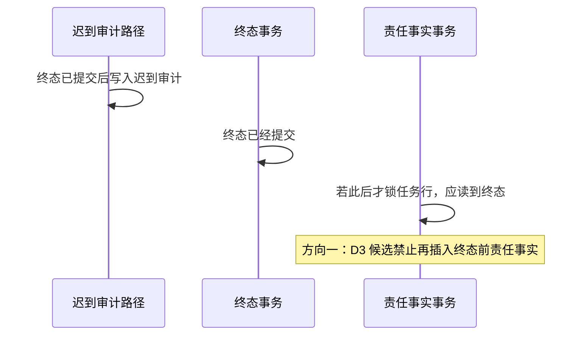
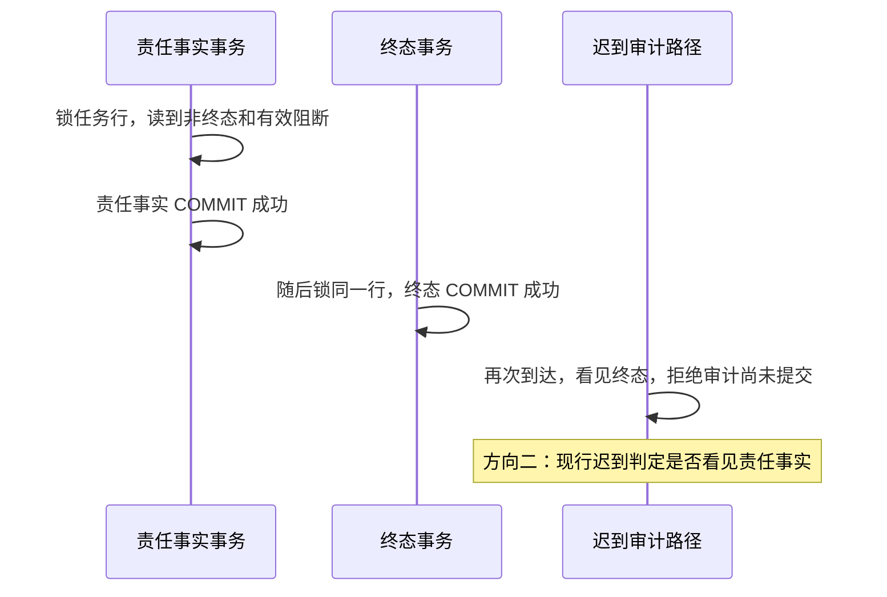

# 06-04-48 MTX Data Platform V2 IR-10 责任事实与终态后迟到审计双向交叉状态专项调查

本文只调查一个交叉：责任事实先成功 `COMMIT`，终态随后提交，同一 `blockIdentity` 再次到达时，现行迟到审计路径会不会把它写成迟到审计。它不是架构批准，也不选定处理方案。不修改 06-04-40 至 06-04-47、ADR、台账、Java 和 DDL。不关闭 IR-10、IR-02、D3、D5、D6、D7。没有执行数据库写入、MySQL 实验或 E2E。不把责任事实和审计并成同一个事务，不新增审计分类字段、待办表、模块、Inbox、Outbox、DLQ 或 Redis 锁。

## 1. 调查目标与范围

[06-04-47](06-04-47%20MTX%20Data%20Platform%20V2%20IR-10%20已提交责任事实的拒绝审计补写与跨进程恢复专项调查.md) 已经写明一个方向：若 D3 的任务行锁协调成立，不应出现「迟到审计先形成，终态前拒绝责任事实后形成」。该协调尚未批准，也未实验。

本轮只补相反方向，并核对 Pipeline 第 11.1 节的既有记录集合是否包含责任事实。

章节：

1. 调查目标与范围
2. 已确认语义和前置边界
3. 两种方向的时序
4. 四种状态与迟到路径
5. Pipeline 第 11.1 节证据核对
6. 候选处理方案比较
7. 对 D3、D5、D6、D7 和 IR-02 的依赖
8. P0、P1、P2
9. 未执行的实验
10. 调查结论与未决事项
11. 参考资料

## 2. 已确认语义和前置边界

定义 B 与规则 C 仍以 [06-04-40](06-04-40%20MTX%20Data%20Platform%20V2%20IR-10%20业务语义决策确认记录.md) 为准。责任事实成功 `COMMIT` 才发生。终态可以是另一次提交。两者之间允许拒绝审计尚未写入。恢复不得按当前终态重分类。

[06-04-44](06-04-44%20MTX%20Data%20Platform%20V2%20IR-10%20Task%20行锁协调专项调查.md) 的 D3 候选要求责任事实事务和终态事务先锁同一条任务行。迟到审计在 [06-04-11](../06-04-11%20MTX%20Data%20Platform%20V2%20Worker%20Task%20Ownership%20与并发执行控制专项设计.md) 第 7 节不锁任务行，也不写 `status`。D3 未批准。仓库没有 `FOR UPDATE` 实现。

[06-04-46](06-04-46%20MTX%20Data%20Platform%20V2%20IR-10%20责任事实%20COMMIT%20不确定性与独立恢复读取专项调查.md) 规定：普通缺行不是确认不存在；`COMMIT` 不确定不能写成没有这行；同一身份多行则停止。D7 与 IR-02 未实现。

[06-04-42](06-04-42%20MTX%20Data%20Platform%20V2%20IR-10%20架构批准阻塞项拆解与技术决策顺序审查.md) 第 4.6 节已经要求把「责任事实已提交、审计未补写」和「从未形成责任事实的终态后首次到达」分开。那是待决处理，不是 Pipeline 正文已经改写，也不是运行中的分支。

## 3. 两种方向的时序

方向一是 06-04-47 已讨论的交叉。方向二是本轮的问题。两图都是设计时序，不是 MySQL 8.0.46 上的观察。

方向一若只靠 D3 候选，后到的责任事实事务会被终态挡住。方向二发生在两笔提交都已经完成之后。此时再锁任务行，只能看见已经终态的任务，不能取消已经提交的责任事实，也不能代替对责任事实行的读取。迟到路径今天还不锁这把锁。

责任事实 `COMMIT` 与拒绝审计 `COMMIT` 是两次提交。前一次成功、后一次尚未发生时，其他会话可以看见责任事实，同时看不见拒绝审计。这个窗口来自定义 B 允许的「事实已发生、审计未写」，不是把两次提交并成一次就能消掉的实现细节。本轮不合并事务。

## 4. 四种状态与迟到路径

| 状态 | 迟到路径能否把它当成终态后首次到达 | 应如何处理 | 是否进入 D5 |
| --- | --- | --- | --- |
| 1. 责任事实已提交，拒绝审计尚未提交 | 不能。这不是「该身份从未形成权威拒绝」 | 停止迟到写入。不返回 `LATE_BLOCK_RECORDED` 作为这条事实的归类 | 发现可以交给 D5。D5 的写入仍受 06-04-46 和 06-04-47 约束，不在这里打开 |
| 2. 责任事实已提交，拒绝审计已提交且四个字段一致 | 不能再写一条迟到审计。Pipeline 对已有拒绝审计的重复有返回码 | 不新增。是否把已有审计当成补写完成，仍看 06-04-47 的 D3 前提 | 不需要再插入。交叉若无法解释，D5 不标完成 |
| 3. 责任事实不存在，任务已终态，该身份首次到达 | 只有权威读取确认责任事实不存在时，才是 D6 的迟到首次写入 | 现行文本想写迟到审计。06-04-46 尚未把普通缺行定义为确认不存在，因此现在也不能靠「没看见责任事实」进入这一支 | 不进入 D5，因为没有已提交责任事实。也不得补造责任事实 |
| 4. 责任事实 `COMMIT` 不确定，或读取不完整、同一身份多行 | 不能进入 | 停止。不写迟到，不写拒绝，不交给 D5 当已确认事实 | 不进入。先留在 D4 |

状态 1 和状态 3 的差别是有没有已确认提交的责任事实，不是任务现在是不是终态，也不是请求第几次到达。重复消息、另一个 Worker 的重试、终态后的第一次调用，入口都是同一次 `recordTaskBlock`。分支差在分类时看见的已提交记录，不在调用者是谁。

## 5. Pipeline 第 11.1 节证据核对

[Pipeline 第 11.1 节](../06-03/06-03-03-06%20MTX%20Data%20Platform%20V2%20金额处理%20Pipeline%20集成与端到端处理设计.md) 的既有记录种类是有效阻断、拒绝审计和迟到审计。责任事实还不是其中的一种。

| 条文 | 它实际覆盖的记录 | 对状态 1 的后果 |
| --- | --- | --- |
| `LATE_BLOCK_RECORDED`：终态已提交，这个 `blockIdentity` 还没有任何记录 | 对照上文，记录指有效阻断、迟到审计、拒绝审计。没有点名责任事实 | 审计尚未写入时，这句可以为真，于是新增迟到审计 |
| `LATE_ALREADY_RECORDED` | 已经有迟到审计，且四个字段相同 | 只有迟到审计已经写下之后才挡住下一次。挡不住第一次误写 |
| `ALREADY_BLOCKED` | 已有有效阻断，且是同一个 `blockIdentity`。明文不用于迟到审计或拒绝审计 | 被拒绝的身份不是那条有效阻断。这句看不见责任事实 |
| `BLOCK_IDENTITY_REJECTED` | 终态未提交时的另一条身份，或这条身份已经有拒绝审计 | 终态已经提交、拒绝审计还没有时，两个条件都不成立 |
| 重复表 | 已有记录只列出有效阻断、迟到审计、拒绝审计 | 没有「已有责任事实」这一行 |
| 第 829 行 | 终态后还没有该身份的记录时，首次返回 `LATE_BLOCK_RECORDED` | 「记录」仍是上一套种类 |
| 第 839 行 | `BLOCK_IDENTITY_REJECTED` 本身不表示拒绝审计已经写入 | 不能用这个返回码证明审计已在，也不能用它识别责任事实 |
| 第 843 至 851 行 | 协调边界排的是阻断接受和终态提交。内存中的异常在 `recordTaskBlock` 返回前不进入这个顺序 | 这段没有把后加的责任事实行放进迟到判定的读取集合 |

因此，按现行第 11.1 节的字面，迟到路径可以不查询责任事实。状态 1 会被看成「终态已提交且该身份还没有任何审计或阻断记录」，从而走进状态 3 的返回。06-04-42 第 4.6 节要求不要这样归类，但 Pipeline 正文还没有把责任事实写进「已有记录」。两边都是文档。本轮不改 Pipeline，也不把任一边写成已经运行。

跨 Worker 重试沿用同一身份和四个字段，入口仍是 `recordTaskBlock`。一个 Worker 若已按上面的空档写下迟到审计，另一个 Worker 再来会落到 `LATE_ALREADY_RECORDED`，而不是发现责任事实。终态后的首次到达和终态前的拒绝分支，差别只是分类时是否已经看见终态、以及审计行在不在。责任事实行不在这个差别里。

## 6. 候选处理方案比较

四个候选都未选定，也未批准。都不把责任事实和拒绝审计收成同一个 `COMMIT`，也不改定义 B、规则 C。

| 问题 | A. 迟到分类前读取已提交责任事实 | B. 迟到路径也先锁任务行 | C. 写入前用统一的身份判定，确认有没有权威责任事实 | D. 只靠 D5 抢先补写审计，或维持现行判定 |
| --- | --- | --- | --- | --- |
| 是否锁任务行 | 不必须。已提交的责任事实对新事务可见，不靠再锁任务行才存在 | 要锁，并且必须仍是先任务行。只锁任务行并不读取责任事实，窗口还在 | 判定若只读已提交责任事实，可以不锁任务行。若某条实现改成先锁别的行再锁任务行，就会和 D3 冲突 | D5 补写按 06-04-47 不为重分类去锁任务行。现行迟到路径不锁 |
| 新的持久化事实或字段 | 不需要。读的是责任事实行。不新增分类字段 | 不需要新事实。会改变 06-04-11「迟到审计不锁任务行」 | 不需要新事实，除非把它做成新的存储。本轮不设这种存储，也不新模块 | 不需要。也因此填不上这个窗口 |
| `COMMIT` 不确定 | 读不完或结果不明则停止，不写迟到，不进入 D5 | 锁不住这个判断。仍要按 D4 读责任事实 | 与 A 相同。判定服务不能把不明写成不存在 | 不明时现行「没有审计记录」仍可能写迟到。这正是要避免的误判 |
| 读取不完整或同一身份多行 | 停止，不写迟到 | 同左。锁成功不是读取完成 | 同左。有旁路不调用该判定时，窗口仍在 | 不读责任事实，就没有这一停 |
| 与 D3 锁顺序 | 不取任务锁则不新增顺序。若还要锁责任事实索引，应在已经持有任务行锁之后；本候选默认不新增这把锁 | 先任务行、再读责任事实，才不与「先任务、后尝试」反向。先锁审计索引再锁任务行会交叉。该交叉未实验 | 只读已提交行时不新增锁顺序。不能另起一套先索引后任务行的协议 | 不改变 D3。也不使用 D3 来挡住方向二 |
| 能否避免同一身份再被写成迟到 | 能挡住状态 1，前提是这次读取完整且恰好一行。挡不住「没看见就当不存在」 | 单独不能。必须同时做 A 的读取 | 能，前提是每条迟到入口都调用它，并且不明时停止 | 不能。补写晚于这次到达时，迟到写入已经发生 |
| 对现有返回码 | `LATE_BLOCK_RECORDED` 不能再用于状态 1。现有码没有「责任事实在、审计不在」这一格。沿用 `BLOCK_IDENTITY_REJECTED` 会扩大它现在的两条判定，本轮不改码 | 同左。锁本身不产生新的返回语义 | 同左。判定结果要能停在现有码之外的「停止」，而不是新造一个码 | 状态 1 会继续落到 `LATE_BLOCK_RECORDED` |
| 定义 B 与规则 C | 不改变。发生时点仍是责任事实 `COMMIT`。终态仍是另一笔事务 | 不改变这两条。但会扩大谁必须锁任务行，那是对 06-04-11 的变更，尚未批准 | 不改变这两条。判定只回答身份上有没有已提交责任事实 | 不改变条文。留下状态 1 被写成迟到的空档 |

D 里的「合并成一个事务」不在表内，因为那会取消定义 B 已经确认的窗口。不采用。

## 7. 对 D3、D5、D6、D7 和 IR-02 的依赖

| 项 | 关系 |
| --- | --- |
| D3 | 只排队责任事实事务和终态事务。它排除方向一的候选路径，不读取、不阻止方向二的迟到写入。调查通过不是批准 |
| D5 | 状态 1 应留给补写发现，而不是改成迟到。D5 尚未批准。补写完成仍要满足 06-04-47：四字段一致还要能排除交叉。方向二若已经写下迟到审计，就制造一个 06-04-47 要求停止的交叉 |
| D6 | 只保留状态 3：确认没有已提交责任事实之后的终态后首次到达。状态 1、状态 4 都不是 D6 |
| D7 | 迟到审计和拒绝审计若并发各写一行，任务行锁和进程内判断都挡不住。唯一约束未实现 |
| IR-02 | 物理唯一索引未建。本轮不设计 DDL，不关闭 IR-02 |

## 8. P0、P1、P2

| 项 | 级别 | 说明 |
| --- | --- | --- |
| 状态 1 不得走 `LATE_BLOCK_RECORDED` | P0 | 否则已发生的拒绝被再记成迟到。与定义 B 和 06-04-42 第 4.6 节冲突 |
| 状态 4 不得写成状态 3 | P0 | 不明、读不完整、多行都停止。普通缺行不是确认不存在 |
| 不合并责任事实事务和审计事务，不用时间推断先后 | P0 | 定义 B 的窗口保留 |
| 不新增返回码、分类字段、待办表或模块来消化这个空档 | P0 | 方案未选，不能先落成新身份 |
| A、B、C、D 选哪一个，以及是否扩大 `BLOCK_IDENTITY_REJECTED` 的判定 | P1 | 本报告只比较，不选定 |
| 迟到入口是否全部经过同一次责任事实读取 | P1 | 有旁路则窗口仍在。没有实现可核对 |
| MySQL 8.0.46 上方向二是否真的写出迟到行 | P1 | 未执行。文本空档不是实验结论 |
| D7 如何约束「一条拒绝审计加一条迟到审计」 | P1 | IR-02 仍开放 |
| 监控这种交叉的方式 | P2 | 不选型 |

## 9. 未执行的实验

下列事项都未执行。本轮没有连接数据库。

| 编号 | 要看的现象 | 状态 |
| --- | --- | --- |
| 责任事实 `COMMIT` 之后、拒绝审计之前，终态 `COMMIT`，再调用 `recordTaskBlock` | 返回是否为 `LATE_BLOCK_RECORDED`，以及是否新增迟到行 | 未执行 |
| 同身份的另一个 Worker 在迟到行写下之后重试 | 是否只得到 `LATE_ALREADY_RECORDED`，因而不再看见责任事实 | 未执行 |
| 责任事实 `COMMIT` 响应丢失期间，迟到路径读取 | 是否把不明当成没有责任事实 | 未执行 |
| 同一身份读到多条责任事实 | 迟到路径是否仍写迟到 | 未执行 |
| 拒绝审计已经提交且四字段一致之后再次到达 | 是否停在已有拒绝审计，而不新增迟到 | 未执行 |
| 权威读取确认没有责任事实的终态后首次到达 | 是否仍是 D6 的迟到，且不补造责任事实 | 未执行 |
| E2E-088、E2E-095 | 06-04-42 已标为未执行的迟到首次写入 | 未执行 |
| E2E-135 至 E2E-139 | 跨进程审计恢复 | 未执行 |

## 10. 调查结论与未决事项

方向一：D3 候选用同一条任务行锁，使终态先提交之后不能再形成终态前责任事实。这仍是未批准、未实验的推论。

方向二：同一把锁挡不住。责任事实和终态都已经提交之后，现行迟到路径不锁任务行，Pipeline 第 11.1 节的「还没有任何记录」也不包含责任事实。按该节字面，状态 1 可以进入 `LATE_BLOCK_RECORDED`。`ALREADY_BLOCKED` 和 `BLOCK_IDENTITY_REJECTED` 覆盖不了「责任事实已提交、拒绝审计尚未提交」。

这是文档上的空档，不是 MySQL 实验结论，也不是已选定的修复。A、B、C、D 都未选。B 单独锁任务行不够。D 留下误判。A 与 C 都能在写入前看见责任事实，但读取不明时必须停止，而且现在没有权威的「确认不存在」可以用来放行状态 3。

未决：用哪一个候选挡住状态 1，现有返回码如何表达「停止而不写迟到」，以及 D7 如何约束两种审计各写一行。定义 B 和规则 C 不因这些未决而改变。

## 11. 参考资料

- [AGENTS.md](../../../../AGENTS.md)
- [06-04-11](../06-04-11%20MTX%20Data%20Platform%20V2%20Worker%20Task%20Ownership%20与并发执行控制专项设计.md)
- [06-04-40](06-04-40%20MTX%20Data%20Platform%20V2%20IR-10%20业务语义决策确认记录.md)
- [06-04-42](06-04-42%20MTX%20Data%20Platform%20V2%20IR-10%20架构批准阻塞项拆解与技术决策顺序审查.md)
- [06-04-43](06-04-43%20MTX%20Data%20Platform%20V2%20IR-10%20责任事实逻辑身份专项调查.md)
- [06-04-44](06-04-44%20MTX%20Data%20Platform%20V2%20IR-10%20Task%20行锁协调专项调查.md)
- [06-04-45](06-04-45%20MTX%20Data%20Platform%20V2%20IR-10%20责任事实不可变内容专项调查.md)
- [06-04-46](06-04-46%20MTX%20Data%20Platform%20V2%20IR-10%20责任事实%20COMMIT%20不确定性与独立恢复读取专项调查.md)
- [06-04-47](06-04-47%20MTX%20Data%20Platform%20V2%20IR-10%20已提交责任事实的拒绝审计补写与跨进程恢复专项调查.md)
- [Pipeline 第 11.1 节](../06-03/06-03-03-06%20MTX%20Data%20Platform%20V2%20金额处理%20Pipeline%20集成与端到端处理设计.md)
