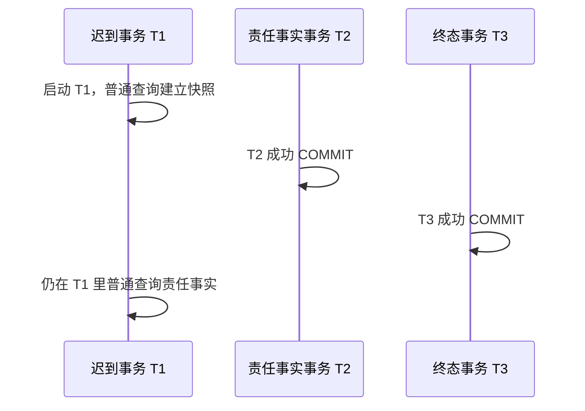

# 06-04-49 MTX Data Platform V2 IR-10 责任事实读取一致性与事务隔离专项调查

本文只调查一件事：迟到路径在写入前读取责任事实时，怎样的事务和读取类型才看得见此前已经成功 `COMMIT` 的行。它不是架构批准，也不选定技术方向。不修改 06-04-40 至 06-04-48、Pipeline、ADR、Java、配置和 DDL。不关闭 D3、D4、D5、D6、D7、IR-02、IR-10。没有执行数据库读写或 E2E。不把普通缺行定义成权威不存在，也不把读到一行写成 D7 已经实现。

证据分成三类，后文用这三词：

| 标记 | 含义 |
| --- | --- |
| 官方语义 | MySQL 8.0 手册对 InnoDB 的一般描述。不是本项目在 8.0.46 上的实验 |
| 配置事实 | 当前仓库可以核对到的代码和配置 |
| 设计推论 | 把官方语义套到尚未实现的迟到读取上。实验完成前不是运行事实 |

## 1. 调查目标与范围

[06-04-48](06-04-48%20MTX%20Data%20Platform%20V2%20IR-10%20责任事实与终态后迟到审计双向交叉状态专项调查.md) 指出：责任事实先提交、终态后提交、拒绝审计还没写时，现行迟到判定可以不查询责任事实。若要在写入前查询，本轮问的是这次查询会不会仍停在旧的读视图上。

章节：

1. 调查目标与范围
2. 项目事务配置事实
3. MySQL 8.0.46 读取语义
4. 关键时序分析
5. 责任事实读取结果分类
6. 方案 A 与方案 C 的读取要求
7. 候选技术方向比较
8. 对 D3、D4、D5、D6、D7 和 IR-02 的影响
9. P0、P1、P2
10. 未执行实验
11. 调查结论与未决事项
12. 参考资料

## 2. 项目事务配置事实

检查日期：2026-11-26。分支 `main`。HEAD 是 `793e7b71d8299baf8d93266c3900e3fbb68a1f7b`。写本文前工作区干净。编号 06-04-49 此前未被占用。

配置事实：

- [app-worker](../../../../app-worker/src/main/resources/application.yml) 与 [app-admin](../../../../app-admin/src/main/resources/application.yml) 只写了应用名。没有数据源、没有 `transaction-isolation`、没有连接池。
- 全仓库 Java 中没有 `@Transactional`，也没有 `FOR UPDATE`。06-04-44 已核对后一点。
- 根 POM 把 `mybatis-plus-spring-boot3-starter` 3.5.18.1 放在 `dependencyManagement`。没有模块把它写入 `dependencies`。因此没有 MyBatis 会话、事务传播或隔离级别可核对。
- [ADR-0005](../../../decisions/0005-mysql-doris-storage-baseline.md) 把 MySQL 8.0.46 定为目标服务器版本。驱动和库表未接入。
- [06-04-02](../06-04-02%20MTX%20Data%20Platform%20V2%20工程实施未决设计决策台账.md) 与 06-04-42、06-04-46 都写明隔离级别未选。本轮不选，也不把手册默认值写成项目决策。

设计文档里的事务是显式事务：规则 C 先锁任务行再提交，迟到审计按 06-04-11 不锁任务行。这些句子没有对应的 Spring 事务边界。以后若使用 Spring 的默认隔离，只表示跟随数据库会话，不表示本仓库已经配置了 `REPEATABLE READ` 或 `READ COMMITTED`。

## 3. MySQL 8.0.46 读取语义

下列句子来自 MySQL 8.0 手册，并与 [06-04-24](../06-04-24%20MTX%20Data%20Platform%20V2%20IR-02%20MySQL%208.0.46%20实验参数决策与物理身份列宽设计.md) 对 17.7.2.1 的摘录一致。本项目没有在 8.0.46 上复现。

| 题目 | 官方语义 | 本仓库 |
| --- | --- | --- |
| 默认隔离级别 | InnoDB 默认 `REPEATABLE READ`。见 [17.7.2.1](https://dev.mysql.com/doc/refman/8.0/en/innodb-transaction-isolation-levels.html) | 没有覆盖配置，也没有选定 |
| 可重复读下的普通一致性读 | 同一事务里的一致性读沿用第一次这种读建立的快照。对方在该时间点之后才 `COMMIT` 的插入，本事务在推进时间点之前看不见。手册 17.7.2.3 的双会话例子就是这样。见 [17.7.2.3](https://dev.mysql.com/doc/refman/8.0/en/innodb-consistent-read.html) | 未实验 |
| 读已提交下的普通一致性读 | 每一次一致性读使用自己的新快照 | 未选定，未实验 |
| 当前读、锁定读 | 要看更新的已提交状态，手册给出 `READ COMMITTED`，或 `SELECT ... FOR SHARE` 等到持有最新行的事务结束。加锁读不是一致性读 | 未选定语句，未实验 |
| 已有快照的事务 | 不提交或不回滚以推进时间点，后面的普通 `SELECT` 仍用旧快照，看不见随后才成功的 `COMMIT` | 未实验 |
| 新事务 | 新的一致性读只看见该次快照之前已经提交的修改。快照取在那些 `COMMIT` 之后，源库上应当看得见 | 未实验。副本可以落后，仓库没有复制拓扑 |
| 提交、回滚、断连 | `COMMIT` 使修改对其他会话可见，并释放本事务的锁。`ROLLBACK` 取消本事务的修改并释放锁。见 [17.7.2.2](https://dev.mysql.com/doc/refman/8.0/en/innodb-autocommit-commit-rollback.html)。`autocommit` 关闭时，会话结束前没有明确提交的最后一笔事务会被回滚。客户端没收到成功包，手册没有定义成回滚 | 与 06-04-46 的三类故障一致。未实验 |

手册不建议在同一个可重复读事务里混用普通读和加锁读。06-04-24 已记下这句。混用是否让后面的普通读改看最新行，本项目没有验证，不能当成读视图已经刷新。

## 4. 关键时序分析

每一步都标明事务和读取类型。图只帮助对照，结论在表里。全部是设计推论加官方语义，不是 8.0.46 实验。

### 4.1 时序 A：迟到事务先建立读视图

| 步骤 | 事务 | 读取类型 |
| --- | --- | --- |
| 1 | 新事务 T1 启动 | 尚未读 |
| 2 | T1 | 普通一致性读。可重复读下，这一次建立并固定快照 |
| 3 | 另一个事务 T2 | 责任事实 `COMMIT`。官方语义：此后新快照才看得见 |
| 4 | 另一个事务 T3 | 终态 `COMMIT` |
| 5 | 仍是 T1 | 再次普通查询责任事实。可重复读下复用步骤 2 的快照 |

设计推论：在默认可重复读下，步骤 5 可以看不见步骤 3 已经提交的责任事实。看不见只说明旧快照里没有这行，不说明行没有提交。若将来改成读已提交，同一次事务里的后一次普通读会使用新快照，这句推论不成立。级别未选，两种都不能写成项目行为。

### 4.2 时序 B：责任事实先提交，迟到事务后启动

| 步骤 | 事务 | 读取类型 |
| --- | --- | --- |
| 1 | T2 | 责任事实成功 `COMMIT` |
| 2 | T3 | 终态成功 `COMMIT` |
| 3 | 在这两次提交之后才启动的 T1 | 尚未读 |
| 4 | T1 的第一次一致性读 | 快照取在两次 `COMMIT` 之后 |

设计推论：在源库上，这次新事务应当看得见已提交的责任事实。前提是 T1 确实是新事务，而不是一条还开着旧快照的会话。连接归还到池里时若事务未结束，下一次借用仍是旧事务。仓库没有连接池配置，这只是使用连接时的边界，不是已存在的池行为。副本上的同一次读取仍可能落后。

### 4.3 时序 C：同一事务里先有别的普通查询

| 步骤 | 事务 | 读取类型 |
| --- | --- | --- |
| 1 | T1 | 先普通查询任务状态或其他表。可重复读下，快照在这一次就建立 |
| 2 | T2、T3 | 在该快照之后 `COMMIT` |
| 3 | 仍是 T1 | 才按身份普通查询责任事实 |

设计推论：步骤 3 受步骤 1 的快照约束，即使查询的是另一张表。把责任事实查询放在方法末尾，并不能躲开前面已经做过的普通读。读已提交下每次普通读换快照，这句同样只在级别选定之后才适用。

### 4.4 时序 D：用独立新事务读取

| 步骤 | 事务 | 读取类型 |
| --- | --- | --- |
| 1 | 调用方事务 T0 可能已经有旧快照 | 与本次读取无关，只要读取不加入 T0 |
| 2 | 挂起或离开 T0 之后新开 T1 | T1 在责任事实 `COMMIT` 之后建立自己的快照 |
| 3 | T1 | 普通一致性读或一次自动提交的单语句读 |

设计推论：新事务能躲开 T0 的旧快照。它解决不了「这次调用仍跑在 T0 里」。Spring 若使用 `REQUIRED`，会加入调用方事务，快照不变。`REQUIRES_NEW` 才挂起并新开。不在事务中的单条自动提交查询，本身就是一笔短事务。仓库没有这些传播配置，不能把「另写一个方法」写成已经是新事务。

新事务仍然只看见自己快照之前的提交。它若启动在责任事实 `COMMIT` 之前，并在对方提交前就做了普通读，就回到时序 A。

### 4.5 时序 E：当前读或锁定读

| 步骤 | 事务 | 读取类型 |
| --- | --- | --- |
| 1 | T1，即使已经有一致性读快照 | `SELECT ... FOR SHARE` 或 `FOR UPDATE`。手册把它写成等到最新已提交行，而不是沿用一致性读快照 |
| 2 | 若责任事实行正被未提交事务锁住 | T1 等待。等待不是缺行 |
| 3 | 若还要锁任务行 | 必须先任务行，再责任事实行。反过来会和 D3 的「先任务行、再索引」交叉 |

设计推论：锁定读有机会看见旧快照看不见的已提交行，并带来锁。手册不建议和一致性读混在同一可重复读事务里。间隙锁范围随索引和级别变化，06-04-24 写明尚未在 8.0.46 上验证。因此不能用「锁定读没有返回行」代替 06-04-46 里尚未打开的权威缺行。只锁责任事实行、不锁任务行，不会单独形成任务行上的逆序；一旦这笔事务稍后又去锁任务行，逆序就出现。本轮不改变 D3，也不把迟到路径改成锁任务行。

## 5. 责任事实读取结果分类

分类沿用 D1、D2、D4，不新增状态。

| 结果 | 可以得出的判断 | 不能得出的判断 |
| --- | --- | --- |
| 恰好一行，完整 D2 可逐项核验 | 该身份上的逻辑责任事实存在。06-04-46：这仍不证明原 Worker 那一次 `COMMIT` 的具体数据包 | 不证明 D7 已实现。不因此跳过唯一约束。不把迟到路径放行成「没有这行」 |
| 普通查询没有行 | 官方语义下，可能是旧快照看不见、未提交、确实没有、副本落后，或身份不对 | 不是权威不存在。不能进入 D6 的首次迟到 |
| 同一身份多行 | 06-04-46：停止，不挑选 | 不能挑一条最新的当权威 |
| 结果不完整 | 保持不确定 | 不能把残缺当成没有，也不能当成恰好一行 |
| 数据库读取失败 | 没有完整结果 | 不用失败前的空结果 |
| 事务或连接状态不确定 | 不能确认快照取在哪一次提交之后 | 不能把这次读取当成新事务的新鲜读 |
| 责任事实 `COMMIT` 仍不确定 | 停留在 D4 | 不写成没有责任事实，也不进入 D5 |

普通查询没查到，在时序 A 和时序 C 里只表示当前读视图不可见。即便换成时序 B 的新事务，06-04-46 仍不允许把缺行定义成权威不存在。本轮发现的缺口是：新鲜读视图可以排除「旧快照把已提交行藏起来」，但没有把缺行升级成新的 D4 状态。这个缺口保持开放。

## 6. 方案 A 与方案 C 的读取要求

这里的 A、C 是 06-04-48 的处理候选，不是下一节的技术方向字母。两者都未选定。

06-04-48 的 A 是迟到分类前读取已提交责任事实。C 是每条迟到入口都先做统一身份判定。两者都要回答「看见的是不是已经提交的行」。统一入口解决的是有人忘记查询。它不改变查询所在事务的快照。

因此两者若要躲开时序 A 和时序 C，都需要一次快照取在责任事实 `COMMIT` 之后的读取：独立新事务，或官方语义中的当前读。只把查询包进调用方已经打开的可重复读事务，两种方案都仍可能看不见刚刚提交的行。增加一个判定服务，不会使读取自然可靠。

C 还要求没有旁路。某条迟到入口直接按 Pipeline 第 11.1 节的「还没有任何记录」写入时，服务内部的新鲜读不会发生。A 若只在一条路径上读取，其他路径仍有 06-04-48 的窗口。

状态 4 在两种方案里都是停止：读取不完整、多行或 `COMMIT` 不确定时，不写迟到，也不把缺行交给 D6。

## 7. 候选技术方向比较

本节字母只表示读取技术，与 06-04-48 的 A 至 D 不是同一套。全部未批准。

| 维度 | 技术 A：当前事务里的普通一致性读 | 技术 B：独立新事务里读取 | 技术 C：当前读或锁定读 | 技术 D：统一判定，并由它固定读取方式 |
| --- | --- | --- | --- | --- |
| 能否看见此前已成功 `COMMIT` 的责任事实 | 只有快照建立在那次 `COMMIT` 之后才看得见。时序 A、C 会看不见 | 新事务的快照若取在那次 `COMMIT` 之后，源库上应当看得见 | 手册把它写成读取最新已提交行，不等旧的一致性读快照 | 只有它内部真正使用 B 或 C，而不是加入调用方旧事务 |
| 是否受旧读视图影响 | 会 | 不受调用方旧快照影响。自己若读得太早，仍受自己的快照影响 | 锁定读按手册不沿用该快照。混用后的普通读是否刷新，未验证 | 传播配置错了就会受影响。仓库没有该配置 |
| 是否需要任务行锁 | 不需要。锁任务行也换不掉旧快照 | 不需要 | 不需要任务行锁才能看见行。语句会锁责任事实侧的记录或间隙 | 不因为叫做服务就需要任务行锁 |
| 锁顺序和死锁 | 普通读不加这些行锁 | 同左 | 若随后锁任务行，必须仍是先任务行。先锁责任事实再锁任务行，与 D3 候选逆序。间隙锁死锁未实验 | 服务若采用技术 C，风险与技术 C 相同 |
| 事务传播 | 留在当前事务 | 必须离开当前事务。`REQUIRED` 做不到 | 可留在当前事务，但是另一种读 | 要规定传播。未规定则不能称可靠 |
| 对 D3 | 不改变锁协议 | 不改变 | 可能改变谁持有责任事实行锁，以及和任务行的顺序 | 不自动改变。实现若加锁则同技术 C |
| 能否权威确认不存在 | 不能 | 不能。新鲜缺行仍不是 06-04-46 的确认不存在 | 不能。锁定读缺行也未被 06-04-46 接受 | 不能 |
| 是否要 8.0.46 实验 | 要。默认级别未被本仓库复现 | 要。还要证明事务确实是新的 | 要。包括锁范围和死锁 | 要。入口覆盖和传播都要看 |
| 对现有返回码 | 看不见时会误走到 `LATE_BLOCK_RECORDED` | 看得见状态 1 时不应再返回该码。没有新码 | 同技术 B。等待失败不是缺行 | 同其所用的读取。不新造返回码 |

## 8. 对 D3、D4、D5、D6、D7 和 IR-02 的影响

| 项 | 影响 |
| --- | --- |
| D3 | 看见已提交责任事实不需要锁任务行。旧读视图靠新的快照或当前读来避开，不靠任务行锁。若采用锁定读并且还要锁任务行，顺序仍是先任务行。本轮不改 06-04-11「迟到审计不锁任务行」，也不改定义 B、规则 C |
| D4 | 读视图不可见、读取失败、连接不确定，都留在已有的不确定分类。不把它们改写成「确认不存在」或「确认未提交」 |
| D5 | 只有读到恰好一行且完整内容可核验，才进入「逻辑责任事实存在」这一判断。旧快照的缺行不能当作没有事实而不去补写，也不能当作有事实而去插入审计 |
| D6 | 终态后首次到达仍要求权威地确认没有已提交责任事实。本节没有提供这种读法 |
| D7 与 IR-02 | 即便恰好读到一行，并发仍可能再写入一条拒绝审计和一条迟到审计。读取可靠不代替唯一约束，也不关闭 IR-02 |

## 9. P0、P1、P2

| 项 | 级别 | 说明 |
| --- | --- | --- |
| 不得用已经建立的旧一致性读快照判定责任事实不存在 | P0 | 时序 A、C 在可重复读下会漏掉已提交行 |
| 普通缺行、锁定读缺行都不是权威不存在 | P0 | 不新增 D4 状态，不打开 D6 |
| 读到恰好一行也不跳过 D7 | P0 | 唯一约束仍未实现 |
| 不改变 D3 的先任务行顺序，不把定义 B 的两次提交并成一次 | P0 | 本轮只读 |
| 隔离级别、是否使用新事务或锁定读 | P1 | 技术 A 至 D 都未选 |
| 事务传播和连接上是否还留着旧事务 | P1 | 仓库没有配置。将来有池之后仍要证明事务已结束 |
| 8.0.46 上的快照、锁定读和死锁 | P1 | 全部未执行 |
| 统一入口如何覆盖每一条迟到路径 | P1 | 06-04-48 的方案 C 未选。入口遗漏不是隔离级别能补上的 |
| 副本是否参与这次读取 | P2 | 没有拓扑。不能用来判缺行 |

## 10. 未执行实验

本轮没有连接数据库。下面每一项都未执行。

| 编号 | 要在 MySQL 8.0.46 上区分的现象 | 状态 |
| --- | --- | --- |
| 可重复读事务先做普通查询，对方再 `COMMIT` 责任事实，同一事务再查 | 是否仍看不见 | 未执行 |
| 两次 `COMMIT` 之后才开始的新事务第一次查询 | 源库是否看得见 | 未执行 |
| 同一可重复读事务先查任务行，再查责任事实 | 第一次查询是否固定了看不见责任事实的快照 | 未执行 |
| 调用方事务已有快照，另一事务或自动提交语句再查 | 是否不受调用方快照影响 | 未执行 |
| 已有一致性读快照之后做 `FOR SHARE` 或 `FOR UPDATE` | 是否看见最新已提交行，缺行时锁住什么 | 未执行 |
| 先锁责任事实再锁任务行，与先锁任务行的终态事务并发 | 是否死锁 | 未执行 |
| 读已提交下重复时序 A | 后一次普通读是否看得见。级别仍未选 | 未执行 |
| 从落后副本做同样的查询 | 缺行是否仍不能当成不存在 | 未执行 |
| E2E-088、E2E-095、E2E-135 至 E2E-139 | 既有未执行用例 | 未执行 |

## 11. 调查结论与未决事项

配置事实是：项目没有隔离级别、事务传播、MyBatis 会话或锁定读实现。官方语义是：可重复读事务的普通查询复用第一次一致性读的快照，因此一个先读过的迟到事务可以看不见随后才 `COMMIT` 的责任事实。在那次提交之后才开始的新事务，其快照应当看得见源库上的已提交行。锁定读按手册读取最新已提交版本，但会加锁，并且不能把缺行写成权威不存在。

这些都还不是 8.0.46 实验。技术方向 A 至 D 都未批准。统一判定服务只解决入口是否调用，不解决调用所在事务的旧快照。

未决：隔离级别、用新事务还是锁定读、传播如何保证事务边界、锁定读与任务行的顺序如何在不修改 D3 的前提下避免死锁，以及缺行何时才能满足 D6。定义 B 和规则 C 不变。

## 12. 参考资料

- [AGENTS.md](../../../../AGENTS.md)
- [ADR-0002](../../../decisions/0002-v2-module-architecture.md)
- [ADR-0005](../../../decisions/0005-mysql-doris-storage-baseline.md)
- [app-admin 配置](../../../../app-admin/src/main/resources/application.yml)
- [app-worker 配置](../../../../app-worker/src/main/resources/application.yml)
- [06-04-02](../06-04-02%20MTX%20Data%20Platform%20V2%20工程实施未决设计决策台账.md)
- [06-04-11](../06-04-11%20MTX%20Data%20Platform%20V2%20Worker%20Task%20Ownership%20与并发执行控制专项设计.md)
- [06-04-24](../06-04-24%20MTX%20Data%20Platform%20V2%20IR-02%20MySQL%208.0.46%20实验参数决策与物理身份列宽设计.md)
- [06-04-40](06-04-40%20MTX%20Data%20Platform%20V2%20IR-10%20业务语义决策确认记录.md)
- [06-04-44](06-04-44%20MTX%20Data%20Platform%20V2%20IR-10%20Task%20行锁协调专项调查.md)
- [06-04-46](06-04-46%20MTX%20Data%20Platform%20V2%20IR-10%20责任事实%20COMMIT%20不确定性与独立恢复读取专项调查.md)
- [06-04-47](06-04-47%20MTX%20Data%20Platform%20V2%20IR-10%20已提交责任事实的拒绝审计补写与跨进程恢复专项调查.md)
- [06-04-48](06-04-48%20MTX%20Data%20Platform%20V2%20IR-10%20责任事实与终态后迟到审计双向交叉状态专项调查.md)
- [Pipeline 第 11.1 节](../06-03/06-03-03-06%20MTX%20Data%20Platform%20V2%20金额处理%20Pipeline%20集成与端到端处理设计.md)
- [MySQL 8.0 手册 17.7.2.1](https://dev.mysql.com/doc/refman/8.0/en/innodb-transaction-isolation-levels.html)
- [MySQL 8.0 手册 17.7.2.2](https://dev.mysql.com/doc/refman/8.0/en/innodb-autocommit-commit-rollback.html)
- [MySQL 8.0 手册 17.7.2.3](https://dev.mysql.com/doc/refman/8.0/en/innodb-consistent-read.html)
