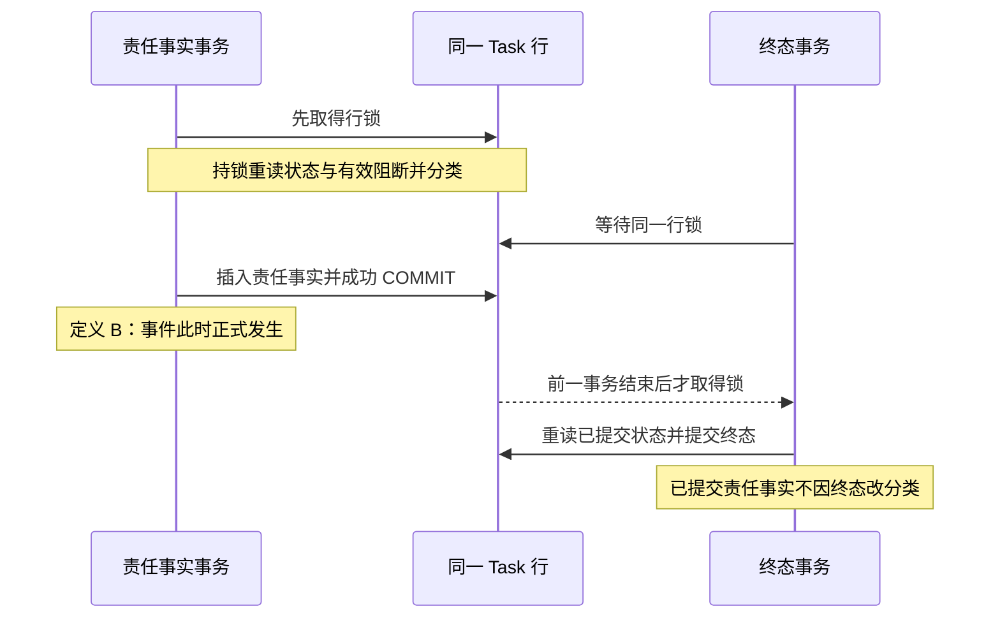
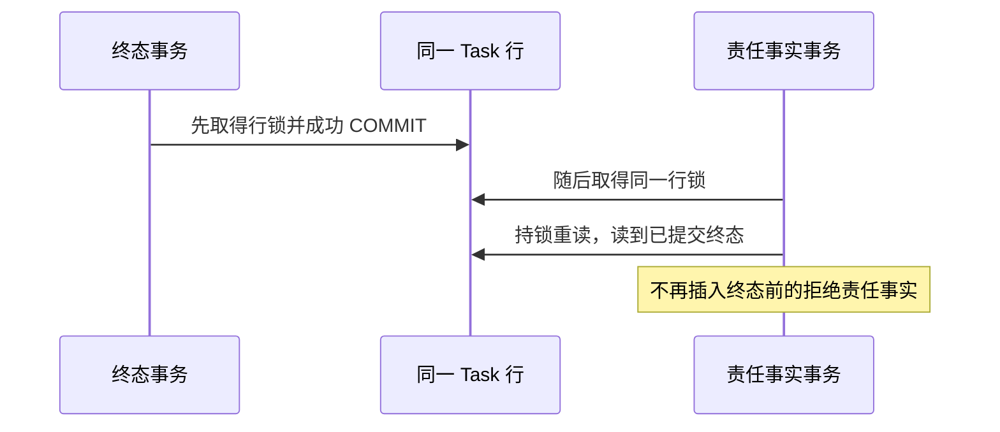

# 06-04-58 MTX Data Platform V2 IR-10 定义B与规则C架构评审输入

本文把定义 B 与规则 C 整理成一份可供架构负责人分别表决的评审输入。它不是架构批准记录，不预填批准结果，不修改已接受 ADR，不改写 [06-04-40](06-04-40%20MTX%20Data%20Platform%20V2%20IR-10%20业务语义决策确认记录.md) 的业务确认，也不把 D6、D7 或 IR-02 写成已经解决。

检查日期以仓库当前文件为准。分支 `main`。动笔前工作区干净，HEAD 是 `975e12b5e13446a21d27981f002553a23475f6ac`。编号 06-04-58 此前未被占用。调查目录没有索引，`docs/decisions/README.md` 只索引 ADR。本轮不新建索引，不改 [06-04-02](../06-04-02%20MTX%20Data%20Platform%20V2%20工程实施未决设计决策台账.md)。台账中 IR-10 仍是待决策、P1，IR-02 仍是待决策、P0，IR-15 仍是待决策、P2。

没有修改 Java、Maven、SQL、DDL 或数据库配置。没有连接 MySQL，没有执行并发实验或 E2E。

## 1. 文档性质

| 事项 | 本文中的位置 |
| --- | --- |
| 定义 B、规则 C 的业务确认 | 已经由 06-04-40 登记。本文不重新确认，也不改回未确认 |
| 架构评审 | 尚未举行。本文只提供输入和空白结论栏 |
| 架构批准 | 未发生。批准若发生，必须另有记录，不能把本文改称为批准记录 |
| 实验验证 | 未执行 |
| 实现 | 仓库没有责任事实实体，没有 `FOR UPDATE`，没有数据源和事务传播配置 |

证据只到业务确认和已有调查。按 [06-04-57](06-04-57%20MTX%20Data%20Platform%20V2%20IR-10%20D6-D7%20与%20IR-02%20交叉依赖及架构批准前独立复审.md) 的门禁，这是 E1 与 E2。物理设计、MySQL 实验和代码验证都还空着。批准这两项语义，不等于 E3、E4 或 E5 已经满足。

## 2. 决策背景

06-04-40 要分开的是两件不同的事。

第一件是拒绝事件何时算正式发生。内存里已经仲裁出某个身份被拒绝，任务行上已经有另一条有效阻断，或者拒绝审计语句还没写完，都不能让其他进程在崩溃之后恢复出这条被拒绝身份。把发生时点放在责任事实事务成功 `COMMIT` 上，崩溃后才有一条可消费的已提交事实。把发生时点放到更早，会把尚未提交的内存仲裁当成历史。把发生时点放到最终审计 `COMMIT`，则审计提交前崩溃同样恢复不出被拒绝身份。

第二件是序列 A 的分类依据。06-04-40 第 4 节保持的前提是：先读到 `RUNNING` 和有效阻断，在内存中仲裁出另一身份被拒绝，审计尚未提交，任务随后被推进到 `FAILED` 并成功 `COMMIT`，原来的处理者再尝试写审计。先读到 `RUNNING` 不能证明随后应是拒绝审计。先提交终态也不能单独证明应是迟到审计。不得仅凭两次 `COMMIT` 的先后推断种类。规则 C 把分类放进责任事实事务：先锁任务行，持锁重读，再按锁内状态插入并提交。终态事务使用同一行排队。

这两项已经由业务决策负责人在 2026-11-26 确认。06-04-40 写明下一步是架构负责人评审该组合是否可批准，业务确认不能代替这次批准。06-04-57 的结论是：它们可以进入只讨论语义的架构评审；D6 和 D7 不具备独立批准条件；现在不能形成关闭 IR-10 的 ADR 草案。本文只执行那一步，不把后续物理问题提前写进表决范围。

它们都还不是已实现功能。责任事实不是现行实体。Pipeline 第 11.1 节仍把同类待处理记录列为未选。

## 3. 决策陈述

两项分开表决。同意其中一项，不自动同意另一项。

### 3.1 D-IR10-01：定义 B

正式陈述：

拒绝责任事实所在数据库事务成功 `COMMIT` 时，该拒绝事件正式发生。这次 `COMMIT` 是正式发生的唯一时点。

在该事务成功 `COMMIT` 之前，进程故障、语句失败、回滚或客户端没有收到成功响应，都不把该责任事实认定为已经发生。取得任务行锁、锁内分类、`INSERT` 成功、Attempt 状态变化、审计记录写入，都不是这个时点。

`COMMIT` 请求已经发出但结果不能确认时，不得把责任事实记成已发生，也不得记成确定未发生。如何读取和判定，不在本次表决范围。

该事务成功 `COMMIT` 之后，即使拒绝审计尚未写入或补写失败，已提交的责任事实仍然存在。恢复补写只消费这条已提交责任事实，不得依据补写当时 Task 的当前状态重新分类该历史事件。

责任事实与拒绝审计是两次不同的持久化事实。按既定业务规则，拒绝审计可以在责任事实之后另行提交。不得把这两次提交收成一次，也不得用审计行代替责任事实。

### 3.2 D-IR10-02：规则 C

正式陈述：

责任事实事务先锁定对应 Task 行，并把该锁保持到本事务结束，即成功 `COMMIT` 或回滚。持锁重新读取 Task 状态和有效阻断。分类只使用这次锁内读到的权威状态，不使用进事务之前记住的状态。责任事实的插入与这次分类在同一事务中完成，并随该事务一起提交或一起放弃。

每一个把 Task `status` 写成终态的事务，使用同一条 Task 行排队。两类事务因此不会同时持有这把锁。责任事实正式发生仍然只以定义 B 的成功 `COMMIT` 为准。取得锁、排队结束或锁被释放，都不表示前一事务已经成功提交了一条责任事实。前一持有者结束，包括提交和回滚。

终态事务先取得锁并成功 `COMMIT` 之后，随后的责任事实事务必须在锁内重新读取。锁内已经是终态时，不再插入一条终态前的拒绝责任事实。责任事实事务先成功 `COMMIT` 之后，已提交事实不因随后的终态而改变分类。

后续审计补写只消费已经提交的责任事实，不在补写事务里按当前 Task 状态重新分类。

规则 C 只表达上述业务事务协调语义。它不选定 MySQL 隔离级别、事务传播方式、SQL 语句、物理表结构或唯一索引。Task 行锁不是物理唯一约束，也不能代替尚未关闭的跨类型唯一性。

## 4. 排除范围

下列事项不在本次批准范围内。正文提到它们，只是为了标出边界。出现在排除名单里，不构成对它们的批准、选型或关闭。

1. D6 首次迟到分类策略，包括终态后首次到达时如何执行迟到审计。
2. D7 跨类型唯一性的任何物理方案，以及方案字母或协调载体。
3. `blockIdentity` 的物理列类型、列宽和唯一索引形状。
4. A-09 所问的跨表唯一性。
5. MySQL 隔离级别。
6. 责任事实的读取语句，以及读视图如何建立。
7. `REQUIRED`、`REQUIRES_NEW` 或其他事务传播配置。
8. 具体的 `FOR UPDATE` SQL 和 MyBatis 实现。
9. 责任事实实体、审计实体和协调载体的最终 DDL。
10. D6 与 D7 的故障恢复实现。
11. 任何 MySQL 并发实验结果。本次没有实验，不能把手册或设计推论写成已通过。
12. 代码实现和 E2E 验收结果。

另外三件保持原状，不因本次评审输入而改写：06-04-40 的业务确认状态、D6 与 D7 的未关闭状态、06-04-02 台账中的决策状态。

## 5. 业务场景与时序

下列顺序只复述 06-04-40 与 [06-04-44](06-04-44%20MTX%20Data%20Platform%20V2%20IR-10%20Task%20行锁协调专项调查.md) 已经确认或作为规则 C 推论写下的语义。它们不是 MySQL 8.0.46 上的观察，也不包含尚未批准的物理方案。

### 5.1 责任事实事务先获得锁

### 5.2 终态事务先提交

反向顺序不把这次到达自动写成迟到审计。没有已提交责任事实时的首次迟到，仍是第 4 节排除的 D6。

### 5.3 COMMIT 前失败

责任事实事务在成功 `COMMIT` 之前失败或回滚。锁可以已经取得，分类可以已经做完，`INSERT` 也可以已经执行。按定义 B，拒绝事件没有正式发生。终态事务随后看到的，不是一条新的已提交责任事实。内存中的仲裁不能在崩溃后当作历史事实恢复。

### 5.4 COMMIT 后审计补写失败

责任事实事务已经成功 `COMMIT`。随后单独的审计写入失败。已提交责任事实仍然存在。审计失败不回滚那次已经成功的责任事实 `COMMIT`。补写尚未完成，不表示事件没有发生。

### 5.5 恢复时 Task 已经进入终态

恢复方看到 Task 已经是终态，同时存在一条更早成功提交的责任事实。补写只消费这条责任事实，不因为当前状态已经是终态，就把该历史事件改判成迟到，也不把它从拒绝改成别的种类。补写是另一次提交。补写事务自己的 `COMMIT` 尚未成功时，审计义务尚未完成，但不得据此删除或否定已经提交的责任事实。

谁执行补写、扫描是否周期运行、完成标记放在哪里，都不在本次表决范围。[06-04-47](06-04-47%20MTX%20Data%20Platform%20V2%20IR-10%20已提交责任事实的拒绝审计补写与跨进程恢复专项调查.md) 写明补写执行仍被缺行边界和未实现的 D7 挡住。

## 6. 业务不变量

定义 B 与规则 C 要保护的是下面这些语义。它们还不是数据库约束，也还不是已运行的代码。

| 不变量 | 由哪一项保护 | 违反时的后果 |
| --- | --- | --- |
| 正式发生时点只有责任事实事务成功 `COMMIT` | 定义 B | 锁、插入或审计会被误当成已经发生 |
| 未提交的责任事实不能当作历史事实 | 定义 B | 崩溃后的内存仲裁无法被其他进程核验，却被当成已发生 |
| 已提交责任事实不因后来的 Task 状态被重新分类 | 定义 B、规则 C | 终态之后的补写会改写已经发生的拒绝 |
| 责任事实事务与终态事务通过同一 Task 行排队 | 规则 C | 序列 A 的「先看见非终态、终态已提交、随后再写」会重新打开 |
| 锁内分类与责任事实写入属于同一事务，锁保持到事务结束 | 规则 C | 分类依据和实际提交的行会分属不同状态 |
| 审计补写不能独立创造责任事实 | 定义 B | 没有已提交责任事实时，审计行会被当成发生依据 |

`COMMIT` 结果不明时保持不确定，是定义 B 已经写下的边界。它不授权任何一种具体读法。普通查询没有返回行，不是这条责任事实的权威不存在证明。该读法留在 [06-04-46](06-04-46%20MTX%20Data%20Platform%20V2%20IR-10%20责任事实%20COMMIT%20不确定性与独立恢复读取专项调查.md)，不在本次表决。

## 7. 决策影响

本节描述的是：若架构负责人日后批准第 3 节的语义，后续设计必须遵守什么。它不宣布该批准已经发生。

### 7.1 后续物理设计必须遵守的语义

- 发生记录必须是责任事实那次成功 `COMMIT` 的结果。不得改到锁取得、`INSERT` 返回、Attempt 变化或审计 `COMMIT`。
- 责任事实事务与终态事务保持两次提交，用同一 Task 行排队，不并成一个事务。
- 分类依据来自持锁重读，不来自两次 `COMMIT` 的墙钟顺序。
- 补写消费已提交责任事实，不按恢复时的当前状态改历史分类。
- 责任事实与同身份的拒绝审计按既定规则可以先后存在。不得用一个「每身份只留一行」的约束把这对合法先后收成互斥。
- 终态条件保持 06-04-11 已有文本：成功类要求有效阻断为空，`FAILED` 要求阻断等于已登记的那一条。本次不改这些条件。已提交的成功类终态不能再配上一条终态前阻断曾存在的责任事实。那种并存是完整性异常，不新增错误码。

### 7.2 批准语义之后仍可比较的实现

隔离级别、锁语句的写法、事务传播、表是否分开、唯一索引的形状、`blockIdentity` 的列类型和列宽、读视图的建立方式、补写由谁触发，都可以继续比较。比较本身不是本次批准。06-04-19 的 A 类不锁一条处于 `RUNNING` 的任务，B 类新插入要求有效阻断为空。责任事实事务与这两类都不重合。把它称为第三类，仍是 [06-04-44](06-04-44%20MTX%20Data%20Platform%20V2%20IR-10%20Task%20行锁协调专项调查.md) 的候选，不是本次已经批准的物理分类。

### 7.3 会违反定义 B 或规则 C 的实现

- 把内存仲裁、日志、`receivedAt` 或 Worker 本地时钟写成发生依据。
- 在责任事实成功 `COMMIT` 之前向调用方返回「拒绝已经发生」。
- 审计补写时若当前已是终态，就把已提交的拒绝改成迟到，或按当前状态重新分类。
- 终态写入不锁责任事实事务所锁的那一行，使两类事务不再排队。
- 先按进事务前的快照分类，再在另一事务插入责任事实。
- 用 Task 行锁代替同类型唯一或拒绝与迟到的互斥。
- 在没有已提交责任事实时，把序列 A 里尚未提交的仲裁补写成拒绝审计。

### 7.4 对 Pipeline、Worker 与 Task Ownership 的约束

不新增第 11 个模块，不把 JDBC、MyBatis 或具体锁语句放进 `platform-core`。`platform-pipeline` 继续只依赖 `platform-common` 和 `platform-core`，不依赖 Connector、Transform、Quality、Writer 的实现，也不依赖 Quartz 或 DolphinScheduler。执行侧装配留在 `app-worker`。`app-admin` 不承担这条处理链路，也不依赖 Worker。这些边界来自 [ADR-0002](../../../decisions/0002-v2-module-architecture.md)，本次不修改该 ADR。

Pipeline 侧日后若改写集成说明，必须保持两笔 `COMMIT` 和「补写不重分类」。本次不修改 Pipeline 正文。Worker 的 `CURRENT`、尝试代次和消费组分区归属不是责任事实的发生点，也不能代替补写所消费的那条已提交事实。06-04-40 已写明补写者不是原 `CURRENT`。本次不设计补写执行者。

[ADR-0003](../../../decisions/0003-unmapped-conflict-observation.md) 仍只覆盖未识别金额与冲突金额观测。[ADR-0004](../../../decisions/0004-external-contract-version-resolution.md) 仍只覆盖金额路径提取之前的契约版本解析。[ADR-0005](../../../decisions/0005-mysql-doris-storage-baseline.md) 仍只接受 MySQL 8.0.46 与 Doris 4.0.7 的服务器版本，不包含隔离级别、字符集、驱动和 DDL。Doris 不承担这笔责任事实的权威。

## 8. 未决事项与后续门禁

批准定义 B 或规则 C 的语义，不自动关闭下列事项。

| 未决项 | 当前状态 | 与本次表决的关系 |
| --- | --- | --- |
| D6 首次迟到分类 | 未关闭。06-04-56 的验收条件是必要条件，不是执行许可 | 排除。终态后、没有已提交责任事实时，不得把未提交仲裁补成拒绝审计。如何执行迟到，另案 |
| D7 跨类型唯一性 | 未关闭。没有一套已证明同时满足同类型唯一、合法并存和跨类型互斥的形状 | 排除。Task 行锁不是其替代 |
| IR-02 物理唯一约束 | 台账仍为待决策、P0。06-04-19 是候选，不是 ADR，不是 DDL | 排除。`blockIdentity` 列、单一键空间和 A-09 都未决定 |
| MySQL 实验 | 未执行。06-04-23 的 42 项、A-09、06-04-56 的读法均未执行 | 排除。不得写成已通过 |
| Java 实现与 E2E | 未验证。E2E-075、E2E-088 以及依赖存储设计的审计用例未执行 | 排除。没有入口清单，不能证明将来没有旁路 |

[06-04-55](06-04-55%20MTX%20Data%20Platform%20V2%20IR-10%20审计分类验证与Task终态提交竞态专项调查.md) 的终态屏障和 [06-04-56](06-04-56%20MTX%20Data%20Platform%20V2%20IR-10%20D6%20终态屏障协议前提与读取验收条件专项调查.md) 的读视图验收，只作为 D6 的未决前提被引用。它们不是本次语义表决的通过项。[06-04-48](06-04-48%20MTX%20Data%20Platform%20V2%20IR-10%20责任事实与终态后迟到审计双向交叉状态专项调查.md) 的状态 B，即责任事实已提交而拒绝审计尚未补写，仍走已提交事实的补写发现，不得写成首次迟到。

后续若进入物理设计，门禁仍是：先有被接受的语义文本，再单独决定键空间和读取方式，再在得到授权的 MySQL 8.0.46 上实验，最后才谈实现。实验未执行前，不能把实验写成批准依据。

## 9. 评审结论栏

评审尚未举行。下面只保留三个合法结果，由评审人填写一个。不得把空白理解成同意。

- `APPROVE`：批准第 3 节对应的那一项语义决策。批准范围不得超出第 4 节的排除名单。若附带条件，条件必须写明仍未完成的物理设计、实验或实现，不能把这些未完成项写成已经满足。
- `REJECT`：拒绝该语义决策，并记录理由。
- `DEFER`：暂缓该语义决策，并列明还要补充的证据。

| 决策 | 结果 | 理由 | DEFER 时需要补充的证据 | 附加条件 |
| --- | --- | --- | --- | --- |
| D-IR10-01 定义 B | 待填写 | 待填写 | 待填写 | 待填写 |
| D-IR10-02 规则 C | 待填写 | 待填写 | 待填写 | 待填写 |

评审人：待填写。不编造个人姓名。

评审日期：待填写。

批准依据：待填写。06-04-40 的业务确认可以作为输入，不能在本栏被写成已经完成的架构批准。

本栏填写之前，本文保持为评审输入。填写之后若结果是批准，仍须另有正式决策记录，并继续受第 4 节和第 8 节约束。本文不预填 `APPROVE`。

## 10. 证据来源

- [AGENTS.md](../../../../AGENTS.md)
- [ADR-0002](../../../decisions/0002-v2-module-architecture.md)
- [ADR-0003](../../../decisions/0003-unmapped-conflict-observation.md)
- [ADR-0004](../../../decisions/0004-external-contract-version-resolution.md)
- [ADR-0005](../../../decisions/0005-mysql-doris-storage-baseline.md)
- [06-04-02](../06-04-02%20MTX%20Data%20Platform%20V2%20工程实施未决设计决策台账.md)
- [06-04-11](../06-04-11%20MTX%20Data%20Platform%20V2%20Worker%20Task%20Ownership%20与并发执行控制专项设计.md)
- [06-04-40](06-04-40%20MTX%20Data%20Platform%20V2%20IR-10%20业务语义决策确认记录.md) 第 3 至 6 节
- [06-04-44](06-04-44%20MTX%20Data%20Platform%20V2%20IR-10%20Task%20行锁协调专项调查.md) 第 3 至 6 节
- [06-04-46](06-04-46%20MTX%20Data%20Platform%20V2%20IR-10%20责任事实%20COMMIT%20不确定性与独立恢复读取专项调查.md)
- [06-04-47](06-04-47%20MTX%20Data%20Platform%20V2%20IR-10%20已提交责任事实的拒绝审计补写与跨进程恢复专项调查.md)
- [06-04-48](06-04-48%20MTX%20Data%20Platform%20V2%20IR-10%20责任事实与终态后迟到审计双向交叉状态专项调查.md)
- [06-04-55](06-04-55%20MTX%20Data%20Platform%20V2%20IR-10%20审计分类验证与Task终态提交竞态专项调查.md)
- [06-04-56](06-04-56%20MTX%20Data%20Platform%20V2%20IR-10%20D6%20终态屏障协议前提与读取验收条件专项调查.md)
- [06-04-57](06-04-57%20MTX%20Data%20Platform%20V2%20IR-10%20D6-D7%20与%20IR-02%20交叉依赖及架构批准前独立复审.md) 第 7、9、10 节
- [Pipeline 第 11.1 节](../06-03/06-03-03-06%20MTX%20Data%20Platform%20V2%20金额处理%20Pipeline%20集成与端到端处理设计.md)
