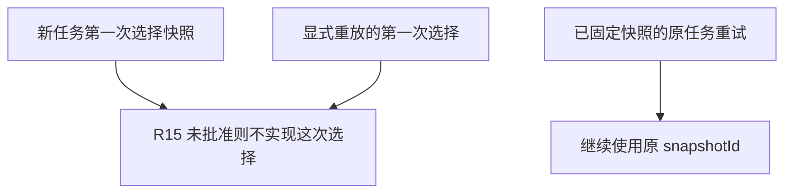

# 06-04-60 MTX Data Platform V2 IR-04 R15 快照选择决策比较与建议

- 基线：`0aba7ed` 所在的 `main`。提交说明是 `docs(development): 完成Stage C前置决策依赖图设计`
- 编号：`06-04-59` 已用于 IR-10。本文使用下一个空号 `06-04-60`
- 状态：决策准备。推荐方案是 `PROPOSED`。不关闭 IR-04，不改 ADR-0004

## 1. 问题与范围

IR-04 只问一件事：没有子批次的新任务，第一次写入 `snapshotId` 时按哪一句选择，以及选中的快照校验失败后能否改用另一份。

范围内是发布、校验和“可被新任务选中”这三层。范围外是契约版本在已经固定的快照内如何计数、原任务能否更换快照、显式重放是否必须新建任务。这三件 ADR-0004 已经接受，本文不重新解释。

R15 未关闭只挡住新任务第一次选择并固定 `snapshotId`，以及显式重放作为新任务时的同一次选择。已经写下 `snapshotId` 的原任务重试、`resolve`，以及与快照选择无关的纯逻辑和调查，不因 R15 被阻断。

本文不新增快照状态、字段或错误码，也不实现选择。

## 2. 原始证据

| 材料 | 使用的位置 |
| --- | --- |
| [06-04-02 台账](../06-04-02%20MTX%20Data%20Platform%20V2%20工程实施未决设计决策台账.md) | IR-04 行 |
| [ADR-0004](../../../decisions/0004-external-contract-version-resolution.md) | 决策节「snapshotId 固定规则」；第 123 至 129 行；第 165 行；文末待决事项 |
| [06-03-02-03](../06-03/06-03-02-03%20MTX%20Data%20Platform%20V2%20金额映射规则配置模型与版本管理设计.md) | 第 8 节第 196、198 行；第 9 节；第 14 节「完整性校验」至第 1269 行 |
| [06-03-03-01](../06-03/06-03-03-01%20MTX%20Data%20Platform%20V2%20原始金额提取模型设计.md) | 第 153 至 157 行；输入表中的 `snapshotId` |
| [06-03-03-03](../06-03/06-03-03-03%20MTX%20Data%20Platform%20V2%20金额映射匹配引擎设计.md) | 第 139 至 143 行 |
| [Pipeline 06-03-03-06](../06-03/06-03-03-06%20MTX%20Data%20Platform%20V2%20金额处理%20Pipeline%20集成与端到端处理设计.md) | 第 2 节第 55 至 61 行；第 4 节；第 14 节第 7 点；文末第二十一轮 |
| [06-04-10](../06-04-10%20MTX%20Data%20Platform%20V2%20Source%20Event%20Identity%20与%20Kafka%20消息接入幂等专项设计.md) | 第 33、39、211 行 |

`06-03-02-03` 文首仍写还不是冻结设计。Pipeline 第 16 节仍写尚未冻结。两份文档里的“已确认事实”不能把 R15 收成已接受决定。

## 3. ADR-0004 已经接受、本轮不动的规则

1. 先固定 `snapshotId`，再解析契约版本。
2. 契约版本只在这份已固定快照的契约条目内解析。
3. 零个或多个修订都是 `CONTRACT_VERSION_UNRESOLVED`，不猜最新修订，不写成 `UNMAPPED`。
4. 原任务重试不创建新任务，不更换 `snapshotId`。
5. 按新配置重新处理必须另建显式重放任务。重放不复用原任务身份和幂等键，也不覆盖旧观测。
6. 快照或契约版本的读取尚未完成、候选数量还没有得出时，是临时失败。原任务在原 `snapshotId` 下再读，不记成 `CONTRACT_VERSION_UNRESOLVED`，也不改读最新快照。

`ContractVersionUniqueness.resolve` 只实现第 2、3 点里的计数。它要求调用方已经提供 `snapshotId`。它不选择快照。

## 4. R15 的冲突

三句都在，ADR-0004 写明它们是否同义尚未决定，也不能把其中一句改写成另一句。

| 句子 | 出处 | 选择发生在校验之前还是之后 |
| --- | --- | --- |
| 没有子批次的最新已发布快照，先校验，通过后再写入 | `06-03-02-03` 第 1269 行前半；ADR-0004 决策节沿用这一句，并写校验失败停止、不改读另一份 | 先按发布和叶子关系选出一份，再校验 |
| 迟到报文固定当时最新的快照 | `06-03-02-03` 第 8 节第 196 行 | 没有写校验 |
| 迟到报文固定当时最新且校验通过的快照 | `06-03-02-03` 第 1269 行后半；`06-03-03-03` 第 141 行 | 可以把“校验通过”读成选择条件 |

同一节第 1255 至 1267 行还写：Worker 只装载任务上的 `snapshotId`；任何一步失败都停止；不允许改读最新快照，不允许跳过损坏部分，不允许写回修复。校验失败的任务不能改用另一份快照继续。

这和第三句可能冲突。第三句若表示“跳过最新发布但校验失败的叶子，改用另一份已经通过的快照”，就和“不能改用另一份”相反。ADR 决策节写了停止且不改读，紧接着又把“能否跳过该叶子”记为不决定。因此决策节的停止句还不是 R15 的关闭。台账 IR-04 状态仍是待决策，建议列写：关闭前，实现不得选择跳过失效快照。

发布和校验不是同一个事实。第 9 节写批次插入成功时状态直接是 `PUBLISHED`，失败整笔回滚。第 14 节的八步是 Worker 读取后重算数量和哈希。仓库没有把“校验通过”定义成另一列发布状态。映射窗口上的 `RETIRED` 也不是快照批次的状态。

“没有子批次”有设计含义：`batchId` 就是 `snapshotId`，新发布不修改旧批次，父批次在设计上唯一。它不是“全部 `PUBLISHED` 里时间最大的一行”的同义词。多个叶子同时存在时，用哪一列比较“最新”，第 1269 行没有写出。族谱接口列出了 `createdAt`，但没有把该列规定成选择键。

## 5. 方案比较

三个方案都未批准。

| 方案 | 新任务的选择 | 校验失败 | 与现有句子的关系 | 确定性 |
| --- | --- | --- | --- | --- |
| A. 沿用第 1269 行前半 | 没有子批次的最新已发布快照 | 停止该任务，不改读另一份，不跳过损坏部分 | 与 ADR 决策节沿用的那一句以及第 1267 行同向。不宣告它与第 8 节、第 1269 行后半同义 | 只有一个这样的叶子时，选择是确定的。多个叶子时比较键未写，仍不确定 |
| B. 最新且校验通过 | 在已发布叶子中跳过校验失败者，取仍能通过的一份 | 允许改选 | 与第 1267 行和 ADR 决策节“不改读另一份”冲突。新任务可能固定更旧的配置，而当时最新的已发布叶子并未被使用 | 要先定义校验顺序和“最新”的键。这些都没有 |
| C. 另立第三套语义 | 无 | 无 | 仓库没有第三套已被写下的选择语义。不把 `createdAt`、父批次唯一或回滚目标改成新规则 | 不适用 |

方案 A 不声称发布后不可能校验失败。第 14 节就是在 `PUBLISHED` 之后再重算。发布成功只说明当时事务提交，不代替 Worker 读取时的八步校验。

方案 B 会在多个快照校验结果不同时隐藏最新叶子的失败。现有材料没有写这种跳过后的审计或任务结果。

## 6. 场景

| 场景 | 现有材料能回答的部分 | 仍待决 |
| --- | --- | --- |
| 没有任何已发布快照 | 第 1258 行：要读的 `publishBatch` 不存在则失败。没有写出新任务在选择阶段的专门结果 | 任务停在哪一状态、是否使用已有错误码。本文不新增码 |
| 只有一份已发布且八步都通过 | 第 1269 行前半：先校验，通过后再写入这个 `snapshotId` | 这一句仍受 R15 未关闭的限制，不能单独当成实现许可 |
| 最新已发布叶子八步失败 | 第 1267 行和第 74 行写停止且不改用另一份。第 187 行写能否跳过仍待决定 | 方案 A 与方案 B 尚未获批。实现不得先按方案 B 跳过 |
| 这份叶子的读取或重算尚未完成 | 第 6 条已接受规则把“读取没有完成”与确定性解析失败分开 | 该规则写的是原任务和原 `snapshotId`。`snapshotId` 还没写入时，重试锚点没有单独句子。不能把未完成读记成确定性失败，也不能因此改选 |
| 最新已发布叶子八步通过 | 通过后才写入。匹配引擎不另选快照 | 多个叶子谁是“最新”未定义时，连“这份就是最新”都还不能判定 |
| 选择期间又有发布提交 | 设计写父批次唯一、同事务插入、失败回滚。该约束未在 MySQL 8.0.46 上执行 | 两个已提交叶子并存时选哪一个。不在本文规定锁 |
| 原任务已经写下 `snapshotId` 后再试 | 已接受：只使用这个标识。后来的发布不改变它。确定性解析失败不因重试或新快照变成成功 | 无。这不是 R15，也不因 R15 未关闭而停止 |
| 显式重放 | 已接受：它是另一个新任务，不复用原身份，也不走上一行的普通重试。第一次固定快照时使用新任务的选择规则 | 该选择仍是 R15。未批准前不实现这次选择。调用方能否指定一份不是该规则结果的历史快照，材料没有写 |
| 已固定快照后来被称为 `RETIRED` | 批次状态写的是 `PUBLISHED`。`RETIRED` 是快照内映射窗口的右端点。第 8 节写 `RETIRED` 窗口仍参加匹配。已开始的任务继续使用原 `snapshotId` | 没有快照批次被改成 `RETIRED` 的句子。不新增这种状态 |

## 7. 创建、重试与重放

普通重试不进入 R15。显式重放要进入，因为它的第一次固定仍是新任务的选择。`06-04-10` 第 39 行重申先固定快照、原任务用原快照、新快照处理必须是显式重放。第 211 行写重放使用 `replayRequestId`，生成算法未定。那是 IR-03，不是本文件能补的选择规则。

## 8. 与 IR-03 的关系

IR-03 问的是有没有稳定接入事件身份，以及无身份来源能否建任务和提交 offset。它不选择快照。

R15 问的是新任务允许创建之后，第一次写入哪一个 `snapshotId`。它不提供事件身份，也不关闭 IR-03。

交叉只有一处：就算 R15 以后被单独 ADR 关闭，没有稳定身份的来源仍然不能建任务，重放标识算法也仍然未定。反过来，IR-03 的现句也不能代替第 1269 行。两件都未关闭，本文不要求再次确认 IR-03。

## 9. 阻断范围

R15 未关闭不是 Stage C 的全局阻断，也不停止全部任务处理。

| 能力 | R15 未批准时 |
| --- | --- |
| 新任务第一次选择并固定 `snapshotId` | 阻断。不允许实现方案 A 或方案 B |
| 已固定 `snapshotId` 的原任务重试 | 不阻断。继续使用原 `snapshotId` |
| 显式重放 | 阻断它作为新任务的第一次快照选择。它不是上一行的普通重试 |
| `ContractVersionUniqueness.resolve` | 不阻断。它不选择快照，入参里的 `snapshotId` 由调用方提供 |
| 与快照选择无关的纯逻辑、调查和设计 | 不因 R15 自动阻断 |
| 匹配与提取 | 已经固定快照的任务，后续处理使用该 `snapshotId`，不因 R15 阻断。还没有固定快照的新任务，不能靠实现选择来开始首次装载。引擎本身不另选快照 |
| Worker 领取、offset、金额二十项、IR-13、IR-14、IR-17、Doris | 不因 R15 阻断。它们各自的未决状态也不由本文关闭 |

## 10. 推荐

推荐方案 A，等级是 `PROPOSED`。

理由只来自已经写下的限制：它与 ADR 决策节沿用的句子和第 1267 行同向；方案 B 会把待决的“跳过”提前做成实现；仓库没有第三套语义。台账在关闭前禁止实现去选择跳过。这只约束新任务和显式重放的第一次选择，不约束已经固定快照的原任务重试。

这个推荐不表示三句已经同义，不表示多个叶子的比较键已经存在，也不表示 IR-04 已关闭。

## 11. 仍要另行批准的决定

1. 三句是同义，还是只有第 1269 行前半成为新任务的选择规则。
2. 八步校验失败时，是停止，还是可以改选另一份已通过的叶子。
3. 没有子批次的已发布快照多于一份时，用哪一个已有字段比较“最新”。
4. 还没有写入 `snapshotId` 时，校验读取未完成的重试锚点。
5. 显式重放能否指定一份不是该规则结果的历史快照。

这些决定若要关闭 IR-04，台账写的路径是单独 ADR。本文不是那份 ADR。在它被接受之前，只保留第 12 节里对新任务和显式重放第一次选择的限制。

## 12. 暂不决定时的阻断与以后的验收

现在必须保留：

- 不实现新任务或显式重放的第一次快照选择，也不在这次选择里跳过校验失败的叶子。
- 已固定 `snapshotId` 的原任务重试继续使用该标识。这是已接受规则，不是 R15 造成的停做。
- 不把三句合并改写，不修改 ADR-0004 和台账状态。
- 显式重放不复用原任务身份。读取未完成不记成确定性解析失败。
- 不新增错误码、快照状态或字段。
- 不把 `resolve`、发布状态 `PUBLISHED` 或窗口上的 `RETIRED` 当成 R15 已关闭。
- 不把 R15 未关闭写成 Stage C 全局阻断，也不据此停止与快照选择无关的调查和纯逻辑。

以后若有单独 ADR，至少要能核对：

- 无已发布快照、唯一叶子且八步通过、唯一叶子且八步失败、读取未完成、两个已提交叶子，这五类的结果都指向该 ADR 的原文。
- 原任务重试和显式重放仍分别遵守第 3 节第 4、5 点。
- 没有新的错误码，也没有把跳过写成未写明的默认行为。
- 台账 IR-04 仍由那份 ADR 的接受来改变。本文件的 `PROPOSED` 不改变它。
